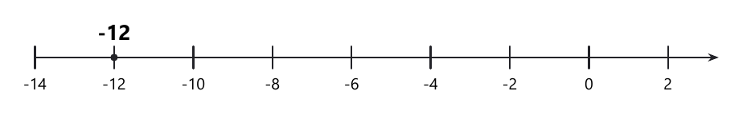
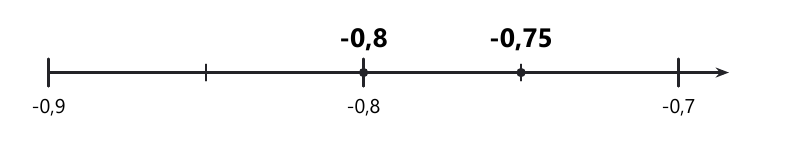
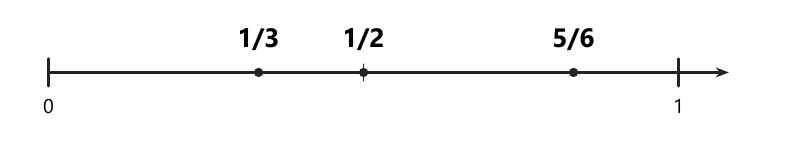
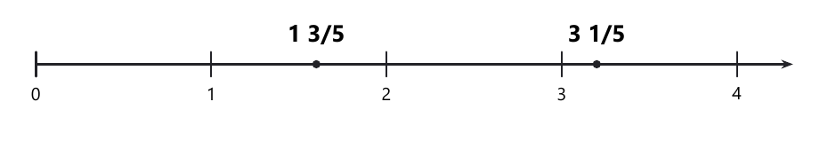
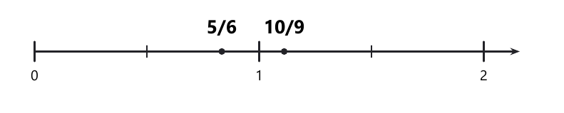
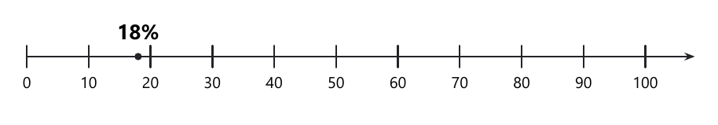
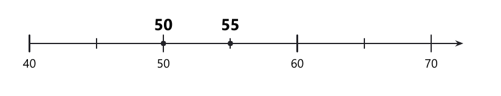
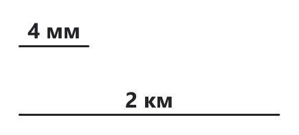
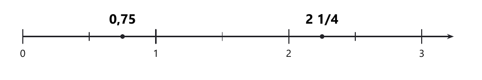

# Занятие 1. Числа, дроби, проценты и порядок действий

**Дата:** 04.09.2026 (пт)  
**Длительность:** 45 минут  
**Раздел:** Числа и вычисления  
**Подтемы:** натуральные, целые и рациональные числа; обыкновенные и десятичные дроби; проценты и пропорции; порядок действий и арифметические ловушки.

## Цели занятия

К концу занятия ученик умеет:

- различать натуральные, целые и рациональные числа и сравнивать их;
- выполнять действия с обыкновенными и десятичными дробями;
- находить процент от числа, число по его проценту и величину после увеличения или уменьшения на несколько процентов;
- применять пропорцию в простых задачах;
- соблюдать порядок действий и проверять знак ответа;
- выбирать блок заданий своего уровня: **1–2, 3–4, 5–6, 7–8 или 9–10 баллов**.

## Тайминг (45 мин)

| Этап | Время | Что делаем |
|---|---:|---|
| Теория | 16 мин | Повторяем четыре мини-темы и правила, которые нужны в заданиях |
| Разбор ключевых заданий | 10 мин | Разбираем образцы по каждой мини-теме |
| Самостоятельная работа | 15 мин | Ученик решает только свой уровень |
| Итог | 4 мин | Проверяем чек-лист и фиксируем ошибки |

---

## Теория к занятию

### Мини-тема 1. Натуральные, целые и рациональные числа

#### Простыми словами

Натуральные числа возникают при счёте предметов: $1; 2; 3; \ldots$.  
Целые числа включают натуральные числа, нуль и отрицательные числа.  
Рациональные числа — это числа, которые можно записать в виде дроби $\frac{m}{n}$, где $m$ — целое число, а $n$ — натуральное число.  
Обыкновенные дроби, конечные десятичные дроби и целые числа являются рациональными.  
Число $0$ натуральным не считают: в школьном курсе натуральные числа начинаются с $1$.  
Минус перед положительным числом не делает его «нечислом»: число может остаться целым и рациональным, но натуральным уже не является.

#### Определение / факт

- Натуральные числа: $1; 2; 3; 4; \ldots$.
- Целые числа: натуральные числа, нуль и отрицательные целые числа.
- Рациональное число — число, представимое в виде $\frac{m}{n}$, где $m \in \mathbb Z$, $n \in \mathbb N$.

#### Формулы

Рациональное число имеет вид

$$
\frac{m}{n}; \qquad m\in\mathbb Z; \quad n\in\mathbb N.
$$

Здесь $m$ — числитель, $n$ — знаменатель.  
Знаменатель не может быть равен нулю.

#### Правила

- $36$ — натуральное, целое и рациональное число.
- $-7$ — целое и рациональное, но не натуральное.
- $0$ — целое и рациональное, но не натуральное в принятом школьном определении.
- $\frac{9}{50}$ — рациональное число, но не целое.
- Любая конечная десятичная дробь рациональна: $0{,}25=\frac{25}{100}$.
- Простое число имеет ровно два различных натуральных делителя: $1$ и само себя. Число $1$ не простое и не составное: делитель у него один. Число $2$ простое, число $4=2\cdot 2$ составное.

#### Алгоритм распознавания числа

1. Если число отрицательное, оно не натуральное. Целым оно является только тогда, когда у него нет дробной части.
2. Если число равно $0$, оно целое и рациональное, но не натуральное.
3. Если число целое и положительное, оно натуральное, а значит, также целое и рациональное.
4. Если есть дробная часть, число не целое и не натуральное. Конечную десятичную дробь можно записать как $\frac{m}{n}$, поэтому она рациональна.

#### Мини-пример

**Условие.** Определите, к каким множествам относится число $-12$.

<!--geo-figure-spec
{
  "needed": true,
  "kind": "plane",
  "template": "number_line",
  "caption": "Число -12 левее нуля",
  "start": -14,
  "end": 2,
  "step": 2,
  "major_step": 2,
  "tick_labels": "major",
  "marks": [
    {
      "at": -12,
      "name": "-12"
    }
  ],
  "axis_arrows": true
}
-->

*Число -12 левее нуля*

*Решение:*

Число $-12$ является целым, так как оно отрицательное и не имеет дробной части.

Число $-12$ является рациональным, так как

$$
-12=\frac{-12}{1}.
$$

Число $-12$ не является натуральным, так как натуральные числа положительны.

**Ответ:** целое и рациональное число.

#### Целые числа на промежутке

На координатной прямой меньшее число лежит левее. Модуль числа — это расстояние от числа до нуля. Модуль нуля равен нулю, модуль положительного числа равен самому числу, модуль отрицательного равен этому числу без знака «минус».

Сравнивают так:

- положительное число больше нуля, отрицательное меньше нуля;
- любое положительное число больше любого отрицательного;
- из двух отрицательных больше то, которое ближе к нулю: у него меньше модуль.

Так сравнивают обыкновенные и десятичные дроби, когда числа нужно расставить по возрастанию или по убыванию. Перед сравнением дробь удобно записать десятичной.

Наименьшее целое число промежутка — самое левое целое число, которое этому промежутку принадлежит. Если левый конец не целый, целое число меньше этого конца в промежуток не входит. Берут первое целое, которое не меньше левого конца. Если спрашивают, при каких натуральных числах значение попадает в промежуток, проверяют подряд $1$, $2$, $3$ и следующие числа, пока результат не окажется правее правого конца.

#### Мини-пример. Сравнение отрицательных чисел

**Условие.** Сравните $-\dfrac{3}{4}$ и $-0{,}8$.

<!--geo-figure-spec
{
  "needed": true,
  "kind": "plane",
  "template": "number_line",
  "caption": "Число -0,8 левее числа -0,75",
  "start": -0.9,
  "end": -0.7,
  "scale": 50,
  "step": 0.05,
  "major_step": 0.1,
  "tick_labels": "major",
  "marks": [
    {
      "at": -0.8,
      "name": "-0,8"
    },
    {
      "at": -0.75,
      "name": "-0,75"
    }
  ],
  "axis_arrows": true
}
-->

*Число -0,8 левее числа -0,75*

*Решение:*

$$
-\frac{3}{4}=-0{,}75.
$$

Модуль $0{,}75$ меньше модуля $0{,}8$, поэтому $-0{,}75$ ближе к нулю и больше, чем $-0{,}8$. На прямой $-0{,}8$ лежит левее.

$$
-0{,}8<-0{,}75.
$$

**Ответ:** $-0{,}8<-0{,}75$.

#### Мини-пример. Наименьшее целое число промежутка

**Условие.** Найдите наименьшее целое число промежутка $[-2{,}5;1{,}5]$.

<!--geo-figure-spec
{
  "needed": true,
  "kind": "plane",
  "template": "number_line",
  "caption": "Промежуток [-2,5; 1,5]",
  "start": -4,
  "end": 2,
  "step": 1,
  "major_step": 1,
  "tick_labels": "all",
  "marks": [
    {
      "at": -2.5,
      "name": "-2,5"
    },
    {
      "at": 1.5,
      "name": "1,5"
    }
  ],
  "highlight_segments": [
    [
      "-2,5",
      "1,5"
    ]
  ],
  "axis_arrows": true
}
-->
![Промежуток [-2,5; 1,5]](figures/01_01_27ed03b863.png)

*Промежуток [-2,5; 1,5]*

*Решение:*

Число $-3$ меньше $-2{,}5$, поэтому в промежуток не входит. Число $-2$ больше $-2{,}5$, не превосходит $1{,}5$ и является целым. Следующие целые числа промежутка: $-1;0;1$.

**Ответ:** $-2$.

#### Типичные ошибки

- $0$ не выбирают как натуральное число.
- Отрицательное число не является натуральным.
- Дробь может быть рациональной, но не целой.
- Знаменатель дроби не равен нулю.
- Число $1$ не является простым.
- Наименьшее целое число промежутка не получают, округляя левый конец вниз: так выходят за промежуток.
- Из двух отрицательных чисел меньшим ошибочно считают то, у которого меньше модуль. Меньше как раз то, которое дальше от нуля.

---

### Мини-тема 2. Обыкновенные и десятичные дроби

#### Простыми словами

Обыкновенная дробь показывает частное двух чисел или часть целого.  
Десятичная дробь удобна, когда знаменатель после преобразования связан с $10$; $100$; $1000$.  
При сложении и вычитании дробей сначала добиваются одинаковых знаменателей.  
При делении на дробь вторую дробь заменяют обратной.  
В десятичных дробях запятые при сложении и вычитании ставят одну под другой.  
Ноль справа после запятой значения не меняет: $0{,}5=0{,}50$.

#### Определение / факт

Обыкновенная дробь имеет вид $\frac{a}{b}$, где $b\ne0$.  
Десятичная дробь записывается с помощью целой и дробной частей, разделённых запятой.

#### Формулы

Сложение и вычитание дробей с одинаковыми знаменателями:

$$
\frac{a}{c}+\frac{b}{c}=\frac{a+b}{c}; \qquad
\frac{a}{c}-\frac{b}{c}=\frac{a-b}{c}.
$$

Деление дробей:

$$
\frac{a}{b}:\frac{c}{d}
=
\frac{a}{b}\cdot\frac{d}{c}; \qquad b\ne0,\ c\ne0,\ d\ne0.
$$

Перевод конечной десятичной дроби:

$$
0{,}36=\frac{36}{100}=\frac{9}{25}.
$$

Умножение дробей и квадрат дроби:

$$
\frac{a}{b}\cdot\frac{c}{d}=\frac{ac}{bd},
\qquad b\ne 0,\ d\ne 0.
$$

$$
\left(\frac{a}{b}\right)^2=\frac{a^2}{b^2}.
$$

Смешанное число перед умножением и возведением в степень переводят в неправильную дробь. Квадрат — это произведение числа на себя:

$$
\left(1\frac{1}{3}\right)^2
=
\left(\frac{4}{3}\right)^2
=
\frac{16}{9}.
$$

#### Правила

- При сложении дробей знаменатели складывать нельзя.
- При делении дробь переворачивают только во втором множителе.
- После вычислений дробь сокращают.
- В десятичных дробях выравнивают запятые.
- Делить на нуль нельзя.
- Смешанное число $2\frac{1}{4}$ — это сумма $2+\frac{1}{4}$. Его записывают неправильной дробью: $2\frac{1}{4}=\frac{9}{4}$.
- Если дробные части с разными знаменателями, дроби сначала приводят к общему знаменателю, затем складывают или вычитают числители.
- Если у уменьшаемого дробная часть меньше, чем у вычитаемого, оба смешанных числа переводят в неправильные дроби.

#### Алгоритм

1. Определи действие.
2. Для сложения или вычитания найди общий знаменатель.
3. Для деления замени деление умножением на обратную дробь.
4. Выполни вычисления.
5. Сократи дробь или запиши конечную десятичную дробь.
6. Проверь знак и приблизительное значение.

#### Мини-пример. Разные знаменатели

**Условие.** Вычислите $\dfrac{1}{2}+\dfrac{1}{3}$.

<!--geo-figure-spec
{
  "needed": true,
  "kind": "plane",
  "template": "number_line",
  "caption": "Слагаемые 1/2 и 1/3 и сумма 5/6",
  "start": 0,
  "end": 1,
  "step": 0.5,
  "major_step": 1,
  "tick_labels": "major",
  "marks": [
    {
      "at": 0.333333,
      "name": "1/3"
    },
    {
      "at": 0.5,
      "name": "1/2"
    },
    {
      "at": 0.833333,
      "name": "5/6"
    }
  ],
  "axis_arrows": true
}
-->

*Слагаемые 1/2 и 1/3 и сумма 5/6*

*Решение:*

Общий знаменатель чисел $2$ и $3$ равен $6$.

$$
\frac{1}{2}=\frac{3}{6},
\qquad
\frac{1}{3}=\frac{2}{6},
\qquad
\frac{3}{6}+\frac{2}{6}=\frac{5}{6}.
$$

**Ответ:** $\dfrac{5}{6}$.

#### Мини-пример. Вычитание смешанных чисел

**Условие.** Вычислите $3\dfrac{1}{5}-1\dfrac{3}{5}$.

<!--geo-figure-spec
{
  "needed": true,
  "kind": "plane",
  "template": "number_line",
  "caption": "Числа 1 3/5 и 3 1/5",
  "start": 0,
  "end": 4,
  "step": 1,
  "major_step": 1,
  "tick_labels": "all",
  "marks": [
    {
      "at": 1.6,
      "name": "1 3/5"
    },
    {
      "at": 3.2,
      "name": "3 1/5"
    }
  ],
  "axis_arrows": true
}
-->

*Числа 1 3/5 и 3 1/5*

*Решение:*

Дробная часть уменьшаемого меньше дробной части вычитаемого: $\dfrac{1}{5}<\dfrac{3}{5}$. Переведём оба числа в неправильные дроби.

$$
3\frac{1}{5}=\frac{16}{5},
\qquad
1\frac{3}{5}=\frac{8}{5},
\qquad
\frac{16}{5}-\frac{8}{5}=\frac{8}{5}=1\frac{3}{5}.
$$

**Ответ:** $1\dfrac{3}{5}$.

#### Мини-пример

**Условие.** Найдите значение выражения

$$
\frac{5}{6}:\frac{10}{9}.
$$

<!--geo-figure-spec
{
  "needed": true,
  "kind": "plane",
  "template": "number_line",
  "caption": "5/6 меньше 1, а 10/9 больше 1",
  "start": 0,
  "end": 2,
  "step": 0.5,
  "major_step": 1,
  "tick_labels": "major",
  "marks": [
    {
      "at": 0.833333,
      "name": "5/6"
    },
    {
      "at": 1.111111,
      "name": "10/9"
    }
  ],
  "axis_arrows": true
}
-->

*5/6 меньше 1, а 10/9 больше 1*

*Решение:*

Деление заменяем умножением на обратную дробь:

$$
\frac{5}{6}:\frac{10}{9}
=
\frac{5}{6}\cdot\frac{9}{10}.
$$

Сократим $5$ и $10$ на $5$:

$$
\frac{5}{6}\cdot\frac{9}{10}
=
\frac{1}{6}\cdot\frac{9}{2}.
$$

Сократим $9$ и $6$ на $3$:

$$
\frac{1}{6}\cdot\frac{9}{2}
=
\frac{1}{2}\cdot\frac{3}{2}
=
\frac{3}{4}.
$$

Проверка: $\frac{5}{6}<1$, а $\frac{10}{9}>1$, поэтому частное должно быть меньше $1$. Значение $\frac34$ подходит.

**Ответ:** $\frac34$.

#### Типичные ошибки

- Не переворачивай первую дробь при делении.
- Не складывай знаменатели.
- Следи за запятой в десятичной дроби.
- Отрицательное число при делении на положительное остаётся отрицательным.

---

### Мини-тема 3. Проценты и пропорции

#### Простыми словами

Процент — это одна сотая часть числа.  
Поэтому $1\%=\frac1{100}=0{,}01$.  
Чтобы найти процент от числа, число умножают на процент, записанный десятичной дробью.  
Чтобы найти число по известному проценту, данное значение делят на десятичную запись процента.  
Пропорция помогает записать равенство двух отношений.  
Десятичная запись процента получается делением на $100$. Если процент меньше $100$, эта запись меньше $1$: $18\%=0{,}18$. Если процент больше $100$, запись больше $1$: $150\%=1{,}5$.  
Масштаб карты — отношение длины на карте к длине на местности. Перед записью масштаба обе длины переводят в одну единицу.

#### Определение / факт

Процентом называют одну сотую часть величины.

$$
1\%=\frac1{100}.
$$

Пропорция — это равенство двух отношений:

$$
\frac{a}{b}=\frac{c}{d}; \qquad b\ne0,\ d\ne0.
$$

#### Формулы

Перевод процентов:

$$
p\%=\frac{p}{100}=0{,}01p.
$$

Процент от числа:

$$
A\% \text{ от } B=B\cdot\frac{A}{100}.
$$

Нахождение числа по его проценту:

$$
B=\frac{C}{A/100}, \qquad A\ne0,
$$

где $C$ — известное значение, составляющее $A\%$ от числа $B$.

Основное свойство пропорции:

$$
\frac{a}{b}=\frac{c}{d}
\quad\Longrightarrow\quad
ad=bc.
$$

#### Правила

- $7\%=0{,}07$, а не $0{,}7$.
- При нахождении процента от числа умножай.
- При нахождении числа по его проценту дели.
- В пропорции произведение крайних членов равно произведению средних.
- Масштаб $1:N$ записывают только после перевода длин в одну единицу: $1$ км $=1\,000\,000$ мм.
- Ответ на вопрос о количестве обычно должен иметь понятный смысл и единицы измерения.
- Чтобы узнать, сколько процентов число $C$ составляет от числа $B$, делят $C$ на $B$ и умножают на $100\%$. Здесь $B\ne 0$.

#### Алгоритм нахождения процента от числа

1. Запиши процент десятичной дробью.
2. Умножь число на эту дробь.
3. Выполни вычисления.
4. Проверь: $15\%$ от числа меньше самого числа.

#### Мини-пример

**Условие.** Найдите $18\%$ от числа $250$.

<!--geo-figure-spec
{
  "needed": true,
  "kind": "plane",
  "template": "number_line",
  "caption": "18% — это 18 из 100",
  "start": 0,
  "end": 100,
  "step": 10,
  "major_step": 10,
  "tick_labels": "major",
  "marks": [
    {
      "at": 18,
      "name": "18%"
    }
  ],
  "axis_arrows": true
}
-->

*18% — это 18 из 100*

*Решение:*

Запишем $18\%$ десятичной дробью:

$$
18\%=0{,}18.
$$

Найдём процент от числа:

$$
250\cdot0{,}18=45.
$$

Проверка: $45<250$, что соответствует $18\%$.

Та же пара чисел решает обратную задачу: сколько процентов $45$ составляет от $250$.

$$
\frac{45}{250}\cdot 100\%=18\%.
$$

Часть делят на целое и умножают на $100\%$.

**Ответ:** $45$.

#### Мини-пример. Увеличение и уменьшение на несколько процентов

**Условие.** Цену увеличили на $10\%$, и товар стал стоить $55$ руб. Какой была цена до повышения?

<!--geo-figure-spec
{
  "needed": true,
  "kind": "plane",
  "template": "number_line",
  "caption": "55 руб. — это 110% от 50 руб.",
  "start": 40,
  "end": 70,
  "scale": 0.35,
  "step": 5,
  "major_step": 10,
  "tick_labels": "major",
  "marks": [
    {
      "at": 50,
      "name": "50"
    },
    {
      "at": 55,
      "name": "55"
    }
  ],
  "axis_arrows": true
}
-->

*55 руб. — это 110% от 50 руб.*

*Решение:*

Увеличение на $10\%$ означает, что новая цена составляет $110\%$ старой цены, то есть $1{,}1$ старой цены. Это та же задача «найти число по его проценту».

$$
55:1{,}1=50.
$$

Проверка: $50\cdot 1{,}1=55$.

Уменьшение на $10\%$ оставляет $90\%$ прежней величины. Если второй процент берут от остатка, его считают уже от новой величины, а не от первоначальной. Например, после расхода $20\%$ остаётся $80\%$ числа, а половина этого остатка составляет

$$
0{,}5\cdot 0{,}8=0{,}4
$$

первоначального числа.

**Ответ:** $50$ руб.

#### Мини-пример. Масштаб

**Условие.** На карте расстояние $2$ км изображено отрезком $4$ мм. Найдите масштаб карты.

<!--geo-figure-spec
{
  "needed": true,
  "kind": "plane",
  "template": "plane_custom",
  "caption": "4 мм на карте соответствуют 2 км на местности",
  "show_labels": false,
  "vertices": {
    "A": [
      0,
      1.6
    ],
    "B": [
      1.6,
      1.6
    ],
    "C": [
      0,
      0
    ],
    "D": [
      6,
      0
    ]
  },
  "edges": [
    [
      "A",
      "B"
    ],
    [
      "C",
      "D"
    ]
  ],
  "segment_labels": [
    {
      "points": [
        "A",
        "B"
      ],
      "text": "4 мм",
      "t": 0.5
    },
    {
      "points": [
        "C",
        "D"
      ],
      "text": "2 км",
      "t": 0.5
    }
  ]
}
-->

*4 мм на карте соответствуют 2 км на местности*

*Решение:*

Масштаб — отношение длины на карте к длине на местности. Сначала обе длины переводят в одну единицу.

$$
1\text{ км}=1\,000\,000\text{ мм},\qquad 2\text{ км}=2\,000\,000\text{ мм}.
$$

Отношение длин:

$$
4:2\,000\,000=1:500\,000.
$$

Это пропорция. Произведение крайних членов равно произведению средних:

$$
4\cdot 500\,000=2\,000\,000\cdot 1.
$$

Проверка: $4$ мм на карте соответствуют $4\cdot 500\,000=2\,000\,000$ мм, то есть $2$ км на местности.

**Ответ:** $1:500\,000$.

#### Типичные ошибки

- $18\%$ — это $0{,}18$, а не $18$.
- Не путай «найти процент от числа» и «найти число по его проценту».
- $100\%$ числа — само число.
- Если процент меньше $100\%$, результат при нахождении процента от положительного числа меньше исходного.
- Увеличение на $10\%$ даёт $110\%$ первоначальной величины, а не $10\%$. Уменьшение на $10\%$ оставляет $90\%$.
- Процент от остатка считают от остатка, а не от первоначального числа.
- $1$ км $=1\,000\,000$ мм, а не $100\,000$ мм. Если нулей меньше, знаменатель масштаба выходит в $10$ раз меньше верного.

---

### Мини-тема 4. Порядок действий и типичные арифметические ловушки

#### Простыми словами

Выражение нельзя считать слева направо без правил.  
Сначала выполняют действия в скобках.  
Затем степени, если они есть.  
После этого умножение и деление в порядке слева направо.  
Затем сложение и вычитание в порядке слева направо.  
Знак минус перед числом относится ко всему числу. Если минус потерять, знак ответа станет противоположным верному.

#### Определение / факт

Порядок действий:

1. действия в скобках;
2. степени;
3. умножение и деление;
4. сложение и вычитание.

Действия одного уровня выполняют слева направо.

#### Формулы

Например,

$$
4{,}5:9-0{,}4
=
0{,}5-0{,}4
=
0{,}1.
$$

Нельзя сначала выполнять вычитание, если перед ним есть деление.

Ненулевое число в нулевой степени равно единице:

$$
a^0=1, \qquad a\ne 0.
$$

Например, $\left(\frac{1}{2}\right)^0=1$. Выражение $0^0$ не определено.

Число, обратное числу $a$ при $a\ne 0$, равно $\dfrac{1}{a}$. Произведение числа и обратного ему равно $1$. У отрицательного числа обратное тоже отрицательное:

$$
(-4)\cdot\left(-\frac{1}{4}\right)=1.
$$

#### Правила

- Сначала вычисляй скобки.
- Умножение и деление важнее сложения и вычитания.
- При умножении и делении чисел с разными знаками результат отрицателен.
- При сложении отрицательных чисел складывают модули и ставят знак «минус».
- Перед ответом оцени его знак и размер.

#### Алгоритм

1. Перепиши выражение аккуратно.
2. Отметь скобки и действия внутри них.
3. Выполни степени.
4. Выполни умножение и деление слева направо.
5. Выполни сложение и вычитание слева направо.
6. Проверь знак и приблизительное значение.

#### Мини-пример

**Условие.** Найдите значение выражения

$$
7{,}2:3+1{,}4\cdot2.
$$

*Решение:*

Сначала выполняем деление и умножение:

$$
7{,}2:3=2{,}4.
$$

$$
1{,}4\cdot2=2{,}8.
$$

Теперь складываем:

$$
2{,}4+2{,}8=5{,}2.
$$

Проверка: оба слагаемых положительны, поэтому ответ положительный.

**Ответ:** $5{,}2$.

#### Типичные ошибки

- Нельзя выполнять сложение раньше умножения.
- При делении отрицательного числа на положительное ответ отрицателен.
- Скобки меняют порядок действий.
- Нельзя округлять промежуточные результаты без указания в условии.
- Обратное отрицательному числу отрицательно. Обратное к нулю не существует.

---

## Сводка формул «выучить наизусть»

$$
\frac{m}{n}; \qquad m\in\mathbb Z; \quad n\in\mathbb N.
$$

$$
\frac{a}{c}+\frac{b}{c}=\frac{a+b}{c}.
$$

$$
\frac{a}{c}-\frac{b}{c}=\frac{a-b}{c}.
$$

$$
\frac{a}{b}:\frac{c}{d}
=
\frac{a}{b}\cdot\frac{d}{c}, \qquad b\ne0,\ c\ne0,\ d\ne0.
$$

$$
\frac{a}{b}\cdot\frac{c}{d}=\frac{ac}{bd},
\qquad
\left(\frac{a}{b}\right)^2=\frac{a^2}{b^2}.
$$

$$
p\%=\frac{p}{100}.
$$

$$
A\% \text{ от } B=B\cdot\frac{A}{100}.
$$

$$
B=\frac{C}{A/100}, \qquad A\ne0.
$$

$$
\frac{a}{b}=\frac{c}{d}
\Longrightarrow ad=bc.
$$

$$
\frac{C}{B}\cdot 100\%
$$

— столько процентов число $C$ составляет от числа $B$, $B\ne 0$.

$$
a^0=1, \qquad a\ne 0.
$$

Число, обратное $a\ne 0$, равно $\dfrac{1}{a}$.

Увеличение на $p\%$ даёт $(100+p)\%$ первоначальной величины, уменьшение на $p\%$ оставляет $(100-p)\%$.

Порядок действий: скобки, степени, умножение и деление, сложение и вычитание.

## Правила, которые нельзя путать

- Натуральные числа начинаются с $1$.
- $0{,}07=7\%$, а $0{,}7=70\%$.
- При делении дробей переворачивается вторая дробь.
- Процент от числа находят умножением.
- Число по его проценту находят делением.
- Деление выполняют раньше вычитания.
- Отрицательное число нельзя считать натуральным.
- Число $1$ не является простым.
- В масштабе $1$ км $=1\,000\,000$ мм.
- Сколько процентов $C$ составляет от $B$, находят так: $\frac{C}{B}\cdot 100\%$.
- $a^0=1$, если $a\ne 0$. Обратное число к $a\ne 0$ равно $\dfrac{1}{a}$.
- Из двух отрицательных больше то, у которого меньше модуль.
- Увеличение на $10\%$ — это $110\%$ первоначальной величины. Процент от остатка считают от остатка.

## Разрешённый набор для практики

На занятии разрешены только:

- натуральные, целые и рациональные числа;
- обыкновенные и десятичные дроби;
- проценты и пропорции;
- порядок действий;
- проверка знаков и арифметических вычислений.

Повтор ранее пройденных тем курса: отсутствует.

---

## Разбор ключевых заданий

### Р1.
**Условие.** Значение выражения $4{,}5:9-0{,}4$ равно:

а) $0{,}9$;  
б) $4{,}6$;  
в) $0{,}1$;  
г) $0{,}3$;  
д) $0{,}01$.

*Решение:*

Дано: выражение $4{,}5:9-0{,}4$.

Найти: его значение.

Сначала выполняем деление, затем вычитание.

$$
4{,}5:9=0{,}5.
$$

$$
0{,}5-0{,}4=0{,}1.
$$

Проверка: $4{,}5:9=0{,}5$, поэтому после вычитания $0{,}4$ должно получиться положительное число, меньшее $0{,}5$.

**Ответ:** в) $0{,}1$.

---

### Р2.
**Условие.** $15\%$ от числа $30$ равны:

а) $0{,}45$;  
б) $4{,}5$;  
в) $450$;  
г) $200$;  
д) $2$.

*Решение:*

Дано: число $30$ и процент $15\%$.

Найти: $15\%$ от $30$.

Запишем процент десятичной дробью:

$$
15\%=0{,}15.
$$

Найдём процент от числа умножением:

$$
30\cdot0{,}15=4{,}5.
$$

Проверка: $15\%$ меньше $100\%$, поэтому результат меньше $30$.

**Ответ:** б) $4{,}5$.

---

### Р3.
**Условие.** Определите верное равенство:

а) $7\%=70$;  
б) $7\%=7$;  
в) $7\%=0{,}7$;  
г) $7\%=0{,}07$;  
д) $7\%=0{,}007$.

*Решение:*

Один процент равен одной сотой:

$$
1\%=0{,}01.
$$

Тогда

$$
7\%=7\cdot0{,}01=0{,}07.
$$

**Ответ:** г) $7\%=0{,}07$.

---

### Р4.
**Условие.** Какое из следующих чисел является натуральным:

а) $-1$;  
б) $0$;  
в) $1{,}65$;  
г) $36$;  
д) $\frac{9}{50}$?

*Решение:*

Натуральные числа — это положительные целые числа.

Число $-1$ отрицательное.

Число $0$ не относим к натуральным числам.

Число $1{,}65$ не является целым.

Число $\frac{9}{50}$ является дробным.

Число $36$ положительное и целое.

**Ответ:** г) $36$.

---

### Р5. Авторское. Мини-тема 2

**Условие.** Найдите значение выражения

$$
2\frac{1}{4}-0{,}75.
$$

<!--geo-figure-spec
{
  "needed": true,
  "kind": "plane",
  "template": "number_line",
  "caption": "Числа 0,75 и 2 1/4 на прямой",
  "start": 0,
  "end": 3,
  "step": 0.5,
  "major_step": 1,
  "tick_labels": "major",
  "marks": [
    {
      "at": 0.75,
      "name": "0,75"
    },
    {
      "at": 2.25,
      "name": "2 1/4"
    }
  ],
  "axis_arrows": true
}
-->

*Числа 0,75 и 2 1/4 на прямой*

*Решение:*

Переведём десятичную дробь в обыкновенную:

$$
0{,}75=\frac{75}{100}=\frac34.
$$

Представим смешанное число неправильной дробью:

$$
2\frac14=\frac94.
$$

Вычитаем дроби с одинаковыми знаменателями:

$$
\frac94-\frac34=\frac{9-3}{4}=\frac64=\frac32.
$$

Запишем результат смешанным числом:

$$
\frac32=1\frac12.
$$

**Ответ:** $1\frac12$.

---

## Самостоятельная работа

Выбери свой уровень и решай только этот блок.  
Решение записывай в тетради: в текст задания его не вписывают.

### Уровень 1–2 балла

**С1. Сборник, вариант 3, №2.** Значение выражения

$$
17\frac{11}{23}-5\frac{14}{23}
$$

равно:

а) $12\frac{3}{23}$;  
б) $11\frac{20}{23}$;  
в) $12\frac{20}{23}$;  
г) $11\frac{19}{23}$;  
д) $13\frac{1}{23}$.

**С2. Сборник, вариант 5, №1.** Определите наименьшее целое число, принадлежащее промежутку $[-8{,}5;3{,}4]$:

а) $-9$; б) $-8$; в) $0$; г) $3$; д) $-1$.

**С3. Сборник, вариант 21, №1.** Значение выражения

$$
\frac34:\frac73
$$

равно:

а) $\frac{28}{9}$; б) $\frac{21}{12}$; в) $\frac9{28}$; г) $\frac74$; д) $\frac47$.

**С4. Сборник, вариант 25, №2.** Значение выражения $68{,}3-50{,}08$ равно:

а) $8{,}38$; б) $8{,}22$; в) $18{,}32$; г) $7{,}32$; д) $18{,}22$.

### Уровень 3–4 балла

**С1. Сборник, вариант 73, №4.** Сравните значение выражения

$$
\frac23\cdot\left(1\frac12\right)^2+1:2
$$

с числом

$$
\left(\frac12\right)^0.
$$

**С2. Сборник, вариант 77, №4.** Определите масштаб изображения, если расстояние на местности, равное $25$ км, изображено на карте отрезком длиной $2{,}5$ мм.

**С3. Авторское. Мини-тема 3.** В школьной библиотеке $240$ книг. Художественная литература составляет $35\%$ всех книг, справочники — $15\%$. На сколько художественных книг больше, чем справочников?

**С4. Авторское. Мини-тема 4.** Найдите значение выражения

$$
18{,}4-2{,}4\cdot3+1{,}6.
$$

### Уровень 5–6 баллов

**С1. Сборник, вариант 63, №6.** Найдите число, $37\%$ которого равны значению выражения $4{,}5:9+3{,}2$.

**С2. Авторское. Мини-тема 1.** Представьте числа $-0{,}75$ и $-\dfrac{2}{3}$ в виде обыкновенных дробей. Какое из них меньше? Является ли меньшее целым числом?

**С3. Авторское. Мини-тема 2.** Вычислите

$$
\left(2\frac13-0{,}8\right):\frac{23}{15}.
$$

**С4. Авторское. Мини-тема 3.** После повышения цены на $20\%$ товар стал стоить $72$ руб. Найдите первоначальную цену товара.

### Уровень 7–8 баллов

**С1. Сборник, вариант 67, №8.** Найдите значение выражения

$$
-\frac95:\left(\frac{16}{25}-1\right)-0{,}025:0{,}01+\frac13(-6)-4:\frac25.
$$

В ответ запишите число, обратное ему.

**С2. Авторское. Мини-тема 1.** Найдите все натуральные числа $n$, для которых число $n-1{,}6$ принадлежит промежутку $[-0{,}5;2]$.

**С3. Авторское. Мини-тема 2.** Найдите значение выражения

$$
\left(\frac{7}{8}-0{,}375\right)\cdot\frac{4}{5}
+
\left(\frac{1}{2}\right)^0:\frac{4}{3}.
$$

**С4. Авторское. Мини-тема 3.** Число увеличили на $20\%$, затем уменьшили на $10\%$. Сколько процентов составляет новое число от первоначального?

### Уровень 9–10 баллов

**С1. Авторское. Мини-тема 1.** Дан набор чисел

$$
-\frac{7}{4};\quad 0{,}7;\quad -0{,}8;\quad \frac{8}{3};\quad 0;\quad -1{,}25.
$$

Найдите сумму всех целых чисел, которые не меньше наименьшего числа набора и не больше наибольшего. Является ли эта сумма натуральным числом?

**С2. Авторское. Мини-тема 2.** Вычислите

$$
\left(1\frac56-0{,}75\right):\left(\frac78-0{,}25\right).
$$

**С3. Авторское. Мини-тема 3.** В первый день магазин продал $40\%$ имевшегося товара, во второй день — $25\%$ оставшегося товара. После этого осталось $180$ единиц товара. Сколько единиц товара было первоначально?

**С4. Авторское. Мини-тема 4.** Найдите значение выражения

$$
\left(3{,}6:\frac45-1\frac12\right)\cdot\frac{10}{7}
-
\left(2-\frac34\right):\frac58.
$$

---

## Домашнее задание

Ученик берёт свой уровень.  
Задания сборника не повторяют задания самостоятельной работы.  
Все вычисления выполняй аккуратно и проверяй знак ответа.

### Уровень 1–2 балла

**Д1. Сборник, вариант 27, №2.** Определите промежуток, которому принадлежит значение выражения

$$
\left(1\frac45+1\right):2.
$$

а) $(1;2)$; б) $(2;3)$; в) $(1;1{,}1)$; г) $(0;1)$; д) $(0;0{,}5)$.

**Д2. Сборник, вариант 29, №2.** Значение выражения

$$
\frac{0{,}6\cdot0{,}3}{-0{,}6}
$$

равно:

а) $0{,}3$; б) $-0{,}3$; в) $0{,}18$; г) $-0{,}18$; д) $-0{,}12$.

**Д3. Авторское. Мини-тема 3.** Найдите $20\%$ от числа $45$.

а) $0{,}9$;  
б) $9$;  
в) $90$;  
г) $2{,}25$;  
д) $25$.

**Д4. Сборник, вариант 67, №1.** Какое число является простым:

а) $9$; б) $1$; в) $77$; г) $51$; д) $2$?

### Уровень 3–4 балла

**Д1. Авторское. Мини-тема 1.** Укажите все целые числа из набора

$$
-2{,}5;\quad -\frac{6}{3};\quad 0;\quad \frac{7}{3};\quad 2{,}0;\quad \frac{5}{2}.
$$

**Д2. Авторское. Мини-тема 2.** Вычислите

$$
3{,}4-\frac78.
$$

**Д3. Авторское. Мини-тема 3.** Найдите $12\%$ от $350$.

**Д4. Авторское. Мини-тема 4.** Найдите значение выражения

$$
24:6+3\cdot1{,}5-2.
$$

### Уровень 5–6 баллов

**Д1. Авторское. Мини-тема 1.** Запишите число $-2{,}125$ в виде несократимой обыкновенной дроби.

**Д2. Авторское. Мини-тема 2.** Вычислите

$$
\frac{7}{10}+\frac{5}{12}-0{,}25.
$$

**Д3. Авторское. Мини-тема 3.** После скидки $15\%$ цена товара составила $680$ руб. Найдите цену товара до скидки.

**Д4. Авторское. Мини-тема 4.** Найдите значение выражения

$$
5{,}6-\left(2{,}4:0{,}6+0{,}5\right)\cdot2.
$$

### Уровень 7–8 баллов

**Д1. Авторское. Мини-тема 1.** Расположите в порядке убывания, записывая равные числа один раз:

$$
-1{,}2; \quad -\frac54; \quad 0; \quad \frac98; \quad 1{,}1; \quad -\frac{6}{5}.
$$

**Д2. Авторское. Мини-тема 2.** Вычислите

$$
\left(2\frac{1}{6}-0{,}75\right):\left(\frac{5}{6}-\frac{1}{3}\right)
-
\frac{3}{4}:\frac{9}{8}.
$$

**Д3. Авторское. Мини-тема 3.** $24\%$ некоторого числа на $18$ больше, чем $15\%$ этого же числа. Найдите число.

**Д4. Авторское. Мини-тема 4.** Найдите значение выражения

$$
\frac{3}{5}:\left(0{,}8-\frac14\right)+1{,}2\cdot\left(-\frac56\right).
$$

### Уровень 9–10 баллов

**Д1. Авторское. Мини-тема 1.** Сравните числа

$$
-\frac{11}{15}; \quad -0{,}72; \quad -\frac34; \quad 0{,}7.
$$

Запишите их в порядке возрастания.

**Д2. Авторское. Мини-тема 2.** Вычислите

$$
\left(2\frac14-0{,}875\right):\left(\frac56-\frac13\right).
$$

**Д3. Авторское. Мини-тема 3.** В баке было некоторое количество воды. Сначала израсходовали $30\%$ воды, затем $20\%$ остатка. После этого в баке осталось $224$ л. Сколько литров воды было первоначально?

**Д4. Авторское. Мини-тема 4.** Найдите значение выражения

$$
\left(4{,}2:\frac{7}{10}-2\frac13\right):\frac{13}{6}
+
\left(\frac58-0{,}125\right):\frac14.
$$

---

## Чек-лист «ученик понял тему»

- [ ] Я различаю натуральные, целые и рациональные числа.
- [ ] Я знаю, что $7\%=0{,}07$.
- [ ] Я умею переводить конечную десятичную дробь в обыкновенную.
- [ ] Я умею складывать и вычитать дроби.
- [ ] Я при делении дробей переворачиваю вторую дробь.
- [ ] Я нахожу процент от числа умножением.
- [ ] Я нахожу, сколько процентов одно число составляет от другого: часть делю на целое и умножаю на $100\%$.
- [ ] Я помню, что $a^0=1$ при $a\ne 0$, а число, обратное $a\ne 0$, равно $\dfrac{1}{a}$.
- [ ] Я сравниваю отрицательные числа: больше то, которое ближе к нулю.
- [ ] Я помню, что увеличение на $10\%$ даёт $110\%$ первоначальной величины, а уменьшение на $10\%$ оставляет $90\%$.
- [ ] Я соблюдаю порядок действий и проверяю знак ответа.
- [ ] Я помню, что число $1$ не является простым.
- [ ] Перед масштабом перевожу длины в одну единицу: $1$ км $=1\,000\,000$ мм.

---
