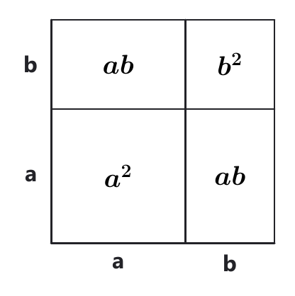

# Занятие 4. Алгебраические выражения и формулы сокращённого умножения

**Дата:** 25.09.2026 (пт)  
**Длительность:** 45 минут  
**Раздел:** Алгебраические выражения  
**Подтемы:** многочлены и приведение подобных слагаемых; разложение на множители; формулы сокращённого умножения; тождественные преобразования.

## Цели занятия

К концу занятия ученик сможет:

- раскрывать скобки и приводить подобные слагаемые;
- распознавать и применять формулы сокращённого умножения;
- раскладывать многочлен на множители;
- выполнять тождественные преобразования;
- аккуратно работать со степенями, корнями и дробными числами;
- выбрать блок своего уровня: 1–2, 3–4, 5–6, 7–8 или 9–10 баллов.

## Тайминг

| Этап | Время |
|---|---:|
| Теория | 12 минут |
| Разбор ключевых заданий | 14 минут |
| Самостоятельная работа | 15 минут |
| Итоги и домашнее задание | 4 минуты |

На самостоятельной работе ученик решает только блок своего уровня.

## Теория к занятию

### Мини-тема 1. Многочлены и приведение подобных слагаемых

#### Простыми словами

Многочлен состоит из одночленов, соединённых знаками сложения или вычитания.

Например, $3x^2-5x+7$ — многочлен.

Слагаемые с одинаковой буквенной частью называют подобными. Их можно заменить одним слагаемым, сложив коэффициенты.

Смотри внимательно: $3x$ и $3x^2$ не являются подобными, потому что степени переменной разные.

#### Определение

**Многочлен** — это сумма одночленов. Один одночлен тоже считают многочленом: в такой сумме одно слагаемое.

**Подобные слагаемые** — слагаемые с одинаковой буквенной частью.

**Приведение подобных слагаемых** — замена нескольких подобных слагаемых одним слагаемым.

**Стандартный вид одночлена**: числовой коэффициент стоит впереди, каждая буква встречается один раз. Коэффициенты перемножают, а показатели одинаковых букв складывают. Например, $2x\cdot x^2\cdot y=2x^3y$.

**Стандартный вид многочлена**: подобные слагаемые уже приведены. Члены обычно записывают по убыванию степеней: $2x+5-3x=-x+5$.

#### Формулы

$$ax+bx=(a+b)x$$

$$ax^n+bx^n=(a+b)x^n$$

Здесь $a$ и $b$ — коэффициенты, а $x^n$ — общая буквенная часть.

#### Правила

- Сначала раскрой скобки.
- При раскрытии скобок внимательно следи за знаком перед скобками.
- Складывай только подобные слагаемые.
- При умножении одночленов коэффициенты перемножаются, а показатели степеней одинаковых букв складываются.
- Нельзя складывать показатели при сложении слагаемых.

#### Алгоритм

1. Раскрыть скобки.
2. Записать выражение без лишних скобок.
3. Найти подобные слагаемые.
4. Сложить их коэффициенты.
5. Записать многочлен в стандартном виде.
6. Проверить знаки и степени.

#### Мини-пример

Упростить выражение $4a-3(2a-5)+a$.

*Решение:*

Раскрываем скобки.

Перед скобками стоит множитель $-3$, поэтому каждый член в скобках умножаем на $-3$:

$$4a-3(2a-5)+a=4a-6a+15+a.$$

Приводим подобные слагаемые:

$$4a-6a+a=(4-6+1)a=-a.$$

Получаем:

$$4a-6a+15+a=15-a.$$

**Ответ:** $15-a$.

#### Мини-пример. Умножение двучленов

Упростить $(x+1)(x-2)$.

Двучлен на двучлен умножают так: каждый член первого умножают на каждый член второго.

$$(a+b)(c+d)=ac+ad+bc+bd.$$

*Решение:*

$$(x+1)(x-2)=x\cdot x+x\cdot(-2)+1\cdot x+1\cdot(-2)=x^2-2x+x-2.$$

Подобные члены $-2x$ и $x$ дают $-x$:

$$x^2-2x+x-2=x^2-x-2.$$

Проверка при $x=3$:

$$(3+1)(3-2)=4, \qquad 3^2-3-2=4.$$

**Ответ:** $x^2-x-2$.

#### Типичные ошибки

- $-(a-b)=-a+b$, а не $-a-b$.
- $x+x=2x$, но $x\cdot x=x^2$.
- $3x^2+2x$ не упрощается.
- Минус перед скобками меняет знаки всех слагаемых.
- В произведении $x\cdot x^2$ показатель равен $3$. При сложении $x+x^2$ показатели не складывают.

---

### Мини-тема 2. Формулы сокращённого умножения

#### Простыми словами

Формулы сокращённого умножения помогают быстро раскрывать скобки и, наоборот, сворачивать многочлен в произведение.

Квадрат суммы — это не просто сумма квадратов. Средний член $2ab$ забывать нельзя: он обычно как раз и ловит невнимательных.

#### Определение

**Формулы сокращённого умножения** — тождества для квадрата суммы, квадрата разности и разности квадратов. Ими раскрывают скобки и, наоборот, раскладывают многочлен на множители.

#### Формулы

Квадрат суммы:

$$(a+b)^2=a^2+2ab+b^2.$$

Квадрат разности:

$$(a-b)^2=a^2-2ab+b^2.$$

Разность квадратов:

$$(a-b)(a+b)=a^2-b^2.$$

Обратная запись:

$$a^2-b^2=(a-b)(a+b).$$

Откуда берётся средний член $2ab$: квадрат со стороной $a+b$ состоит из квадрата $a^2$, квадрата $b^2$ и двух одинаковых прямоугольников $ab$.

<!--geo-figure-spec
{
  "needed": true,
  "kind": "plane",
  "template": "plane_custom",
  "caption": "Квадрат суммы: (a+b)^2 = a^2 + 2ab + b^2",
  "show_labels": false,
  "vertices": {
    "A": [
      0,
      0
    ],
    "E": [
      3,
      0
    ],
    "B": [
      5,
      0
    ],
    "H": [
      5,
      3
    ],
    "C": [
      5,
      5
    ],
    "F": [
      3,
      5
    ],
    "D": [
      0,
      5
    ],
    "G": [
      0,
      3
    ]
  },
  "edges": [
    [
      "A",
      "E"
    ],
    [
      "E",
      "B"
    ],
    [
      "B",
      "H"
    ],
    [
      "H",
      "C"
    ],
    [
      "C",
      "F"
    ],
    [
      "F",
      "D"
    ],
    [
      "D",
      "G"
    ],
    [
      "G",
      "A"
    ],
    [
      "E",
      "F"
    ],
    [
      "G",
      "H"
    ]
  ],
  "segment_labels": [
    {
      "points": [
        "A",
        "E"
      ],
      "text": "a",
      "t": 0.5,
      "side": -1,
      "offset": 0.45
    },
    {
      "points": [
        "E",
        "B"
      ],
      "text": "b",
      "t": 0.5,
      "side": -1,
      "offset": 0.45
    },
    {
      "points": [
        "A",
        "G"
      ],
      "text": "a",
      "t": 0.5,
      "side": 1,
      "offset": 0.45
    },
    {
      "points": [
        "G",
        "D"
      ],
      "text": "b",
      "t": 0.5,
      "side": 1,
      "offset": 0.45
    },
    {
      "points": [
        "E",
        "F"
      ],
      "text": "$a^2$",
      "t": 0.3,
      "side": 1,
      "offset": 1.5
    },
    {
      "points": [
        "E",
        "F"
      ],
      "text": "$ab$",
      "t": 0.3,
      "side": -1,
      "offset": 1
    },
    {
      "points": [
        "E",
        "F"
      ],
      "text": "$ab$",
      "t": 0.8,
      "side": 1,
      "offset": 1.5
    },
    {
      "points": [
        "E",
        "F"
      ],
      "text": "$b^2$",
      "t": 0.8,
      "side": -1,
      "offset": 1
    }
  ]
}
-->

*Квадрат суммы: (a+b)² = a² + 2ab + b²*

Ту же формулу получают умножением. Каждый член первого двучлена умножают на каждый член второго, затем $ab$ и $ba$ складывают:

$$(a+b)^2=(a+b)(a+b)=a^2+ab+ba+b^2=a^2+2ab+b^2.$$

Два одинаковых прямоугольника на чертеже как раз и дают средний член $2ab$.

#### Когда применять

- Если видишь $(a+b)^2$ или $(a-b)^2$, раскрывай квадрат суммы или разности.
- Если видишь $a^2-b^2$, раскладывай на множители.
- Формула разности квадратов применяется, когда один квадрат вычитают из другого.
- Сумму квадратов $a^2+b^2$ этими формулами не разложить.
- Трёхчлен $a^2+2ab+b^2$ сворачивай в $(a+b)^2$, а $a^2-2ab+b^2$ — в $(a-b)^2$. Сначала проверь, что крайние члены — квадраты, а средний равен удвоенному произведению.

#### Алгоритм

1. Определи, какая формула подходит.
2. Выдели выражения $a$ и $b$.
3. Подставь их в формулу.
4. Выполни возведение в квадрат и умножение.
5. Приведи подобные слагаемые.
6. Проверь средний член и знаки.

#### Мини-пример

Разложить на множители $9x^2-25$.

*Решение:*

Представляем слагаемые как квадраты:

$$9x^2=(3x)^2,$$

$$25=5^2.$$

Получаем разность квадратов:

$$9x^2-25=(3x)^2-5^2.$$

Применяем формулу разности квадратов:

$$a^2-b^2=(a-b)(a+b).$$

Тогда

$$9x^2-25=(3x-5)(3x+5).$$

Проверка:

$$(3x-5)(3x+5)=9x^2-25.$$

**Ответ:** $(3x-5)(3x+5)$.

#### Типичные ошибки

- $(a-b)^2=a^2-2ab+b^2$, последний член положительный.
- $(a+b)^2$ не равен $a^2+b^2$.
- Разность квадратов раскладывается на два множителя.
- $a^2+b^2$ не превращается в $(a+b)(a-b)$.

---

### Мини-тема 3. Разложение многочлена на множители

#### Простыми словами

Разложить многочлен на множители — значит представить его в виде произведения.

Главный вопрос: что общего у всех слагаемых?

Иногда общий множитель виден сразу. Иногда сначала нужно сгруппировать слагаемые, а затем применить формулу сокращённого умножения.

Разложение на множители часто нужно для сокращения дробей и решения уравнений.

#### Определение

**Разложение многочлена на множители** — представление многочлена в виде произведения двух или нескольких выражений.

#### Основные способы

Вынесение общего множителя:

$$ab+ac=a(b+c).$$

Группировка:

$$ax+ay+bx+by=a(x+y)+b(x+y)=(a+b)(x+y).$$

Разность квадратов:

$$a^2-b^2=(a-b)(a+b).$$

#### Правила

- Сначала ищи общий множитель во всех слагаемых.
- Если общего множителя нет, попробуй сгруппировать слагаемые.
- После разложения проверь раскрытием скобок.
- Если выражение является разностью квадратов, формула обычно самый короткий путь.
- Не выноси множитель только из части выражения без группировки.
- В скобках после вынесения остаётся столько же слагаемых, сколько было. Если множитель совпал с целым слагаемым, на его месте пишут $1$: $ab+b=b(a+1)$.
- Если после группировки скобки получились разными, эта группировка не подошла. Возьми другие пары слагаемых.

#### Алгоритм

1. Найти общий множитель.
2. Вынести его за скобки.
3. Если это невозможно, сгруппировать слагаемые.
4. В каждой группе вынести общий множитель.
5. Вынести общую скобку.
6. Если внутри скобки видна формула сокращённого умножения, применить её.
7. Проверить результат умножением.

#### Мини-пример

Разложить на множители $6x^2+9x$.

*Решение:*

Наибольший общий числовой множитель равен $3$.

В буквенной части всех слагаемых есть $x$.

Общий множитель равен $3x$.

Выносим его за скобки:

$$6x^2+9x=3x(2x+3).$$

Проверяем:

$$3x(2x+3)=6x^2+9x.$$

**Ответ:** $3x(2x+3)$.

#### Типичные ошибки

- При вынесении общего множителя проверь каждое слагаемое.
- $a^2-b^2$ — произведение, а не сумма.
- В группировке скобки должны получиться одинаковыми.
- После вынесения $b$ из $ab+b$ в скобках остаётся $a+1$, а не $a$.

---

### Мини-тема 4. Тождественные преобразования

#### Простыми словами

Тождественное преобразование заменяет выражение другим, равным ему при всех допустимых значениях переменных.

Например, $3x+2x=5x$ — тождественное преобразование.

Если в выражении есть знаменатель, нужно помнить: знаменатель не может быть равен нулю.

При сокращении дроби сокращают множители, а не отдельные слагаемые.

#### Определение

**Тождественно равные выражения** принимают одинаковые значения при всех допустимых значениях переменных.

**Тождественное преобразование** — замена выражения тождественно равным ему выражением.

#### Формулы

$$a(b+c)=ab+ac$$

$$a(b-c)=ab-ac$$

$$\frac{ac}{bc}=\frac{a}{b}; \qquad b\ne0,\ c\ne0$$

Разность квадратов:

$$a^2-b^2=(a-b)(a+b).$$

#### Правила

- Перед преобразованием дробного выражения укажи ограничения на знаменатель.
- Сокращай только множители.
- Нельзя сокращать слагаемые в сумме.
- В сумме сначала упрости каждую дробь, затем складывай уже полученные выражения.
- После преобразования можно проверить ответ подстановкой допустимого числа.
- Если выражение содержит корень, подкоренное выражение должно быть неотрицательным. Это правило занятия 3.

#### Алгоритм

1. Записать ограничения на переменные.
2. Разложить числитель и знаменатель на множители.
3. Сократить общие множители.
4. Упростить полученное выражение.
5. Подставить допустимое значение для проверки.
6. Записать ответ с ограничениями.

#### Мини-пример

Сократить дробь

$$\frac{x^2-16}{x-4}.$$

*Решение:*

Знаменатель не должен быть равен нулю:

$$x-4\ne0.$$

Отсюда

$$x\ne4.$$

Разлагаем числитель по формуле разности квадратов:

$$x^2-16=x^2-4^2=(x-4)(x+4).$$

Получаем:

$$\frac{x^2-16}{x-4}=\frac{(x-4)(x+4)}{x-4}.$$

Сокращаем множитель $x-4$:

$$\frac{(x-4)(x+4)}{x-4}=x+4.$$

Ограничение сохраняется:

$$x\ne4.$$

Проверка при $x=5$:

$$\frac{5^2-16}{5-4}=\frac{25-16}{1}=9,$$

$$5+4=9.$$

**Ответ:** $x+4$, $x\ne4$.

#### Типичные ошибки

- Нельзя сокращать $x$ в выражении $\frac{x+2}{x+5}$.
- После сокращения нельзя забывать ограничение.
- Если один и тот же множитель стоит и в числителе, и в знаменателе, значение, обращающее его в нуль, после сокращения всё равно исключают.
- Нельзя делить на выражение, которое может быть равно нулю.
- Ограничение на знаменатель сохраняется и после сокращения.

### Дополнительно для уровней 7–10

Эти два приёма нужны блокам 7–8 и 9–10. В блоках 1–6 они не используются.

#### Квадрат минус квадрат

Если три члена уже складываются в квадрат двучлена, а четвёртый член — вычитаемый квадрат, сначала сверни трёхчлен, потом примени разность квадратов.

**Условие.** Разложите на множители $a^2+4a+4-9b^2$.

*Решение:*

$$a^2+4a+4=(a+2)^2, \qquad 9b^2=(3b)^2.$$

$$(a+2)^2-(3b)^2=(a+2-3b)(a+2+3b).$$

Проверка: $(a+2)^2-9b^2=a^2+4a+4-9b^2$.

**Ответ:** $(a+2-3b)(a+2+3b)$.

Если общий множитель есть у всех членов, его выносят до формул.

**Условие.** Разложите на множители $2x^2+4x+2-8$.

*Решение:*

$$2x^2+4x+2-8=2(x^2+2x+1-4)=2\bigl((x+1)^2-2^2\bigr).$$

$$(x+1)^2-2^2=(x+1-2)(x+1+2)=(x-1)(x+3).$$

$$2(x-1)(x+3).$$

Проверка: $2(x-1)(x+3)=2(x^2+2x-3)=2x^2+4x-6$, и $2x^2+4x+2-8=2x^2+4x-6$.

**Ответ:** $2(x-1)(x+3)$.

#### Разбиение члена при группировке

Если готовые группы не дают одинаковых скобок, один член разбивают на два. Для $x^2+px+q$ ищут два числа, произведение которых равно $q$, а сумма равна $p$.

**Условие.** Разложите на множители $x^2+5x+6$.

*Решение:*

Пары с произведением $6$: $1$ и $6$ (сумма $7$), $2$ и $3$ (сумма $5$). Подходят $2$ и $3$.

$$x^2+2x+3x+6=x(x+2)+3(x+2)=(x+2)(x+3).$$

Проверка: $(x+2)(x+3)=x^2+5x+6$.

**Ответ:** $(x+2)(x+3)$.

Тот же подбор работает с отрицательными числами.

**Условие.** Разложите на множители $x^2-5x+6$.

*Решение:*

Произведение $6$, сумма $-5$. Подходят $-2$ и $-3$.

$$x^2-2x-3x+6=x(x-2)-3(x-2)=(x-2)(x-3).$$

Проверка: $(x-2)(x-3)=x^2-5x+6$.

**Ответ:** $(x-2)(x-3)$.

Для $x^4+px^2+q$ делают то же самое, только роль $x$ играет $x^2$: ищут два числа с произведением $q$ и суммой $p$. Каждую получившуюся разность квадратов раскладывают ещё раз.

## Сводка формул «выучить наизусть»

$$a(b+c)=ab+ac$$

$$a(b-c)=ab-ac$$

$$(a+b)(c+d)=ac+ad+bc+bd$$

$$ax+bx=(a+b)x$$

$$(a+b)^2=a^2+2ab+b^2$$

$$(a-b)^2=a^2-2ab+b^2$$

$$(a-b)(a+b)=a^2-b^2$$

$$a^2-b^2=(a-b)(a+b)$$

$$a^2+2ab+b^2=(a+b)^2$$

$$a^2-2ab+b^2=(a-b)^2$$

## Правила, которые нельзя путать

- При сложении подобных слагаемых складываются коэффициенты.
- При умножении степеней с одинаковым основанием показатели складываются.
- Минус перед скобками меняет знаки всех слагаемых.
- В квадрате разности средний член отрицательный, последний — положительный.
- Сокращаются множители, а не слагаемые.
- Ограничения на знаменатель сохраняются после сокращения.

## Разрешённый набор для практики

Мини-темы занятия:

- многочлены и приведение подобных слагаемых;
- разложение на множители;
- формулы сокращённого умножения;
- тождественные преобразования.

Повтор из прошлых занятий этого курса:

- занятие 1: проценты от числа умножением, порядок действий, модуль числа;
- занятие 2: степень с натуральным и целым показателем, $a^m\cdot a^n=a^{m+n}$, $(a^m)^n=a^{mn}$, $a^{-n}=\dfrac{1}{a^n}$ при $a\ne0$, $a^0=1$ при $a\ne0$;
- занятие 3: арифметический квадратный корень, $\sqrt{a^2}=|a|$, вынесение множителя из-под корня, ограничение «под корнем неотрицательное число».

## Разбор ключевых заданий

### Р1.
Сократите дробь

$$\frac{4x^2-9y^2}{2x-3y}$$

и найдите её значение, если $x=0{,}5$; $y=\frac{2}{3}$.

*Решение:*

Дано:

$$x=0{,}5; \qquad y=\frac{2}{3}.$$

Найти значение сокращённой дроби.

Знаменатель не должен быть равен нулю:

$$2x-3y\ne0.$$

Числитель является разностью квадратов:

$$4x^2-9y^2=(2x)^2-(3y)^2.$$

Разлагаем числитель:

$$4x^2-9y^2=(2x-3y)(2x+3y).$$

Сокращаем общий множитель:

$$\frac{4x^2-9y^2}{2x-3y}=2x+3y.$$

Ограничение:

$$2x-3y\ne0.$$

Проверим его для данных значений:

$$2\cdot0{,}5-3\cdot\frac{2}{3}=1-2=-1\ne0.$$

Подставляем значения в сокращённое выражение:

$$2x+3y=2\cdot0{,}5+3\cdot\frac{2}{3}.$$

$$2\cdot0{,}5=1.$$

$$3\cdot\frac{2}{3}=2.$$

$$1+2=3.$$

Проверка подстановкой в исходную дробь:

$$4\cdot(0{,}5)^2-9\cdot\left(\frac{2}{3}\right)^2=4\cdot0{,}25-9\cdot\frac{4}{9}=1-4=-3,$$

$$\frac{-3}{-1}=3.$$

**Ответ:** $2x+3y$ при $2x-3y\ne0$; при данных $x$ и $y$ значение равно $3$.

---

### Р2.
Разложите на множители $x^2-16+5x-20$.

*Решение:*

Общего множителя у всех четырёх слагаемых нет. Группируем так, чтобы в одной группе появилась разность квадратов:

$$(x^2-16)+(5x-20).$$

Первая группа — разность квадратов:

$$x^2-16=x^2-4^2=(x-4)(x+4).$$

Вторая группа:

$$5x-20=5(x-4).$$

В обеих частях есть скобка $x-4$. Выносим её:

$$(x-4)(x+4)+5(x-4)=(x-4)\bigl((x+4)+5\bigr)=(x-4)(x+9).$$

Проверка раскрытием скобок:

$$(x-4)(x+9)=x^2+9x-4x-36=x^2+5x-36,$$

$$x^2-16+5x-20=x^2+5x-36.$$

**Ответ:** $(x-4)(x+9)$.

---

### Р3.
Какое из приведённых выражений тождественно равно произведению $-x(-x+3)$?

а) $x^2-3x$;  
б) $x^2+3x$;  
в) $x^2+3$;  
г) $x^2-3$;  
д) $3x-x^2$.

*Решение:*

Раскрываем скобки:

$$-x(-x+3)=(-x)(-x)+(-x)\cdot3.$$

$$(-x)(-x)=x^2.$$

$$(-x)\cdot3=-3x.$$

Следовательно,

$$-x(-x+3)=x^2-3x.$$

Это вариант а).

Проверка при $x=1$:

$$-1(-1+3)=-2,$$

$$1^2-3\cdot1=1-3=-2.$$

**Ответ:** а) $x^2-3x$.

---

### Р4.
Представьте трёхчлен $9x^2-12x+4$ в виде квадрата двучлена.

*Решение:*

Крайние члены записываем как квадраты:

$$9x^2=(3x)^2, \qquad 4=2^2.$$

Для квадрата разности средний член должен быть равен $-2\cdot 3x\cdot 2=-12x$. В трёхчлене стоит именно $-12x$, значит

$$9x^2-12x+4=(3x-2)^2.$$

Проверка:

$$(3x-2)^2=9x^2-2\cdot3x\cdot2+4=9x^2-12x+4.$$

**Ответ:** $(3x-2)^2$.

## Самостоятельная работа

Выбери свой уровень и решай только этот блок.  
В каждом блоке есть все мини-темы урока и повтор ранее изученного материала.

### Уровень 1–2 балла

**С1.** *Сборник, вариант 25, №1.* Какое выражение тождественно равно произведению $-2(-5-a)$?

а) $10-a$; б) $2a-10$; в) $10+2a$; г) $10-2a$; д) $2a-5$.

**С2.** *Сборник, вариант 65, №1.* Из данных равенств выберите тождество:

а) $x+x+x=x^3$; б) $x\cdot x\cdot x=3x$; в) $x+x+x=3x$; г) $x\cdot x\cdot x\cdot x=4+x$; д) $x+x+x=3+x$.

**С3.** *мини-тема 2, авторское.* Разложите на множители $25a^2-16$.

**С4.** *мини-тема 3, авторское.* Вынесите общий множитель за скобки: $12x^2-8x$.

**С5.** *повтор.* Вычислите $2^3\cdot2^{-1}$.

### Уровень 3–4 балла

**С1.** *Сборник, вариант 75, №4.* Разложите на множители многочлен $25x^2-9y^2+5x-3y$.

**С2.** *Сборник, вариант 09, №4.* Приведите одночлен $4ab^2abb^4a(-0{,}5)$ к стандартному виду.

**С3.** *Сборник, вариант 21, №4.* Упростите выражение $2(a-3b)-3(2a+b)$.

**С4.** *Сборник, вариант 71, №4.* Раскройте скобки и приведите подобные слагаемые:

$$2a^2(1-a)-(-2a^3+3a^2).$$

**С5.** *повтор.* Упростите выражение $\sqrt{72}-2\sqrt{8}$.

### Уровень 5–6 баллов

**С1.** *Сборник, вариант 13, №6.* Сократите дробь и укажите ограничение:

$$\frac{4n^2-9m^2}{9m^2+4n^2+12mn}.$$

**С2.** *Сборник, вариант 75, №5.* Найдите значение выражения $2a^2:b-4ab$ при $a=3$; $b=-1{,}5$.

**С3.** *мини-темы 1 и 2, авторское.* Упростите выражение:

$$(2x-1)(x+4)-(x+3)(x-3).$$

**С4.** *мини-тема 2, авторское.* Представьте в виде произведения:

$$4p^2-12p+9.$$

**С5.** *повтор.* Упростите:

$$\frac{\sqrt{50}}{\sqrt{2}}.$$

### Уровень 7–8 баллов

**С1.** *Сборник, вариант 17, №7.* Найдите $55\%$ от значения выражения

$$\frac{71^2-23^2+94\cdot42}{62^2-32^2}.$$

**С2.** *мини-тема 3, авторское.* Разложите на множители:

$$x^3+2x^2-9x-18.$$

**С3.** *мини-тема 4, авторское.* Сократите дробь и укажите ограничения:

$$\frac{x^2-6x+9}{x^2-9}.$$

**С4.** *мини-темы 1 и 2, авторское.* Упростите:

$$(a+3)(a-3)-(a-1)^2+2(a^2-a).$$

**С5.** *повтор.* Вычислите:

$$\frac{3^{-2}+2^{-1}}{\frac{5}{4}}.$$

### Уровень 9–10 баллов

**С1.** *мини-тема 4, авторское.* Упростите и укажите ограничения:

$$\frac{x^2-9}{x+3}+\frac{x^2-4}{x-2}-2x.$$

**С2.** *дополнительно для уровней 7–10, авторское.* Разложите на множители:

$$12x^2-12xy+3y^2-27.$$

**С3.** *мини-тема 4, авторское.* Сократите дробь и укажите ограничения:

$$\frac{(x^2-10x+25)(x+4)}{(x-5)(x^2-16)}.$$

**С4.** *дополнительно для уровней 7–10, авторское.* Разложите на множители:

$$x^4-5x^2+4.$$

**С5.** *повтор.* Упростите выражение:

$$\sqrt{12a^2}-2a\sqrt{3}; \qquad a\ge0.$$

## Домашнее задание

Ученик берёт свой уровень. В каждом блоке 6 задач: четыре задания по теме занятия и два задания на повтор.

### Уровень 1–2 балла

**Д1.** *мини-тема 1, авторское.* Упростите $7x+3x-4$.

**Д2.** *мини-тема 2, авторское.* Раскройте скобки: $(a+4)^2$.

**Д3.** *мини-тема 3, авторское.* Вынесите общий множитель: $15b^2+10b$.

**Д4.** *мини-тема 4, авторское.* Упростите $2(3y-1)+y$.

**Д5.** *повтор.* Вычислите $3^2\cdot3^{-1}$.

**Д6.** *повтор.* Упростите $\sqrt{18}+\sqrt{8}$.

### Уровень 3–4 балла

**Д1.** *мини-тема 1, авторское.* Упростите $5x^2-3x+2x^2+7x$.

**Д2.** *мини-тема 2, авторское.* Разложите на множители $36m^2-49$.

**Д3.** *мини-тема 3, авторское.* Разложите на множители $8a^2+12a$.

**Д4.** *мини-тема 4, авторское.* Упростите $4(2p-3)-2(p+1)$.

**Д5.** *повтор.* Упростите $\sqrt{98}-\sqrt{8}$.

**Д6.** *повтор.* Вычислите $\left(\frac{2}{3}\right)^{-2}$.

### Уровень 5–6 баллов

**Д1.** *мини-темы 1 и 2, авторское.* Упростите:

$$(3x+1)(x-2)-(2x-1)(x+1).$$

**Д2.** *мини-тема 2, авторское.* Представьте в виде квадрата:

$$9t^2+12t+4.$$

**Д3.** *мини-тема 3, авторское.* Разложите на множители:

$$3y^3-12y.$$

**Д4.** *мини-тема 4, авторское.* Сократите дробь:

$$\frac{a^2-16}{a+4}.$$

Укажите ограничение.

**Д5.** *повтор.* Упростите:

$$\sqrt{75}-\sqrt{12}.$$

**Д6.** *повтор.* Вычислите:

$$2^{-3}+\frac{1}{4}.$$

### Уровень 7–8 баллов

**Д1.** *мини-темы 1 и 2, авторское.* Упростите:

$$(b+2)(b-2)-(b-3)^2+3(b^2+b).$$

**Д2.** *дополнительно для уровней 7–10, авторское.* Разложите на множители:

$$x^2-6x+9-4y^2.$$

**Д3.** *мини-тема 3, авторское.* Разложите на множители:

$$x^3-4x^2-9x+36.$$

**Д4.** *мини-тема 4, авторское.* Сократите дробь:

$$\frac{b^2-10b+25}{b^2-25}.$$

Укажите ограничения.

**Д5.** *повтор.* Упростите:

$$\frac{\sqrt{48}}{\sqrt{3}}.$$

**Д6.** *повтор.* Вычислите:

$$\frac{2^{-1}+3^{-1}}{\frac{5}{6}}.$$

### Уровень 9–10 баллов

**Д1.** *мини-тема 4, авторское.* Упростите и укажите ограничения:

$$\frac{y^2-16}{y-4}+\frac{y^2-1}{y+1}-2y.$$

**Д2.** *дополнительно для уровней 7–10, авторское.* Разложите на множители:

$$2x^2-4xy+2y^2-18.$$

**Д3.** *дополнительно для уровней 7–10, авторское.* Разложите на множители:

$$y^4-10y^2+9.$$

**Д4.** *мини-тема 4, авторское.* Сократите дробь и укажите ограничения:

$$\frac{(a^2+6a+9)(a-2)}{(a+3)(a^2-4)}.$$

**Д5.** *повтор, занятие 3.* Упростите:

$$\sqrt{48a^2}-3a\sqrt{3}; \qquad a\ge0.$$

**Д6.** *повтор, занятие 2.* Упростите:

$$\frac{(2^{-2})^{-3}\cdot2^{-4}}{2^{0}}.$$

## Чек-лист «ученик понял тему»

- [ ] Я умею раскрывать скобки с положительным и отрицательным множителем.
- [ ] Я умею умножать двучлен на двучлен.
- [ ] Я умею находить и складывать подобные слагаемые.
- [ ] Я умею приводить одночлен к стандартному виду.
- [ ] Я знаю формулы квадрата суммы и квадрата разности.
- [ ] Я знаю формулу разности квадратов.
- [ ] Я умею выносить общий множитель за скобки.
- [ ] Я умею раскладывать многочлен способом группировки.
- [ ] Я помню ограничения при сокращении алгебраической дроби.
- [ ] Я не путаю действия со степенями и корнями.
