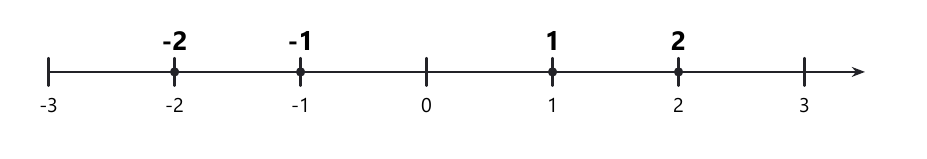
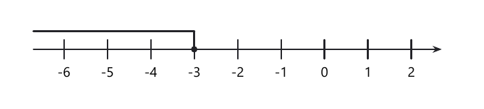
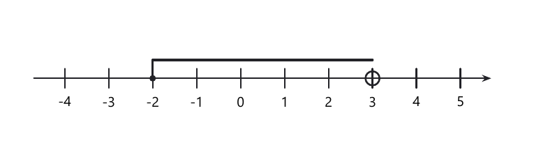
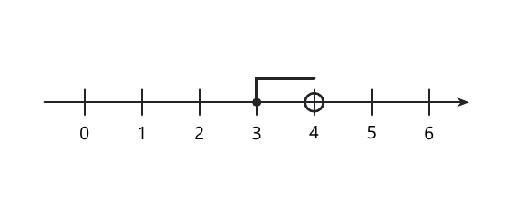
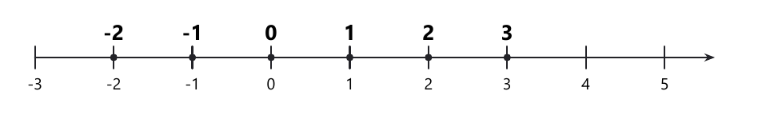
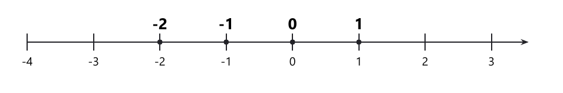
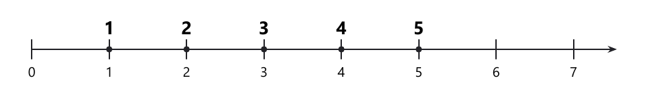
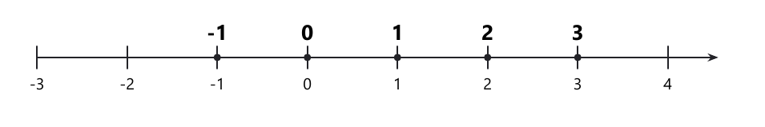
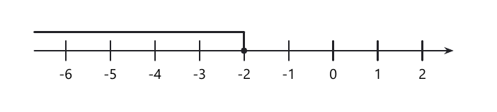
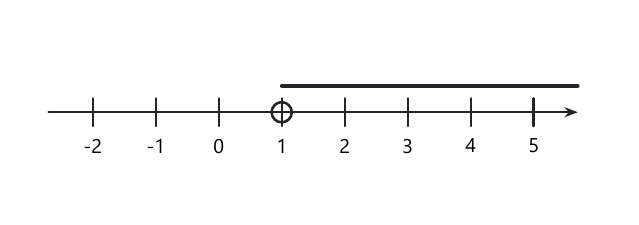

# Занятие 5. Линейные уравнения, неравенства и системы неравенств

**Дата:** 02.10.2026 (пт)  
**Длительность:** 45 минут  
**Раздел:** Неравенства  
**Подтемы:** линейные уравнения; линейные неравенства; системы линейных неравенств; числовые промежутки и целые решения

## Цели занятия

К концу занятия ученик сможет:

- решать линейные уравнения и уравнения, сводящиеся к линейным;
- решать линейные неравенства и помнить об изменении знака при делении на отрицательное число;
- решать системы линейных неравенств как пересечение промежутков;
- записывать решения с помощью знаков неравенств и числовых промежутков;
- находить целые и натуральные решения неравенств;
- применять в преобразованиях многочлены, степени, корни и формулы сокращённого умножения.

Ученик выбирает блок своего уровня: **1–2, 3–4, 5–6, 7–8 или 9–10 баллов**.

## Тайминг

| Этап | Время |
|---|---:|
| Теория | 12 минут |
| Разбор ключевых заданий | 14 минут |
| Самостоятельная работа | 15 минут |
| Итог и самооценка | 4 минуты |

На самостоятельной работе ученик решает **только один блок своего уровня**.

## Теория к занятию

### Мини-тема 1. Линейные уравнения

#### Простыми словами

Линейное уравнение — это уравнение, в котором переменная входит только в первой степени. После раскрытия скобок и приведения подобных слагаемых оно превращается в уравнение $ax=b$. Нужно оставить переменную одну: с обеими частями делают одно и то же действие. Новое уравнение равносильно исходному: корни те же. Если получилось верное равенство без переменной, корнем является любое число. Если получилось неверное равенство, корней нет.

#### Определение

**Корнем уравнения** называется значение переменной, которое превращает уравнение в верное числовое равенство.

**Решить уравнение** — значит найти все его корни или доказать, что корней нет.

Уравнение вида $ax=b$, где $a$ и $b$ — числа, а $x$ — переменная, называется линейным уравнением.

#### Формулы

Если $a\ne0$, то

$$ax=b; \qquad x=\frac{b}{a}.$$

Если $a=0$, делить на коэффициент нельзя. Уравнение $0\cdot x=0$ верно при любом $x$: корнем является любое действительное число. Уравнение $0\cdot x=b$ при $b\ne0$ неверно ни при каком $x$: корней нет.

Например, $2x+1=2x+1$. Переносим $2x$ влево и $1$ вправо: $2x-2x=1-1$, то есть $0=0$. Равенство верное, подходит любое число. Уравнение $2x+1=2x+3$ даёт $2x-2x=3-1$, то есть $0=2$. Равенство неверное, корней нет.

При переносе слагаемого из одной части уравнения в другую его знак меняется:

$$x+5=12; \qquad x=12-5.$$

При раскрытии скобок используется распределительный закон:

$$a(b+c)=ab+ac.$$

#### Правила

- Одинаковое действие выполняй с обеими частями.
- Перед скобкой со знаком «минус» меняй знаки всех слагаемых внутри.
- Приводи подобные слагаемые.
- Слагаемые с переменной собирай в одной части, числа — в другой.
- Если коэффициент при переменной не равен нулю, раздели на него обе части.
- Если коэффициент стал равен нулю, не дели. Проверь, верное ли получилось числовое равенство.
- Полученный корень подставь в исходное уравнение.

#### Алгоритм

1. Раскрыть скобки.
2. Привести подобные слагаемые.
3. Перенести слагаемые с переменной в одну часть, числа — в другую.
4. Привести уравнение к виду $ax=b$.
5. Если $a\ne0$, разделить обе части на $a$. Если $a=0$, проверить, верное ли получилось числовое равенство.
6. Выполнить проверку.

#### Мини-пример

Решите уравнение $3(2x-1)-4x=11$.

*Решение:*

Раскрываем скобки:

$$3(2x-1)-4x=11.$$

$$6x-3-4x=11.$$

Приводим подобные слагаемые:

$$2x-3=11.$$

Переносим число $-3$ в правую часть:

$$2x=11+3.$$

$$2x=14.$$

Делим обе части на $2$:

$$x=7.$$

Проверка:

$$3(2\cdot7-1)-4\cdot7=3\cdot13-28=39-28=11.$$

Получили верное равенство.

**Ответ:** $7$.

#### Типичные ошибки

- При раскрытии скобок забывают изменить знаки.
- При переносе слагаемого знак не меняют.
- Делят только один член, а не обе части.
- Не проверяют полученный корень.

---

### Мини-тема 2. Линейные неравенства

#### Простыми словами

Неравенство показывает, что одно выражение больше или меньше другого. У уравнения обычно один корень, а у неравенства — целый промежуток чисел. Прибавление или вычитание одного и того же числа знак не меняет. Умножение или деление на положительное число знак тоже не меняет. При умножении или делении на отрицательное число знак меняется на противоположный.

Почему знак меняется, видно на числах. Верно $2>1$: число $2$ лежит правее числа $1$. Умножим оба числа на $-1$ и получим $-2$ и $-1$. На прямой $-2$ левее $-1$, поэтому $-2<-1$. Порядок чисел стал противоположным. Так бывает при умножении и делении на любое отрицательное число: это свойство числовых неравенств из курса 7 класса.

<!--geo-figure-spec
{
  "needed": true,
  "kind": "plane",
  "template": "number_line",
  "caption": "Число -2 левее числа -1, поэтому -2 меньше -1",
  "start": -3,
  "end": 3,
  "step": 1,
  "major_step": 1,
  "tick_labels": "major",
  "marks": [
    {
      "at": -2,
      "name": "-2"
    },
    {
      "at": -1,
      "name": "-1"
    },
    {
      "at": 1,
      "name": "1"
    },
    {
      "at": 2,
      "name": "2"
    }
  ],
  "axis_arrows": true
}
-->

*Число -2 левее числа -1, поэтому -2 меньше -1*

#### Определение

**Линейным неравенством с одной переменной** называется неравенство, которое после преобразований можно привести к виду

$$ax>b; \qquad ax<b; \qquad ax\ge b; \qquad ax\le b.$$

Число, при подстановке которого неравенство становится верным, называется его решением.

#### Формулы

При $a>0$:

$$ax>b\quad\Longleftrightarrow\quad x>\frac{b}{a}.$$

При $a<0$ знак меняется:

$$ax>b\quad\Longleftrightarrow\quad x<\frac{b}{a}.$$

Например:

$$-3x\le12\quad\Longleftrightarrow\quad x\ge-4.$$

#### Правила

- Прибавление или вычитание одного и того же числа знак не меняет.
- Умножение или деление на положительное число знак не меняет.
- Умножение или деление на отрицательное число меняет знак на противоположный.
- Если после преобразований осталось верное числовое неравенство, подходит любое действительное число. Если неверное — решений нет. Например, $x+1>x$ верно всегда, а $x+1>x+2$ неверно никогда.
- Знак $<$ или $>$ соответствует открытой границе. Знак $\le$ или $\ge$ — включённой.
- Неотрицательное число — это число, которое больше нуля или равно нулю. Так уже говорили в занятии 3.
- В двойном неравенстве одно и то же действие выполняют со всеми тремя частями. Если делят или умножают на отрицательное число, меняют оба знака.
- После решения можно проверить границу и одно число из промежутка.

На рисунках решения показаны чертой над координатной прямой. Закрашенная точка означает, что граница входит. Пустой кружок означает, что граница не входит. Если черта доходит до края рисунка, решения в эту сторону продолжаются: виден только кусок прямой.

#### Алгоритм

1. Раскрыть скобки.
2. Привести подобные слагаемые.
3. Перенести слагаемые.
4. Привести неравенство к виду $ax>b$, $ax<b$, $ax\ge b$ или $ax\le b$.
5. Если коэффициент при переменной не равен нулю, разделить на него обе части. При отрицательном коэффициенте изменить знак. Если коэффициент равен нулю, проверить, верное ли получилось числовое неравенство.
6. Записать ответ промежутком или неравенством. Если подходит любое число или решений нет, так и записать.

#### Мини-пример

Решите неравенство $5-2x\ge11$.

<!--geo-figure-spec
{
  "needed": true,
  "kind": "plane",
  "template": "plane_custom",
  "caption": "Решения неравенства: числа не больше -3",
  "show_labels": false,
  "vertices": {
    "L": [
      -6.7,
      0
    ],
    "R": [
      2.7,
      0
    ],
    "P": [
      -3,
      0
    ],
    "S": [
      -6.7,
      0.42
    ],
    "T": [
      -3,
      0.42
    ]
  },
  "edges": [
    [
      "L",
      "R"
    ],
    [
      "S",
      "T"
    ],
    [
      "T",
      "P"
    ]
  ],
  "highlight_edges": [
    [
      "S",
      "T"
    ]
  ],
  "dots": [
    "P"
  ],
  "axis_arrows": true,
  "ticks": [
    {
      "x": -6,
      "label": "-6"
    },
    {
      "x": -5,
      "label": "-5"
    },
    {
      "x": -4,
      "label": "-4"
    },
    {
      "x": -3,
      "label": "-3"
    },
    {
      "x": -2,
      "label": "-2"
    },
    {
      "x": -1,
      "label": "-1"
    },
    {
      "x": 0,
      "label": "0"
    },
    {
      "x": 1,
      "label": "1"
    },
    {
      "x": 2,
      "label": "2"
    }
  ]
}
-->

*Решения неравенства: числа не больше -3*

*Решение:*

Переносим число $5$ в правую часть:

$$-2x\ge11-5.$$

$$-2x\ge6.$$

Делим обе части на $-2$.

При делении на отрицательное число знак меняется:

$$x\le-3.$$

Проверим число $-3$:

$$5-2(-3)=5+6=11.$$

Равенство допускается, поэтому число $-3$ входит в ответ.

**Ответ:** $x\le-3$, или $x\in(-\infty;-3]$.

#### Типичные ошибки

- Делят на отрицательное число и оставляют знак.
- В двойном неравенстве меняют только один знак.
- Путают круглую и квадратную скобки.
- При строгом неравенстве включают граничное число.
- При нестрогом неравенстве исключают граничное число.

#### Мини-пример. Двойное неравенство

Двойным называют неравенство, в котором переменная стоит между двумя границами, например $-6<-2x\le4$. Его читают с середины: $-2x$ больше $-6$ и не больше $4$.

Решите неравенство $-6<-2x\le4$.

<!--geo-figure-spec
{
  "needed": true,
  "kind": "plane",
  "template": "plane_custom",
  "caption": "Решения: от -2 включительно до 3 не включая",
  "show_labels": false,
  "vertices": {
    "L": [
      -4.7,
      0
    ],
    "R": [
      5.7,
      0
    ],
    "P": [
      -2,
      0
    ],
    "B": [
      3,
      0
    ],
    "U": [
      3,
      0.16
    ],
    "S": [
      -2,
      0.42
    ],
    "T": [
      3,
      0.42
    ]
  },
  "edges": [
    [
      "L",
      "R"
    ],
    [
      "S",
      "T"
    ],
    [
      "S",
      "P"
    ]
  ],
  "highlight_edges": [
    [
      "S",
      "T"
    ]
  ],
  "dots": [
    "P"
  ],
  "circle": {
    "center": "B",
    "r": 0.16
  },
  "axis_arrows": true,
  "ticks": [
    {
      "x": -4,
      "label": "-4"
    },
    {
      "x": -3,
      "label": "-3"
    },
    {
      "x": -2,
      "label": "-2"
    },
    {
      "x": -1,
      "label": "-1"
    },
    {
      "x": 0,
      "label": "0"
    },
    {
      "x": 1,
      "label": "1"
    },
    {
      "x": 2,
      "label": "2"
    },
    {
      "x": 3,
      "label": "3"
    },
    {
      "x": 4,
      "label": "4"
    },
    {
      "x": 5,
      "label": "5"
    }
  ]
}
-->

*Решения: от -2 включительно до 3 не включая*

*Решение:*

Делим все три части на $-2$. Число отрицательное, поэтому меняем оба знака:

$$3>x\ge-2.$$

Записываем от меньшего к большему:

$$-2\le x<3, \qquad x\in[-2;3).$$

Проверка границы $x=-2$:

$$-6<-2\cdot(-2)\le4, \qquad -6<4\le4.$$

Неравенство верно, граница входит. При $x=3$:

$$-6<-2\cdot3\le4, \qquad -6<-6\le4.$$

Сравнение $-6<-6$ неверно, поэтому $3$ не входит.

**Ответ:** $x\in[-2;3)$.

---

### Мини-тема 3. Системы линейных неравенств

#### Простыми словами

Система требует, чтобы переменная одновременно удовлетворяла всем неравенствам. Поэтому нужно найти не объединение, а общую часть решений. На числовой прямой это пересечение промежутков. Если общей части нет, система решений не имеет. Удобно сначала решить каждое неравенство отдельно, а потом сравнить границы. Два условия — два фильтра: проходит только то число, которое подходит обоим.

#### Определение

**Системой линейных неравенств** называется запись из нескольких неравенств, которые должны выполняться одновременно. В школьном курсе есть и другое слово: совокупность. В совокупности достаточно, чтобы выполнялось хотя бы одно неравенство, поэтому берут объединение. В этом занятии совокупностей нет. В системе ищем пересечение.

Решением системы является пересечение множеств решений всех её неравенств.

#### Формулы

Система

$$
\begin{cases}
x>a,\\
x\le b
\end{cases}
$$

имеет решение

$$x\in(a;b],$$

если $a<b$.

Система

$$
\begin{cases}
x>a,\\
x\le a
\end{cases}
$$

решений не имеет.

#### Правила

- Сначала решай каждое неравенство отдельно.
- При делении на отрицательное число меняй знак.
- Отметь оба промежутка на координатной прямой и возьми общую часть. Это и есть решение системы.
- В точке пересечения граница включается только тогда, когда соответствующий знак нестрогий.
- Если общая часть пустая, система решений не имеет.
- Если нужны целые решения, выпиши только целые числа из найденного промежутка.

#### Алгоритм

1. Решить первое неравенство.
2. Решить второе и остальные неравенства.
3. Записать полученные промежутки.
4. Найти их пересечение на координатной прямой.
5. Записать ответ.
6. Если требуется, отобрать целые или натуральные числа.

#### Мини-пример

Решите систему

$$
\begin{cases}
3x-2\ge7,\\
2x+4<12.
\end{cases}
$$

<!--geo-figure-spec
{
  "needed": true,
  "kind": "plane",
  "template": "plane_custom",
  "caption": "Общая часть: от 3 включительно до 4 не включая",
  "show_labels": false,
  "vertices": {
    "L": [
      -0.7,
      0
    ],
    "R": [
      6.7,
      0
    ],
    "A": [
      3,
      0
    ],
    "B": [
      4,
      0
    ],
    "U": [
      4,
      0.16
    ],
    "S": [
      3,
      0.42
    ],
    "T": [
      4,
      0.42
    ]
  },
  "edges": [
    [
      "L",
      "R"
    ],
    [
      "S",
      "T"
    ],
    [
      "S",
      "A"
    ]
  ],
  "highlight_edges": [
    [
      "S",
      "T"
    ]
  ],
  "dots": [
    "A"
  ],
  "circle": {
    "center": "B",
    "r": 0.16
  },
  "axis_arrows": true,
  "ticks": [
    {
      "x": 0,
      "label": "0"
    },
    {
      "x": 1,
      "label": "1"
    },
    {
      "x": 2,
      "label": "2"
    },
    {
      "x": 3,
      "label": "3"
    },
    {
      "x": 4,
      "label": "4"
    },
    {
      "x": 5,
      "label": "5"
    },
    {
      "x": 6,
      "label": "6"
    }
  ]
}
-->

*Общая часть: от 3 включительно до 4 не включая*

*Решение:*

Решаем первое неравенство:

$$3x-2\ge7.$$

$$3x\ge9.$$

$$x\ge3.$$

Решаем второе неравенство:

$$2x+4<12.$$

$$2x<8.$$

$$x<4.$$

Находим общую часть условий $x\ge3$ и $x<4$:

$$x\in[3;4).$$

Проверка: число $3$ подходит первому условию и второму, а число $4$ второму условию не подходит.

**Ответ:** $x\in[3;4)$.

#### Типичные ошибки

- Для системы берут объединение вместо пересечения.
- Забывают закрыть границу при знаке $\ge$ или $\le$.
- Включают правую границу при знаке $<$.
- После нахождения промежутка неверно выписывают целые числа.

---

### Мини-тема 4. Числовые промежутки и целые решения

#### Простыми словами

Числовой промежуток — это способ коротко записать множество чисел. Круглая скобка означает, что граница не входит. Квадратная скобка означает, что граница входит. Например, $(-2;5]$ содержит числа больше $-2$ и не больше $5$.

В учебнике 8 класса у промежутков есть названия:

- $(a;b)$ — интервал, обе границы не входят;
- $[a;b]$ — отрезок, обе границы входят;
- $[a;b)$ и $(a;b]$ — полуинтервалы, входит одна граница;
- $[a;+\infty)$ — числовой луч, граница $a$ входит;
- $(a;+\infty)$ — открытый числовой луч, граница $a$ не входит.

Левый луч записывают так же, только бесконечность стоит слева. Например, $(-\infty;-2]$ — это числа, которые не больше $-2$.

Если требуется найти целые решения, из промежутка выписываем только целые числа. На рисунке такое число отмечают жирной точкой. Число без точки в ответ не входит. Натуральные числа в школьных заданиях — это положительные целые числа: $1; 2; 3; \ldots$. Число $0$ натуральным не является. Числа первого десятка — от $1$ до $10$, второго десятка — от $11$ до $20$ включительно.

#### Определение и соответствия

$$x>a\quad\Longleftrightarrow\quad x\in(a;+\infty).$$

$$x\ge a\quad\Longleftrightarrow\quad x\in[a;+\infty).$$

$$x<a\quad\Longleftrightarrow\quad x\in(-\infty;a).$$

$$x\le a\quad\Longleftrightarrow\quad x\in(-\infty;a].$$

#### Правила

- Круглая скобка: граница не входит.
- Квадратная скобка: граница входит.
- Бесконечность всегда записывается с круглой скобкой.
- Целые числа не имеют дробной части.
- Натуральные числа положительны.
- При поиске наименьшего целого числа учитывай, входит ли левая граница.

#### Алгоритм

1. Решить неравенство или систему.
2. Записать промежуток.
3. Определить, какие границы включены.
4. Выписать целые числа из промежутка.
5. Если требуется, найти их количество или сумму.

#### Мини-пример

Найдите сумму целых решений неравенства $-4\le2x<8$.

<!--geo-figure-spec
{
  "needed": true,
  "kind": "plane",
  "template": "number_line",
  "caption": "Целые решения: -2, -1, 0, 1, 2, 3. Число 4 не входит",
  "start": -3,
  "end": 5,
  "step": 1,
  "major_step": 1,
  "tick_labels": "major",
  "marks": [
    {
      "at": -2,
      "name": "-2"
    },
    {
      "at": -1,
      "name": "-1"
    },
    {
      "at": 0,
      "name": "0"
    },
    {
      "at": 1,
      "name": "1"
    },
    {
      "at": 2,
      "name": "2"
    },
    {
      "at": 3,
      "name": "3"
    }
  ],
  "axis_arrows": true
}
-->

*Целые решения: -2, -1, 0, 1, 2, 3. Число 4 не входит*

*Решение:*

Делим все части двойного неравенства на положительное число $2$:

$$-2\le x<4.$$

Записываем промежуток:

$$x\in[-2;4).$$

Целые решения:

$$-2; -1; 0; 1; 2; 3.$$

Находим их сумму:

$$-2-1+0+1+2+3=3.$$

**Ответ:** $3$.

#### Типичные ошибки

- В промежутке $[-2;4)$ ошибочно включают число $4$.
- Не выписывают число $0$, хотя оно является целым.
- Путают целые и натуральные числа.
- При подсчёте забывают одну из границ.

---

## Сводка формул «выучить наизусть»

Линейное уравнение:

$$ax=b; \qquad a\ne0; \qquad x=\frac{b}{a}.$$

Если $a=0$ и $b=0$, подходит любое число. Если $a=0$ и $b\ne0$, корней нет.

Линейное неравенство:

$$ax>b; \qquad a>0\Longrightarrow x>\frac ba.$$

$$ax>b; \qquad a<0\Longrightarrow x<\frac ba.$$

Систему решаем пересечением промежутков.

Основные соответствия:

$$x>a\Longleftrightarrow x\in(a;+\infty).$$

$$x\ge a\Longleftrightarrow x\in[a;+\infty).$$

$$x<a\Longleftrightarrow x\in(-\infty;a).$$

$$x\le a\Longleftrightarrow x\in(-\infty;a].$$

Повторяемые формулы из занятий 2–4. Если шаг не получается, вернись к тому занятию: степени — занятие 2, корни — занятие 3, формулы сокращённого умножения и разложение на множители — занятие 4.

$$a^m\cdot a^n=a^{m+n}.$$

$$\frac{a^m}{a^n}=a^{m-n}; \qquad a\ne0.$$

$$a^0=1; \qquad a\ne0.$$

$$(a+b)^2=a^2+2ab+b^2.$$

$$(a-b)^2=a^2-2ab+b^2.$$

$$a^2-b^2=(a-b)(a+b).$$

$$\sqrt{a^2}=|a|.$$

## Правила, которые нельзя путать

- При делении неравенства на отрицательное число знак меняется.
- В двойном неравенстве при делении на отрицательное число меняются оба знака.
- Равенство $0=0$ означает, что подходит любое число; равенство $0=b$ при $b\ne0$ означает, что корней нет. То же для неравенства: верное числовое неравенство — любое число, неверное — решений нет.
- В системе берём пересечение, а не объединение. Объединение было бы у совокупности, её в этом занятии нет.
- Круглая скобка не включает границу.
- Квадратная скобка включает границу.
- При раскрытии скобок перед минусом знаки внутри меняются.
- В формуле $(a-b)^2$ средний член отрицательный.
- $\sqrt{a^2}=|a|$, а не всегда $a$.
- Натуральные числа положительны.

## Разрешённый набор для практики

На занятии разрешены:

- линейные уравнения;
- линейные неравенства;
- системы линейных неравенств;
- числовые промежутки и целые решения;
- степени с натуральным и целым показателем;
- преобразования выражений со степенями;
- многочлены и приведение подобных;
- разложение на множители;
- формулы сокращённого умножения;
- тождественные преобразования;
- преобразования выражений с корнями.

---

## Разбор ключевых заданий

### Р1.
Найдите все целые решения неравенства $-23\le10x\le13$.

*Решение:*

Дано двойное неравенство:

$$-23\le10x\le13.$$

Найти все целые значения $x$.

Делим все части на положительное число $10$:

$$-\frac{23}{10}\le x\le\frac{13}{10}.$$

Записываем границы десятичными дробями:

$$-2{,}3\le x\le1{,}3.$$

Целые числа из этого промежутка:

$$-2; -1; 0; 1.$$

<!--geo-figure-spec
{
  "needed": true,
  "kind": "plane",
  "template": "number_line",
  "caption": "Целые решения: -2, -1, 0, 1",
  "start": -4,
  "end": 3,
  "step": 1,
  "major_step": 1,
  "tick_labels": "major",
  "marks": [
    {
      "at": -2,
      "name": "-2"
    },
    {
      "at": -1,
      "name": "-1"
    },
    {
      "at": 0,
      "name": "0"
    },
    {
      "at": 1,
      "name": "1"
    }
  ],
  "axis_arrows": true
}
-->

*Целые решения: -2, -1, 0, 1*

Проверка крайних целых чисел:

$$-23\le10(-2)=-20\le13.$$

$$-23\le10\cdot1=10\le13.$$

Следующие целые числа $-3$ и $2$ уже не подходят.

**Ответ:** $-2; -1; 0; 1$.

---

### Р2.
При каких натуральных значениях $n$ верно неравенство $4{,}8(n-4)-3{,}7(2-n)<24{,}4$?

*Решение:*

Дано:

$$4{,}8(n-4)-3{,}7(2-n)<24{,}4.$$

Найти натуральные значения $n$.

Раскрываем скобки:

$$4{,}8n-19{,}2-7{,}4+3{,}7n<24{,}4.$$

Приводим подобные слагаемые:

$$8{,}5n-26{,}6<24{,}4.$$

Переносим число $-26{,}6$ в правую часть:

$$8{,}5n<24{,}4+26{,}6.$$

$$8{,}5n<51.$$

Делим на положительное число $8{,}5$:

$$n<6.$$

Натуральные значения, меньшие $6$:

$$n\in\{1; 2; 3; 4; 5\}.$$

<!--geo-figure-spec
{
  "needed": true,
  "kind": "plane",
  "template": "number_line",
  "caption": "Натуральные решения: 1, 2, 3, 4, 5. Число 6 не входит",
  "start": 0,
  "end": 7,
  "step": 1,
  "major_step": 1,
  "tick_labels": "major",
  "marks": [
    {
      "at": 1,
      "name": "1"
    },
    {
      "at": 2,
      "name": "2"
    },
    {
      "at": 3,
      "name": "3"
    },
    {
      "at": 4,
      "name": "4"
    },
    {
      "at": 5,
      "name": "5"
    }
  ],
  "axis_arrows": true
}
-->

*Натуральные решения: 1, 2, 3, 4, 5. Число 6 не входит*

Проверим граничное значение $n=5$:

$$4{,}8(5-4)-3{,}7(2-5)=4{,}8+11{,}1=15{,}9<24{,}4.$$

При $n=6$:

$$4{,}8(6-4)-3{,}7(2-6)=9{,}6+14{,}8=24{,}4,$$

но требуется строгое неравенство.

**Ответ:** $n=1; 2; 3; 4; 5$.

---

### Р3.
Определите наименьшее целое решение двойного неравенства

$$-2<\frac{3x+1}{2}\le5.$$

*Решение:*

Дано:

$$-2<\frac{3x+1}{2}\le5.$$

Умножаем все части на положительное число $2$:

$$-4<3x+1\le10.$$

Вычитаем $1$ из всех частей:

$$-5<3x\le9.$$

Делим все части на положительное число $3$:

$$-\frac53<x\le3.$$

Записываем промежуток:

$$x\in\left(-\frac53;3\right].$$

Целые решения:

$$-1; 0; 1; 2; 3.$$

<!--geo-figure-spec
{
  "needed": true,
  "kind": "plane",
  "template": "number_line",
  "caption": "Целые решения. Наименьшее из них равно -1",
  "start": -3,
  "end": 4,
  "step": 1,
  "major_step": 1,
  "tick_labels": "major",
  "marks": [
    {
      "at": -1,
      "name": "-1"
    },
    {
      "at": 0,
      "name": "0"
    },
    {
      "at": 1,
      "name": "1"
    },
    {
      "at": 2,
      "name": "2"
    },
    {
      "at": 3,
      "name": "3"
    }
  ],
  "axis_arrows": true
}
-->

*Целые решения. Наименьшее из них равно -1*

Наименьшее целое решение равно $-1$.

Проверка:

$$-2<\frac{3(-1)+1}{2}\le5.$$

$$-2<\frac{-2}{2}\le5.$$

$$-2<-1\le5.$$

Неравенство верно.

**Ответ:** $-1$.

---

### Р4.
Определите неравенство, множество решений которого изображено на рисунке.

а) $x<-2$;  
б) $x\le-2$;  
в) $x>-2$;  
г) $x\ge-2$;  
д) $x\in\mathbb R$.

<!--geo-figure-spec
{
  "needed": true,
  "kind": "plane",
  "template": "plane_custom",
  "caption": "Множество на координатной прямой",
  "show_labels": false,
  "vertices": {
    "L": [
      -6.7,
      0
    ],
    "R": [
      2.7,
      0
    ],
    "P": [
      -2,
      0
    ],
    "S": [
      -6.7,
      0.42
    ],
    "T": [
      -2,
      0.42
    ]
  },
  "edges": [
    [
      "L",
      "R"
    ],
    [
      "S",
      "T"
    ],
    [
      "T",
      "P"
    ]
  ],
  "highlight_edges": [
    [
      "S",
      "T"
    ]
  ],
  "dots": [
    "P"
  ],
  "axis_arrows": true,
  "ticks": [
    {
      "x": -6,
      "label": "-6"
    },
    {
      "x": -5,
      "label": "-5"
    },
    {
      "x": -4,
      "label": "-4"
    },
    {
      "x": -3,
      "label": "-3"
    },
    {
      "x": -2,
      "label": "-2"
    },
    {
      "x": -1,
      "label": "-1"
    },
    {
      "x": 0,
      "label": "0"
    },
    {
      "x": 1,
      "label": "1"
    },
    {
      "x": 2,
      "label": "2"
    }
  ]
}
-->

*Множество на координатной прямой*

*Решение:*

Черта идёт влево от числа $-2$ и доходит до края рисунка, значит подходят числа левее $-2$, и этот кусок прямой на рисунке не кончается. Точка на $-2$ закрашена, поэтому $-2$ входит. Вместе получается левый числовой луч

$$x\le-2.$$

Это вариант **б**.

Проверка: число $-3$ лежит под чертой, число $-2$ отмечено закрашенной точкой, а число $-1$ под чертой не лежит. Строгий знак $<$ отбросил бы $-2$.

**Ответ:** б).

---

## Самостоятельная работа

Выбери свой уровень и решай только этот блок. В каждом блоке есть все мини-темы занятия и повтор пройденного материала.

### Уровень 1–2 балла

**С1.** *Сборник, вариант 29, №1.* Какой из промежутков является решением неравенства $-x>-3$:

а) $(-\infty;3)$;  
б) $(-\infty;-3)$;  
в) $(3;+\infty)$;  
г) $(-3;+\infty)$;  
д) $[-3;+\infty)$?

**С2.** *Сборник, вариант 71, №1.* Какое из данных чисел является решением неравенства $2x\ge-1$:

а) $-3$; б) $-2$; в) $-1$; г) $-1{,}5$; д) $-0{,}5$?

**С3.** *Сборник, вариант 77, №1.* Определите, решением какого неравенства является промежуток $(-\infty;-3]$:

а) $x<-3$; б) $x>-3$; в) $x\le-3$; г) $x\ge-3$; д) $x\le3$?

**С4.** *Мини-тема 1, авторское.* Решите уравнение $4x-7=13$.

**С5.** *Повтор. Степени с натуральным показателем.* Вычислите $2^3+3^2$.

### Уровень 3–4 балла

**С1.** *Мини-тема 4, авторское.* Найдите все целые решения неравенства $-9\le4x<11$.

**С2.** *Мини-тема 2, авторское.* Решите неравенство $7-3x\ge16$.

**С3.** *Мини-тема 3, авторское.* Решите систему

$$
\begin{cases}
x+3\ge5,\\
2x-1<7.
\end{cases}
$$

**С4.** *Мини-тема 4, авторское.* Найдите количество целых решений неравенства $-2<x\le4$.

**С5.** *Повтор. Формулы сокращённого умножения.* Упростите выражение $(x+3)^2-x^2$.

### Уровень 5–6 баллов

**С1.** *Сборник, вариант 37, №5.* Решите неравенство $2x-5>17$. Определите количество целых чисел из второго десятка, которые являются решениями этого неравенства.

**С2.** *Сборник, вариант 41, №6.* Разность дробей $\frac{4a-3}{5}$ и $\frac{4a-5}{7}$ неотрицательна, то есть

$$\frac{4a-3}{5}-\frac{4a-5}{7}\ge0.$$

Определите, при каких значениях переменной это верно. В ответ запишите наименьшее натуральное значение переменной.

**С3.** *Мини-тема 3, авторское.* Решите систему

$$
\begin{cases}
4x-1\le11,\\
3x+2>-7.
\end{cases}
$$

**С4.** *Мини-тема 4, авторское.* Найдите сумму целых решений двойного неравенства $-5\le2x+1<9$.

**С5.** *Повтор. Тождественные преобразования и корни.* Упростите выражение $\sqrt{50}-2\sqrt2$.

### Уровень 7–8 баллов

**С1.** *Мини-тема 1, авторское.* Решите уравнение $4(2x-3)-3(x+1)=2x+5$.

**С2.** *Мини-тема 2, авторское.* Решите неравенство $3(2x-1)-4(x+2)\le5$.

**С3.** *Мини-тема 3, авторское.* Решите систему

$$
\begin{cases}
5-2x\ge1,\\
3x-4>-10.
\end{cases}
$$

**С4.** *Мини-тема 4, авторское.* Найдите все целые решения системы

$$
\begin{cases}
-3<2x+1\le7,\\
x\ge-1.
\end{cases}
$$

**С5.** *Повтор. Разложение на множители и степени.* При $x\ne4$ упростите $\dfrac{x^2-16}{x-4}$ и вычислите значение при $x=6$.

### Уровень 9–10 баллов

**С1.** *Мини-тема 1, авторское.* Решите уравнение

$$2(3x-1)-5(x+2)=x-12.$$

**С2.** *Мини-тема 2, авторское.* Решите неравенство

$$5(2x-3)-2(3x+4)>x-19.$$

**С3.** *Мини-тема 3, авторское.* Решите систему

$$
\begin{cases}
2(3x-1)-5\le x+4,\\
4x-7>2(x+1).
\end{cases}
$$

**С4.** *Мини-тема 4, авторское.* Найдите сумму всех целых решений системы

$$
\begin{cases}
-7\le3x+2<11,\\
2x-1\ge-5.
\end{cases}
$$

**С5.** *Повтор. Формулы сокращённого умножения, степени и корни.* Упростите выражение

$$\frac{(x+2)^2-(x-2)^2}{\sqrt{16}}$$

при $x=5$.

---

## Домашнее задание

Ученик выбирает свой уровень и выполняет только этот блок.

### Уровень 1–2 балла

**Д1.** *Мини-тема 4, авторское.* Определите неравенство, множество решений которого изображено на рисунке.

<!--geo-figure-spec
{
  "needed": true,
  "kind": "plane",
  "template": "plane_custom",
  "caption": "Множество на координатной прямой",
  "show_labels": false,
  "vertices": {
    "L": [
      -2.7,
      0
    ],
    "R": [
      5.7,
      0
    ],
    "B": [
      1,
      0
    ],
    "U": [
      1,
      0.16
    ],
    "S": [
      1,
      0.42
    ],
    "T": [
      5.7,
      0.42
    ]
  },
  "edges": [
    [
      "L",
      "R"
    ],
    [
      "S",
      "T"
    ]
  ],
  "highlight_edges": [
    [
      "S",
      "T"
    ]
  ],
  "circle": {
    "center": "B",
    "r": 0.16
  },
  "axis_arrows": true,
  "ticks": [
    {
      "x": -2,
      "label": "-2"
    },
    {
      "x": -1,
      "label": "-1"
    },
    {
      "x": 0,
      "label": "0"
    },
    {
      "x": 1,
      "label": "1"
    },
    {
      "x": 2,
      "label": "2"
    },
    {
      "x": 3,
      "label": "3"
    },
    {
      "x": 4,
      "label": "4"
    },
    {
      "x": 5,
      "label": "5"
    }
  ]
}
-->

*Множество на координатной прямой*

а) $x<1$; б) $x\le1$; в) $x>1$; г) $x\ge1$; д) $x\in\mathbb R$.

**Д2.** *Мини-тема 1, авторское.* Решите уравнение $x+8=15$.

**Д3.** *Мини-тема 2, авторское.* Решите неравенство $2x+3<9$.

**Д4.** *Мини-тема 3, авторское.* Решите систему

$$
\begin{cases}
x\ge2,\\
x<5.
\end{cases}
$$

**Д5.** *Повтор. Степень с целым показателем.* Вычислите $2^{-3}\cdot2^5$.

**Д6.** *Повтор. Приведение подобных и тождественные преобразования.* Упростите выражение $3x+5-2x+7$.

### Уровень 3–4 балла

**Д1.** *Мини-тема 1, авторское.* Решите уравнение $5(x-2)=3x+6$.

**Д2.** *Мини-тема 2, авторское.* Решите неравенство $4x-9\le7$.

**Д3.** *Мини-тема 3, авторское.* Решите систему

$$
\begin{cases}
2x-3>5,\\
x+1\le6.
\end{cases}
$$

**Д4.** *Мини-тема 4, авторское.* Выпишите все целые числа из промежутка $[-3;2)$.

**Д5.** *Повтор. Формулы сокращённого умножения.* Разложите на множители $x^2-25$.

**Д6.** *Повтор. Преобразования со степенями и корнями.* Упростите $\sqrt{72}-\sqrt8$.

### Уровень 5–6 баллов

**Д1.** *Сборник, вариант 59, №5.* Найдите сумму целых решений неравенства $-3<-2x+5\le9$.

**Д2.** *Мини-тема 1, авторское.* Решите уравнение $2(3x+4)-5x=17$.

**Д3.** *Мини-тема 2, авторское.* Решите неравенство $6-2(1-x)>10$.

**Д4.** *Мини-тема 3, авторское.* Решите систему

$$
\begin{cases}
2x+1\ge7,\\
3x-2<13.
\end{cases}
$$

**Д5.** *Повтор. Разложение на множители.* Разложите на множители выражение $3x^2-12$.

**Д6.** *Повтор. Формулы сокращённого умножения и корни.* Упростите $\sqrt{27}+\sqrt{12}$.

### Уровень 7–8 баллов

**Д1.** *Мини-тема 1, авторское.* Решите уравнение $7(x-1)-2(2x+3)=3x-19$.

**Д2.** *Мини-тема 2, авторское.* Решите неравенство $2(3x-4)-5(x+1)\ge x-18$.

**Д3.** *Мини-тема 3, авторское.* Решите систему

$$
\begin{cases}
4x+3\le15,\\
7-3x<1.
\end{cases}
$$

**Д4.** *Мини-тема 4, авторское.* Найдите количество целых решений системы

$$
\begin{cases}
-4\le x<5,\\
x>-2.
\end{cases}
$$

**Д5.** *Повтор. Степени и тождественные преобразования.* Упростите $\frac{a^3\cdot a^{-1}}{a}$ при $a\ne0$.

**Д6.** *Повтор. Формулы сокращённого умножения и корни.* Упростите $\sqrt{98}-\sqrt8$.

### Уровень 9–10 баллов

**Д1.** *Мини-тема 1, авторское.* Решите уравнение

$$3(2x-5)-2(x+4)=4x-23.$$

**Д2.** *Мини-тема 2, авторское.* Решите неравенство

$$4(3x-2)-5(2x+1)\le x-19.$$

**Д3.** *Мини-тема 3, авторское.* Решите систему

$$
\begin{cases}
3(2x-1)-4\le2x+7,\\
5x-6>2(2x+1).
\end{cases}
$$

**Д4.** *Мини-тема 4, авторское.* Найдите сумму всех целых решений системы

$$
\begin{cases}
-10<2x+4\le8,\\
3x+1\ge-8.
\end{cases}
$$

**Д5.** *Повтор. Формулы сокращённого умножения.* Упростите и вычислите при $x=3$:

$$\frac{(x+4)^2-(x-4)^2}{8}.$$

**Д6.** *Повтор. Степени, корни и разложение на множители.* Упростите выражение

$$\sqrt{75}-\sqrt{12}+\frac{x^2-9}{x-3}$$

при $x=5$.

---

## Чек-лист «ученик понял тему»

- [ ] Я умею решать линейное уравнение после раскрытия скобок.
- [ ] Я умею переносить слагаемые с изменением знака.
- [ ] Я помню, что при делении неравенства на отрицательное число знак меняется.
- [ ] Я различаю строгие и нестрогие неравенства.
- [ ] Я помню, что в двойном неравенстве действие выполняют со всеми тремя частями, а при делении на отрицательное число меняют оба знака.
- [ ] Я умею записывать решение в виде промежутка.
- [ ] Я умею находить пересечение решений системы.
- [ ] Я умею выписывать целые и натуральные решения из промежутка.
- [ ] Я не путаю формулы сокращённого умножения, степени и свойства корней.
