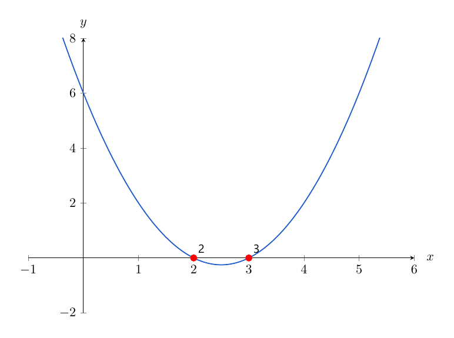
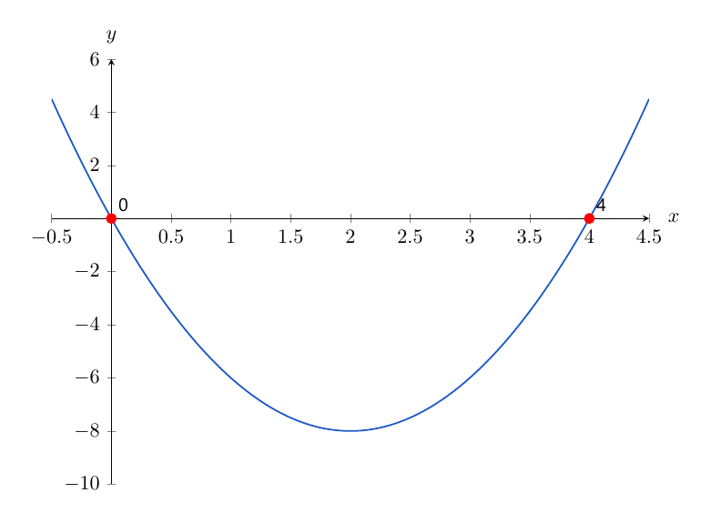
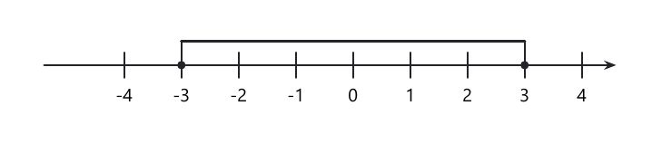
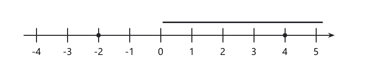
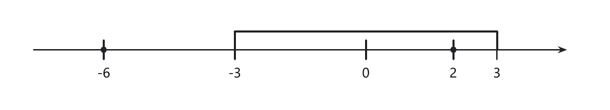
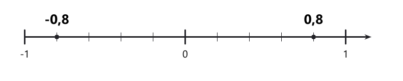

# Занятие 6. Квадратные уравнения и теорема Виета

**Дата:** 09.10.2026 (пт)  
**Длительность:** 45 минут  
**Раздел:** Уравнения  
**Подтемы:** дискриминант и формула корней; неполные квадратные уравнения; теорема Виета и обратная теорема; отбор корней по условию.

## Цели занятия

К концу занятия ученик должен уметь:

- распознавать полное и неполное квадратное уравнение;
- вычислять дискриминант и находить корни квадратного уравнения;
- решать неполные квадратные уравнения разложением на множители или извлечением корня;
- применять теорему Виета и обратную теорему Виета;
- отбирать корни по дополнительному условию;
- не терять корень $x=0$ и проверять ответ подстановкой.

Ученик выбирает **только свой блок**: 1–2, 3–4, 5–6, 7–8 или 9–10 баллов.

## Тайминг

| Этап | Время | Что делаем |
|---|---:|---|
| Теория | 12 мин | Повторяем четыре мини-темы и алгоритмы |
| Разбор ключевых заданий | 14 мин | Разбираем типовые задания сборника |
| Самостоятельная работа | 15 мин | Ученик решает только свой уровень |
| Итог | 4 мин | Проверка чек-листа и фиксация ошибок |

На уровнях 1–6 в разборе достаточно примеров Р2 и Р3. Р4 рассчитан на уровни 7–8, Р1 — на уровни 9–10: приём тот же, но запись длиннее. Свой блок задач решай полностью.

## Теория к занятию

### Мини-тема 1. Дискриминант и формула корней

Квадратное уравнение обязательно содержит $x^2$. Слагаемое с $x$ и свободный член могут присутствовать, а могут быть равны нулю. Сколько у уравнения действительных корней, показывает дискриминант: два различных, один или ни одного.

#### Определение и факт

Квадратным называется уравнение вида

$$
ax^2+bx+c=0,
$$

где $a$, $b$, $c$ — числа, причём $a\ne0$.

Число

$$
D=b^2-4ac
$$

называется дискриминантом квадратного уравнения.

Если $D>0$, уравнение имеет два различных действительных корня:

$$
x_1=\frac{-b+\sqrt D}{2a}; \qquad
x_2=\frac{-b-\sqrt D}{2a}.
$$

Если $D=0$, уравнение имеет один действительный корень:

$$
x=-\frac{b}{2a}.
$$

Записывать его два раза не нужно.

Если $D<0$, действительных корней нет.

Корни уравнения $ax^2+bx+c=0$ — это абсциссы точек, в которых график функции $y=ax^2+bx+c$ пересекает ось $Ox$. При $D>0$ таких точек две, при $D=0$ парабола касается оси $Ox$ в одной точке, при $D<0$ пересечений нет.

#### Правила

- Сначала приведи уравнение к виду $ax^2+bx+c=0$.
- Коэффициент $a$ не должен быть равен нулю.
- В дискриминанте внимательно учитывай знаки $b$ и $c$.
- Если $b$ отрицательно, то $b^2$ всё равно положительно.
- После нахождения корней полезно выполнить подстановку.

#### Алгоритм

1. Перенести все слагаемые в левую часть.
2. Привести подобные слагаемые.
3. Определить $a$, $b$, $c$.
4. Вычислить $D=b^2-4ac$.
5. Определить количество корней по знаку $D$.
6. Найти корни по формуле.
7. Проверить корни подстановкой.

#### Мини-пример

Решите уравнение $x^2-5x+6=0$.

Корни — это точки, где парабола $y=x^2-5x+6$ пересекает ось $Ox$. На рисунке видны оба пересечения. Ниже те же числа получены по формуле.

<!--geo-figure-spec
{
  "needed": true,
  "kind": "graph",
  "template": "function",
  "caption": "Корни уравнения x^2-5x+6=0",
  "x_range": [
    -1,
    6
  ],
  "y_range": [
    -2,
    8
  ],
  "curves": [
    {
      "expr": "x**2-5*x+6"
    }
  ],
  "marks": [
    {
      "xy": [
        2,
        0
      ],
      "label": "2"
    },
    {
      "xy": [
        3,
        0
      ],
      "label": "3"
    }
  ]
}
-->

*Корни уравнения x²-5x+6=0*

*Решение:*

Дано:

$$
x^2-5x+6=0.
$$

Найти: корни уравнения.

Коэффициенты:

$$
a=1; \qquad b=-5; \qquad c=6.
$$

Вычислим дискриминант:

$$
D=(-5)^2-4\cdot1\cdot6.
$$

$$
D=25-24=1.
$$

Так как $D>0$, уравнение имеет два корня.

$$
x_1=\frac{-(-5)+\sqrt1}{2\cdot1}.
$$

$$
x_1=\frac{5+1}{2}=3.
$$

$$
x_2=\frac{-(-5)-\sqrt1}{2\cdot1}.
$$

$$
x_2=\frac{5-1}{2}=2.
$$

Проверка:

$$
3^2-5\cdot3+6=9-15+6=0.
$$

$$
2^2-5\cdot2+6=4-10+6=0.
$$

**Ответ:** $2;3$.

Среднее арифметическое корней равно половине их суммы. Здесь

$$
\frac{2+3}{2}=2{,}5.
$$

Для уравнения $ax^2+bx+c=0$ с двумя корнями это же число равно $-\dfrac{b}{2a}$. В примере $-\dfrac{-5}{2}=2{,}5$: вершина параболы на рисунке выше лежит ровно посередине между точками $2$ и $3$.

Ловушка простая: минус перед $5$ не исчезает сам, но при вычислении $-b$ превращается в плюс.

#### Типичные ошибки

- записать $D=b^2+4ac$ вместо $D=b^2-4ac$;
- потерять минус в выражении $-b$;
- применить формулу корней, не приведя уравнение к нулю;
- при $D=0$ записывать два корня: корень один.

---

### Мини-тема 2. Неполные квадратные уравнения

Неполное квадратное уравнение — это квадратное уравнение, в котором отсутствует член с $x$ или свободный член. Такие уравнения часто решаются быстрее, чем полные: дискриминант иногда вообще не нужен. Но корень $x=0$ забывать нельзя — он не виноват, что свободный член исчез.

#### Определение

Неполные квадратные уравнения имеют один из видов:

$$
ax^2=0,
$$

$$
ax^2+c=0, \qquad c\ne0,
$$

$$
ax^2+bx=0, \qquad b\ne0,
$$

где $a\ne0$. Уравнение $ax^2=0$ не смешивай с двумя другими: в нём нет ни члена с $x$, ни свободного члена.

#### Формулы и способы

Если

$$
ax^2=0,
$$

то

$$
x=0.
$$

Если

$$
ax^2+c=0,
$$

то

$$
x^2=-\frac ca.
$$

Если правая часть неотрицательна, то

$$
x=\pm\sqrt{-\frac ca}.
$$

Если $-\dfrac{c}{a}<0$, действительных корней нет. Случай $-\dfrac{c}{a}=0$ означает $c=0$, то есть уравнение уже имеет вид $ax^2=0$.

Если

$$
ax^2+bx=0,
$$

то выносим $x$ за скобки:

$$
x(ax+b)=0.
$$

Произведение равно нулю, если хотя бы один множитель равен нулю:

$$
x=0
$$

или

$$
ax+b=0.
$$

#### Алгоритм

1. Определить вид неполного уравнения.
2. Если есть общий множитель $x$, вынести его за скобки.
3. Применить правило произведения, равного нулю.
4. Если осталось $x^2=k$, проверить знак $k$.
5. Записать все корни.

#### Мини-пример

Решите уравнение $2x^2-8x=0$.

Парабола $y=2x^2-8x$ пересекает ось $Ox$ в двух точках. Одна из них — начало координат: корень $0$ здесь есть, его нельзя отбрасывать.

<!--geo-figure-spec
{
  "needed": true,
  "kind": "graph",
  "template": "function",
  "caption": "Корни уравнения 2x^2-8x=0, включая 0",
  "x_range": [
    -0.5,
    4.5
  ],
  "y_range": [
    -10,
    6
  ],
  "curves": [
    {
      "expr": "2*x**2-8*x"
    }
  ],
  "marks": [
    {
      "xy": [
        0,
        0
      ],
      "label": "0"
    },
    {
      "xy": [
        4,
        0
      ],
      "label": "4"
    }
  ]
}
-->

*Корни уравнения 2x²-8x=0, включая 0*

*Решение:*

Дано:

$$
2x^2-8x=0.
$$

Вынесем общий множитель $2x$:

$$
2x(x-4)=0.
$$

Произведение равно нулю, поэтому:

$$
2x=0
$$

или

$$
x-4=0.
$$

Из первого уравнения:

$$
x=0.
$$

Из второго уравнения:

$$
x=4.
$$

Проверка:

$$
2\cdot0^2-8\cdot0=0.
$$

$$
2\cdot4^2-8\cdot4=32-32=0.
$$

**Ответ:** $0;4$.

#### Типичные ошибки

- потерять корень $x=0$;
- забыть знак $\pm$ при извлечении квадратного корня;
- делить на $x$, когда $x$ может быть равен нулю;
- неверно вынести общий множитель.

---

### Мини-тема 3. Теорема Виета и обратная теорема

Иногда корни можно найти без дискриминанта. Для приведённого уравнения достаточно подобрать два числа по их сумме и произведению. Это и есть удобная работа с теоремой Виета.

#### Теорема Виета

Приведённым называют квадратное уравнение, у которого коэффициент при $x^2$ равен $1$. Его записывают так:

$$
x^2+px+q=0.
$$

Если у этого уравнения два корня $x_1$ и $x_2$, то есть $D>0$, то

$$
x_1+x_2=-p,
$$

$$
x_1x_2=q.
$$

Для уравнения

$$
ax^2+bx+c=0
$$

с действительными корнями, то есть при $D>0$, сумма и произведение корней равны:

$$
x_1+x_2=-\frac ba,
$$

$$
x_1x_2=\frac ca.
$$

При $D=0$ корень один, и формулы суммы и произведения двух корней не применяют. При $D<0$ действительных корней нет, поэтому теорема Виета не даёт корней.

#### Обратная теорема Виета

Если два числа имеют сумму $-p$ и произведение $q$, то они являются корнями уравнения

$$
x^2+px+q=0.
$$

Если эти два числа равны, корень один: записывают его один раз.

- Теорему Виета удобно применять, когда корни легко подобрать.
- Сначала смотрим на произведение, затем проверяем сумму.
- Если произведение положительное, корни одного знака. Если отрицательное — разных знаков.
- Для неприведённого уравнения сначала учитываем коэффициент $a$.

#### Алгоритм

1. Привести уравнение к виду $x^2+px+q=0$.
2. Найти числа с произведением $q$.
3. Проверить, равна ли их сумма $-p$.
4. Подставить найденные числа в уравнение.
5. Если такая пара не находится, вычислить дискриминант: при $D<0$ действительных корней нет, при $D=0$ корень один.

#### Мини-пример

Найдите корни уравнения $x^2-7x+12=0$ по теореме Виета.

*Решение:*

Дано:

$$
x^2-7x+12=0.
$$

Здесь:

$$
p=-7; \qquad q=12.
$$

По теореме Виета:

$$
x_1+x_2=7,
$$

$$
x_1x_2=12.
$$

Подбираем числа $3$ и $4$:

$$
3+4=7,
$$

$$
3\cdot4=12.
$$

Следовательно:

$$
x_1=3; \qquad x_2=4.
$$

Проверка:

$$
3^2-7\cdot3+12=9-21+12=0.
$$

$$
4^2-7\cdot4+12=16-28+12=0.
$$

**Ответ:** $3;4$.

Отсюда же видно, как разложить трёхчлен. Если $x_1$ и $x_2$ — корни приведённого уравнения, то

$$
x^2+px+q=(x-x_1)(x-x_2).
$$

Проверка на этом примере:

$$
(x-3)(x-4)=x^2-7x+12.
$$

Сумму и произведение можно использовать, не выписывая сами корни. Сначала убедись, что $D>0$. Сумма квадратов корней равна

$$
x_1^2+x_2^2=(x_1+x_2)^2-2x_1x_2,
$$

потому что $(x_1+x_2)^2=x_1^2+2x_1x_2+x_2^2$. Здесь сумма равна $7$, произведение равно $12$, значит

$$
x_1^2+x_2^2=7^2-2\cdot12=49-24=25.
$$

Проверка уже найденными корнями: $3^2+4^2=9+16=25$.

#### Типичные ошибки

- перепутать $p$ и $-p$;
- использовать сумму корней $p$, а не $-p$;
- проверить только сумму и забыть произведение;
- применить формулу для приведённого уравнения к неприведённому без деления на $a$.

---

### Мини-тема 4. Отбор корней по условию

Решить уравнение — значит найти все его корни. Но в задаче могут попросить только целые корни, положительные корни или корни, удовлетворяющие неравенству. Поэтому после решения появляется второй этап — отбор.

#### Факт

Сначала находят все корни исходного уравнения, а затем проверяют каждый корень по дополнительному условию.

Например, если требуется $x\le3$, подходят только корни, не превосходящие $3$.

Если требуется $|x|\le3$, это равносильно двойному неравенству:

$$
-3\le x\le3.
$$

На числовой прямой этому условию соответствует отрезок от $-3$ до $3$, включая концы. Точки $-3$ и $3$ закрашены: они подходят.

<!--geo-figure-spec
{
  "needed": true,
  "kind": "plane",
  "template": "plane_custom",
  "caption": "Числа, у которых модуль не больше 3",
  "show_labels": false,
  "vertices": {
    "L": [
      -5.4,
      0
    ],
    "R": [
      4.6,
      0
    ],
    "A": [
      -3,
      0
    ],
    "B": [
      3,
      0
    ],
    "S": [
      -3,
      0.42
    ],
    "T": [
      3,
      0.42
    ]
  },
  "edges": [
    [
      "L",
      "R"
    ],
    [
      "S",
      "T"
    ],
    [
      "S",
      "A"
    ],
    [
      "T",
      "B"
    ]
  ],
  "highlight_edges": [
    [
      "S",
      "T"
    ]
  ],
  "dots": [
    "A",
    "B"
  ],
  "axis_arrows": true,
  "ticks": [
    {
      "x": -4,
      "label": "-4"
    },
    {
      "x": -3,
      "label": "-3"
    },
    {
      "x": -2,
      "label": "-2"
    },
    {
      "x": -1,
      "label": "-1"
    },
    {
      "x": 0,
      "label": "0"
    },
    {
      "x": 1,
      "label": "1"
    },
    {
      "x": 2,
      "label": "2"
    },
    {
      "x": 3,
      "label": "3"
    },
    {
      "x": 4,
      "label": "4"
    }
  ]
}
-->

*Числа, у которых модуль не больше 3*

#### Алгоритм

1. Найти все корни уравнения.
2. Выписать дополнительное условие.
3. Проверить каждый найденный корень.
4. Исключить неподходящие значения.
5. Записать только отобранные корни.

#### Мини-пример

Решите уравнение $x^2-2x-8=0$ и выберите корни, удовлетворяющие условию $x>0$.

*Решение:*

Дано:

$$
x^2-2x-8=0.
$$

Разложим левую часть на множители. Произведение корней равно $-8$, сумма равна $2$. Подходят числа $4$ и $-2$:

$$
4+(-2)=2, \qquad 4\cdot(-2)=-8.
$$

Значит,

$$
x^2-2x-8=(x-4)(x+2).
$$

Получаем:

$$
(x-4)(x+2)=0.
$$

По правилу произведения:

$$
x-4=0
$$

или

$$
x+2=0.
$$

Отсюда:

$$
x=4
$$

или

$$
x=-2.
$$

Проверяем условие $x>0$. На прямой корень $4$ лежит правее нуля, корень $-2$ — левее. Луч на рисунке начинается правее нуля: само число $0$ в условие $x>0$ не входит.

<!--geo-figure-spec
{
  "needed": true,
  "kind": "plane",
  "template": "plane_custom",
  "caption": "Условию x > 0 подходит только корень 4",
  "show_labels": false,
  "vertices": {
    "L": [
      -4.4,
      0
    ],
    "R": [
      5.6,
      0
    ],
    "H": [
      0.08,
      0.42
    ],
    "T": [
      5.2,
      0.42
    ],
    "N": [
      -2,
      0
    ],
    "P": [
      4,
      0
    ]
  },
  "edges": [
    [
      "L",
      "R"
    ],
    [
      "H",
      "T"
    ]
  ],
  "highlight_edges": [
    [
      "H",
      "T"
    ]
  ],
  "dots": [
    "N",
    "P"
  ],
  "axis_arrows": true,
  "ticks": [
    {
      "x": -4,
      "label": "-4"
    },
    {
      "x": -3,
      "label": "-3"
    },
    {
      "x": -2,
      "label": "-2"
    },
    {
      "x": -1,
      "label": "-1"
    },
    {
      "x": 0,
      "label": "0"
    },
    {
      "x": 1,
      "label": "1"
    },
    {
      "x": 2,
      "label": "2"
    },
    {
      "x": 3,
      "label": "3"
    },
    {
      "x": 4,
      "label": "4"
    },
    {
      "x": 5,
      "label": "5"
    }
  ]
}
-->

*Условию x > 0 подходит только корень 4*

$$
4>0,
$$

поэтому $4$ подходит.

$$
-2>0
$$

— неверно, поэтому $-2$ не подходит.

**Ответ:** $4$.

#### Типичные ошибки

- записать все корни, не выполнив отбор;
- записать в ответ числа, хотя после отбора не осталось ни одного корня;
- перепутать $x>0$ и $x\ge0$;
- забыть, что условие $|x|\le a$ означает $-a\le x\le a$;
- отбирать корни до решения уравнения.

## Сводка формул «выучить наизусть»

Для уравнения

$$
ax^2+bx+c=0; \qquad a\ne0,
$$

дискриминант:

$$
D=b^2-4ac.
$$

При $D>0$:

$$
x_{1;2}=\frac{-b\pm\sqrt D}{2a}.
$$

При $D=0$ корень один:

$$
x=-\frac b{2a}.
$$

Для приведённого уравнения при $D>0$

$$
x^2+px+q=0:
$$

$$
x_1+x_2=-p, \qquad x_1x_2=q.
$$

Среднее арифметическое двух корней уравнения $ax^2+bx+c=0$ равно $-\dfrac{b}{2a}$.

Разложение и сумма квадратов:

$$
x^2+px+q=(x-x_1)(x-x_2),
$$

$$
x_1^2+x_2^2=(x_1+x_2)^2-2x_1x_2.
$$

Для неполного уравнения:

$$
ax^2+bx=x(ax+b).
$$

Для отбора по модулю:

$$
|x|\le a\Longleftrightarrow -a\le x\le a.
$$

## Правила, которые нельзя путать

- $D=b^2-4ac$, а не $b^2+4ac$.
- В формуле корней стоит $-b$, а не $b$.
- При $D=0$ корень один: $x=-\dfrac{b}{2a}$.
- При $x^2=k$ и $k>0$ пишем $x=\pm\sqrt k$. При $k<0$ действительных корней нет, при $k=0$ корень один: $x=0$.
- В уравнении $x(ax+b)=0$ корень $x=0$ сохраняется.
- В теореме Виета сумма корней приведённого уравнения равна $-p$.
- Сначала решаем уравнение, затем отбираем корни.
- Ответ проверяем подстановкой.

## Разрешённый набор для практики

Мини-темы занятия:

- дискриминант и формула корней;
- неполные квадратные уравнения;
- теорема Виета и обратная теорема;
- отбор корней по условию.

Повтор:

- линейные неравенства и их системы — занятие 5;
- степени с натуральным и целым показателем, свойства степеней — занятие 2;
- арифметический квадратный корень и равенство $\sqrt{a^2}=|a|$ — занятие 3;
- многочлены и приведение подобных, разложение на множители, формулы сокращённого умножения, тождественные преобразования — занятие 4.

## Разбор ключевых заданий

### Р1. Уровень 9–10
Решите уравнение

$$
(x^2+4x+5)^2-16(x^2+4x+5)=17.
$$

В ответ запишите целые корни уравнения, удовлетворяющие неравенству $|x|\le3$.

*Решение:*

Введём замену:

$$
t=x^2+4x+5.
$$

Тогда уравнение принимает вид:

$$
t^2-16t=17.
$$

Перенесём $17$ в левую часть:

$$
t^2-16t-17=0.
$$

Вычислим дискриминант:

$$
D=(-16)^2-4\cdot1\cdot(-17).
$$

$$
D=256+68=324.
$$

$$
\sqrt D=18.
$$

Находим значения $t$:

$$
t_1=\frac{16+18}{2}=17.
$$

$$
t_2=\frac{16-18}{2}=-1.
$$

Возвращаемся к $x$.

Первый случай:

$$
x^2+4x+5=17.
$$

$$
x^2+4x-12=0.
$$

$$
D=4^2-4\cdot1\cdot(-12)=16+48=64.
$$

$$
x=\frac{-4\pm8}{2}.
$$

$$
x_1=2; \qquad x_2=-6.
$$

Второй случай:

$$
x^2+4x+5=-1.
$$

$$
x^2+4x+6=0.
$$

$$
D=4^2-4\cdot1\cdot6=16-24=-8.
$$

Действительных корней нет.

Корни исходного уравнения — $2$ и $-6$. На прямой корень $-6$ лежит левее отрезка $[-3;3]$, корень $2$ — внутри него.

<!--geo-figure-spec
{
  "needed": true,
  "kind": "plane",
  "template": "plane_custom",
  "caption": "Корень 2 лежит на отрезке от -3 до 3, корень -6 — нет",
  "show_labels": false,
  "vertices": {
    "L": [
      -7.6,
      0
    ],
    "R": [
      4.6,
      0
    ],
    "A": [
      -3,
      0
    ],
    "B": [
      3,
      0
    ],
    "S": [
      -3,
      0.42
    ],
    "T": [
      3,
      0.42
    ],
    "P": [
      -6,
      0
    ],
    "Q": [
      2,
      0
    ]
  },
  "edges": [
    [
      "L",
      "R"
    ],
    [
      "S",
      "T"
    ],
    [
      "S",
      "A"
    ],
    [
      "T",
      "B"
    ]
  ],
  "highlight_edges": [
    [
      "S",
      "T"
    ]
  ],
  "dots": [
    "P",
    "Q"
  ],
  "axis_arrows": true,
  "ticks": [
    {
      "x": -6,
      "label": "-6"
    },
    {
      "x": -3,
      "label": "-3"
    },
    {
      "x": 0,
      "label": "0"
    },
    {
      "x": 2,
      "label": "2"
    },
    {
      "x": 3,
      "label": "3"
    }
  ]
}
-->

*Корень 2 на отрезке от −3 до 3, корень −6 вне его*

Проверяем условие $|x|\le3$:

$$
|2|=2\le3.
$$

$$
|-6|=6>3.
$$

Подходит только $x=2$.

Проверка в исходном уравнении:

$$
2^2+4\cdot2+5=17.
$$

$$
17^2-16\cdot17=289-272=17.
$$

**Ответ:** $2$.

---

### Р2. Уровень 3–4
Решите уравнение

$$
2x^2-0{,}4x=0.
$$

В ответ запишите среднее арифметическое корней уравнения.

*Решение:*

Вынесем общий множитель:

$$
2x^2-0{,}4x=x(2x-0{,}4).
$$

Получаем:

$$
x(2x-0{,}4)=0.
$$

Отсюда:

$$
x=0
$$

или

$$
2x-0{,}4=0.
$$

$$
2x=0{,}4.
$$

$$
x=0{,}2.
$$

Среднее арифметическое корней — половина суммы. Его можно найти и по теореме Виета, не выписывая корни: сумма корней уравнения $2x^2-0{,}4x=0$ равна $\dfrac{0{,}4}{2}=0{,}2$, поэтому среднее равно

$$
\frac{0{,}2}{2}=0{,}1.
$$

Тот же результат по найденным корням:

$$
\frac{0+0{,}2}{2}=0{,}1.
$$

Проверка второго корня:

$$
2\cdot(0{,}2)^2-0{,}4\cdot0{,}2=0{,}08-0{,}08=0.
$$

**Ответ:** $0{,}1$.

---

### Р3. Уровень 1–2
Решите уравнение

$$
0{,}64-x^2=0.
$$

В ответ запишите наименьший корень уравнения.

*Решение:*

Перенесём $x^2$ вправо:

$$
0{,}64=x^2.
$$

Извлекаем квадратный корень. Правая часть положительна, поэтому знаков два:

$$
x=\pm\sqrt{0{,}64}.
$$

Так как

$$
0{,}8^2=0{,}64,
$$

то

$$
x=0{,}8
$$

или

$$
x=-0{,}8.
$$

На прямой меньшее число лежит левее.

<!--geo-figure-spec
{
  "needed": true,
  "kind": "plane",
  "template": "number_line",
  "caption": "Корни -0,8 и 0,8; наименьший — левый",
  "start": -1,
  "end": 1,
  "step": 0.2,
  "major_step": 1,
  "tick_labels": "major",
  "marks": [
    {
      "at": -0.8,
      "name": "-0,8"
    },
    {
      "at": 0.8,
      "name": "0,8"
    }
  ],
  "axis_arrows": true
}
-->

*Корни -0,8 и 0,8; наименьший — левый*

Наименьший корень:

$$
-0{,}8.
$$

**Ответ:** $-0{,}8$.

---

### Р4. Уровень 7–8
Найдите больший корень уравнения

$$
x^4-15x^2-16=0.
$$

*Решение:*

Введём замену:

$$
t=x^2.
$$

Тогда:

$$
t^2-15t-16=0.
$$

Разложим на множители:

$$
t^2-15t-16=(t-16)(t+1).
$$

Получаем:

$$
(t-16)(t+1)=0.
$$

Следовательно:

$$
t=16
$$

или

$$
t=-1.
$$

Так как $t=x^2$, значение $t=-1$ невозможно.

Из уравнения

$$
x^2=16
$$

получаем:

$$
x=4
$$

или

$$
x=-4.
$$

Больший корень равен $4$.

Проверка:

$$
4^4-15\cdot4^2-16=256-240-16=0.
$$

**Ответ:** $4$.

## Самостоятельная работа

Выбери свой уровень и решай только этот блок.  
В каждом блоке есть все мини-темы занятия и повтор ранее изученного материала.

### Уровень 1–2 балла

**С1.** *Сборник, вариант 51, №1.* Сумма корней квадратного уравнения $x^2+6x-11=0$ равна:  
а) $6$; б) $-11$; в) $-6$; г) $11$; д) $4$.

**С2.** *Сборник, вариант 61, №1.* Определите, какое уравнение является приведённым:  
а) $4x^2+x=0$; б) $2-4x-3x^2=0$; в) $x^2-3x+2=0$; г) $3x+2=0$; д) $-x^2-3x+4=0$.

**С3.** *Мини-тема 2, авторское.* Решите уравнение $x^2-25=0$.

**С4.** *Мини-тема 4, авторское.* Решите уравнение $x^2-5x+6=0$ и запишите корни, удовлетворяющие условию $x<3$.

**С5.** *Повтор.* Решите неравенство $3x-7\le5$.

### Уровень 3–4 балла

**С1.** *Сборник, вариант 45, №4.* Решите уравнение $3x^2+x=0$. В ответ запишите среднее арифметическое корней.

**С2.** *Сборник, вариант 47, №4.* При каких значениях $x$ равны значения трёхчленов $5x^2-3x+4$ и $3x+3-4x^2$?

**С3.** *Мини-тема 3, авторское.* Не решая уравнение формулой корней, найдите корни уравнения $x^2-5x-6=0$. В ответ запишите все корни и отдельно положительный корень.

**С4.** *Мини-тема 1, авторское.* Решите уравнение $2x^2-5x-3=0$.

**С5.** *Повтор.* Решите неравенство $5-2x>9$.

### Уровень 5–6 баллов

**С1.** *Мини-тема 1, авторское.* Решите уравнение $3x^2-7x+2=0$.

**С2.** *Мини-тема 2, авторское.* Решите уравнение $4x^2-12x=0$.

**С3.** *Мини-тема 3, авторское.* Не решая уравнение формулой корней, найдите корни уравнения $x^2+9x+20=0$.

**С4.** *Мини-тема 4, авторское.* Решите уравнение $x^2-4x-12=0$ и выберите корни, удовлетворяющие условию $|x|\le4$.

**С5.** *Повтор.* Упростите выражение $2^5\cdot2^{-3}+3^2$.

### Уровень 7–8 баллов

**С1.** *Сборник, вариант 59, №7.* Найдите среднее арифметическое абсцисс точек пересечения графиков функций $y=12-x-2x^2$ и $y=3x^2-5x+3$.

**С2.** *Сборник, вариант 17, №8.* Найдите значение выражения $a+x_0$, где $a$ — положительное число, при котором левая часть уравнения $4x^2-ax+25=0$ является квадратом разности, а $x_0$ — корень уравнения.

**С3.** *Сборник, вариант 69, №7.* Решите уравнение $(x-4)^2-(x+6)^2=30$.

**С4.** *Мини-тема 4, авторское.* Решите уравнение $(x^2-5x)^2-6(x^2-5x)=16$ и выберите целые корни, удовлетворяющие условию $0\le x\le5$. Если таких корней нет, так и запишите.

**С5.** *Повтор, занятие 5.* Решите двойное неравенство $-7<3-2x\le1$.

### Уровень 9–10 баллов

**С1.** *Мини-тема 1, авторское.* Решите уравнение $(x^2+x)^2-8(x^2+x)+12=0$.

**С2.** *Мини-тема 2, авторское.* Решите уравнение $x^2(x+5)-4(x+5)=0$.

**С3.** *Мини-тема 3, авторское.* Известно, что корни уравнения $x^2+px+18=0$ — целые числа, причём один корень на $3$ больше другого. Найдите $p$ и корни уравнения.

**С4.** *Мини-тема 4, авторское.* Решите уравнение $(x^2-2x-3)^2-5(x^2-2x-3)=6$ и запишите корни, удовлетворяющие условию $|x|\le3$.

**С5.** *Повтор.* Упростите выражение $\frac{3^5\cdot3^{-2}}{3}+2^0$.

## Домашнее задание

Ученик выбирает свой уровень.  
В каждом блоке 6 задач: четыре задания по теме занятия и две задачи на повтор.

### Уровень 1–2 балла

**Д1.** *Мини-тема 1, авторское.* Найдите дискриминант уравнения $x^2+4x+1=0$.

**Д2.** *Мини-тема 2, авторское.* Решите уравнение $5x^2=0$.

**Д3.** *Мини-тема 3, авторское.* Найдите сумму корней уравнения $x^2-8x+5=0$.

**Д4.** *Мини-тема 4, авторское.* Из корней уравнения $x^2-x-6=0$ выберите положительный.

**Д5.** *Повтор.* Решите неравенство $2x+1<7$.

**Д6.** *Повтор.* Вычислите $5^2-2^3$.

### Уровень 3–4 балла

**Д1.** *Мини-тема 1, авторское.* Решите уравнение $x^2-9x+20=0$.

**Д2.** *Мини-тема 2, авторское.* Решите уравнение $7x^2-21x=0$.

**Д3.** *Мини-тема 3, авторское.* Найдите корни уравнения $x^2+2x-15=0$ по теореме Виета.

**Д4.** *Мини-тема 4, авторское.* Решите уравнение $x^2-6x+8=0$ и выберите корни, удовлетворяющие условию $x\ge3$.

**Д5.** *Повтор.* Упростите $4x+3-2x+5$.

**Д6.** *Повтор.* Решите неравенство $7-3x\ge1$.

### Уровень 5–6 баллов

**Д1.** *Мини-тема 1, авторское.* Решите уравнение $2x^2+3x-2=0$.

**Д2.** *Мини-тема 2, авторское.* Решите уравнение $6x^2-24=0$.

**Д3.** *Мини-тема 3, авторское.* Разложите квадратный трёхчлен $x^2-11x+30$ на множители.

**Д4.** *Мини-тема 4, авторское.* Решите уравнение $x^2+x-12=0$ и выберите корни, удовлетворяющие условию $-2\le x<4$.

**Д5.** *Повтор.* Упростите выражение $(a+3)^2-a^2$.

**Д6.** *Повтор.* Решите неравенство $4(2x-1)<3x+7$.

### Уровень 7–8 баллов

**Д1.** *Мини-тема 1, авторское.* Решите уравнение $4x^2-4x-15=0$.

**Д2.** *Мини-тема 2, авторское.* Решите уравнение $x^4-13x^2+36=0$.

**Д3.** *Мини-тема 3, авторское.* Корни уравнения $x^2+px-20=0$ отличаются на $9$. Найдите $p$, если больший корень положителен.

**Д4.** *Мини-тема 4, авторское.* Решите уравнение $(x^2-3x)^2-4(x^2-3x)=5$ и выберите корни, удовлетворяющие условию $x>0$.

**Д5.** *Повтор, занятие 5.* Решите систему неравенств $2x-3<5$, $1-x\le4$.

**Д6.** *Повтор.* Упростите выражение $\frac{2^6\cdot2^{-2}}{2^2}$.

### Уровень 9–10 баллов

**Д1.** *Мини-тема 1, авторское.* Решите уравнение $(x^2+2x)^2-3(x^2+2x)-4=0$.

**Д2.** *Мини-тема 2, авторское.* Решите уравнение $(x^2-1)(x+4)-3(x+4)=0$.

**Д3.** *Мини-тема 3, авторское.* Корни уравнения $x^2+px-12=0$ — целые числа, а сумма их квадратов равна $25$. Найдите все такие $p$ и соответствующие корни.

**Д4.** *Мини-тема 4, авторское.* Решите уравнение $(x^2+2x-3)^2-4(x^2+2x-3)=12$ и запишите корни, удовлетворяющие условию $|x|\le4$.

**Д5.** *Повтор.* Решите систему неравенств $-2\le3x+1<10$.

**Д6.** *Повтор.* Упростите выражение $\frac{5^4\cdot5^{-2}}{25}+3^0$.

## Чек-лист «ученик понял тему»

- [ ] Я узнаю квадратное уравнение и определяю коэффициенты $a$, $b$, $c$.
- [ ] При $D=0$ я записываю один корень.
- [ ] Я правильно вычисляю дискриминант.
- [ ] Я знаю, сколько корней бывает при разных знаках дискриминанта.
- [ ] Я решаю неполное уравнение и не теряю корень $x=0$.
- [ ] Я применяю теорему Виета для суммы и произведения корней.
- [ ] Я умею отбирать корни по условию.
- [ ] Я проверяю найденные корни подстановкой.
