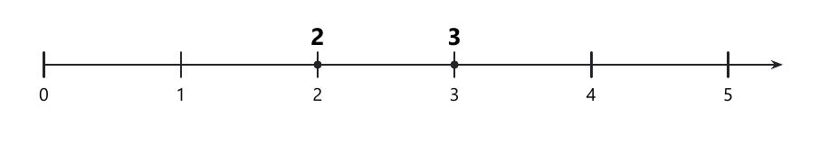
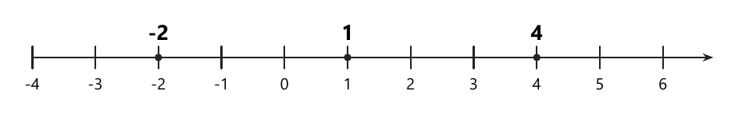
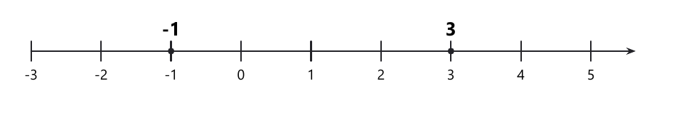
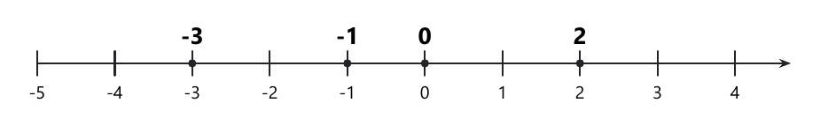
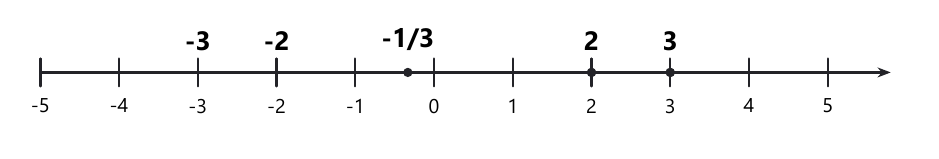

# Занятие 7. Квадратные неравенства и метод интервалов

**Дата:** 16.10.2026 (пт)  
**Длительность:** 45 минут  
**Раздел:** Неравенства  
**Подтемы:** квадратные неравенства; метод интервалов для многочленов; пересечение и объединение промежутков; знак неравенства при делении на отрицательное число.

## Цели занятия

К концу занятия ученик сможет:

- решать квадратные неравенства через корни квадратного трёхчлена;
- применять метод интервалов для произведения множителей;
- находить пересечение и объединение числовых промежутков;
- правильно менять знак неравенства при делении на отрицательное число;
- выбирать задания своего уровня: 1–2, 3–4, 5–6, 7–8 или 9–10 баллов.

## Тайминг

| Этап | Время | Что делаем |
|---|---:|---|
| Теория | 12 мин | Повторяем алгоритмы и типичные ловушки |
| Разбор | 14 мин | Решаем задания сборника |
| Самостоятельная работа | 15 мин | Ученик решает только свой уровень |
| Итог | 4 мин | Проверяем чек-лист и фиксируем ошибки |

---

## Теория к занятию

### Мини-тема 1. Квадратные неравенства

Квадратным неравенством называют неравенство, в котором переменная входит в выражение второй степени.

Главная идея такая: сначала находим нули квадратного трёхчлена, то есть значения переменной, при которых он равен нулю.

Эти значения делят числовую прямую на промежутки.

Затем определяем знак выражения на каждом промежутке.

Если коэффициент при квадрате положительный, выражение имеет знак «плюс» снаружи корней и «минус» между корнями.

Если коэффициент отрицательный, знаки меняются наоборот.

Эти правила относятся к случаю двух различных корней, то есть $D>0$.

Если $D=0$, трёхчлен равен нулю только в одной точке, а во всех остальных точках сохраняет знак коэффициента $a$.

Если $D<0$, корней нет. При $a>0$ трёхчлен положителен при всех $x$, при $a<0$ — отрицателен при всех $x$.

Знак минус перед квадратом — не украшение, а главный переключатель знаков.

**Определение.**

Квадратным неравенством называют неравенство вида

$$
ax^2+bx+c>0,
$$

$$
ax^2+bx+c<0,
$$

$$
ax^2+bx+c\geq 0,
$$

$$
ax^2+bx+c\leq 0,
$$

где $a\neq 0$.

**Формулы.**

Для квадратного уравнения

$$
ax^2+bx+c=0
$$

дискриминант вычисляют по формуле

$$
D=b^2-4ac.
$$

Если $D>0$, уравнение имеет два корня:

$$
x_1=\frac{-b-\sqrt D}{2a}; \qquad
x_2=\frac{-b+\sqrt D}{2a}.
$$

При $a>0$ получается $x_1<x_2$. При $a<0$ эти формулы дают корни в обратном порядке, поэтому на прямой их расставляют по возрастанию, а не по номерам $x_1$ и $x_2$.

Если $D=0$, имеется один корень:

$$
x_0=\frac{-b}{2a}.
$$

**Правила.**

- Сначала перенеси всё в одну часть неравенства.
- Приведи подобные слагаемые.
- Найди корни соответствующего квадратного уравнения.
- Отметь корни на числовой прямой.
- Учитывай знак коэффициента $a$.
- При знаках $\geq$ и $\leq$ корни включаются.
- При знаках $>$ и $<$ корни не включаются.

**Алгоритм решения квадратного неравенства.**

1. Записать квадратный трёхчлен в одной части.
2. Решить уравнение $ax^2+bx+c=0$.
3. Отметить корни на числовой прямой.
4. Определить знаки на промежутках.
5. Выбрать промежутки с нужным знаком.
6. Включить или не включить корни по знаку неравенства.

**Мини-пример.**

Решите неравенство

$$
x^2-5x+6\leq 0.
$$

*Решение:*

Дано:

$$
x^2-5x+6\leq 0.
$$

Найти множество решений.

Решаем соответствующее уравнение:

$$
x^2-5x+6=0.
$$

Разложим левую часть на множители:

$$
x^2-5x+6=(x-2)(x-3).
$$

Корни:

$$
x_1=2; \qquad
x_2=3.
$$

<!--geo-figure-spec
{
  "needed": true,
  "kind": "plane",
  "template": "number_line",
  "caption": "Корни 2 и 3 квадратного трёхчлена",
  "start": 0,
  "end": 5,
  "step": 1,
  "major_step": 1,
  "tick_labels": "major",
  "marks": [
    {
      "at": 2,
      "name": "2"
    },
    {
      "at": 3,
      "name": "3"
    }
  ],
  "axis_arrows": true
}
-->

*Корни 2 и 3 квадратного трёхчлена*

Коэффициент при $x^2$ положительный.

Значит, выражение отрицательно между корнями и положительно вне корней.

Так как требуется знак «меньше или равно», корни включаем.

Получаем:

$$
x\in[2;3].
$$

Проверка:

$$
x=2:\quad 2^2-5\cdot2+6=4-10+6=0;
$$

$$
x=3:\quad 3^2-5\cdot3+6=9-15+6=0.
$$

Оба конца промежутка подходят.

**Ответ:** $[2;3]$.

**Ловушки экзамена.**

- При $a<0$ знак между корнями положительный, а не отрицательный.
- При строгом неравенстве корни не включаются.
- Нельзя потерять корень при разложении на множители.
- Нельзя решать квадратное неравенство только по одному найденному корню.
- Если $D<0$, корней на прямой нет: знак трёхчлена при всех $x$ совпадает со знаком $a$.

---

### Мини-тема 2. Метод интервалов для многочленов

Метод интервалов применяют, когда выражение разложено на множители.

Например,

$$
(x-2)(x+3)(x-5).
$$

Каждый множитель обращается в ноль в своей точке.

Эти точки делят числовую прямую на промежутки.

На каждом промежутке знак произведения постоянен.

Достаточно взять по одному числу из каждого промежутка и определить знак.

**Определение.**

Метод интервалов — это способ решения неравенств, при котором числовую прямую разбивают нулями множителей и определяют знак выражения на каждом промежутке.

**Формулы.**

Если

$$
(x-a)(x-b)=0,
$$

то нули выражения:

$$
x=a; \qquad x=b.
$$

Если корень имеет чётную степень, знак при переходе через него не меняется.

Если корень имеет нечётную степень, знак меняется.

**Правила.**

- Нули числителя отмечаются на прямой.
- Нули знаменателя, если он есть, в решение не входят.
- При переходе через множитель первой степени знак меняется.
- При переходе через квадратный множитель знак сохраняется.
- Для произведения удобно начать с правого промежутка.
- Если старший коэффициент многочлена положителен, справа знак «плюс».
- У дроби знак справа проверяют подстановкой: он зависит и от числителя, и от знаменателя.
- Если множитель первой степени стоит и в числителе, и в знаменателе, при переходе через его нуль знак не меняется, а сама точка в решение не входит.

**Алгоритм.**

1. Разложить выражение на множители.
2. Найти нули всех множителей.
3. Расставить точки в порядке возрастания.
4. Определить знак на одном промежутке.
5. Чередовать знаки с учётом кратности корней.
6. Выбрать нужные промежутки.
7. Проверить включение граничных точек.

**Мини-пример.**

Решите неравенство

$$
(x-1)(x+2)(x-4)>0.
$$

*Решение:*

Найдём нули множителей:

$$
x-1=0; \qquad x=1;
$$

$$
x+2=0; \qquad x=-2;
$$

$$
x-4=0; \qquad x=4.
$$

Располагаем точки в порядке возрастания:

$$
-2<1<4.
$$

<!--geo-figure-spec
{
  "needed": true,
  "kind": "plane",
  "template": "number_line",
  "caption": "Нули множителей: -2, 1 и 4",
  "start": -4,
  "end": 6,
  "step": 1,
  "major_step": 1,
  "tick_labels": "major",
  "marks": [
    {
      "at": -2,
      "name": "-2"
    },
    {
      "at": 1,
      "name": "1"
    },
    {
      "at": 4,
      "name": "4"
    }
  ],
  "axis_arrows": true
}
-->

*Нули множителей: -2, 1 и 4*

На промежутке $(4;+\infty)$ все множители положительны.

Значит, произведение положительно.

При переходе через каждую точку знак меняется:

$$
(-\infty;-2):-
$$

$$
(-2;1):+
$$

$$
(1;4):-
$$

$$
(4;+\infty):+
$$

Требуется знак «больше нуля».

Корни при строгом неравенстве не включаем.

Получаем:

$$
x\in(-2;1)\cup(4;+\infty).
$$

**Ответ:** $(-2;1)\cup(4;+\infty)$.

**Ловушки экзамена.**

- Не путай нули числителя и запрещённые значения знаменателя.
- Общий множитель числителя и знаменателя не меняет знак; сама точка остаётся запрещённой.
- Знак дроби на правом промежутке проверяют подстановкой.
- При квадратном множителе знак не меняется.
- При строгом неравенстве точки не включаются.
- В произведении важно учитывать знак каждого множителя.

---

### Мини-тема 3. Пересечение и объединение промежутков

Система неравенств означает, что должны выполняться оба условия одновременно.

Поэтому для системы используем пересечение промежутков.

Совокупность означает, что достаточно выполнения хотя бы одного условия.

Поэтому для совокупности используем объединение промежутков.

Система — это «и», совокупность — это «или».

**Определение.**

Пересечение числовых множеств состоит из чисел, принадлежащих каждому из множеств.

Объединение состоит из чисел, принадлежащих хотя бы одному из множеств.

**Формулы.**

Для системы

$$
\begin{cases}
x\in A,\\
x\in B
\end{cases}
$$

решение записывают как

$$
x\in A\cap B.
$$

Для совокупности

$$
x\in A
\quad\text{или}\quad
x\in B
$$

решение записывают как

$$
x\in A\cup B.
$$

**Правила.**

- В системе ищи общую часть промежутков.
- В совокупности соединяй все подходящие части.
- Круглая скобка означает, что точка не входит.
- Квадратная скобка означает, что точка входит.
- При бесконечности всегда ставят круглую скобку.

**Алгоритм.**

1. Решить каждое неравенство отдельно.
2. Записать полученные промежутки.
3. Для системы найти общую часть.
4. Для совокупности объединить промежутки.
5. Проверить граничные точки.

**Мини-пример.**

Решите систему

$$
\begin{cases}
x\geq -1,\\
x<3.
\end{cases}
$$

*Решение:*

Первое неравенство даёт:

$$
x\in[-1;+\infty).
$$

Второе неравенство даёт:

$$
x\in(-\infty;3).
$$

<!--geo-figure-spec
{
  "needed": true,
  "kind": "plane",
  "template": "number_line",
  "caption": "Границы промежутков системы: -1 и 3",
  "start": -3,
  "end": 5,
  "step": 1,
  "major_step": 1,
  "tick_labels": "major",
  "marks": [
    {
      "at": -1,
      "name": "-1"
    },
    {
      "at": 3,
      "name": "3"
    }
  ],
  "axis_arrows": true
}
-->

*Границы промежутков системы: -1 и 3*

Это система, поэтому находим пересечение:

$$
[-1;+\infty)\cap(-\infty;3)=[-1;3).
$$

Число $-1$ включается.

Число $3$ не включается.

**Ответ:** $[-1;3)$.

**Ловушки экзамена.**

- Система — это пересечение, а не объединение.
- Совокупность — это объединение.
- Не включай точку при строгом знаке.
- Бесконечность не является числом и квадратной скобки около неё быть не может.

---

### Мини-тема 4. Знак неравенства при делении на отрицательное число

При делении или умножении обеих частей неравенства на положительное число знак сохраняется.

При делении или умножении на отрицательное число знак меняется на противоположный.

Это связано с расположением чисел на координатной прямой: умножение на отрицательное число меняет направление.

**Факт.**

Если $a<b$ и $c<0$, то

$$
ac>bc.
$$

При делении на отрицательное число знак также меняется:

$$
\frac{a}{c}>\frac{b}{c}.
$$

**Формулы.**

$$
a<b; \quad c>0
\quad\Longrightarrow\quad
\frac ac<\frac bc.
$$

$$
a<b; \quad c<0
\quad\Longrightarrow\quad
\frac ac>\frac bc.
$$

**Правила.**

- При переносе слагаемого знак неравенства не меняется.
- При делении на положительное число знак не меняется.
- При делении на отрицательное число знак меняется.
- Если делишь на выражение с переменной, сначала нужно знать его знак.
- Нельзя делить на выражение, которое может быть равно нулю, без отдельного анализа.

**Алгоритм.**

1. Определи число, на которое делишь.
2. Установи его знак.
3. Если число отрицательное, поменяй знак неравенства.
4. Выполни деление.
5. Проверь результат подстановкой.

**Мини-пример.**

Решите неравенство

$$
-3x+6\geq 0.
$$

*Решение:*

Перенесём число $6$ вправо:

$$
-3x\geq -6.
$$

Делим обе части на $-3$.

Так как делим на отрицательное число, знак меняется:

$$
x\leq 2.
$$

Проверим число $2$:

$$
-3\cdot2+6=-6+6=0.
$$

Равенство допускается.

**Ответ:** $(-\infty;2]$.

**Ловушки экзамена.**

- При делении на $-3$ нельзя оставить знак $\geq$.
- При переносе слагаемого знак самого слагаемого меняется, но знак неравенства — нет.
- Ноль не является ни положительным, ни отрицательным числом.
- Деление на переменное выражение требует анализа его знака.

---

## Сводка формул «выучить наизусть»

Квадратное уравнение:

$$
ax^2+bx+c=0.
$$

Дискриминант:

$$
D=b^2-4ac.
$$

Корни при $D>0$:

$$
x_{1;2}=\frac{-b\pm\sqrt D}{2a}.
$$

Система:

$$
A\cap B.
$$

Совокупность:

$$
A\cup B.
$$

При делении на отрицательное число знак меняется:

$$
a<b; \quad c<0
\quad\Longrightarrow\quad
\frac ac>\frac bc.
$$

---

## Правила, которые нельзя путать

- $>$ и $<$ — корни не включаются.
- $\geq$ и $\leq$ — корни включаются.
- Система — пересечение.
- Совокупность — объединение.
- При делении на отрицательное число знак меняется.
- Нули знаменателя исключаются.
- При чётной кратности корня знак не меняется.
- При нечётной кратности корня знак меняется.

## Разрешённый набор для практики

Мини-темы занятия:

- квадратные неравенства;
- метод интервалов для многочленов;
- пересечение и объединение промежутков;
- знак неравенства при делении на отрицательное число.

Повтор:

- линейные неравенства;
- степени с натуральным показателем;
- степени с целым показателем;
- многочлены и приведение подобных;
- разложение на множители;
- формулы сокращённого умножения;
- тождественные преобразования;
- преобразование выражений со степенями.

---

## Разбор ключевых заданий

### Р1.
Найдите наибольшее целое решение неравенства

$$
\frac{(x-9)^2}{x^2+x-12}\leq 0.
$$

*Решение:*

Дано:

$$
\frac{(x-9)^2}{x^2+x-12}\leq 0.
$$

Найти наибольшее целое решение.

Сначала найдём область допустимых значений:

$$
x^2+x-12\neq0.
$$

Разложим знаменатель:

$$
x^2+x-12=(x+4)(x-3).
$$

Получаем ограничения:

$$
x\neq -4; \qquad x\neq3.
$$

Числитель равен нулю при

$$
(x-9)^2=0,
$$

$$
x=9.
$$

Точка $x=9$ может войти в решение, так как знаменатель при $x=9$ не равен нулю.

Критические точки:

$$
-4; \quad3; \quad9.
$$

На промежутке $(9;+\infty)$ числитель положителен, знаменатель положителен.

Знак дроби положительный.

При переходе через точку $9$ знак не меняется, так как корень числителя имеет чётную кратность.

На промежутке $(3;9)$ дробь положительна.

При переходе через точку $3$ знак меняется: множитель $x-3$ входит в знаменатель в первой степени. Точка $3$ в решение не входит.

На промежутке $(-4;3)$ знаменатель отрицателен, а числитель положителен.

Дробь отрицательна.

При переходе через точку $-4$ знак снова меняется. Точка $-4$ запрещена.

На промежутке $(-\infty;-4)$ дробь положительна.

При знаке $\leq0$ берём отрицательный промежуток и ноль числителя:

$$
x\in(-4;3)\cup\{9\}.
$$

Целые решения из промежутка $(-4;3)$:

$$
-3; -2; -1; 0; 1; 2.
$$

Также подходит число $9$.

Наибольшее целое решение:

$$
9.
$$

Проверка:

$$
\frac{(9-9)^2}{9^2+9-12}
=
\frac{0}{78}
=
0.
$$

Условие выполнено.

**Ответ:** $9$.

---

### Р2.
Определите количество целых решений неравенства

$$
\frac{(-x^2-x+6)x^2}{x^2-x-2}\geq0.
$$

*Решение:*

Разложим числитель:

$$
-x^2-x+6=-(x^2+x-6).
$$

$$
x^2+x-6=(x+3)(x-2).
$$

Следовательно,

$$
-x^2-x+6=-(x+3)(x-2).
$$

Разложим знаменатель:

$$
x^2-x-2=(x-2)(x+1).
$$

Область допустимых значений:

$$
x\neq2; \qquad x\neq-1.
$$

Получаем:

$$
\frac{-(x+3)(x-2)x^2}{(x-2)(x+1)}\geq0.
$$

При $x\neq2$ множитель $x-2$ в числителе и знаменателе сокращается, но точка $2$ остаётся запрещённой.

Для определения знаков используем критические точки:

$$
-3; \quad -1; \quad 0; \quad2.
$$

<!--geo-figure-spec
{
  "needed": true,
  "kind": "plane",
  "template": "number_line",
  "caption": "Критические точки неравенства Р2: -3, -1, 0 и 2",
  "start": -5,
  "end": 4,
  "step": 1,
  "major_step": 1,
  "tick_labels": "major",
  "marks": [
    {
      "at": -3,
      "name": "-3"
    },
    {
      "at": -1,
      "name": "-1"
    },
    {
      "at": 0,
      "name": "0"
    },
    {
      "at": 2,
      "name": "2"
    }
  ],
  "axis_arrows": true
}
-->

*Критические точки неравенства Р2: -3, -1, 0 и 2*

Точка $x=0$ — нуль чётной кратности: при переходе через неё знак не меняется, а само значение $0$ подходит под знак $\geq$.

Множитель $x-2$ входит и в числитель, и в знаменатель в первой степени. При $x\neq2$ эти множители сокращаются и дают $1$, поэтому при переходе через $2$ знак не меняется. Сама точка $2$ запрещена.

Проверим знак справа, в точке $x=3$:

$$
\frac{(-9-3+6)\cdot9}{9-3-2}=\frac{-54}{4}<0.
$$

На $(2;+\infty)$ дробь отрицательна. Знак при переходе через $2$ не меняется, значит на $(0;2)$ дробь тоже отрицательна.

При переходе через $0$ знак не меняется, поэтому на $(-1;0)$ дробь отрицательна.

Точка $-1$ запрещена. Множитель $x+1$ стоит только в знаменателе и имеет первую степень, поэтому при переходе через $-1$ знак меняется: на $(-3;-1)$ дробь положительна.

При переходе через $-3$ знак меняется: на $(-\infty;-3)$ дробь отрицательна.

Нули числителя в области допустимых значений — это $x=-3$ и $x=0$. Оба дают нуль дроби и входят в решение. Точка $x=2$ в решение не входит.

С учётом знака $\geq0$ получаем:

$$
x\in[-3;-1)\cup\{0\}.
$$

Целые решения:

$$
-3; \quad -2; \quad 0.
$$

Их три.

Проверка при $x=-2$:

$$
\frac{(-4-(-2)+6)\cdot4}{4-(-2)-2}=\frac{16}{4}=4\geq0.
$$

**Ответ:** $3$.

---

### Р3.
Определите количество целых решений неравенства

$$
\frac{3x^2+10x+3}{(3-x)^2(4-x^2)}>0.
$$

*Решение:*

Разложим числитель:

$$
3x^2+10x+3=(3x+1)(x+3).
$$

Разложим выражение $4-x^2$:

$$
4-x^2=(2-x)(2+x).
$$

Знаменатель:

$$
(3-x)^2(2-x)(2+x).
$$

Запрещённые значения:

$$
x\neq3; \qquad x\neq2; \qquad x\neq-2.
$$

Нули числителя:

$$
3x+1=0,
$$

$$
x=-\frac13;
$$

$$
x+3=0,
$$

$$
x=-3.
$$

Критические точки:

$$
-3; \quad -2; \quad-\frac13; \quad2; \quad3.
$$

<!--geo-figure-spec
{
  "needed": true,
  "kind": "plane",
  "template": "number_line",
  "caption": "Критические точки неравенства Р3",
  "start": -5,
  "end": 5,
  "step": 1,
  "major_step": 1,
  "tick_labels": "major",
  "marks": [
    {
      "at": -3,
      "name": "-3"
    },
    {
      "at": -2,
      "name": "-2"
    },
    {
      "at": -0.333,
      "name": "-1/3"
    },
    {
      "at": 2,
      "name": "2"
    },
    {
      "at": 3,
      "name": "3"
    }
  ],
  "axis_arrows": true
}
-->

*Критические точки неравенства Р3*

Точка $x=3$ имеет чётную кратность в знаменателе: при переходе через неё знак не меняется, а сама точка запрещена.

На правом промежутке знак не обязан быть плюсом: в знаменателе есть множитель $4-x^2$ со старшим коэффициентом $-1$. Проверим $x=4$:

$$
\frac{3\cdot16+40+3}{(3-4)^2(4-16)}=\frac{91}{-12}<0.
$$

На $(3;+\infty)$ дробь отрицательна. Через $3$ знак не меняется, поэтому на $(2;3)$ дробь тоже отрицательна.

При переходе через $2$ знак меняется, точка $2$ запрещена. На $\left(-\frac13;2\right)$ дробь положительна.

При переходе через $-\frac13$ знак меняется. На $\left(-2;-\frac13\right)$ дробь отрицательна.

При переходе через $-2$ знак меняется, точка $-2$ запрещена. На $(-3;-2)$ дробь положительна.

При переходе через $-3$ знак меняется. На $(-\infty;-3)$ дробь отрицательна.

Неравенство строгое, поэтому нули числителя $x=-3$ и $x=-\frac13$ не входят в решение.

Положительные промежутки:

$$
(-3;-2)\cup\left(-\frac13;2\right).
$$

Целые числа из этих промежутков: $0$ и $1$.

**Ответ:** $2$.

---

### Р4.
Определите, какое из данных чисел не является решением неравенства

$$
x^2\leq4.
$$

а) $0$;  
б) $1$;  
в) $2$;  
г) $-3$;  
д) $-2$.

*Решение:*

Проверим предложенные числа.

Для $x=0$:

$$
0^2=0\leq4.
$$

Число $0$ подходит.

Для $x=1$:

$$
1^2=1\leq4.
$$

Число $1$ подходит.

Для $x=2$:

$$
2^2=4\leq4.
$$

Число $2$ подходит.

Для $x=-3$:

$$
(-3)^2=9.
$$

$$
9\leq4
$$

неверно.

Число $-3$ не является решением.

Для $x=-2$:

$$
(-2)^2=4\leq4.
$$

Число $-2$ подходит.

**Ответ:** г) $-3$.

---

## Самостоятельная работа

Выбери свой уровень и решай только этот блок.

В каждом блоке есть задания по всем мини-темам урока и повтор уже изученного материала.

### Уровень 1–2 балла

**С1.** *мини-тема 1, авторское*  
Решите неравенство

$$
x^2-9\leq0.
$$

**С2.** *мини-тема 3, авторское*  
Найдите пересечение промежутков

$$
[-2;5)\cap(1;7].
$$

**С3.** *мини-тема 4, авторское*  
Решите неравенство

$$
-2x>8.
$$

**С4.** *мини-тема 2, авторское*  
Решите неравенство

$$
(x-1)(x+3)\geq0.
$$

**С5.** *повтор*  
Вычислите:

$$
2^3+3^2.
$$

### Уровень 3–4 балла

**С1.** *сборник, вариант 27, №4*  
Решите неравенство

$$
\frac{(x-3)^2(x+1)}{(x-2)^3}\leq0.
$$

**С2.** *сборник, вариант 1, №4*  
Определите наименьшее целое решение системы

$$
\begin{cases}
x^2-3x\leq0,\\
x>-2.5.
\end{cases}
$$

**С3.** *мини-тема 3, авторское*  
Решите совокупность

$$
x\leq-1
\quad\text{или}\quad
x>3.
$$

**С4.** *мини-тема 2, авторское*  
Решите неравенство

$$
(x+2)(x-4)(x-1)\leq0.
$$

**С5.** *повтор*  
Решите неравенство

$$
5-2x\geq11.
$$

### Уровень 5–6 баллов

**С1.** *сборник, вариант 17, №6*  
Найдите количество целых решений неравенства

$$
x^2+5x<14.
$$

**С2.** *сборник, вариант 31, №6*  
Найдите наименьшее целое решение двойного неравенства

$$
-12<2x-6\leq4.
$$

**С3.** *мини-тема 1, авторское*  
Решите неравенство

$$
2x^2-7x+3\geq0.
$$

**С4.** *мини-тема 4, авторское*  
Решите неравенство

$$
-4(2x-3)<20.
$$

**С5.** *повтор*  
Упростите выражение:

$$
(2a-3)^2-4a^2.
$$

### Уровень 7–8 баллов

**С1.** *сборник, вариант 39, №7*  
Найдите число целых решений неравенства

$$
\frac{(x-3)(-x^2+5x+6)}{x-5}\geq0.
$$

**С2.** *сборник, вариант 65, №8*  
Найдите сумму целых значений аргумента, для которых график функции

$$
y=\frac{2x-10}{x^2+x-12}
$$

расположен выше прямой $y=1$.

**С3.** *мини-тема 2, авторское*  
Решите неравенство

$$
(x-2)^2(x+1)(x-4)<0.
$$

**С4.** *мини-тема 3, авторское*  
Решите систему

$$
\begin{cases}
x^2-4x-5\leq0,\\
x\geq1.
\end{cases}
$$

**С5.** *повтор*  
Упростите:

$$
\frac{2^5\cdot2^{-2}}{2^2}.
$$

### Уровень 9–10 баллов

**С1.** *мини-тема 1, авторское*  
Решите неравенство

$$
(x^2-5x+4)(x^2-9)\leq0.
$$

**С2.** *мини-тема 2, авторское*  
Решите неравенство

$$
(x-3)^2(x+2)(x-5)\geq0.
$$

**С3.** *мини-тема 3, авторское*  
Решите систему

$$
\begin{cases}
x^2-6x+8\leq0,\\
x^2-4x-5>0.
\end{cases}
$$

**С4.** *мини-тема 4, авторское*  
Решите неравенство

$$
-2(x^2-3x-4)>0.
$$

**С5.** *повтор*  
Упростите выражение:

$$
(3x-2)^2-(x-2)(9x+4).
$$

---

## Домашнее задание

Ученик берёт только свой уровень.

### Уровень 1–2 балла

**Д1.** *мини-тема 1, авторское*  
Решите неравенство

$$
x^2-16\leq0.
$$

**Д2.** *мини-тема 2, авторское*  
Решите неравенство

$$
(x-3)(x+1)>0.
$$

**Д3.** *мини-тема 3, авторское*  
Найдите объединение промежутков

$$
(-\infty;2]\cup[5;+\infty).
$$

**Д4.** *мини-тема 4, авторское*  
Решите неравенство

$$
-5x\leq15.
$$

**Д5.** *повтор*  
Вычислите:

$$
3^2-2^3.
$$

**Д6.** *повтор*  
Упростите:

$$
4a+3a-2.
$$

### Уровень 3–4 балла

**Д1.** *мини-тема 1, авторское*  
Решите неравенство

$$
x^2-2x-8<0.
$$

**Д2.** *мини-тема 2, авторское*  
Решите неравенство

$$
(x+4)(x-2)(x-5)\geq0.
$$

**Д3.** *мини-тема 3, авторское*  
Решите систему

$$
\begin{cases}
x\geq-3,\\
x<4.
\end{cases}
$$

**Д4.** *мини-тема 4, авторское*  
Решите неравенство

$$
-7x+14>0.
$$

**Д5.** *повтор*  
Разложите на множители:

$$
x^2-25.
$$

**Д6.** *повтор*  
Упростите:

$$
3^4\cdot3^{-2}.
$$

### Уровень 5–6 баллов

**Д1.** *мини-тема 1, авторское*  
Решите неравенство

$$
3x^2-10x+3\leq0.
$$

**Д2.** *мини-тема 2, авторское*  
Решите неравенство

$$
(x+3)^2(x-1)(x-4)>0.
$$

**Д3.** *мини-тема 3, авторское*  
Решите совокупность

$$
x^2-9\leq0
\quad\text{или}\quad
x>4.
$$

**Д4.** *мини-тема 4, авторское*  
Решите неравенство

$$
-3(2x+1)\geq9.
$$

**Д5.** *повтор*  
Приведите подобные слагаемые:

$$
4x^2-3x+7-2x^2+5x-1.
$$

**Д6.** *повтор*  
Упростите:

$$
\frac{5^4}{5^2}.
$$

### Уровень 7–8 баллов

**Д1.** *мини-тема 1, авторское*  
Решите неравенство

$$
(x^2-4x+3)(x^2-1)\geq0.
$$

**Д2.** *мини-тема 2, авторское*  
Решите неравенство

$$
(x+1)^3(x-2)^2(x-5)<0.
$$

**Д3.** *мини-тема 3, авторское*  
Решите систему

$$
\begin{cases}
x^2-5x+4\leq0,\\
x^2-9>0.
\end{cases}
$$

**Д4.** *мини-тема 4, авторское*  
Решите неравенство

$$
-5(x^2-2x-3)\leq0.
$$

**Д5.** *повтор*  
Упростите:

$$
\frac{2^7\cdot2^{-3}}{2^2}.
$$

**Д6.** *повтор*  
Разложите на множители:

$$
4x^2-12x+9.
$$

### Уровень 9–10 баллов

**Д1.** *мини-тема 1, авторское*  
Решите неравенство

$$
(x^2-7x+10)(x^2-4x-5)\leq0.
$$

**Д2.** *мини-тема 2, авторское*  
Решите неравенство

$$
(x-1)^2(x+3)^3(x-4)\geq0.
$$

**Д3.** *мини-тема 3, авторское*  
Решите систему

$$
\begin{cases}
x^2-8x+15\leq0,\\
x^2-2x-8<0.
\end{cases}
$$

**Д4.** *мини-тема 4, авторское*  
Решите неравенство

$$
-3(x^2-5x+6)>0.
$$

**Д5.** *повтор*  
Преобразуйте выражение:

$$
(2x+3)^2-(x-1)(4x+7).
$$

**Д6.** *повтор*  
Упростите:

$$
\frac{3^5\cdot3^{-2}}{3}.
$$

---

## Чек-лист «ученик понял тему»

- [ ] Я умею привести квадратное неравенство к стандартному виду.
- [ ] Я умею находить корни квадратного уравнения.
- [ ] Я умею отмечать критические точки на числовой прямой.
- [ ] Я умею определять знаки методом интервалов.
- [ ] Я понимаю разницу между пересечением и объединением промежутков.
- [ ] Я меняю знак неравенства при делении на отрицательное число.
- [ ] Я проверяю включение корней и исключение запрещённых значений.

---
