# Занятие 9. Тригонометрия острого угла и решение прямоугольного треугольника

**Дата:** 30.10.2026 (пт)  
**Длительность:** 45 минут  
**Раздел:** Тригонометрия треугольника  
**Подтемы:** синус, косинус, тангенс и котангенс острого угла; табличные значения; решение прямоугольного треугольника; основное тригонометрическое тождество; тригонометрия тупого угла; площадь через синус; среднее пропорциональное.

## Цели занятия

К концу занятия ученик сможет:

- находить синус, косинус, тангенс и котангенс острого угла по сторонам прямоугольного треугольника;
- применять табличные значения углов $30^\circ$; $45^\circ$; $60^\circ$;
- находить неизвестные стороны и углы прямоугольного треугольника;
- использовать тождество $\sin^2\alpha+\cos^2\alpha=1$;
- находить значения тригонометрических функций тупого угла;
- применять формулы площади через синус и теоремы о среднем пропорциональном.

Ученик выбирает один блок своего уровня: **1–2, 3–4, 5–6, 7–8 или 9–10 баллов**.

## Тайминг

| Этап | Время | Содержание |
|---|---:|---|
| Теория | 16 мин | Определения, тождество, тупой угол, площадь и высота |
| Разбор ключевых заданий | 10 мин | Четыре задачи: определение, ложное утверждение, медиана, высота |
| Самостоятельная работа | 15 мин | Ученик решает только свой уровень |
| Подведение итогов | 4 мин | Проверка формул и типичных ошибок |

В программе 9 класса на соотношения в прямоугольном треугольнике отведено несколько уроков. За 45 минут бери формулы, разбор и блок своего уровня. Среднее пропорциональное и тупой угол, если не успел, дореши дома: формулы уже в конспекте.

## Теория к занятию

### Мини-тема 1. Синус, косинус, тангенс и котангенс острого угла

Смотри на прямоугольный треугольник. У него есть гипотенуза — сторона напротив прямого угла, и два катета. Для выбранного острого угла один катет будет прилежащим, а другой — противолежащим.

Тригонометрические функции показывают, как связаны стороны и углы. По ним находят неизвестную сторону, угол или площадь.

**Определение.** Синус острого угла равен отношению противолежащего катета к гипотенузе. Косинус равен отношению прилежащего катета к гипотенузе. Тангенс равен отношению противолежащего катета к прилежащему. Котангенс равен отношению прилежащего катета к противолежащему.

$$
\sin\alpha=\frac{\text{противолежащий катет}}{\text{гипотенуза}}
$$

$$
\cos\alpha=\frac{\text{прилежащий катет}}{\text{гипотенуза}}
$$

$$
\tg\alpha=\frac{\text{противолежащий катет}}{\text{прилежащий катет}}
$$

$$
\ctg\alpha=\frac{\text{прилежащий катет}}{\text{противолежащий катет}}
$$

Здесь $\alpha$ — острый угол, $a$ — противолежащий ему катет, $b$ — прилежащий, $c$ — гипотенуза.

Отношения не зависят от размера треугольника. Прямоугольные треугольники с общим острым углом подобны, это занятие 8, поэтому соответствующие стороны пропорциональны. Синус, косинус, тангенс и котангенс определяются углом, а не чертежом.

Катет короче гипотенузы, поэтому у острого угла $0<\sin\alpha<1$ и $0<\cos\alpha<1$. Тангенс и котангенс острого угла положительны и могут быть больше $1$: так, $\tg60^\circ=\sqrt3>1$.

Острые углы прямоугольного треугольника дополняют друг друга до $90^\circ$. Поэтому $\sin(90^\circ-\alpha)=\cos\alpha$ и $\cos(90^\circ-\alpha)=\sin\alpha$. Отсюда $\sin60^\circ=\cos30^\circ$ и $\cos60^\circ=\sin30^\circ$.

<!--geo-figure-spec
{
  "needed": true,
  "kind": "plane",
  "template": "plane_custom",
  "caption": "Синус, косинус и тангенс острого угла",
  "show_labels": true,
  "vertices": {
    "A": [
      0,
      0
    ],
    "C": [
      4,
      0
    ],
    "B": [
      4,
      3
    ]
  },
  "edges": [
    [
      "A",
      "C"
    ],
    [
      "C",
      "B"
    ],
    [
      "B",
      "A"
    ]
  ],
  "right_angles": [
    {
      "at": "C",
      "from": "A",
      "to": "B"
    }
  ],
  "angle_marks": [
    {
      "vertex": "A",
      "from": "C",
      "to": "B",
      "text": "α"
    }
  ],
  "segment_labels": [
    {
      "points": [
        "C",
        "B"
      ],
      "text": "a",
      "t": 0.55,
      "side": 1
    },
    {
      "points": [
        "A",
        "C"
      ],
      "text": "b",
      "t": 0.5,
      "side": -1
    },
    {
      "points": [
        "A",
        "B"
      ],
      "text": "c",
      "t": 0.45,
      "side": -1
    }
  ]
}
-->
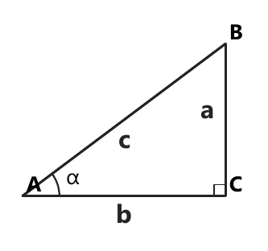

*Синус, косинус и тангенс острого угла*

**Табличные значения:**

$$
\sin30^\circ=\frac12; \qquad \cos30^\circ=\frac{\sqrt3}{2}
$$

$$
\tg30^\circ=\frac{\sqrt3}{3}; \qquad \ctg30^\circ=\sqrt3
$$

$$
\sin45^\circ=\frac{\sqrt2}{2}; \qquad \cos45^\circ=\frac{\sqrt2}{2}
$$

$$
\tg45^\circ=1; \qquad \ctg45^\circ=1
$$

$$
\sin60^\circ=\frac{\sqrt3}{2}; \qquad \cos60^\circ=\frac12
$$

$$
\tg60^\circ=\sqrt3; \qquad \ctg60^\circ=\frac{\sqrt3}{3}
$$

**Правила:**

- сначала назови угол, для которого ищешь функцию;
- гипотенуза всегда лежит напротив прямого угла;
- синус и косинус имеют знаменатель-гипотенузу;
- тангенс и котангенс используют только катеты;
- не путай прилежащий катет с гипотенузой: гипотенуза к острому углу не бывает прилежащим катетом.

**Алгоритм:**

1. Найди прямой угол.
2. Определи гипотенузу.
3. Относительно нужного острого угла назови катеты.
4. Выбери подходящую формулу.
5. Подставь длины сторон.
6. Сократи дробь. Для синуса и косинуса проверь $0<\sin\alpha<1$ и $0<\cos\alpha<1$. Для тангенса и котангенса проверь только знак «плюс»: число больше $1$ ошибкой не является.

**Мини-пример.** В прямоугольном треугольнике катеты равны $6$ см и $8$ см. Найдите синус угла, противолежащего катету длиной $6$ см.

<!--geo-figure-spec
{
  "needed": true,
  "kind": "plane",
  "template": "plane_custom",
  "caption": "Катеты 6 см и 8 см, синус угла напротив катета 6 см",
  "show_labels": true,
  "vertices": {
    "A": [
      0,
      0
    ],
    "C": [
      8,
      0
    ],
    "B": [
      8,
      6
    ]
  },
  "edges": [
    [
      "A",
      "C"
    ],
    [
      "C",
      "B"
    ],
    [
      "B",
      "A"
    ]
  ],
  "right_angles": [
    {
      "at": "C",
      "from": "A",
      "to": "B"
    }
  ],
  "angle_marks": [
    {
      "vertex": "A",
      "from": "C",
      "to": "B",
      "text": "α"
    }
  ],
  "segment_labels": [
    {
      "points": [
        "C",
        "B"
      ],
      "text": "6",
      "t": 0.55,
      "side": 1
    },
    {
      "points": [
        "A",
        "C"
      ],
      "text": "8",
      "t": 0.5,
      "side": -1
    },
    {
      "points": [
        "A",
        "B"
      ],
      "text": "c",
      "t": 0.45,
      "side": -1
    }
  ]
}
-->
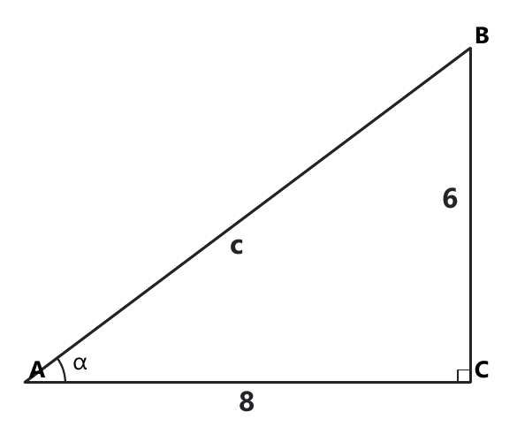

*Катеты 6 см и 8 см, синус угла напротив катета 6 см*

*Решение:*

Дано: катеты $6$ см и $8$ см.

Найти: $\sin\alpha$.

Находим гипотенузу по теореме Пифагора:

$$
c^2=6^2+8^2
$$

$$
c^2=36+64=100
$$

$$
c=10\text{ см}
$$

Синус равен отношению противолежащего катета к гипотенузе:

$$
\sin\alpha=\frac{6}{10}
$$

$$
\sin\alpha=\frac35
$$

Значение находится между $0$ и $1$, значит, результат имеет смысл.

**Ответ:** $\frac35$.

**Ловушки экзамена:**

- взять прилежащий катет вместо противолежащего;
- назвать гипотенузой больший катет без проверки прямого угла;
- перепутать $\tg\alpha$ и $\ctg\alpha$;
- забыть сократить дробь.

### Мини-тема 2. Решение прямоугольного треугольника

Решить прямоугольный треугольник — значит найти его неизвестные стороны и углы по данным величинам.

Сначала используют теорему Пифагора или тригонометрическую функцию. Если известна сторона и угол, выбирают функцию, в формуле которой есть эти данные.

Сумма острых углов прямоугольного треугольника равна $90^\circ$.

**Основные формулы:**

$$
a^2+b^2=c^2
$$

$$
a=c\sin\alpha
$$

$$
b=c\cos\alpha
$$

$$
a=b\tg\alpha
$$

$$
b=a\ctg\alpha
$$

Здесь $a$ — противолежащий катет, $b$ — прилежащий катет, $c$ — гипотенуза.

**Радиус описанной окружности.** Середина гипотенузы равноудалена от всех трёх вершин. Если прямой угол лежит при вершине $C$, а $M$ — середина гипотенузы, то $MA=MB=\dfrac{c}{2}$. Отрезок $CM$ — гипотенуза прямоугольного треугольника с катетами $\dfrac{a}{2}$ и $\dfrac{b}{2}$:

$$
CM=\sqrt{\left(\frac{a}{2}\right)^2+\left(\frac{b}{2}\right)^2}=\frac{c}{2}.
$$

Все три вершины лежат на окружности с центром $M$. Гипотенуза — её диаметр, поэтому

$$
R=\frac{c}{2}.
$$

В задаче на радиус сначала найди гипотенузу и раздели её пополам. Окружности подробнее разбираются в занятии 14.

<!--geo-figure-spec
{
  "needed": true,
  "kind": "plane",
  "template": "plane_custom",
  "caption": "Середина гипотенузы — центр описанной окружности",
  "show_labels": true,
  "vertices": {
    "C": [
      0,
      0
    ],
    "B": [
      8,
      0
    ],
    "A": [
      0,
      6
    ],
    "M": [
      4,
      3
    ]
  },
  "edges": [
    [
      "C",
      "B"
    ],
    [
      "B",
      "A"
    ],
    [
      "A",
      "C"
    ]
  ],
  "circle": {
    "center": "M",
    "r": 5
  },
  "segment_labels": [
    {
      "points": [
        "C",
        "B"
      ],
      "text": "8",
      "t": 0.5,
      "side": -1
    },
    {
      "points": [
        "A",
        "C"
      ],
      "text": "6",
      "t": 0.55,
      "side": -1
    }
  ]
}
-->
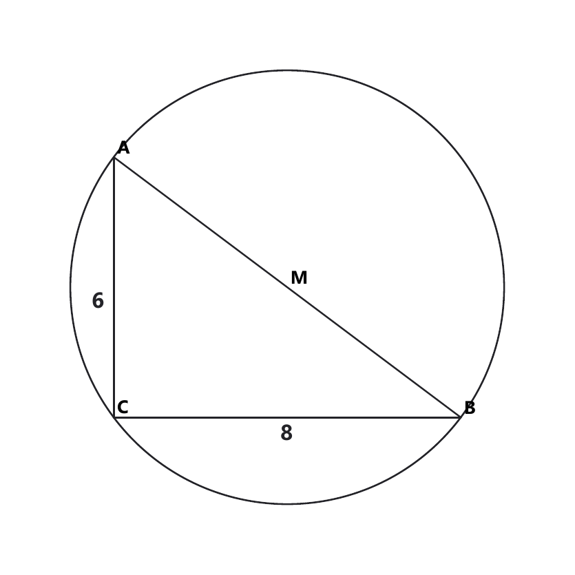

*Середина гипотенузы — центр описанной окружности*

*Середина гипотенузы — центр описанной окружности. Для сторон $6$, $8$ и $10$ радиус равен $5$.*

**Алгоритм:**

1. Сделай краткую запись данных.
2. Определи гипотенузу и катеты.
3. Если известны два катета, примени теорему Пифагора.
4. Если известны сторона и угол, выбери синус, косинус или тангенс.
5. Найди второй острый угол как разность $90^\circ-\alpha$.
6. Проверь ответ: гипотенуза должна быть больше каждого катета.

**Мини-пример.** В прямоугольном треугольнике гипотенуза равна $12$ см, а один острый угол равен $30^\circ$. Найдите катет, противолежащий этому углу.

<!--geo-figure-spec
{
  "needed": true,
  "kind": "plane",
  "template": "plane_custom",
  "caption": "Гипотенуза 12 см и угол 30°: ищем противолежащий катет",
  "show_labels": true,
  "vertices": {
    "A": [
      0,
      0
    ],
    "C": [
      10.392,
      0
    ],
    "B": [
      10.392,
      6
    ]
  },
  "edges": [
    [
      "A",
      "C"
    ],
    [
      "C",
      "B"
    ],
    [
      "B",
      "A"
    ]
  ],
  "right_angles": [
    {
      "at": "C",
      "from": "A",
      "to": "B"
    }
  ],
  "angle_marks": [
    {
      "vertex": "A",
      "from": "C",
      "to": "B",
      "text": "30°",
      "radius": 220
    }
  ],
  "segment_labels": [
    {
      "points": [
        "A",
        "B"
      ],
      "text": "12",
      "t": 0.45,
      "side": -1
    }
  ]
}
-->
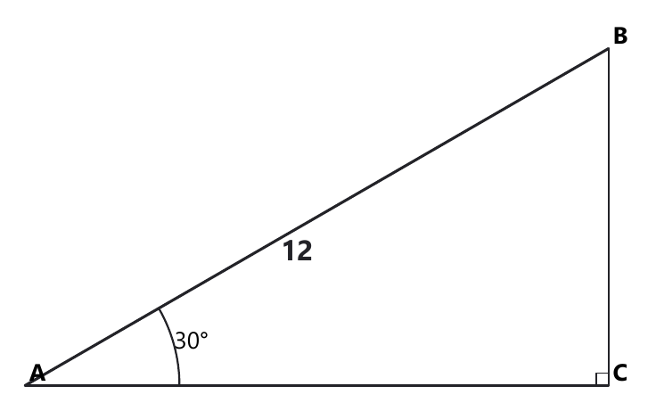

*Гипотенуза 12 см и угол 30°: ищем противолежащий катет*

*Решение:*

Дано: $c=12$ см, $\alpha=30^\circ$.

Найти: $a$.

Используем формулу:

$$
\sin\alpha=\frac{a}{c}
$$

Выразим катет:

$$
a=c\sin\alpha
$$

Подставим значения:

$$
a=12\cdot\sin30^\circ
$$

$$
a=12\cdot\frac12=6\text{ см}
$$

Катет меньше гипотенузы, значит, ответ имеет смысл.

**Ответ:** $6$ см.

**Ловушки экзамена:**

- перепутать сторону напротив угла;
- использовать $30^\circ$ вместо $60^\circ$;
- забыть, что второй острый угол равен $90^\circ-\alpha$;
- получить катет больше гипотенузы.

### Мини-тема 3. Основное тригонометрическое тождество

Синус и косинус одного угла связаны тождеством. Возьми теорему Пифагора $a^2+b^2=c^2$ и раздели обе части на $c^2$:

$$
\left(\frac{a}{c}\right)^2+\left(\frac{b}{c}\right)^2=1.
$$

Слева как раз $\sin^2\alpha$ и $\cos^2\alpha$.

**Основное тождество:**

$$
\sin^2\alpha+\cos^2\alpha=1
$$

Для тупого угла тождество тоже верно. Меняется только знак корня: косинус тупого угла отрицателен. Об этом в мини-теме 4.

Для острого угла синус и косинус положительны, поэтому при извлечении корня берём положительное значение:

$$
\cos\alpha=\sqrt{1-\sin^2\alpha}
$$

$$
\sin\alpha=\sqrt{1-\cos^2\alpha}
$$

Также:

$$
\tg\alpha=\frac{\sin\alpha}{\cos\alpha}
$$

$$
\ctg\alpha=\frac{\cos\alpha}{\sin\alpha}
$$

Отсюда $\ctg\alpha=\dfrac{1}{\tg\alpha}$, если $\tg\alpha\ne0$.

**Алгоритм:**

1. Запиши тождество.
2. Подставь известное значение.
3. Перенеси известный квадрат в другую часть.
4. Извлеки квадратный корень.
5. Выбери положительный корень, если угол острый.
6. При необходимости найди $\tg\alpha$ или $\ctg\alpha$.

**Мини-пример.** Известно, что $\sin\alpha=\frac35$, где $\alpha$ — острый угол. Найдите $\cos\alpha$ и $\tg\alpha$.

*Решение:*

Дано:

$$
\sin\alpha=\frac35
$$

Так как угол острый, $\cos\alpha>0$.

Используем тождество:

$$
\sin^2\alpha+\cos^2\alpha=1
$$

$$
\left(\frac35\right)^2+\cos^2\alpha=1
$$

$$
\frac9{25}+\cos^2\alpha=1
$$

$$
\cos^2\alpha=1-\frac9{25}
$$

$$
\cos^2\alpha=\frac{16}{25}
$$

$$
\cos\alpha=\frac45
$$

Теперь найдём тангенс:

$$
\tg\alpha=\frac{\sin\alpha}{\cos\alpha}
$$

$$
\tg\alpha=\frac{3/5}{4/5}
$$

$$
\tg\alpha=\frac35\cdot\frac54=\frac34
$$

Проверка:

$$
\left(\frac35\right)^2+\left(\frac45\right)^2
=\frac9{25}+\frac{16}{25}=1
$$

Другой способ, без корня из тождества. Построй прямоугольный треугольник с противолежащим катетом $3$ и гипотенузой $5$. Второй катет равен $\sqrt{5^2-3^2}=4$. Тогда $\cos\alpha=\dfrac{4}{5}$ и $\tg\alpha=\dfrac{3}{4}$. Так же поступают, если дан тангенс: катеты берут пропорциональными числителю и знаменателю, гипотенузу находят по теореме Пифагора.

**Ответ:** $\cos\alpha=\frac45$; $\tg\alpha=\frac34$.

**Ловушки экзамена:**

- написать $\cos\alpha=-\frac45$ для острого угла;
- забыть возвести дробь в квадрат;
- при делении дробей не перевернуть вторую дробь;
- перепутать $\tg\alpha$ и $\ctg\alpha$.

### Мини-тема 4. Тригонометрия тупого угла

Тупой угол больше $90^\circ$ и меньше $180^\circ$. Его удобно записать как $180^\circ-\alpha$, где $\alpha$ — острый угол, дополняющий тупой до развёрнутого. Синусы таких углов равны. Косинус, тангенс и котангенс тупого угла противоположны значениям острого.

На единичной полуокружности синус — это высота точки над горизонтальной осью, косинус — её абсцисса. У тупого угла точка лежит слева от вертикальной оси: высота та же, что у острого смежного угла, а абсцисса отрицательна. Поэтому синус положителен, а косинус отрицателен.

Если тупой угол равен $180^\circ-\alpha$, то синус сохраняет значение, а косинус меняет знак. Тангенс и котангенс также меняют знак.

$$
\sin(180^\circ-\alpha)=\sin\alpha
$$

$$
\cos(180^\circ-\alpha)=-\cos\alpha
$$

$$
\tg(180^\circ-\alpha)=-\tg\alpha
$$

$$
\ctg(180^\circ-\alpha)=-\ctg\alpha
$$

**Алгоритм:**

1. Представь тупой угол в виде $180^\circ-\alpha$.
2. Найди острый угол $\alpha$.
3. Используй табличное значение или формулу для острого угла.
4. Для синуса знак не меняй.
5. Для косинуса, тангенса и котангенса поставь знак «минус».
6. Если угол тупой и косинус находишь из тождества, бери отрицательный корень.

**Мини-пример.** Найдите $\cos150^\circ$ и $\sin150^\circ$.

<!--geo-figure-spec
{
  "needed": true,
  "kind": "plane",
  "template": "plane_custom",
  "caption": "Угол 150°: синус как у 30°, косинус противоположен",
  "show_labels": true,
  "vertices": {
    "O": [
      0,
      0
    ],
    "A": [
      3,
      0
    ],
    "M": [
      -2.598,
      1.5
    ],
    "N": [
      -2.598,
      0
    ]
  },
  "edges": [
    [
      "O",
      "A"
    ],
    [
      "O",
      "M"
    ],
    [
      "M",
      "N"
    ]
  ],
  "dashed_segments": [
    [
      "M",
      "N"
    ]
  ],
  "circle": {
    "center": "O",
    "r": 3
  },
  "right_angles": [
    {
      "at": "N",
      "from": "M",
      "to": "O"
    }
  ],
  "angle_marks": [
    {
      "vertex": "O",
      "from": "A",
      "to": "M",
      "text": "150°",
      "radius": 42
    }
  ]
}
-->
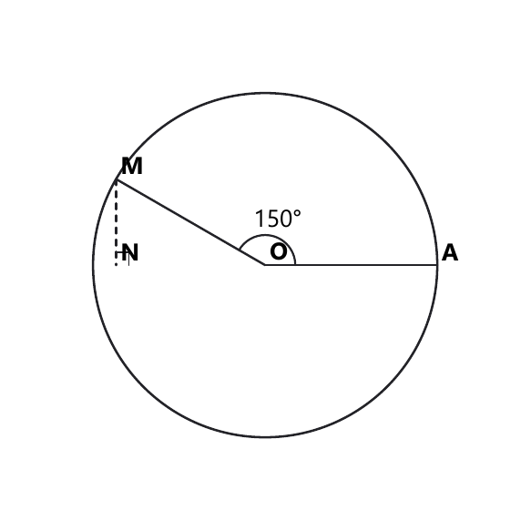

*Угол 150°: синус как у 30°, косинус противоположен*

*Решение:*

На рисунке пунктир $MN$ — высота точки $M$ над горизонтальной осью, это и есть синус. Точка $M$ лежит слева от вертикальной оси, поэтому косинус отрицателен.

Представим $150^\circ$ как разность:

$$
150^\circ=180^\circ-30^\circ
$$

Используем формулу для косинуса:

$$
\cos150^\circ=-\cos30^\circ
$$

$$
\cos150^\circ=-\frac{\sqrt3}{2}
$$

Используем формулу для синуса:

$$
\sin150^\circ=\sin30^\circ
$$

$$
\sin150^\circ=\frac12
$$

**Ответ:** $\cos150^\circ=-\frac{\sqrt3}{2}$; $\sin150^\circ=\frac12$.

Если дан синус, а угол тупой, корень из тождества тоже берут со знаком «минус». Например, при $\sin\alpha=\dfrac{3}{5}$ и тупом $\alpha$ получается $\cos\alpha=-\dfrac{4}{5}$, а не $\dfrac{4}{5}$. Проверка: $\left(\dfrac{3}{5}\right)^2+\left(-\dfrac{4}{5}\right)^2=1$.

**Ловушки экзамена:**

- оставить косинус тупого угла положительным;
- поставить минус перед синусом;
- перепутать угол $150^\circ$ с $60^\circ$;
- забыть указать градусы.

### Мини-тема 5. Площадь через синус. Среднее пропорциональное

Площадь треугольника можно находить не только через основание и высоту. Если известны две стороны и угол между ними, высота выражается через синус этого угла.

Пусть угол $\alpha$ между сторонами $a$ и $b$ острый. Высота к стороне $b$ отсекает прямоугольный треугольник, в котором $h=a\sin\alpha$. Тогда

$$
S=\frac12bh=\frac12ab\sin\alpha.
$$

Если угол между сторонами тупой, высота падает на продолжение стороны. Синус тупого угла равен синусу острого, который дополняет его до $180^\circ$, поэтому в формулу подставляют синус самого угла между сторонами. Площадь положительна: минус от косинуса сюда не попадает.

У параллелограмма высота к стороне $b$ равна $a\sin\alpha$, множителя $\dfrac12$ нет.

**Формулы площади:**

$$
S_{\triangle}=\frac12ab\sin\alpha
$$

Здесь $a$ и $b$ — две стороны, а $\alpha$ — угол между ними, острый или тупой.

Для параллелограмма:

$$
S_{\text{параллелограмма}}=ab\sin\alpha
$$

Из двух записей площади прямоугольного треугольника, $\dfrac12ab$ и $\dfrac12ch$, получается высота к гипотенузе:

$$
h=\frac{ab}{c}.
$$

Для прямоугольного треугольника важны также отрезки, на которые высота к гипотенузе делит гипотенузу. Они называются проекциями катетов.

**Среднее пропорциональное в прямоугольном треугольнике:**

$$
h^2=pq
$$

$$
a^2=cp
$$

$$
b^2=cq
$$

Здесь $a$ и $b$ — катеты, $c$ — гипотенуза, $h$ — высота, проведённая к гипотенузе, $p$ — проекция катета $a$, $q$ — проекция катета $b$. Проекция катета — отрезок гипотенузы от вершины этого катета до основания высоты.

<!--geo-figure-spec
{
  "needed": true,
  "kind": "plane",
  "template": "plane_custom",
  "caption": "Высота к гипотенузе и проекции катетов",
  "show_labels": true,
  "vertices": {
    "C": [
      0,
      3
    ],
    "B": [
      4,
      3
    ],
    "A": [
      0,
      0
    ],
    "H": [
      1.44,
      1.08
    ]
  },
  "edges": [
    [
      "A",
      "B"
    ],
    [
      "B",
      "C"
    ],
    [
      "C",
      "A"
    ],
    [
      "C",
      "H"
    ]
  ],
  "right_angles": [
    {
      "at": "C",
      "from": "A",
      "to": "B"
    },
    {
      "at": "H",
      "from": "C",
      "to": "A"
    }
  ],
  "segment_labels": [
    {
      "points": [
        "B",
        "C"
      ],
      "text": "a",
      "t": 0.5,
      "side": -1
    },
    {
      "points": [
        "C",
        "A"
      ],
      "text": "b",
      "t": 0.72,
      "side": -1
    },
    {
      "points": [
        "A",
        "H"
      ],
      "text": "q",
      "t": 0.5,
      "side": -1
    },
    {
      "points": [
        "H",
        "B"
      ],
      "text": "p",
      "t": 0.55,
      "side": -1
    },
    {
      "points": [
        "A",
        "B"
      ],
      "text": "c",
      "t": 0.5,
      "side": 1
    },
    {
      "points": [
        "C",
        "H"
      ],
      "text": "h",
      "t": 0.42,
      "side": -1
    }
  ]
}
-->
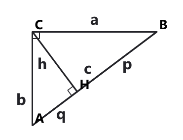

*Высота к гипотенузе и проекции катетов*

**Откуда берутся формулы.** Угол между высотой и катетом $a$ равен углу $A$ треугольника: оба дополняют угол $B$ до $90^\circ$. В маленьком треугольнике у катета $b$ тангенс этого угла равен $\dfrac{h}{q}$, а в треугольнике у катета $a$ тот же тангенс равен $\dfrac{p}{h}$. Поэтому $\dfrac{h}{q}=\dfrac{p}{h}$ и $h^2=pq$.

Косинус угла $A$ в маленьком треугольнике равен $\dfrac{q}{b}$, а в большом равен $\dfrac{b}{c}$. Поэтому $\dfrac{q}{b}=\dfrac{b}{c}$ и $b^2=cq$. Так же $a^2=cp$. Проекция $p$ выходит из той же вершины гипотенузы, что и катет $a$.

**Угол между высотой и катетом.** Пусть прямой угол при $C$, высота $CH$, и угол между $CH$ и катетом $BC$ равен $\varphi$. В треугольнике $BCH$ угол при $H$ прямой, значит угол при $B$ равен $90^\circ-\varphi$. Это острый угол исходного треугольника. Угол при катете и угол между этим катетом и высотой дают в сумме $90^\circ$. Если один из них $60^\circ$, другой равен $30^\circ$, и катет против $30^\circ$ вдвое короче гипотенузы.

**Третья сторона по двум сторонам и углу между ними.** Теорема косинусов будет в занятии 21. Сейчас хватает высоты.

Сначала найди угол между данными сторонами. Сумма углов треугольника равна $180^\circ$: если два угла в сумме дают $120^\circ$, третий равен $60^\circ$, и это как раз угол между сторонами, которым эти два угла противолежат.

Угол $\gamma$ между сторонами $a$ и $b$ острый. Высота к стороне $b$ равна $h=a\sin\gamma$, проекция стороны $a$ на $b$ равна $m=a\cos\gamma$ и лежит на стороне. Второй отрезок равен $b-m$. Третья сторона $c=\sqrt{h^2+(b-m)^2}$.

Угол тупой. Косинус отрицателен, проекция падает на продолжение стороны, за вершину угла. Отрезки складываются: от основания высоты до дальнего конца стороны $b$ равен $b+|m|$, где $m=a\cos\gamma$. Высота по-прежнему $h=a\sin\gamma$. Дальше теорема Пифагора.

**Мини-пример.** Стороны $6$ см и $8$ см, угол между ними $60^\circ$. Найдите третью сторону.

<!--geo-figure-spec
{
  "needed": true,
  "kind": "plane",
  "template": "plane_custom",
  "caption": "Стороны 6 см и 8 см, угол между ними 60°: высота внутри треугольника",
  "show_labels": true,
  "vertices": {
    "C": [
      0,
      0
    ],
    "B": [
      8,
      0
    ],
    "A": [
      3,
      5.196
    ],
    "H": [
      3,
      0
    ]
  },
  "edges": [
    [
      "C",
      "B"
    ],
    [
      "B",
      "A"
    ],
    [
      "A",
      "C"
    ],
    [
      "A",
      "H"
    ]
  ],
  "dashed_segments": [
    [
      "A",
      "H"
    ]
  ],
  "right_angles": [
    {
      "at": "H",
      "from": "A",
      "to": "B"
    }
  ],
  "angle_marks": [
    {
      "vertex": "C",
      "from": "B",
      "to": "A",
      "text": "60°",
      "radius": 90
    }
  ],
  "segment_labels": [
    {
      "points": [
        "A",
        "C"
      ],
      "text": "6",
      "t": 0.45,
      "side": -1
    },
    {
      "points": [
        "C",
        "B"
      ],
      "text": "8",
      "t": 0.55,
      "side": -1
    }
  ]
}
-->
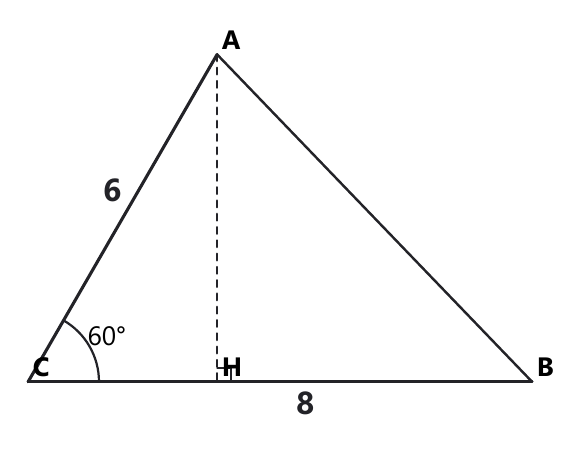

*Стороны 6 см и 8 см, угол между ними 60°: высота внутри треугольника*

*Решение.* Высота к стороне $8$ см: $h=6\sin60^\circ=6\cdot\dfrac{\sqrt3}{2}=3\sqrt3$ см. Проекция: $m=6\cos60^\circ=3$ см, она лежит на стороне. Второй отрезок $8-3=5$ см.

$$
c=\sqrt{(3\sqrt3)^2+5^2}=\sqrt{27+25}=\sqrt{52}=2\sqrt{13}\text{ см}.
$$

Проверка площади: $S=\dfrac12\cdot6\cdot8\cdot\sin60^\circ=12\sqrt3\text{ см}^2$, и $S=\dfrac12\cdot8\cdot3\sqrt3=12\sqrt3\text{ см}^2$.

**Ответ:** $2\sqrt{13}$ см.

**Мини-пример.** Стороны по $5$ см, угол между ними $120^\circ$. Найдите третью сторону.

<!--geo-figure-spec
{
  "needed": true,
  "kind": "plane",
  "template": "plane_custom",
  "caption": "Равные стороны 5 см и тупой угол 120°: высота вне стороны",
  "show_labels": true,
  "labels": [
    "A",
    "B",
    "C"
  ],
  "vertices": {
    "H": [
      -2.5,
      0
    ],
    "C": [
      0,
      0
    ],
    "B": [
      5,
      0
    ],
    "A": [
      -2.5,
      4.33
    ]
  },
  "edges": [
    [
      "C",
      "B"
    ],
    [
      "C",
      "A"
    ],
    [
      "A",
      "B"
    ],
    [
      "A",
      "H"
    ],
    [
      "H",
      "C"
    ]
  ],
  "dashed_segments": [
    [
      "H",
      "C"
    ],
    [
      "A",
      "H"
    ]
  ],
  "right_angles": [
    {
      "at": "H",
      "from": "A",
      "to": "B",
      "size": 0.45
    }
  ],
  "angle_marks": [
    {
      "vertex": "C",
      "from": "B",
      "to": "A",
      "text": "120°",
      "radius": 72,
      "dir": "ccw"
    }
  ],
  "segment_labels": [
    {
      "points": [
        "C",
        "A"
      ],
      "text": "5",
      "t": 0.45,
      "side": -1
    },
    {
      "points": [
        "C",
        "B"
      ],
      "text": "5",
      "t": 0.55,
      "side": -1
    }
  ]
}
-->
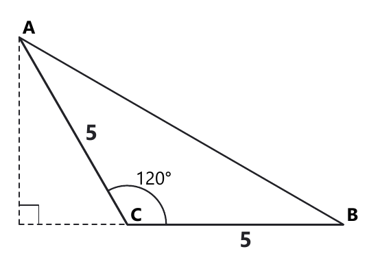

*Равные стороны 5 см и тупой угол 120°: высота вне стороны*

*Решение.* $\sin120^\circ=\sin60^\circ=\dfrac{\sqrt3}{2}$, $\cos120^\circ=-\dfrac12$. Высота $h=5\cdot\dfrac{\sqrt3}{2}=\dfrac{5\sqrt3}{2}$ см. Проекция по модулю $5\cdot\dfrac12=\dfrac52$ см и лежит на продолжении стороны, за вершину угла. До дальнего конца стороны $5+\dfrac52=\dfrac{15}{2}$ см.

$$
c=\sqrt{\left(\frac{5\sqrt3}{2}\right)^2+\left(\frac{15}{2}\right)^2}=\sqrt{\frac{75}{4}+\frac{225}{4}}=\sqrt{75}=5\sqrt3\text{ см}.
$$

Площадь $\dfrac12\cdot5\cdot5\cdot\sin120^\circ=\dfrac{25\sqrt3}{2}\text{ см}^2$. Если взять косинус положительным и вычесть $2{,}5$ из $5$, получится другая сторона: это ошибка знака.

**Ответ:** $5\sqrt3$ см.

**Алгоритм для площади:**

1. Определи две известные стороны.
2. Найди угол между ними.
3. Запиши формулу площади.
4. Подставь табличное значение синуса.
5. Укажи квадратные единицы.

**Алгоритм для среднего пропорционального:**

1. Найди гипотенузу.
2. Определи, какой катет и какая его проекция связаны.
3. Запиши квадрат катета как произведение гипотенузы и проекции.
4. Извлеки квадратный корень.
5. Проверь, что длина положительна.

**Мини-пример.** В треугольнике две стороны равны $8$ см и $5$ см, а угол между ними равен $30^\circ$. Найдите площадь.

<!--geo-figure-spec
{
  "needed": true,
  "kind": "plane",
  "template": "plane_custom",
  "caption": "Стороны 8 см и 5 см, угол между ними 30°",
  "show_labels": true,
  "vertices": {
    "C": [
      0,
      0
    ],
    "B": [
      8,
      0
    ],
    "A": [
      4.33,
      2.5
    ]
  },
  "edges": [
    [
      "C",
      "B"
    ],
    [
      "B",
      "A"
    ],
    [
      "A",
      "C"
    ]
  ],
  "angle_marks": [
    {
      "vertex": "C",
      "from": "B",
      "to": "A",
      "text": "30°",
      "radius": 180
    }
  ],
  "segment_labels": [
    {
      "points": [
        "C",
        "B"
      ],
      "text": "8",
      "t": 0.45,
      "side": -1
    },
    {
      "points": [
        "A",
        "C"
      ],
      "text": "5",
      "t": 0.5,
      "side": -1
    }
  ]
}
-->
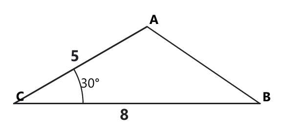

*Стороны 8 см и 5 см, угол между ними 30°*

*Решение:*

Дано: $a=8$ см, $b=5$ см, $\alpha=30^\circ$.

Найти: $S$.

Используем формулу:

$$
S=\frac12ab\sin\alpha
$$

Подставим данные:

$$
S=\frac12\cdot8\cdot5\cdot\sin30^\circ
$$

$$
S=4\cdot5\cdot\frac12
$$

$$
S=10\text{ см}^2
$$

Площадь положительна, единицы указаны верно.

**Ответ:** $10\text{ см}^2$.

**Ловушки экзамена:**

- забыть множитель $\frac12$ в формуле площади треугольника;
- взять угол не между данными сторонами;
- перепутать площадь треугольника и параллелограмма;
- записать ответ в сантиметрах, а не в квадратных сантиметрах;
- в равенстве $a^2=cp$ взять проекцию другого катета: $p$ выходит из той же вершины, что и катет $a$.

## Сводка формул «выучить наизусть»

$$
\sin\alpha=\frac{a}{c}; \qquad
\cos\alpha=\frac{b}{c}; \qquad
\tg\alpha=\frac{a}{b}; \qquad
\ctg\alpha=\frac{b}{a}
$$

$$
a^2+b^2=c^2
$$

$$
\sin^2\alpha+\cos^2\alpha=1
$$

$$
\tg\alpha=\frac{\sin\alpha}{\cos\alpha}; \qquad
\ctg\alpha=\frac{\cos\alpha}{\sin\alpha}
$$

$$
\sin(180^\circ-\alpha)=\sin\alpha
$$

$$
\cos(180^\circ-\alpha)=-\cos\alpha
$$

$$
\tg(180^\circ-\alpha)=-\tg\alpha
$$

$$
\ctg(180^\circ-\alpha)=-\ctg\alpha
$$

$$
S_{\triangle}=\frac12ab\sin\alpha
$$

$$
S_{\text{параллелограмма}}=ab\sin\alpha
$$

$$
h^2=pq; \qquad a^2=cp; \qquad b^2=cq; \qquad h=\frac{ab}{c}; \qquad R=\frac{c}{2}
$$

## Правила, которые нельзя путать

- Синус — противолежащий катет к гипотенузе.
- Косинус — прилежащий катет к гипотенузе.
- Тангенс — противолежащий катет к прилежащему.
- Для острого угла синус, косинус, тангенс и котангенс положительны.
- У тупого угла синус положителен, а косинус, тангенс и котангенс отрицательны.
- В формуле площади треугольника есть множитель $\frac12$.
- В прямоугольном треугольнике гипотенуза — самая длинная сторона, и она же диаметр описанной окружности: $R=\dfrac{c}{2}$.
- Если угол тупой, из тождества бери отрицательный косинус.
- У тупого угла между сторонами проекция падает на продолжение стороны: отрезки складывают, а не вычитают.

## Разрешённый набор для практики

Мини-темы занятия:

- тригонометрические функции острого угла;
- табличные значения;
- решение прямоугольного треугольника;
- основное тригонометрическое тождество;
- функции тупого угла;
- площадь через синус;
- среднее пропорциональное.

Повтор:

- линейные неравенства;
- степени с натуральным и целым показателем;
- многочлены и приведение подобных;
- разложение на множители;
- формулы сокращённого умножения;
- тождественные преобразования;
- преобразование выражений со степенями.

## Разбор ключевых заданий

### Р1.
**Условие.** На клетчатой бумаге луч $AB$ идёт от точки $A$ по горизонтали вправо. Точка $C$ лежит на $3$ клетки правее и на $4$ клетки выше точки $A$. Найдите $\sin\angle BAC$.

<!--geo-figure-spec
{
  "needed": true,
  "kind": "plane",
  "template": "plane_custom",
  "caption": "Угол BAC: точка C на 3 клетки правее и на 4 выше точки A",
  "show_labels": true,
  "vertices": {
    "A": [
      0,
      0
    ],
    "B": [
      6,
      0
    ],
    "C": [
      3,
      4
    ],
    "H": [
      3,
      0
    ]
  },
  "edges": [
    [
      "A",
      "B"
    ],
    [
      "A",
      "C"
    ],
    [
      "C",
      "H"
    ]
  ],
  "dashed_segments": [
    [
      "C",
      "H"
    ]
  ],
  "right_angles": [
    {
      "at": "H",
      "from": "C",
      "to": "A"
    }
  ],
  "segment_labels": [
    {
      "points": [
        "A",
        "H"
      ],
      "text": "3",
      "t": 0.5,
      "side": -1
    },
    {
      "points": [
        "C",
        "H"
      ],
      "text": "4",
      "t": 0.55,
      "side": 1
    }
  ]
}
-->
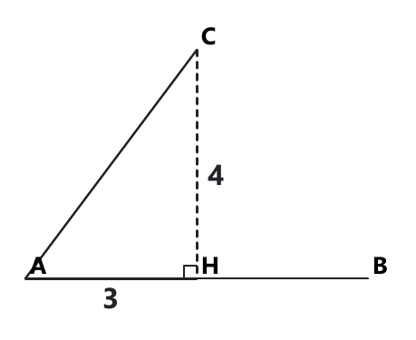

*Угол BAC: точка C на 3 клетки правее и на 4 выше точки A*

*Решение:*

Опустим из точки $C$ перпендикуляр $CH$ на прямую $AB$. Получится прямоугольный треугольник $ACH$ с катетами $AH=3$ и $CH=4$.

Гипотенуза:

$$
AC=\sqrt{3^2+4^2}=\sqrt{25}=5
$$

Углу $BAC$ противолежит катет $CH$, поэтому

$$
\sin\angle BAC=\frac{CH}{AC}=\frac45
$$

Значение между $0$ и $1$.

**Ответ:** $\frac45$.

### Р2.
**Условие.** Какое из следующих утверждений НЕ верно:

а) окружность, вписанная в треугольник, касается всех его сторон;

б) синус острого угла прямоугольного треугольника равен отношению прилежащего катета к гипотенузе;

в) площадь прямоугольного треугольника равна половине произведения катетов;

г) катет, лежащий против угла $30^\circ$, равен половине гипотенузы.

*Решение:*

Проверим утверждение а).

Вписанная окружность касается всех сторон треугольника. Это использовалось в занятии 8, когда площадь записывали как $S=pr$.

Утверждение а) верно.

Проверим утверждение б).

Синус острого угла равен отношению противолежащего катета к гипотенузе. Прилежащий катет стоит в косинусе.

Утверждение б) неверно.

Проверим утверждение в).

В занятии 8 площадь прямоугольного треугольника равна $\dfrac{ab}{2}$.

Утверждение в) верно.

Проверим утверждение г).

В занятии 8 катет против $30^\circ$ равен половине гипотенузы.

Утверждение г) верно.

**Ответ:** б).

### Р3.
**Условие.** В треугольнике $ABC$ $AB=6$ см, $AC=5$ см, $CM$ — медиана, $\angle ACM=\angle BCM$. Найдите синус угла $A$.

<!--geo-figure-spec
{
  "needed": true,
  "kind": "plane",
  "template": "plane_custom",
  "caption": "Медиана CM совпадает с биссектрисой угла C",
  "show_labels": true,
  "vertices": {
    "A": [
      -3,
      0
    ],
    "B": [
      3,
      0
    ],
    "C": [
      0,
      4
    ],
    "M": [
      0,
      0
    ]
  },
  "edges": [
    [
      "A",
      "B"
    ],
    [
      "B",
      "C"
    ],
    [
      "C",
      "A"
    ],
    [
      "C",
      "M"
    ]
  ],
  "angle_marks": [
    {
      "vertex": "C",
      "from": "A",
      "to": "M",
      "text": "α",
      "radius": 40
    },
    {
      "vertex": "C",
      "from": "M",
      "to": "B",
      "text": "α",
      "radius": 68
    }
  ],
  "segment_labels": [
    {
      "points": [
        "A",
        "C"
      ],
      "text": "5",
      "t": 0.55,
      "side": -1
    },
    {
      "points": [
        "A",
        "B"
      ],
      "text": "6",
      "t": 0.5,
      "side": -1
    }
  ]
}
-->
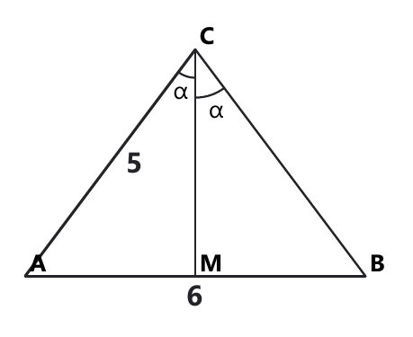

*Медиана CM совпадает с биссектрисой угла C*

*Решение:*

Дано: $AB=6$ см, $AC=5$ см.

Медиана, которая оказалась биссектрисой, бывает только в равнобедренном треугольнике. Приём тот же, что в занятии 8: медиану продолжают на её собственную длину.

Так как $CM$ — медиана, то:

$$
AM=MB
$$

По условию $CM$ — биссектриса угла $C$.

Продолжим $CM$ за точку $M$ и отметим $D$ так, что $MD=CM$. Тогда $AM=MB$, $CM=MD$, а углы $AMC$ и $BMD$ вертикальные. Треугольники $AMC$ и $BMD$ равны по двум сторонам и углу между ними, поэтому $AC=BD$ и $\angle ACM=\angle BDM$.

Точки $C$, $M$, $D$ лежат на одной прямой, значит $\angle BCD=\angle BCM$. По условию $\angle ACM=\angle BCM$, а из равенства треугольников $\angle ACM=\angle BDM$. Поэтому $\angle BCD=\angle BDM$: в треугольнике $BCD$ равны углы при вершинах $C$ и $D$. Отсюда $BC=BD$. Но $BD=AC$, поэтому

$$
BC=AC=5\text{ см}
$$

Получаем стороны:

$$
AB=6\text{ см}; \qquad AC=5\text{ см}; \qquad BC=5\text{ см}
$$

Проведём высоту из вершины $C$ на сторону $AB$.

В равнобедренном треугольнике эта высота делит основание пополам:

$$
AH=\frac{AB}{2}=3\text{ см}
$$

По теореме Пифагора:

$$
CH^2=AC^2-AH^2
$$

$$
CH^2=5^2-3^2=25-9=16
$$

$$
CH=4\text{ см}
$$

В прямоугольном треугольнике $ACH$:

$$
\sin A=\frac{CH}{AC}
$$

$$
\sin A=\frac45
$$

Проверка: сторона $3$–$4$–$5$ образует прямоугольный треугольник.

**Ответ:** $\frac45$.

### Р4.
**Условие.** В прямоугольном треугольнике $ABC$ $\angle B=90^\circ$; $BC=20$ см, высота $BH=12$ см. Найдите синус угла $A$.

<!--geo-figure-spec
{
  "needed": true,
  "kind": "plane",
  "template": "plane_custom",
  "caption": "Прямоугольный треугольник с высотой к гипотенузе",
  "show_labels": true,
  "vertices": {
    "B": [
      0,
      0
    ],
    "C": [
      -20,
      0
    ],
    "A": [
      0,
      15
    ],
    "H": [
      -7.2,
      9.6
    ]
  },
  "edges": [
    [
      "A",
      "B"
    ],
    [
      "B",
      "C"
    ],
    [
      "C",
      "A"
    ],
    [
      "B",
      "H"
    ]
  ],
  "right_angles": [
    {
      "at": "B",
      "from": "A",
      "to": "C"
    },
    {
      "at": "H",
      "from": "B",
      "to": "C"
    }
  ],
  "segment_labels": [
    {
      "points": [
        "B",
        "C"
      ],
      "text": "20",
      "t": 0.45,
      "side": 1
    },
    {
      "points": [
        "B",
        "H"
      ],
      "text": "12",
      "t": 0.45,
      "side": 1
    }
  ]
}
-->
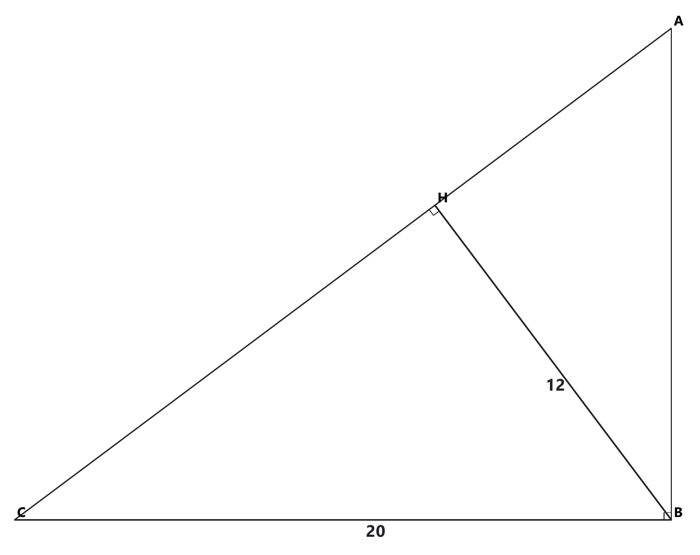

*Прямоугольный треугольник с высотой к гипотенузе*

*Решение:*

Дано:

$$
\angle B=90^\circ; \qquad BC=20\text{ см}; \qquad BH=12\text{ см}
$$

Найти: $\sin A$.

Пусть $AB=x$, а гипотенуза $AC=c$.

Площадь треугольника найдём двумя способами:

$$
S=\frac12\cdot AB\cdot BC
$$

$$
S=\frac12\cdot AC\cdot BH
$$

Приравниваем:

$$
\frac12\cdot x\cdot20=\frac12\cdot c\cdot12
$$

$$
20x=12c
$$

$$
c=\frac53x
$$

По теореме Пифагора:

$$
x^2+20^2=c^2
$$

$$
x^2+400=\left(\frac53x\right)^2
$$

$$
x^2+400=\frac{25}{9}x^2
$$

$$
400=\frac{16}{9}x^2
$$

$$
x^2=225
$$

$$
x=15\text{ см}
$$

Тогда:

$$
c=\frac53\cdot15=25\text{ см}
$$

Синус угла $A$ равен отношению противолежащего катета к гипотенузе:

$$
\sin A=\frac{BC}{AC}
$$

$$
\sin A=\frac{20}{25}=\frac45
$$

Проверка:

$$
15^2+20^2=225+400=625=25^2
$$

**Ответ:** $\frac45$.

## Самостоятельная работа

Выбери свой уровень и решай только этот блок. В блоке есть задачи по теме занятия и повтор. На уровне 1–2 площадь и среднее пропорциональное стоят в домашнем задании: на уроке там самые прямые применения определений.

### Уровень 1–2 балла

1. *Мини-тема 1.* В прямоугольном треугольнике противолежащий катет равен $3$ см, гипотенуза равна $5$ см. Найдите $\sin\alpha$.

2. *Мини-тема 1.* Найдите $\cos60^\circ$.

3. *Мини-тема 2.* В прямоугольном треугольнике катеты равны $6$ см и $8$ см. Найдите гипотенузу.

4. *Мини-тема 3.* Вычислите $\sin^230^\circ+\cos^230^\circ$.

5. *Мини-тема 4.* Найдите $\sin150^\circ$.

6. *Повтор.* Решите неравенство $3x-7<5$.

### Уровень 3–4 балла

1. *Сборник, вариант 9, №3.* Какое утверждение НЕ верно:  
а) площадь квадрата со стороной $a$ равна $a^2$;  
б) сумма углов параллелограмма равна $360^\circ$;  
в) синус острого угла равен отношению прилежащего катета к гипотенузе;  
г) биссектриса равнобедренного треугольника, проведённая к основанию, является медианой?

2. *Мини-тема 4.* Вычислите $\sin150^\circ+\cos120^\circ$.

3. *Мини-тема 3.* Известно, что $\cos\alpha=\dfrac35$, где $\alpha$ — острый угол. Найдите $\sin\alpha$ и $\tg\alpha$.

4. *Мини-тема 2.* В прямоугольном треугольнике гипотенуза равна $10$ см, а один острый угол равен $30^\circ$. Найдите противолежащий катет.

5. *Мини-тема 5.* Найдите площадь треугольника со сторонами $6$ см и $8$ см и углом $30^\circ$ между ними.

6. *Повтор.* Разложите на множители выражение $x^2-25$.

### Уровень 5–6 баллов

1. *Сборник, вариант 11, №5.* Угол между высотой прямоугольного треугольника, проведённой к гипотенузе, и одним из катетов равен $60^\circ$. Второй катет равен $16$ см. Найдите радиус окружности, описанной около треугольника.

<!--geo-figure-spec
{
  "needed": true,
  "kind": "plane",
  "template": "plane_custom",
  "caption": "Высота к гипотенузе: угол с одним катетом 60°, другой катет 16 см",
  "show_labels": true,
  "vertices": {
    "C": [
      0,
      0
    ],
    "B": [
      -4,
      0
    ],
    "A": [
      0,
      6.928203230275509
    ],
    "H": [
      -3,
      1.732050807568877
    ]
  },
  "edges": [
    [
      "A",
      "B"
    ],
    [
      "B",
      "C"
    ],
    [
      "C",
      "A"
    ],
    [
      "C",
      "H"
    ]
  ],
  "right_angles": [
    {
      "at": "C",
      "from": "A",
      "to": "B"
    },
    {
      "at": "H",
      "from": "C",
      "to": "B"
    }
  ],
  "angle_marks": [
    {
      "vertex": "C",
      "from": "A",
      "to": "H",
      "text": "60°",
      "radius": 150
    }
  ],
  "segment_labels": [
    {
      "points": [
        "B",
        "C"
      ],
      "text": "16",
      "t": 0.5,
      "side": -1
    }
  ]
}
-->
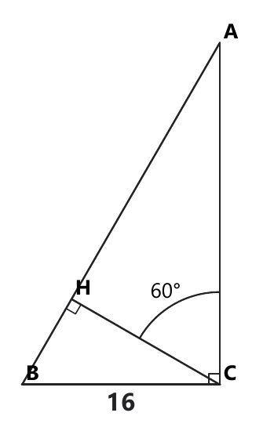

*Высота к гипотенузе: угол с одним катетом 60°, другой катет 16 см*

2. *Сборник, вариант 25, №5.* В треугольнике две стороны равны $6$ см и $10$ см, а сумма углов, противолежащих этим сторонам, равна $120^\circ$. Найдите третью сторону треугольника.

3. *Сборник, вариант 35, №6.* $ABCD$ — параллелограмм, $BK$ — высота, проведённая к стороне $AD$, $CD=10$ см, $KD=7$ см, $\angle A=60^\circ$. Найдите периметр параллелограмма.

<!--geo-figure-spec
{
  "needed": true,
  "kind": "plane",
  "template": "plane_custom",
  "caption": "Параллелограмм ABCD с высотой BK",
  "show_labels": true,
  "vertices": {
    "A": [
      0,
      0
    ],
    "K": [
      5,
      0
    ],
    "D": [
      12,
      0
    ],
    "B": [
      5,
      8.660254037844386
    ],
    "C": [
      17,
      8.660254037844386
    ]
  },
  "edges": [
    [
      "A",
      "B"
    ],
    [
      "B",
      "C"
    ],
    [
      "C",
      "D"
    ],
    [
      "D",
      "A"
    ],
    [
      "B",
      "K"
    ]
  ],
  "right_angles": [
    {
      "at": "K",
      "from": "A",
      "to": "B"
    }
  ],
  "angle_marks": [
    {
      "vertex": "A",
      "from": "D",
      "to": "B",
      "text": "60°"
    }
  ],
  "segment_labels": [
    {
      "points": [
        "K",
        "D"
      ],
      "text": "7",
      "t": 0.55,
      "side": -1
    },
    {
      "points": [
        "C",
        "D"
      ],
      "text": "10",
      "t": 0.45,
      "side": 1
    }
  ]
}
-->
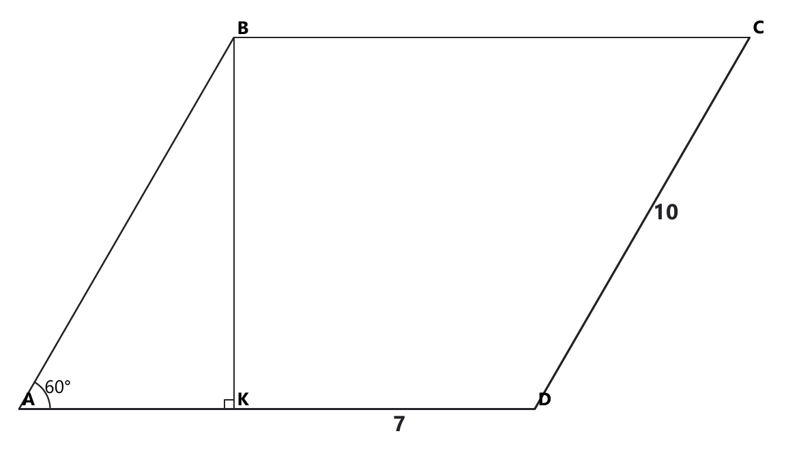

*Параллелограмм ABCD с высотой BK*

4. *Мини-тема 3.* Известно, что $\cos\alpha=\frac5{13}$, где $\alpha$ — острый угол. Найдите $\sin\alpha$ и $\tg\alpha$.

5. *Мини-тема 5.* В прямоугольном треугольнике высота к гипотенузе делит её на отрезки $4$ см и $12$ см. Найдите высоту и катеты.

6. *Повтор.* Упростите выражение $(a-3)^2-a^2+6a$.

### Уровень 7–8 баллов

1. *Мини-тема 2 и 5.* Площадь прямоугольного треугольника равна $18\sqrt3\text{ см}^2$, один острый угол равен $60^\circ$. Найдите катеты и гипотенузу.

2. *Мини-тема 3.* Известно, что $\tg\alpha=\dfrac{8}{15}$, где $\alpha$ — острый угол. Найдите $\sin\alpha$, $\cos\alpha$ и $\ctg\alpha$.

3. *Мини-тема 4.* Известно, что $\sin\alpha=\dfrac{5}{13}$, а угол $\alpha$ тупой. Найдите $\cos\alpha$ и $\tg\alpha$.

4. *Мини-тема 3 и 4.* Вычислите $\cos^2120^\circ+\sin^2120^\circ+\tg150^\circ$.

5. *Мини-тема 5.* Площадь параллелограмма равна $42\sqrt3\text{ см}^2$, его стороны равны $7$ см и $12$ см. Найдите острый угол между этими сторонами.

6. *Повтор.* Решите неравенство $(x-2)(x+5)>0$.

### Уровень 9–10 баллов

1. *Мини-тема 2 и 5.* Катеты прямоугольного треугольника относятся как $3:4$, а высота, проведённая к гипотенузе, равна $12$ см. Найдите катеты, гипотенузу и синус меньшего острого угла.

2. *Мини-тема 4 и 5.* В треугольнике две стороны равны $7$ см и $8$ см, угол между ними равен $120^\circ$. Найдите площадь и третью сторону.

3. *Мини-тема 4.* Найдите $\cos\alpha$, если $\tg\alpha=-\sqrt3$ и $90^\circ<\alpha<180^\circ$.

4. *Мини-тема 5.* В прямоугольном треугольнике катеты равны $9$ см и $12$ см. Найдите высоту, проведённую к гипотенузе, используя среднее пропорциональное.

5. *Мини-тема 5.* В прямоугольном треугольнике катет равен $20$ см, а его проекция на гипотенузу равна $16$ см. Найдите гипотенузу, второй катет и площадь.

6. *Повтор.* Упростите выражение $\frac{x^2-16}{x-4}$ при $x\ne4$ и решите неравенство $x+3\ge2$.

## Домашнее задание

### Уровень 1–2 балла

1. *Мини-тема 1.* Найдите $\sin45^\circ$.

2. *Мини-тема 5.* Найдите площадь треугольника со сторонами $4$ см и $10$ см и углом $30^\circ$ между ними.

3. *Мини-тема 2.* В прямоугольном треугольнике гипотенуза равна $14$ см, один катет равен $7$ см. Найдите второй катет.

4. *Мини-тема 5.* Высота к гипотенузе прямоугольного треугольника делит гипотенузу на отрезки $4$ см и $9$ см. Найдите высоту.

5. *Мини-тема 4.* Найдите $\cos120^\circ$.

6. *Повтор.* Вычислите $2^3\cdot2^2$.

7. *Повтор.* Приведите подобные слагаемые: $7a-3a+5$.

### Уровень 3–4 балла

1. *Мини-тема 1.* Найдите $\tg30^\circ+\ctg60^\circ$.

2. *Мини-тема 5.* Высота к гипотенузе прямоугольного треугольника делит гипотенузу на отрезки $2$ см и $8$ см. Найдите высоту и площадь треугольника.

3. *Мини-тема 3.* Известно, что $\sin\alpha=\frac8{17}$. Найдите $\cos\alpha$ для острого угла $\alpha$.

4. *Мини-тема 4.* Найдите $\tg150^\circ$.

5. *Мини-тема 5.* Найдите площадь треугольника со сторонами $10$ см и $6$ см и углом $60^\circ$ между ними.

6. *Повтор.* Разложите на множители $4x^2-9$.

7. *Повтор.* Решите неравенство $5-2x\le9$.

### Уровень 5–6 баллов

1. *Мини-тема 1.* В прямоугольном треугольнике катеты равны $7$ см и $24$ см. Найдите $\sin$ и $\cos$ угла, противолежащего катету $7$ см.

2. *Мини-тема 2.* В прямоугольном треугольнике гипотенуза равна $20$ см, а один острый угол равен $60^\circ$. Найдите катет, противолежащий этому углу, и катет, прилежащий к нему.

3. *Мини-тема 3.* Известно, что $\cos\alpha=\frac{12}{13}$, где $\alpha$ — острый угол. Найдите $\sin\alpha$, $\tg\alpha$ и $\ctg\alpha$.

4. *Мини-тема 4.* Вычислите $\sin120^\circ+\cos150^\circ$.

5. *Мини-тема 5.* Высота к гипотенузе прямоугольного треугольника делит гипотенузу на отрезки $5$ см и $20$ см. Найдите высоту и гипотенузу.

6. *Повтор.* Упростите выражение $(x+4)^2-x^2-8x$.

7. *Повтор.* Преобразуйте выражение $3^5\cdot3^{-2}$.

### Уровень 7–8 баллов

1. *Мини-тема 1.* В прямоугольном треугольнике гипотенуза равна $26$ см, один катет равен $10$ см. Найдите четыре тригонометрические функции угла, противолежащего этому катету.

2. *Мини-тема 2 и 5.* Угол между катетом и гипотенузой равен $30^\circ$, площадь прямоугольного треугольника равна $8\sqrt3\text{ см}^2$. Найдите оба катета и гипотенузу.

3. *Мини-тема 3.* Известно, что $\tg\alpha=\frac5{12}$, где $\alpha$ — острый угол. Найдите $\sin\alpha$ и $\cos\alpha$.

4. *Мини-тема 4.* Вычислите $\cos135^\circ-\sin150^\circ$.

5. *Мини-тема 5.* Найдите площадь параллелограмма со сторонами $6$ см и $10$ см и тупым углом $150^\circ$ между ними.

6. *Повтор.* Решите неравенство $(2x-1)(x+3)<0$.

7. *Повтор.* Разложите на множители $x^3-9x$.

### Уровень 9–10 баллов

1. *Мини-тема 1.* В прямоугольном треугольнике катеты относятся как $5:12$, а площадь равна $270\text{ см}^2$. Найдите катеты, гипотенузу и значения синуса и косинуса меньшего острого угла.

2. *Мини-тема 5.* В прямоугольном треугольнике высота к гипотенузе делит её на отрезки $9$ см и $16$ см. Найдите катет, проекция которого равна $9$ см, второй катет, высоту и площадь треугольника.

3. *Мини-тема 3 и 4.* Известно, что $\sin\alpha=\dfrac{8}{17}$ и $\cos\alpha<0$. Найдите $\cos\alpha$, $\tg\alpha$ и $\ctg\alpha$.

4. *Мини-тема 4.* Вычислите $\sin120^\circ-\cos135^\circ+\tg150^\circ$.

5. *Мини-тема 4 и 5.* В треугольнике две стороны равны $6$ см и $10$ см, угол между ними равен $120^\circ$. Найдите площадь треугольника и третью сторону.

6. *Повтор.* Упростите выражение $\frac{x^2-25}{x-5}$ при $x\ne5$ и решите неравенство $2x-7>1$.

7. *Повтор.* Упростите $(a+b)^2-(a-b)^2$ и вычислите результат при $a=5$; $b=2$.

## Чек-лист «ученик понял тему»

- [ ] Я различаю прилежащий и противолежащий катеты.
- [ ] Я правильно называю гипотенузу.
- [ ] Я знаю формулы $\sin$, $\cos$, $\tg$, $\ctg$.
- [ ] Я помню табличные значения углов $30^\circ$; $45^\circ$; $60^\circ$.
- [ ] Я умею применять $\sin^2\alpha+\cos^2\alpha=1$.
- [ ] Я умею находить функции тупого угла через острый.
- [ ] Я умею находить площадь через синус и применять среднее пропорциональное.
- [ ] У тупого угла я беру отрицательный косинус, в том числе корень из тождества.
- [ ] Радиус описанной окружности прямоугольного треугольника я нахожу как половину гипотенузы.
- [ ] Третью сторону по двум сторонам и углу между ними я ищу через высоту: при тупом угле проекцию прибавляю, а не вычитаю.
