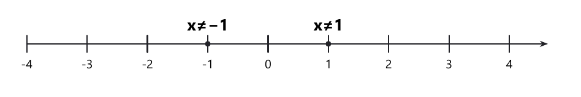
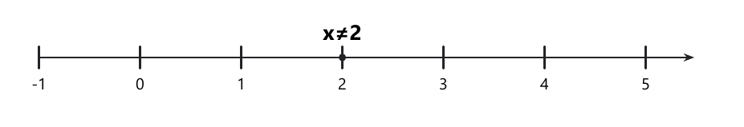
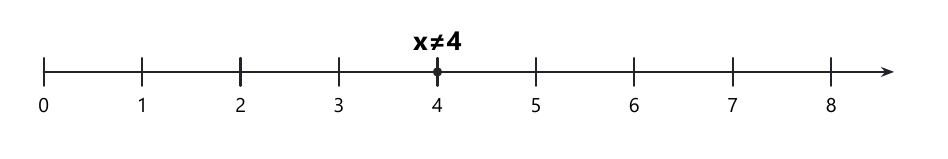

# Занятие 11. Преобразования рациональных выражений

**Дата:** 20.11.2026 (пт)  
**Длительность:** 45 минут  
**Раздел:** Рациональные дроби  
**Подтемы:** комплексные преобразования рациональных выражений; ОДЗ и потеря или появление корней; связь с формулами сокращённого умножения.

## Цели занятия

К концу занятия ученик умеет:

- находить ОДЗ рационального выражения;
- выполнять несколько действий с рациональными дробями по порядку;
- применять разложение на множители и формулы сокращённого умножения;
- понимать, почему после сокращения нельзя забывать первоначальные ограничения;
- выбирать блок заданий своего уровня: 1–2, 3–4, 5–6, 7–8 или 9–10 баллов.

## Тайминг

| Этап | Время | Содержание |
|---|---:|---|
| Теория | 12 мин | ОДЗ, разложение на множители, комплексные преобразования |
| Разбор | 14 мин | Задания сборника и типовые ловушки |
| Самостоятельная работа | 15 мин | Ученик решает только блок своего уровня |
| Итог | 4 мин | Проверка алгоритма и самооценка |

---

## Теория к занятию

### Мини-тема 1. Комплексные преобразования рациональных выражений

Сложное рациональное выражение — это несколько знакомых действий подряд. Сначала записывают, где выражение имеет смысл. Затем выполняют действия по порядку: сложение или вычитание, умножение, деление. В ответе оставляют одну дробь или многочлен и сохраняют ограничения исходной записи.

Отдельные действия уже разобраны в занятии 10. Здесь их соединяют в одну цепочку.

**Определение**

Рациональным называют выражение, составленное из чисел и переменных с помощью сложения, вычитания, умножения, деления и возведения в натуральную степень. Отрицательная целая степень — это деление: $a^{-n}=\frac{1}{a^n}$ при $a\ne 0$, поэтому выражение с целым показателем тоже остаётся рациональным.

Если деления на выражение с переменными нет, рациональное выражение называют целым. Оно имеет смысл при любом значении переменных. Если такое деление есть, выражение называют дробным рациональным.

Рациональная дробь — это частное двух многочленов $\frac{A}{B}$, где $B$ не является нулевым многочленом. Дробь имеет смысл только при $B\ne 0$.

Например, $\frac{x+1}{x-2}$ уже записано как рациональная дробь. Сумма $x^2+\frac{1}{x}$ — дробное рациональное выражение. Одной дробью она становится после приведения: $\frac{x^3+1}{x}$.

В учебнике алгебры 9 класса множество значений, при которых выражение имеет смысл, называют областью определения. В этом курсе то же множество называют ОДЗ.

**Формулы**

Основное свойство дроби:

$$
\frac{A}{B}=\frac{A\cdot C}{B\cdot C}; \qquad C\ne0.
$$

Сложение и вычитание:

$$
\frac{A}{B}+\frac{C}{D}=\frac{AD+BC}{BD},
$$

$$
\frac{A}{B}-\frac{C}{D}=\frac{AD-BC}{BD}.
$$

Деление:

$$
\frac{A}{B}:\frac{C}{D}=\frac{A}{B}\cdot\frac{D}{C}; \qquad C\ne0.
$$

**Правила**

- Сначала запиши ОДЗ по исходной записи.
- Действия выполняй по порядку, а не все скобки сразу.
- Общий знаменатель выбирай после разложения на множители.
- Сокращать можно только множители.
- Деление на дробь заменяй умножением на обратную. Сам делитель не должен быть равен нулю.
- Минус перед скобками меняет знак каждого слагаемого внутри.

**Алгоритм**

1. Найти все знаменатели и дробь, на которую делят.
2. Записать ОДЗ: знаменатели не равны нулю, делитель не равен нулю.
3. Разложить многочлены на множители.
4. Выполнить действия по порядку.
5. Сократить общие множители.
6. В ответе сохранить ОДЗ исходного выражения.

**Мини-пример**

Упростите выражение

$$
\left(\frac{x+1}{x^2-1}-\frac{1}{x-1}\right)(x+1).
$$

На прямой отмечены значения, при которых выражение не существует. Ниже показано, как их получить из знаменателей.

<!--geo-figure-spec
{
  "needed": true,
  "kind": "plane",
  "template": "number_line",
  "caption": "Выколотые значения: x не равно −1 и x не равно 1",
  "start": -4,
  "end": 4,
  "step": 1,
  "major_step": 1,
  "tick_labels": "major",
  "marks": [
    {
      "at": -1,
      "name": "x≠−1"
    },
    {
      "at": 1,
      "name": "x≠1"
    }
  ],
  "axis_arrows": true
}
-->

*Выколотые значения: $x\ne-1$ и $x\ne1$*

*Решение:*

Дано выражение выше. Найти его упрощённый вид и ОДЗ.

Знаменатели исходной записи не должны обращаться в нуль:

$$
x^2-1\ne0, \qquad x-1\ne0.
$$

Разложим разность квадратов:

$$
x^2-1=(x-1)(x+1).
$$

Произведение равно нулю, когда хотя бы один множитель равен нулю. Поэтому

$$
x\ne1, \qquad x\ne-1.
$$

При этих ограничениях в первой дроби сокращается множитель $x+1$:

$$
\frac{x+1}{(x-1)(x+1)}=\frac{1}{x-1}.
$$

Тогда скобка равна

$$
\frac{1}{x-1}-\frac{1}{x-1}=0.
$$

Умножение нуля на $x+1$ даёт нуль. На ОДЗ множитель $x+1$ сам не равен нулю, поэтому он не добавляет нового запрета и не меняет значение.

Тот же нуль виден без раннего сокращения. Вторую дробь приводят к знаменателю $(x-1)(x+1)$, домножая числитель и знаменатель на $x+1$:

$$
\frac{1}{x-1}=\frac{x+1}{(x-1)(x+1)}.
$$

Обе дроби совпали, их разность равна нулю.

Проверка при $x=2$: это значение входит в ОДЗ.

$$
\left(\frac{2+1}{4-1}-\frac{1}{2-1}\right)\cdot(2+1)
=
\left(\frac{3}{3}-1\right)\cdot3=0.
$$

**Ответ:** $0$ при $x\ne-1$ и $x\ne1$.

**Типичные ошибки**

- Сократить $x+1$ внутри суммы или разности: там это слагаемое, а не общий множитель всей дроби.
- После сокращения выбросить $x\ne-1$: в записи $0$ запрета уже не видно, но в исходных знаменателях он был.
- При приведении к общему знаменателю забыть домножить числитель.

---

### Мини-тема 2. ОДЗ и потеря или появление корней

ОДЗ — это все значения, при которых исходное выражение имеет смысл. После сокращения запрещённое значение может исчезнуть из записи, но разрешённым оно не становится. Если обе части уравнения умножить на выражение с переменной, может появиться лишний корень: он подходит к новому уравнению и не подходит к исходному.

Полный алгоритм дробно-рациональных уравнений разбирается в занятии 17. Здесь достаточно сократить общий множитель и сверить каждый ответ с ОДЗ.

**Определение**

Область определения рационального выражения, или ОДЗ, — все значения переменных, при которых выражение имеет смысл: ни один знаменатель не равен нулю и нет деления на нуль.

**Формулы**

Если знаменатель равен $x-a$, то:

$$
x-a\ne0,
$$

$$
x\ne a.
$$

Если знаменатель равен $x^2-a^2$, то:

$$
x^2-a^2=(x-a)(x+a),
$$

$$
x\ne a; \qquad x\ne-a.
$$

**Правила**

- ОДЗ составляют по исходной записи, а не по сокращённой.
- Число из ОДЗ корнем не является, даже если после сокращения оно формально подошло.
- Если делят на дробь, эта дробь сама не должна быть равна нулю.
- После умножения обеих частей на выражение с переменной каждый корень проверяют в исходном уравнении.

**Алгоритм**

1. Выписать знаменатели исходного уравнения и приравнять их к нулю.
2. Исключить найденные значения: это ОДЗ.
3. Разложить числители и сократить общие множители только на ОДЗ.
4. Решить получившееся уравнение.
5. Вычеркнуть корни, которые не входят в ОДЗ.
6. Оставшиеся корни подставить в исходное уравнение.

**Мини-пример**

Решите уравнение

$$
\frac{x^2-4}{x-2}=3.
$$

Точка $x=2$ отмечена как запрещённая: в ней знаменатель равен нулю, поэтому корнем она быть не может.

<!--geo-figure-spec
{
  "needed": true,
  "kind": "plane",
  "template": "number_line",
  "caption": "Значение x = 2 исключено из ОДЗ",
  "start": -1,
  "end": 5,
  "step": 1,
  "major_step": 1,
  "tick_labels": "major",
  "marks": [
    {
      "at": 2,
      "name": "x≠2"
    }
  ],
  "axis_arrows": true
}
-->

*Значение $x=2$ исключено из ОДЗ*

*Решение:*

ОДЗ:

$$
x-2\ne0, \qquad x\ne2.
$$

Разложим числитель:

$$
x^2-4=(x-2)(x+2).
$$

При $x\ne2$ сокращаем общий множитель:

$$
\frac{(x-2)(x+2)}{x-2}=x+2.
$$

Уравнение принимает вид

$$
x+2=3, \qquad x=1.
$$

Число $1$ входит в ОДЗ. Подстановка в исходное уравнение:

$$
\frac{1-4}{1-2}=\frac{-3}{-1}=3.
$$

Обе части равны, значит, $x=1$ — корень.

Откуда берётся лишний корень. Если умножить обе части на $x-2$, не выписав ОДЗ, получится

$$
(x-2)(x+2)=3(x-2).
$$

Перенесём всё влево и вынесем $x-2$:

$$
(x-2)(x+2-3)=0, \qquad (x-2)(x-1)=0.
$$

Кандидаты: $x=2$ и $x=1$. Число $2$ обращает знаменатель исходной дроби в нуль, поэтому корнем не является. В ответ остаётся только $x=1$.

**Ответ:** $1$.

**Типичные ошибки**

- Считать $x=2$ корнем, потому что оно появилось после умножения на знаменатель.
- Проверять только сокращённое уравнение $x+2=3$, не возвращаясь к исходной дроби.
- После сокращения записать ответ без ОДЗ.

---

### Мини-тема 3. Связь с формулами сокращённого умножения

Рациональные дроби часто не сокращаются сразу. Сначала нужно увидеть знакомые выражения: разность квадратов, квадрат суммы или квадрат разности. После разложения многочлены превращаются в произведения, а произведения уже можно сокращать.

Формулы сокращённого умножения уже были в занятии 4. Здесь они нужны, чтобы превратить числитель и знаменатель в произведения: сокращать можно только после этого.

**Формулы**

Разность квадратов:

$$
a^2-b^2=(a-b)(a+b).
$$

Квадрат суммы:

$$
(a+b)^2=a^2+2ab+b^2.
$$

Квадрат разности:

$$
(a-b)^2=a^2-2ab+b^2.
$$

Разложение квадратного трёхчлена:

$$
x^2+(p+q)x+pq=(x+p)(x+q).
$$

**Правила**

- Перед сокращением разложи числитель и знаменатель на множители.
- $a^2+b^2$ не раскладывается по формуле разности квадратов.
- В выражении $a^2-2ab+b^2$ средний член имеет знак «минус».
- Сокращают множители, а не отдельные слагаемые.

**Алгоритм**

1. Найти ОДЗ.
2. Определить подходящую формулу.
3. Разложить числитель и знаменатель.
4. Сократить одинаковые множители.
5. Выполнить оставшиеся действия.
6. Сохранить ограничения ОДЗ.

**Мини-пример**

Сократите дробь

$$
\frac{x^2-16}{x^2-8x+16}.
$$

После разложения знаменателя запрещённым остаётся одно значение. На прямой оно уже отмечено; в решении видно, почему сокращение его не отменяет.

<!--geo-figure-spec
{
  "needed": true,
  "kind": "plane",
  "template": "number_line",
  "caption": "Значение x = 4 исключено: знаменатель обращается в нуль",
  "start": 0,
  "end": 8,
  "step": 1,
  "major_step": 1,
  "tick_labels": "major",
  "marks": [
    {
      "at": 4,
      "name": "x≠4"
    }
  ],
  "axis_arrows": true
}
-->

*Значение $x=4$ исключено: знаменатель обращается в нуль*

*Решение:*

Знаменатель не должен быть равен нулю:

$$
x^2-8x+16\ne0.
$$

Разложим знаменатель:

$$
x^2-8x+16=(x-4)^2.
$$

Разложим числитель по формуле разности квадратов:

$$
x^2-16=(x-4)(x+4).
$$

Получаем:

$$
\frac{x^2-16}{x^2-8x+16}
=
\frac{(x-4)(x+4)}{(x-4)^2}.
$$

В знаменателе два одинаковых множителя $x-4$. Сократить можно только один: второй остаётся в знаменателе.

$$
\frac{(x-4)(x+4)}{(x-4)(x-4)}
=
\frac{x+4}{x-4}.
$$

ОДЗ сохраняется:

$$
x\ne4.
$$

Проверка при $x=5$:

$$
\frac{25-16}{25-40+16}
=
\frac{9}{1}=9,
$$

$$
\frac{5+4}{5-4}=9.
$$

**Ответ:** $\frac{x+4}{x-4}$, $x\ne4$.

**Типичные ошибки**

- Сократить $x^2$ в записи $x^2-16$: слагаемые сокращать нельзя.
- Сократить оба множителя $x-4$ и получить $x+4$ без знаменателя.
- Забыть, что $x=4$ по-прежнему запрещено: у дроби $\frac{x+4}{x-4}$ знаменатель в этой точке равен нулю.
- Перепутать $a^2-b^2$ и $a^2+b^2$. Сумма квадратов по формуле разности квадратов не раскладывается.

---

## Сводка формул «выучить наизусть»

$$
\frac{A}{B}=\frac{A\cdot C}{B\cdot C}; \qquad C\ne0.
$$

$$
\frac{A}{B}\pm\frac{C}{D}=\frac{AD\pm BC}{BD}.
$$

$$
\frac{A}{B}:\frac{C}{D}=\frac{A}{B}\cdot\frac{D}{C}; \qquad C\ne0.
$$

$$
a^2-b^2=(a-b)(a+b).
$$

$$
(a+b)^2=a^2+2ab+b^2.
$$

$$
(a-b)^2=a^2-2ab+b^2.
$$

ОДЗ: все знаменатели исходного выражения не равны нулю.

## Правила, которые нельзя путать

- Сокращают множители, а не слагаемые.
- ОДЗ записывают до преобразований.
- При делении дробей вторую дробь переворачивают.
- Минус перед скобками меняет знаки всех слагаемых.
- После сокращения ограничения ОДЗ сохраняются.
- $a^2-b^2$ и $a^2+b^2$ — разные выражения.

## Разрешённый набор для практики

Мини-темы занятия:

- комплексные преобразования рациональных выражений;
- ОДЗ;
- потеря и появление посторонних корней;
- формулы сокращённого умножения.

Повтор, уже разобранный в прошлых занятиях:

- степени с натуральным и целым показателем — занятие 2;
- многочлены, разложение на множители и формулы сокращённого умножения — занятие 4;
- линейные неравенства — занятие 5;
- квадратные неравенства и метод интервалов для произведения множителей — занятие 7;
- рациональная дробь, сокращение и действия с дробями — занятие 10.

Дробно-рациональные уравнения целиком разбираются в занятии 17, дробно-рациональные неравенства — в занятии 23. В этом занятии такие неравенства не решаем.

---

## Разбор ключевых заданий

Р1 нужен всем: в нём цепочка из вычитания и деления. Р2 — короткая запись одной дробью. Р3 показывает, как противоположные множители дают единицу, и почему в ответе остаётся ОДЗ. Р4 — уравнение с проверкой корней. Если на разбор осталось мало времени, Р3 и Р4 досмотри по шагам дома.

### Р1.
Упростите выражение

$$
\left(\frac{x-4}{x^2-2x+1}
-
\frac{x+2}{x^2+x-2}\right)
:
\frac{1}{(2x-2)^2}.
$$

*Решение:*

Дано выражение.

Найти его упрощённый вид.

Знаменатели исходного выражения не должны обращаться в нуль:

$$
x^2-2x+1\ne0,
$$

$$
x^2+x-2\ne0,
$$

$$
(2x-2)^2\ne0.
$$

Разложим многочлены:

$$
x^2-2x+1=(x-1)^2,
$$

$$
x^2+x-2=(x+2)(x-1),
$$

$$
(2x-2)^2=4(x-1)^2.
$$

ОДЗ:

$$
x\ne1; \qquad x\ne-2.
$$

Выполним вычитание:

$$
\frac{x-4}{(x-1)^2}
-
\frac{x+2}{(x+2)(x-1)}
=
\frac{x-4}{(x-1)^2}
-
\frac{1}{x-1}.
$$

Дробь $\frac{1}{x-1}$ приводим к знаменателю $(x-1)^2$: числитель и знаменатель домножаем на $x-1$.

$$
\frac{1}{x-1}=\frac{x-1}{(x-1)^2}.
$$

Вычитаем числители. Минус перед второй дробью меняет знаки в скобке $x-1$:

$$
\frac{x-4}{(x-1)^2}
-
\frac{x-1}{(x-1)^2}
=
\frac{x-4-(x-1)}{(x-1)^2}
=
\frac{x-4-x+1}{(x-1)^2}.
$$

Получаем:

$$
\frac{-3}{(x-1)^2}.
$$

Деление заменяем умножением на обратную дробь:

$$
\frac{-3}{(x-1)^2}
:
\frac{1}{4(x-1)^2}
=
\frac{-3}{(x-1)^2}\cdot4(x-1)^2.
$$

Сокращаем:

$$
-3\cdot4=-12.
$$

Проверка при $x=0$. Это значение входит в ОДЗ.

$$
\frac{0-4}{0-0+1}=\frac{-4}{1}=-4,
\qquad
\frac{0+2}{0+0-2}=\frac{2}{-2}=-1.
$$

Разность: $-4-(-1)=-3$. Делитель $\frac{1}{(0-2)^2}=\frac{1}{4}$.

$$
-3:\frac{1}{4}=-3\cdot4=-12.
$$

**Ответ:** $-12$, $x\ne1$, $x\ne-2$.

---

### Р2.
Запись выражения

$$
\frac{m}{n}-1
$$

в виде дроби имеет вид:

а) $\frac{m-1}{n}$;

б) $\frac{1-m}{n}$;

в) $\frac{m-n}{n}$;

г) $m-n$;

д) $\frac{n-m}{n}$.

*Решение:*

Дано выражение:

$$
\frac{m}{n}-1.
$$

Найти его запись в виде одной дроби.

Число $1$ представим дробью со знаменателем $n$:

$$
1=\frac{n}{n}; \qquad n\ne0.
$$

Выполним вычитание:

$$
\frac{m}{n}-1
=
\frac{m}{n}-\frac{n}{n}.
$$

Вычитаем числители:

$$
\frac{m-n}{n}.
$$

Это вариант в). Запись имеет смысл при $n\ne0$.

**Ответ:** в) $\frac{m-n}{n}$ при $n\ne0$.

---

### Р3.
Упростите выражение

$$
\left(
\frac{x}{2xy-y^2}
-
\frac{9y}{2x^2-xy}
\right)
:
\frac{9y^2-x^2}{xy^2-2x^2y}.
$$

*Решение:*

Дано выражение с двумя переменными. Найти его упрощённый вид и ОДЗ.

Разложим знаменатели:

$$
2xy-y^2=y(2x-y),
$$

$$
2x^2-xy=x(2x-y),
$$

$$
xy^2-2x^2y=xy(y-2x).
$$

Условие $y-2x\ne0$ — то же самое, что $2x-y\ne0$, то есть $y\ne2x$. Делитель $\frac{9y^2-x^2}{xy(y-2x)}$ не должен быть равен нулю, поэтому $9y^2-x^2\ne0$. Это $x\ne3y$ и $x\ne-3y$.

ОДЗ:

$$
x\ne0,\quad y\ne0,\quad y\ne2x,\quad x\ne3y,\quad x\ne-3y.
$$

Первую скобку приводим к знаменателю $xy(2x-y)$:

$$
\frac{x\cdot x}{xy(2x-y)}
-
\frac{9y\cdot y}{xy(2x-y)}
=
\frac{x^2-9y^2}{xy(2x-y)}.
$$

Деление заменяем умножением на обратную дробь:

$$
\frac{x^2-9y^2}{xy(2x-y)}
\cdot
\frac{xy(y-2x)}{9y^2-x^2}.
$$

Сокращаем $xy$, он на ОДЗ не равен нулю. Остаётся

$$
\frac{x^2-9y^2}{2x-y}
\cdot
\frac{y-2x}{9y^2-x^2}.
$$

Противоположные множители отличаются знаком:

$$
x^2-9y^2=-(9y^2-x^2),
\qquad
y-2x=-(2x-y).
$$

Подставляем:

$$
\frac{-(9y^2-x^2)}{2x-y}
\cdot
\frac{-(2x-y)}{9y^2-x^2}
=
\frac{(-1)\cdot(-1)}{1}
=1.
$$

Оба сокращённых множителя на ОДЗ не равны нулю, поэтому сокращение законно.

Проверка при $x=1$, $y=1$. Все ограничения выполнены.

$$
\frac{1}{2-1}-\frac{9}{2-1}=-8,
\qquad
\frac{9-1}{1-2}=-8,
\qquad
(-8):(-8)=1.
$$

**Ответ:** $1$ при $x\ne0$, $y\ne0$, $y\ne2x$, $x\ne3y$, $x\ne-3y$.

---

### Р4.
Решите уравнение

$$
\frac{x^2-5x}{x-5}=2-x^2.
$$

*Решение:*

ОДЗ:

$$
x-5\ne0,
$$

$$
x\ne5.
$$

Разложим числитель:

$$
x^2-5x=x(x-5).
$$

При $x\ne5$:

$$
\frac{x(x-5)}{x-5}=x.
$$

Получаем уравнение:

$$
x=2-x^2.
$$

Перенесём все слагаемые в левую часть:

$$
x^2+x-2=0.
$$

Разложим квадратный трёхчлен:

$$
x^2+x-2=(x+2)(x-1).
$$

Тогда:

$$
(x+2)(x-1)=0.
$$

Следовательно:

$$
x=-2
\quad\text{или}\quad
x=1.
$$

Проверка ОДЗ:

$$
-2\ne5; \qquad1\ne5.
$$

Проверка подстановкой:

$$
\frac{(-2)^2-5(-2)}{-2-5}
=
\frac{4+10}{-7}
=-2,
$$

$$
2-(-2)^2=2-4=-2.
$$

Для $x=1$:

$$
\frac{1-5}{1-5}=1,
$$

$$
2-1=1.
$$

**Ответ:** $-2;1$.

---

## Самостоятельная работа

Выбери свой уровень и решай только этот блок.  
В каждом блоке есть все мини-темы урока и повтор пройденного материала.

### Уровень 1–2 балла

**С1.** *Сборник, вариант 35, №1.* При каком значении переменной $n$ выражение $\frac{m}{n-2}$ не имеет смысла: а) $-2$; б) $-1$; в) $0$; г) $1$; д) $2$?

**С2.** *Мини-тема 1, авторское.* Представьте в виде одной дроби:

$$
\frac{a}{b}+1.
$$

**С3.** *Мини-тема 3, авторское.* Сократите дробь:

$$
\frac{x^2-25}{x-5}.
$$

**С4.** *Повтор.* Решите неравенство:

$$
3x-7<8.
$$

### Уровень 3–4 балла

**С1.** *Сборник, вариант 79, №4.* Упростите выражение $\frac{x^2-a^2}{x+a}-(3x-a)$ и найдите его значение при $x=12$. Укажите, при каком ограничении на $a$ это значение существует.

**С2.** *Мини-тема 1, авторское.* Упростите:

$$
\frac{2}{x-1}+\frac{3}{x+1}.
$$

**С3.** *Мини-тема 2, авторское.* Решите уравнение:

$$
\frac{x^2-9}{x-3}=4.
$$

**С4.** *Повтор.* Упростите:

$$
\frac{2^5\cdot2^{-2}}{2^2}.
$$

### Уровень 5–6 баллов

**С1.** *Мини-тема 1, авторское.* Упростите выражение и найдите его значение при $x=2$:

$$
\frac{x+1}{x-1}-\frac{x-1}{x+1}.
$$

**С2.** *Мини-тема 1, авторское.* Упростите:

$$
\left(\frac{x+2}{x^2-4}-\frac{1}{x+2}\right)(x-2).
$$

**С3.** *Мини-тема 3, авторское.* Сократите дробь:

$$
\frac{x^2-6x+9}{x^2-9}.
$$

**С4.** *Повтор, занятие 7.* Решите неравенство:

$$
x^2-5x+6\ge0.
$$

### Уровень 7–8 баллов

**С1.** *Сборник, вариант 11, №8.* Найдите все значения переменной, при которых разность дробей $\frac{x}{x+1}$ и $\frac1x$ равна дроби $\frac1{x^2+x}$.

**С2.** *Сборник, вариант 15, №7.* Найдите все значения переменной, при которых значение выражения $\frac{x+3}{x+2}-\frac{2x}{x^2-4}$ равно нулю.

**С3.** *Мини-тема 2, авторское.* Решите уравнение:

$$
\frac{x^2-4x}{x-4}=3-x.
$$

**С4.** *Повтор.* Решите неравенство:

$$
(x-2)(x+3)\le0.
$$

### Уровень 9–10 баллов

**С1.** *Мини-тема 1, авторское.* Упростите:

$$
\left(
\frac{x+1}{x^2-1}
-
\frac{2}{x-1}
\right)
:
\frac{x-3}{x+1}.
$$

**С2.** *Мини-тема 2, авторское.* Решите уравнение:

$$
\frac{x^2-1}{x-1}=x+3.
$$

**С3.** *Мини-тема 3, авторское.* Упростите:

$$
\frac{x^2-4}{x^2-4x+4}
-
\frac{x+2}{x-2}.
$$

**С4.** *Повтор, занятие 7.* Решите неравенство:

$$
(x^2-1)(x-3)\le0.
$$

---

## Домашнее задание

Ученик выбирает тот же уровень, что и в самостоятельной работе.

### Уровень 1–2 балла

**Д1.** *Мини-тема 2, авторское.* При каком значении $x$ дробь $\frac{4}{x+6}$ не имеет смысла?

**Д2.** *Мини-тема 1, авторское.* Представьте в виде одной дроби:

$$
\frac{p}{q}-1.
$$

**Д3.** *Мини-тема 3, авторское.* Разложите на множители:

$$
x^2-36.
$$

**Д4.** *Мини-тема 3, авторское.* Разложите на множители:

$$
x^2+6x+9.
$$

**Д5.** *Мини-тема 1, авторское.* Сократите:

$$
\frac{3x}{6x}.
$$

**Д6.** *Мини-тема 2, авторское.* Укажите ОДЗ выражения $\frac{x+2}{x^2-4}$.

**Д7.** *Повтор.* Вычислите:

$$
3^4:3^2.
$$

**Д8.** *Повтор.* Решите неравенство:

$$
2x+1>7.
$$

### Уровень 3–4 балла

**Д1.** *Мини-тема 1, авторское.* Упростите:

$$
\frac{1}{x-2}+\frac{2}{x+2}.
$$

**Д2.** *Мини-тема 2, авторское.* Решите уравнение:

$$
\frac{x^2-16}{x-4}=5.
$$

**Д3.** *Мини-тема 3, авторское.* Сократите:

$$
\frac{x^2-49}{x^2-14x+49}.
$$

**Д4.** *Мини-тема 1, авторское.* Упростите:

$$
\left(\frac{x}{x+1}-\frac{1}{x+1}\right)(x+1).
$$

**Д5.** *Мини-тема 2, авторское.* Укажите ОДЗ:

$$
\frac{3x}{(x-1)(x+4)}.
$$

**Д6.** *Мини-тема 3, авторское.* Разложите на множители:

$$
4x^2-25.
$$

**Д7.** *Повтор.* Упростите:

$$
\frac{a^3\cdot a^{-1}}{a}.
$$

**Д8.** *Повтор.* Решите неравенство:

$$
7-3x<1.
$$

### Уровень 5–6 баллов

**Д1.** *Мини-тема 1, авторское.* Упростите:

$$
\frac{x+3}{x^2-9}-\frac{1}{x-3}.
$$

**Д2.** *Мини-тема 1, авторское.* Упростите:

$$
\left(\frac{2}{x-1}+\frac{1}{x+1}\right)(x^2-1).
$$

**Д3.** *Мини-тема 2, авторское.* Решите уравнение:

$$
\frac{x^2-25}{x-5}=6.
$$

**Д4.** *Мини-тема 3, авторское.* Сократите:

$$
\frac{x^2+4x+4}{x^2-4}.
$$

**Д5.** *Мини-тема 2, авторское.* Найдите ОДЗ выражения:

$$
\frac{x-1}{x^2-5x+6}.
$$

**Д6.** *Мини-тема 1, авторское.* Упростите:

$$
\frac{x}{x-2}:\frac{x+1}{x-2}.
$$

**Д7.** *Повтор.* Решите неравенство:

$$
4x-9\le3.
$$

**Д8.** *Повтор.* Упростите:

$$
\frac{5^4}{5^2}.
$$

### Уровень 7–8 баллов

**Д1.** *Сборник, вариант 53, №7.* Решите уравнение:

$$
1+\frac{5}{m^2-m-6}=\frac{1}{m+2}.
$$

**Д2.** *Мини-тема 1, авторское.* Упростите:

$$
\left(
\frac{x-2}{x^2-4}
-
\frac{1}{x+2}
\right)
:
\frac{x-1}{x-2}.
$$

**Д3.** *Мини-тема 2, авторское.* Решите уравнение:

$$
\frac{x^2-9}{x-3}=2x-5.
$$

**Д4.** *Мини-тема 3, авторское.* Упростите:

$$
\frac{x^2-16}{x^2-8x+16}
+
\frac{x+4}{x-4}.
$$

**Д5.** *Мини-тема 1, авторское.* Упростите:

$$
\frac{x}{x-1}-\frac{1}{x^2-x}.
$$

**Д6.** *Мини-тема 2, авторское.* Решите уравнение:

$$
\frac{x^2-1}{x+1}=2x.
$$

**Д7.** *Повтор.* Решите неравенство:

$$
(x-1)(x+4)>0.
$$

**Д8.** *Повтор.* Упростите:

$$
\frac{2^6\cdot2^{-3}}{2}.
$$

### Уровень 9–10 баллов

**Д1.** *Мини-тема 1, авторское.* Упростите:

$$
\left(
\frac{x-1}{x^2-1}
-
\frac{2}{x+1}
\right)
:
\frac{x-3}{x-1}.
$$

**Д2.** *Мини-тема 2, авторское.* Решите уравнение:

$$
\frac{x^2-4x+3}{x-1}=2.
$$

**Д3.** *Мини-тема 3, авторское.* Упростите:

$$
\frac{x^2-25}{x^2-10x+25}
-
\frac{x+5}{x-5}.
$$

**Д4.** *Мини-тема 1, авторское.* Упростите:

$$
\left(
\frac{x+2}{x^2-4}
+
\frac{1}{x-2}
\right)
:
\frac{x+1}{x+2}.
$$

**Д5.** *Мини-тема 2, авторское.* Решите уравнение:

$$
\frac{x+1}{x-2}-\frac{x-1}{x+2}=\frac{6}{x^2-4}.
$$

**Д6.** *Мини-тема 3, авторское.* Сократите:

$$
\frac{x^2-6x+9}{x^2-9}
\cdot
\frac{x+3}{x-3}.
$$

**Д7.** *Повтор, занятие 7.* Решите неравенство:

$$
(x^2-4)(x+1)\ge0.
$$

**Д8.** *Повтор.* Упростите:

$$
\frac{a^4\cdot a^{-2}}{a}.
$$

---

## Чек-лист «ученик понял тему»

- Я умею находить все запрещённые значения переменной.
- Я записываю ОДЗ до сокращения дроби.
- Я раскладываю разность квадратов на множители.
- Я узнаю квадрат суммы и квадрат разности.
- Я не сокращаю слагаемые в сумме.
- Я умею заменять деление дробей умножением на обратную дробь.
- Я проверяю найденные корни по ОДЗ.
- Если после сокращения получилось неверное числовое равенство, я записываю: решений нет.
- Если единственный кандидат попал в запрещённое значение, я тоже записываю: решений нет.

---
