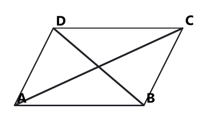
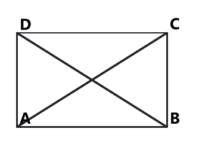

# Занятие 12. Четырёхугольники: свойства, площади, трапеция

**Дата:** 27.11.2026 (пт)  
**Длительность:** 45 минут  
**Раздел:** Планиметрия: четырёхугольники  
**Подтемы:** параллелограмм, прямоугольник, ромб, квадрат; трапеция; средняя линия и площади; диагонали и углы; задачи по готовому чертежу.

## Цели занятия

К концу занятия ученик сможет:

- различать параллелограмм, прямоугольник, ромб, квадрат и трапецию;
- применять свойства сторон, углов и диагоналей четырёхугольников;
- находить среднюю линию и площадь трапеции;
- выбирать нужную формулу по условию и чертежу;
- решать задачи своего экзаменационного уровня от 1–2 до 9–10 баллов.

## Тайминг

| Этап | Время |
|---|---:|
| Теория | 12 мин |
| Разбор ключевых заданий | 14 мин |
| Самостоятельная работа | 15 мин |
| Проверка и домашнее задание | 4 мин |

На самостоятельной работе ученик решает **только один блок** своего уровня.

## Теория к занятию

### Мини-тема 1. Параллелограмм, прямоугольник, ромб, квадрат

Смотри на эти фигуры как на «семейство» четырёхугольников. Параллелограмм — самая общая фигура в этом семействе. Если у него все углы прямые, получается прямоугольник. Если все стороны равны — ромб. Если выполнены оба условия, получаем квадрат.

#### Определение / факт

**Параллелограмм** — это четырёхугольник, у которого противоположные стороны попарно параллельны.

**Прямоугольник** — параллелограмм, у которого все углы прямые.

**Ромб** — параллелограмм, у которого все стороны равны.

**Квадрат** — прямоугольник, у которого все стороны равны.

Параллелограмм обладает свойствами:

- противоположные стороны равны;
- противоположные углы равны;
- соседние углы в сумме дают $180^\circ$;
- диагонали точкой пересечения делятся пополам.

Для прямоугольника:

- диагонали равны;
- диагонали делятся пополам.

Для ромба:

- диагонали перпендикулярны;
- диагонали являются биссектрисами углов;
- диагонали делятся пополам.

Для квадрата верны свойства и прямоугольника, и ромба.

#### Формулы

Периметр параллелограмма:

$$P=2(a+b).$$

Площадь параллелограмма:

$$S=ah,$$

где $a$ — сторона, к которой проведена высота $h$.

Площадь прямоугольника:

$$S=ab.$$

Площадь ромба через диагонали:

$$S=\frac{d_1d_2}{2}.$$

Площадь квадрата:

$$S=a^2.$$

#### Правила

- Не говори, что диагонали любого параллелограмма равны: это неверно.
- Равные диагонали параллелограмма дают прямоугольник, но не обязательно квадрат.
- Перпендикулярные диагонали параллелограмма дают ромб.
- В квадрате диагонали одновременно равны и перпендикулярны.
- В формуле площади параллелограмма высота должна быть перпендикулярна выбранной стороне.

#### Алгоритм

1. Определи вид четырёхугольника.
2. Выпиши известные стороны, диагонали, углы и высоты.
3. Выбери свойство или формулу.
4. Подставь числа с единицами измерения.
5. Проверь, не использовано ли свойство, которого у данной фигуры нет.

#### Мини-пример

**Условие.** Диагонали ромба равны $12$ см и $16$ см. Найдите площадь ромба.

*Решение:*

Дано: ромб, $d_1=12$ см, $d_2=16$ см.

Найти: $S$.

Для площади ромба используем формулу

$$S=\frac{d_1d_2}{2}.$$

Подставляем значения:

$$S=\frac{12\cdot16}{2}.$$

Вычисляем произведение:

$$12\cdot16=192.$$

Делим на $2$:

$$S=\frac{192}{2}=96\text{ см}^2.$$

Площадь положительна и измеряется в квадратных единицах.

**Ответ:** $96\text{ см}^2$.

#### Ловушки экзамена

- Диагонали ромба не обязаны быть равными.
- Площадь ромба не равна произведению диагоналей без деления на $2$.
- Сторона и высота — не одно и то же.
- Прямоугольник не всегда является квадратом.

---

### Мини-тема 2. Трапеция: средняя линия и площадь

Трапеция имеет одну пару параллельных сторон. Эти стороны называются основаниями. Две остальные стороны — боковые стороны. Средняя линия трапеции словно «усредняет» основания: она равна их полусумме.

#### Определение / факт

**Трапеция** — четырёхугольник, у которого только две противоположные стороны параллельны.

Параллельные стороны называются основаниями.

**Средняя линия трапеции** — отрезок, соединяющий середины боковых сторон.

Средняя линия трапеции параллельна основаниям и равна их полусумме.

#### Формулы

Средняя линия трапеции:

$$m=\frac{a+b}{2},$$

где $a$ и $b$ — основания.

Площадь трапеции:

$$S=\frac{a+b}{2}\cdot h,$$

где $h$ — высота трапеции.

Так как $m=\frac{a+b}{2}$, можно записать:

$$S=mh.$$

#### Правила

- В формуле площади используются именно основания, а не боковые стороны.
- Высота перпендикулярна основаниям.
- Если трапеция равнобедренная, её боковые стороны равны.
- В равнобедренной трапеции углы при каждом основании равны.
- Диагонали равнобедренной трапеции равны.

#### Алгоритм

1. Найди основания трапеции.
2. Найди высоту.
3. Если нужна средняя линия, вычисли полусумму оснований.
4. Если нужна площадь, используй формулу площади.
5. Проверь единицы: площадь записывается в квадратных единицах.

#### Мини-пример

**Условие.** Основания трапеции равны $8$ см и $14$ см, высота равна $5$ см. Найдите площадь трапеции.

*Решение:*

Дано: $a=8$ см, $b=14$ см, $h=5$ см.

Найти: $S$.

Используем формулу площади трапеции:

$$S=\frac{a+b}{2}\cdot h.$$

Подставляем значения:

$$S=\frac{8+14}{2}\cdot5.$$

Складываем основания:

$$8+14=22.$$

Находим их полусумму:

$$\frac{22}{2}=11.$$

Умножаем на высоту:

$$S=11\cdot5=55\text{ см}^2.$$

Проверка: средняя линия равна $11$ см, поэтому $S=mh=11\cdot5=55\text{ см}^2$.

**Ответ:** $55\text{ см}^2$.

#### Ловушки экзамена

- Не складывай боковые стороны вместо оснований.
- Не забывай делить сумму оснований на $2$.
- Высота не обязана совпадать с боковой стороной.
- Средняя линия — это не половина одного основания.

---

### Мини-тема 3. Свойства диагоналей и углов

Диагональ соединяет две противоположные вершины многоугольника. В четырёхугольнике диагонали помогают разделить фигуру на треугольники и найти неизвестные углы или площади.

В параллелограмме диагонали пересекаются и делятся пополам. Это часто превращает длинные отрезки в равные половины. В прямоугольнике диагонали дополнительно равны. В ромбе они дополнительно перпендикулярны.

#### Определение / факт

**Диагональ четырёхугольника** — отрезок, соединяющий две его противоположные вершины.

Сумма углов любого четырёхугольника равна $360^\circ$.

В параллелограмме:

$$\angle A=\angle C,$$

$$\angle B=\angle D,$$

$$\angle A+\angle B=180^\circ.$$

#### Формулы

Сумма углов четырёхугольника:

$$\angle A+\angle B+\angle C+\angle D=360^\circ.$$

Если диагонали параллелограмма пересекаются в точке $O$, то

$$AO=OC,\qquad BO=OD.$$

В прямоугольнике:

$$AC=BD.$$

В ромбе:

$$AC\perp BD.$$

#### Правила

- Вертикальные углы равны.
- Смежные углы в сумме дают $180^\circ$.
- Не путай диагонали и стороны.
- В ромбе диагонали перпендикулярны, но равны только в частном случае квадрата.
- На готовом чертеже сначала отметь все равные углы и отрезки, которые следуют из условия.

#### Алгоритм работы с готовым чертежом

1. Выпиши, какая фигура дана.
2. Отметь параллельные и равные стороны.
3. Найди свойства диагоналей.
4. Раздели фигуру на треугольники, если это удобно.
5. Используй сумму углов треугольника или четырёхугольника.
6. Проверь, что найденный угол лежит в пределах от $0^\circ$ до $180^\circ$.

#### Мини-пример

**Условие.** В параллелограмме $ABCD$ угол $A$ равен $68^\circ$. Найдите угол $B$.

*Решение:*

Дано: $ABCD$ — параллелограмм, $\angle A=68^\circ$.

Найти: $\angle B$.

Соседние углы параллелограмма являются односторонними углами при параллельных прямых.

Поэтому их сумма равна $180^\circ$:

$$\angle A+\angle B=180^\circ.$$

Подставляем значение угла $A$:

$$68^\circ+\angle B=180^\circ.$$

Вычитаем $68^\circ$:

$$\angle B=180^\circ-68^\circ.$$

Вычисляем:

$$\angle B=112^\circ.$$

Проверка:

$$68^\circ+112^\circ=180^\circ.$$

**Ответ:** $112^\circ$.

#### Ловушки экзамена

- Противоположные углы параллелограмма равны, соседние — нет.
- Сумма углов четырёхугольника равна $360^\circ$, а не $180^\circ$.
- Равные диагонали не означают, что фигура является квадратом.
- В ромбе диагонали перпендикулярны, но могут иметь разную длину.

---

### Мини-тема 4. Задачи на готовом чертеже

Чертёж — не украшение, а карта задачи. Но карта не должна заменять условие: все данные нужно читать из текста. На экзамене важно не дорисовывать свойства «по внешнему виду». Если фигура выглядит как прямоугольник, это ещё не значит, что она прямоугольник.

<!--geo-figure-spec
{
  "needed": true,
  "kind": "plane",
  "template": "parallelogram",
  "caption": "Параллелограмм $ABCD$ с диагоналями",
  "show_labels": true,
  "show_hidden": false,
  "highlight_segments": [
    [
      "A",
      "C"
    ],
    [
      "B",
      "D"
    ]
  ],
  "segment_labels": []
}
-->

*Параллелограмм ABCD с диагоналями*

#### Простыми словами

Сначала прочитай условие, затем рассмотри чертёж. Найди, какие отрезки параллельны, какие равны и где расположены прямые углы. Если даны диагонали, отметь их точку пересечения. Если дана высота, найди прямой угол.

#### Определение / факт

Высота параллелограмма или трапеции — перпендикуляр, проведённый к прямой, содержащей основание.

Прямой угол обозначается так:

$$90^\circ.$$

#### Правила

- Не измеряй угол линейкой на рисунке.
- Не считай стороны равными только потому, что они выглядят одинаковыми.
- Используй только данные условия и известные свойства фигуры.
- При нахождении площади обязательно указывай единицы измерения.

#### Алгоритм

1. Перепиши данные кратко.
2. Укажи, что требуется найти.
3. Назови фигуру и нужное свойство.
4. Запиши формулу.
5. Подставь числа.
6. Выполни вычисления.
7. Проверь ответ по смыслу.

#### Мини-пример

**Условие.** В прямоугольнике $ABCD$ сторона $AB=7$ см, сторона $BC=4$ см. Найдите диагональ $AC$.

*Решение:*

Дано: $ABCD$ — прямоугольник, $AB=7$ см, $BC=4$ см.

Найти: $AC$.

Треугольник $ABC$ прямоугольный, потому что угол $B$ прямой.

По теореме Пифагора:

$$AC^2=AB^2+BC^2.$$

Подставляем значения:

$$AC^2=7^2+4^2.$$

Вычисляем квадраты:

$$7^2=49,$$

$$4^2=16.$$

Складываем:

$$AC^2=49+16=65.$$

Так как длина отрезка положительна:

$$AC=\sqrt{65}\text{ см}.$$

Проверка: $\sqrt{65}>7$, что верно для гипотенузы прямоугольного треугольника.

**Ответ:** $\sqrt{65}\text{ см}$.

#### Ловушки экзамена

- Не используй теорему Пифагора без прямого угла.
- Не бери квадратный корень с отрицательным результатом.
- Не округляй ответ, если точное значение можно записать через корень.
- Не путай диагональ с высотой.

## Сводка формул «выучить наизусть»

$$P_{\text{параллелограмма}}=2(a+b).$$

$$S_{\text{параллелограмма}}=ah.$$

$$S_{\text{прямоугольника}}=ab.$$

$$S_{\text{квадрата}}=a^2.$$

$$S_{\text{ромба}}=\frac{d_1d_2}{2}.$$

$$m_{\text{трапеции}}=\frac{a+b}{2}.$$

$$S_{\text{трапеции}}=\frac{a+b}{2}\cdot h=mh.$$

$$\angle A+\angle B+\angle C+\angle D=360^\circ.$$

$$AC=BD$$

для прямоугольника.

$$AC\perp BD$$

для ромба.

## Правила, которые нельзя путать

- У параллелограмма противоположные стороны равны.
- У прямоугольника диагонали равны.
- У ромба диагонали перпендикулярны.
- У квадрата выполняются оба свойства.
- В трапеции в формуле площади участвуют основания и высота.
- Средняя линия трапеции равна полусумме оснований.
- Соседние углы параллелограмма в сумме дают $180^\circ$.
- Сумма углов четырёхугольника равна $360^\circ$.

## Разрешённый набор для практики

Мини-темы занятия:

- параллелограмм, прямоугольник, ромб, квадрат;
- трапеция, средняя линия и площадь;
- свойства диагоналей и углов;
- задачи на готовом чертеже.

Повтор:

- линейные неравенства;
- степени с натуральным показателем;
- степени с целым показателем;
- приведение подобных слагаемых;
- разложение на множители;
- формулы сокращённого умножения;
- тождественные преобразования;
- преобразование выражений со степенями.

## Разбор ключевых заданий

### Р1.
$ABCD$ — прямоугольник, $O$ — точка пересечения его диагоналей. Угол $AOB$ равен $46^\circ$. Найдите угол $ADB$.

<!--geo-figure-spec
{
  "needed": true,
  "kind": "plane",
  "template": "rectangle",
  "caption": "Прямоугольник $ABCD$ с диагоналями",
  "show_labels": true,
  "show_hidden": false,
  "highlight_segments": [
    [
      "A",
      "C"
    ],
    [
      "B",
      "D"
    ]
  ],
  "angle_marks": [
    {
      "vertex": "O",
      "from": "A",
      "to": "B",
      "text": "46°"
    }
  ]
}
-->

*Прямоугольник ABCD с диагоналями*

*Решение:*

Дано: $ABCD$ — прямоугольник, $O$ — точка пересечения диагоналей, $\angle AOB=46^\circ$.

Найти: $\angle ADB$.

Диагонали прямоугольника равны и точкой пересечения делятся пополам.

Поэтому

$$OA=OB.$$

Треугольник $AOB$ равнобедренный.

Его углы при основании равны:

$$\angle OAB=\angle ABO.$$

Сумма углов треугольника равна $180^\circ$:

$$\angle OAB+\angle ABO+\angle AOB=180^\circ.$$

Подставляем:

$$2\angle OAB+46^\circ=180^\circ.$$

$$2\angle OAB=134^\circ.$$

$$\angle OAB=67^\circ.$$

Луч $AO$ лежит на диагонали $AC$, поэтому

$$\angle OAB=\angle CAB=67^\circ.$$

В прямоугольном треугольнике $ABD$ угол $BAD$ равен $90^\circ$.

Следовательно,

$$\angle ADB=180^\circ-90^\circ-67^\circ.$$

$$\angle ADB=23^\circ.$$

Проверка:

$$90^\circ+67^\circ+23^\circ=180^\circ.$$

**Ответ:** $23^\circ$.

---

### Р2.
$ABCD$ — параллелограмм, биссектриса угла $A$ пересекает сторону $BC$ в точке $K$, отрезки $BK$ и $KC$ равны соответственно $6$ см и $4$ см. Найдите периметр параллелограмма.

*Решение:*

Дано:

$$BK=6\text{ см},\qquad KC=4\text{ см}.$$

Найти: $P$.

Так как точка $K$ лежит на стороне $BC$,

$$BC=BK+KC.$$

$$BC=6+4=10\text{ см}.$$

В параллелограмме противоположные стороны равны:

$$AD=BC=10\text{ см}.$$

Так как $AK$ — биссектриса угла $A$, то

$$\angle BAK=\angle KAD.$$

Поскольку $AD\parallel BC$, получаем равенство соответствующих углов:

$$\angle KAD=\angle AKB.$$

Следовательно, в треугольнике $ABK$

$$\angle BAK=\angle AKB.$$

Против равных углов лежат равные стороны:

$$AB=BK=6\text{ см}.$$

Периметр параллелограмма:

$$P=2(AB+BC).$$

$$P=2(6+10).$$

$$P=2\cdot16=32\text{ см}.$$

**Ответ:** $32\text{ см}$.

---

### Р3.
Какое из утверждений **неверно**:

а) площадь прямоугольника равна произведению соседних сторон;

б) диагонали любого ромба равны между собой;

в) диаметры одной окружности равны между собой;

г) если три угла одного треугольника соответственно равны трём углам другого, то такие треугольники подобны?

*Решение:*

Проверим утверждения.

а) Верно, так как

$$S=ab.$$

б) Неверно.

У ромба диагонали перпендикулярны, но равны они только у квадрата.

в) Верно: все радиусы одной окружности равны, поэтому и все диаметры равны.

г) Верно: если три угла одного треугольника равны трём углам другого, треугольники подобны.

**Ответ:** б).

---

### Р4.
В параллелограмме $ABCD$ диагонали взаимно перпендикулярны. Высота $BH$, проведённая к стороне $AD$, пересекает диагональ $AC$ в точке $K$; $BK=10$ см, $KH=6$ см. Найдите площадь параллелограмма.

*Решение:*

Дано:

$$AC\perp BD,$$

$$BK=10\text{ см},\qquad KH=6\text{ см}.$$

Найти: $S_{ABCD}$.

Так как $BH\perp AD$, а $K$ лежит на $BH$, треугольник $AKH$ прямоугольный.

В параллелограмме с перпендикулярными диагоналями все стороны равны, то есть параллелограмм является ромбом.

Точка $K$ лежит на диагонали $AC$, а $BK$ — часть диагонали $BD$.

Диагонали ромба перпендикулярны и делятся пополам.

Так как $BH$ — высота к стороне $AD$, отрезок $KH$ является высотой треугольника $BCD$.

Рассмотрим прямоугольный треугольник $BKH$:

$$BH=BK+KH.$$

$$BH=10+6=16\text{ см}.$$

В ромбе высота к стороне и расстояние между параллельными сторонами равны, поэтому высота параллелограмма равна $16$ см.

Из прямоугольного треугольника $BKH$ по теореме Пифагора:

$$BH^2=BK^2+KH^2.$$

Здесь данные отрезки являются катетами соответствующего прямоугольного треугольника, поэтому

$$BH=\sqrt{10^2+6^2}.$$

$$BH=\sqrt{100+36}.$$

$$BH=\sqrt{136}=2\sqrt{34}.$$

Тогда сторона ромба, являющаяся основанием параллелограмма, равна

$$AD=BK+KH=16\text{ см}.$$

Площадь параллелограмма:

$$S=AD\cdot BH.$$

$$S=16\cdot2\sqrt{34}.$$

$$S=32\sqrt{34}\text{ см}^2.$$

**Ответ:** $32\sqrt{34}\text{ см}^2$.

## Самостоятельная работа

Выбери свой уровень и решай только этот блок.  
В каждом блоке есть мини-темы занятия и повтор ранее изученного материала.

### Уровень 1–2 балла

1. *мини-тема 1, авторское.* Как называется параллелограмм, у которого все углы прямые?

2. *мини-тема 2, авторское.* Основания трапеции равны $7$ см и $11$ см. Найдите её среднюю линию.

3. *мини-тема 3, авторское.* Один угол параллелограмма равен $72^\circ$. Найдите соседний угол.

4. *мини-тема 4, авторское.* Найдите площадь прямоугольника со сторонами $6$ см и $3$ см.

5. *повтор.* Решите неравенство:

$$3x-5<10.$$

### Уровень 3–4 балла

1. *сборник, вариант 1, №3.* Какое утверждение неверно: а) вертикальные углы равны; б) если в треугольнике два угла равны, то он равнобедренный; в) противоположные стороны параллелограмма равны; г) диагонали любого ромба равны?

2. *сборник, вариант 7, №3.* Какое утверждение неверно: а) накрест лежащие углы при параллельных прямых равны; б) средняя линия треугольника параллельна основанию; в) $\sin30^\circ=\frac12$; г) если диагонали параллелограмма равны, то он обязательно квадрат?

3. *сборник, вариант 73, №3.* Какое утверждение неверно: а) $P_{\text{квадрата}}=4a$; б) радиус в два раза меньше диаметра; в) треугольник с углами $20^\circ$ и $70^\circ$ прямоугольный; г) диагонали любого параллелограмма перпендикулярны?

4. *мини-тема 2, авторское.* Основания трапеции равны $10$ см и $18$ см, высота равна $4$ см. Найдите площадь.

5. *повтор.* Упростите:

$$3a^2+5a-2a^2-7a.$$

### Уровень 5–6 баллов

1. *сборник, вариант 41, №5.* Диагонали параллелограмма $ABCD$ пересекаются в точке $O$, площадь треугольника $AOB$ равна $15\text{ см}^2$. Высота, проведённая из вершины $C$ к $AD$, равна $6$ см. Найдите длину стороны $BC$ параллелограмма.

2. *сборник, вариант 53, №6.* $ABCD$ — равнобедренная трапеция с основаниями $AD=10$ см и $BC=6$ см. Диагональ $BD=10$ см. Найдите площадь трапеции.

3. *сборник, вариант 5, №5.* Высоты параллелограмма, проведённые из вершины тупого угла, равны $6$ см и $9$ см. Периметр параллелограмма равен $40$ см. Найдите площадь.

4. *мини-тема 3, авторское.* Диагонали ромба равны $10$ см и $24$ см. Найдите его сторону.

5. *повтор.* Разложите на множители:

$$x^2-9x+20.$$

### Уровень 7–8 баллов

1. *сборник, вариант 67, №7.* В параллелограмм с диагоналями, равными $6$ см и $8$ см, вписана окружность. Найдите радиус этой окружности.

2. *мини-тема 1, авторское.* В ромбе сторона равна $13$ см, одна диагональ равна $10$ см. Найдите площадь ромба.

3. *мини-тема 2, авторское.* В равнобедренной трапеции основания равны $18$ см и $8$ см, боковая сторона равна $13$ см. Найдите площадь.

4. *мини-тема 4, авторское.* В параллелограмме $ABCD$ диагонали пересекаются в точке $O$, $AC=18$ см, $BD=14$ см. Найдите $AO$ и $DO$.

5. *повтор.* Упростите:

$$\frac{x^2-16}{x-4},\qquad x\ne4.$$

### Уровень 9–10 баллов

1. *мини-тема 1, авторское.* В прямоугольнике диагональ равна $25$ см, одна сторона равна $7$ см. Найдите площадь прямоугольника.

2. *мини-тема 2, авторское.* В равнобедренной трапеции основания равны $26$ см и $10$ см, площадь равна $216\text{ см}^2$. Найдите боковую сторону.

3. *мини-тема 3, авторское.* В ромбе сторона равна $10$ см, острый угол равен $60^\circ$. Найдите площадь ромба.

4. *мини-тема 4, авторское.* В параллелограмме одна диагональ равна $20$ см, другая — $14$ см, а сторона равна $13$ см. Найдите площадь параллелограмма.

5. *повтор.* Решите неравенство:

$$x^2-5x+6\le0.$$

## Домашнее задание

### Уровень 1–2 балла

1. *мини-тема 1, авторское.* Назовите фигуру, у которой все стороны равны и все углы прямые.

2. *мини-тема 2, авторское.* Найдите среднюю линию трапеции с основаниями $12$ см и $20$ см.

3. *мини-тема 3, авторское.* В параллелограмме один угол равен $115^\circ$. Найдите противоположный угол.

4. *мини-тема 4, авторское.* Найдите площадь квадрата со стороной $9$ см.

5. *повтор.* Вычислите:

$$2^4+3^2.$$

6. *повтор.* Упростите:

$$7x-3x+5.$$

### Уровень 3–4 балла

1. *мини-тема 1, авторское.* Найдите периметр параллелограмма со сторонами $8$ см и $13$ см.

2. *мини-тема 2, авторское.* Основания трапеции равны $9$ см и $15$ см, высота равна $6$ см. Найдите площадь.

3. *мини-тема 3, авторское.* В прямоугольнике один из углов треугольника, образованного диагональю и стороной, равен $35^\circ$. Найдите угол между диагональю и другой стороной прямоугольника.

4. *мини-тема 4, авторское.* Диагонали параллелограмма пересекаются в точке $O$. Если $AO=5$ см и $BO=7$ см, найдите $AC$ и $BD$.

5. *повтор.* Решите неравенство:

$$5x+2\ge17.$$

6. *повтор.* Разложите на множители:

$$a^2-25.$$

### Уровень 5–6 баллов

1. *сборник, вариант 7, №5.* В трапеции $ABCD$ с основаниями $AD$ и $BC$ точка $O$ — точка пересечения диагоналей, $AD=10$ см, $AO=6$ см, $OC=3$ см. Найдите среднюю линию трапеции.

2. *сборник, вариант 65, №6.* Около окружности радиуса $4$ см описана равнобедренная трапеция, площадь которой равна $80\text{ см}^2$. Найдите боковую сторону.

3. *мини-тема 1, авторское.* Площадь ромба равна $120\text{ см}^2$, одна диагональ равна $10$ см. Найдите другую диагональ.

4. *мини-тема 2, авторское.* Основания трапеции относятся как $2:3$, их сумма равна $25$ см, высота равна $8$ см. Найдите площадь.

5. *повтор.* Упростите:

$$\frac{x^2-9}{x+3},\qquad x\ne-3.$$

6. *повтор.* Решите неравенство:

$$4-2x>10.$$

### Уровень 7–8 баллов

1. *мини-тема 1, авторское.* В прямоугольнике стороны относятся как $3:4$, а диагональ равна $20$ см. Найдите площадь.

2. *мини-тема 2, авторское.* В равнобедренной трапеции основания равны $22$ см и $12$ см, высота равна $12$ см. Найдите боковую сторону и площадь.

3. *мини-тема 3, авторское.* В ромбе диагонали равны $16$ см и $30$ см. Найдите сторону и периметр ромба.

4. *мини-тема 4, авторское.* В параллелограмме $ABCD$ диагональ $AC$ образует со стороной $AB$ угол $40^\circ$, а со стороной $BC$ угол $25^\circ$. Найдите углы параллелограмма.

5. *повтор.* Разложите на множители:

$$x^3-4x.$$

6. *повтор.* Упростите:

$$\frac{a^2-2a+1}{a-1},\qquad a\ne1.$$

### Уровень 9–10 баллов

1. *мини-тема 1, авторское.* В ромбе диагонали относятся как $3:4$, а сторона равна $25$ см. Найдите площадь ромба.

2. *мини-тема 2, авторское.* В равнобедренной трапеции основания равны $30$ см и $14$ см, боковая сторона равна $17$ см. Найдите площадь.

3. *мини-тема 3, авторское.* В прямоугольнике диагонали пересекаются под углом $60^\circ$, меньшая сторона равна $8$ см. Найдите площадь прямоугольника.

4. *мини-тема 4, авторское.* В параллелограмме диагонали равны $10$ см и $26$ см, а площадь равна $120\text{ см}^2$. Найдите высоту, проведённую к стороне длиной $13$ см.

5. *повтор.* Решите неравенство:

$$x^2-7x+10>0.$$

6. *повтор.* Преобразуйте выражение:

$$\frac{(a-2)^2-a^2}{4-a},\qquad a\ne4.$$

## Чек-лист «ученик понял тему»

- Я различаю параллелограмм, прямоугольник, ромб, квадрат и трапецию.
- Я знаю свойства диагоналей параллелограмма.
- Я не путаю свойства прямоугольника и ромба.
- Я умею находить среднюю линию трапеции.
- Я умею находить площадь трапеции.
- Я использую сумму углов параллелограмма и четырёхугольника.
- Я читаю готовый чертёж только вместе с текстом условия.
