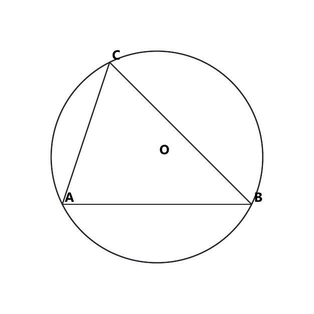
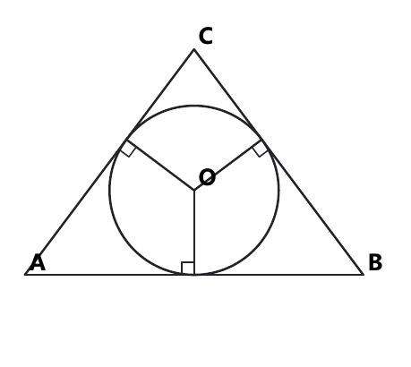
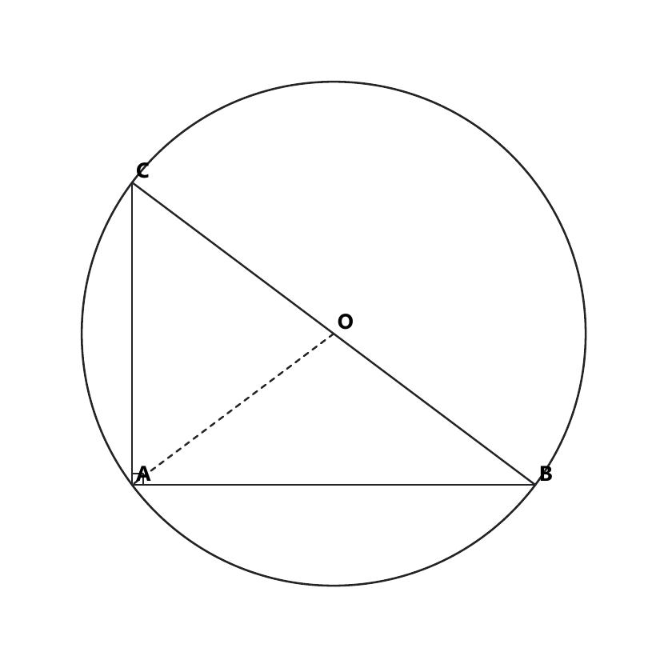
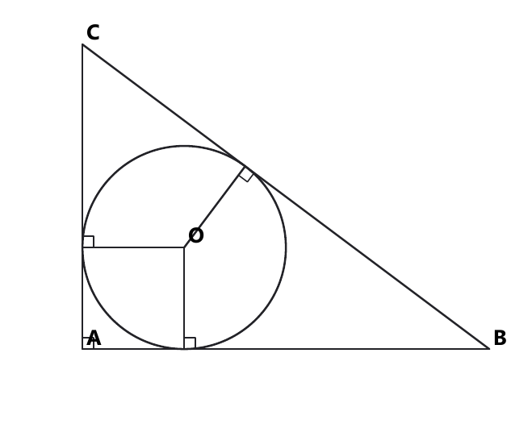
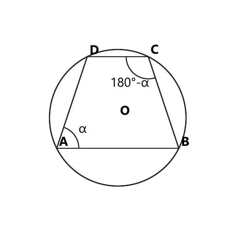
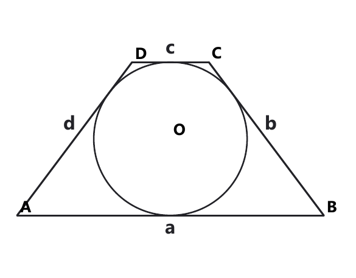
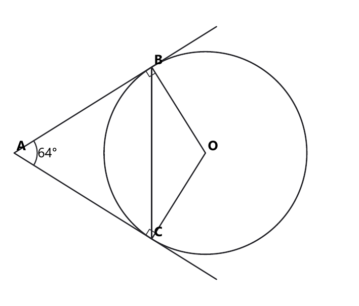
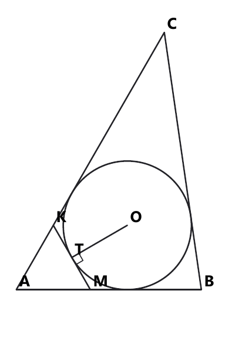
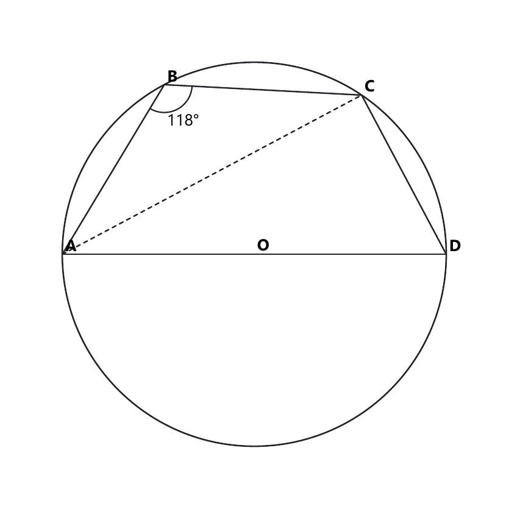
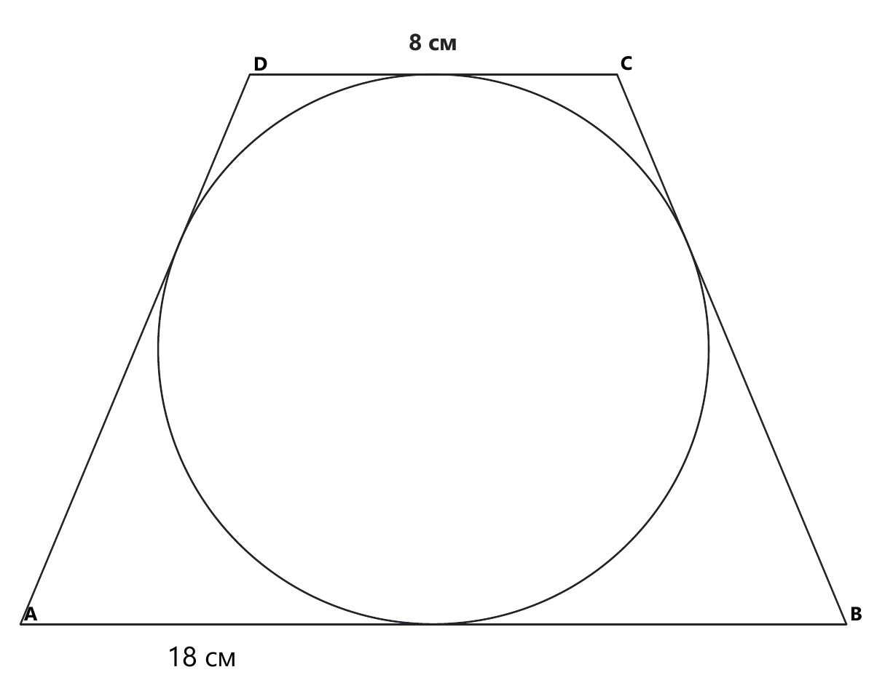

# Занятие 14. Вписанные и описанные окружности

**Дата:** 11.12.2026 (пт)  
**Длительность:** 45 минут  
**Раздел:** Планиметрия: окружность  
**Подтемы:** описанная и вписанная окружности треугольника; окружности прямоугольного треугольника; вписанные и описанные четырёхугольники; формула $S=pr$.

## Цели занятия

К концу занятия ученик:

- различает вписанную и описанную окружности;
- знает расположение центров этих окружностей;
- применяет формулы $R=\frac c2$; $r=\frac{a+b-c}{2}$ и $S=pr$;
- использует свойства вписанного и описанного четырёхугольника;
- выбирает блок своего уровня: 1–2, 3–4, 5–6, 7–8 или 9–10 баллов.

## Тайминг (45 мин)

| Этап | Время | Работа |
|---|---:|---|
| Теория | 12 мин | Повтор определений, свойств и формул |
| Разбор | 14 мин | Задания Р1–Р4 |
| Самостоятельная работа | 15 мин | Только блок выбранного уровня |
| Итог | 4 мин | Чек-лист и домашнее задание |

---

## Теория к занятию

### Мини-тема 1. Описанная и вписанная окружности треугольника

#### Простыми словами

Если окружность проходит через все вершины треугольника, то она описана около треугольника. Треугольник при этом называют вписанным в окружность.

Если окружность касается всех сторон треугольника, то она вписана в треугольник. Центр вписанной окружности находится внутри треугольника.

Центр описанной окружности — точка пересечения серединных перпендикуляров к сторонам. Центр вписанной окружности — точка пересечения биссектрис углов.

#### Определение и факты

- Окружность называется **описанной около треугольника**, если проходит через все его вершины.
- Окружность называется **вписанной в треугольник**, если касается всех его сторон.
- Центр описанной окружности лежит на серединных перпендикулярах к сторонам.
- Центр вписанной окружности лежит на биссектрисах углов.
- Радиус, проведённый в точку касания, перпендикулярен касательной.
- Отрезки касательных, проведённых из одной точки, равны.

*Описанная окружность проходит через вершины треугольника*
<!--geo-figure-spec
{
  "needed": true,
  "kind": "plane",
  "template": "plane_custom",
  "caption": "Описанная окружность проходит через вершины треугольника",
  "show_labels": true,
  "vertices": {
    "A": [
      0,
      0
    ],
    "B": [
      6,
      0
    ],
    "C": [
      1.5,
      4.5
    ],
    "O": [
      3,
      1.5
    ]
  },
  "edges": [
    [
      "A",
      "B"
    ],
    [
      "B",
      "C"
    ],
    [
      "C",
      "A"
    ]
  ],
  "circle": {
    "center": "O",
    "r": 3.354102,
    "through": "A"
  },
  "labels": [
    "A",
    "B",
    "C",
    "O"
  ]
}
-->

*Вписанная окружность касается всех сторон*

<!--geo-figure-spec
{
  "needed": true,
  "kind": "plane",
  "template": "plane_custom",
  "caption": "Вписанная окружность касается всех сторон",
  "show_labels": true,
  "vertices": {
    "A": [
      0,
      0
    ],
    "B": [
      6,
      0
    ],
    "C": [
      3,
      4
    ],
    "O": [
      3,
      1.5
    ],
    "X": [
      3,
      0
    ],
    "Y": [
      1.8,
      2.4
    ],
    "Z": [
      4.2,
      2.4
    ]
  },
  "edges": [
    [
      "A",
      "B"
    ],
    [
      "B",
      "C"
    ],
    [
      "C",
      "A"
    ],
    [
      "O",
      "X"
    ],
    [
      "O",
      "Y"
    ],
    [
      "O",
      "Z"
    ]
  ],
  "circle": {
    "center": "O",
    "r": 1.5
  },
  "right_angles": [
    {
      "at": "X",
      "from": "A",
      "to": "O"
    },
    {
      "at": "Y",
      "from": "A",
      "to": "O"
    },
    {
      "at": "Z",
      "from": "B",
      "to": "O"
    }
  ],
  "labels": [
    "A",
    "B",
    "C",
    "O"
  ]
}
-->

#### Формулы

Для любого треугольника:

$$S=pr,$$

где $S$ — площадь треугольника, $p$ — полупериметр, $r$ — радиус вписанной окружности.

Полупериметр:

$$p=\frac{a+b+c}{2}.$$

Для прямоугольного треугольника формулы приведены в следующей мини-теме.

#### Правила

- Сначала определи, о какой окружности идёт речь.
- Для центра вписанной окружности ищи пересечение биссектрис.
- Для центра описанной окружности ищи пересечение серединных перпендикуляров.
- В формуле $S=pr$ используй именно полупериметр, а не периметр.
- Радиус окружности положителен.

#### Алгоритм решения задач с $S=pr$

1. Найти стороны треугольника или его периметр.
2. Найти полупериметр $p$.
3. Записать формулу $S=pr$.
4. Подставить известные величины.
5. Найти неизвестную величину.
6. Проверить единицы измерения и смысл ответа.

#### Мини-пример

В треугольник со сторонами $10$ см, $10$ см и $12$ см вписана окружность радиуса $3$ см. Найдите площадь треугольника.

*Решение:*

Дано: $a=10$ см, $b=10$ см, $c=12$ см, $r=3$ см.

Найти: $S$.

Находим полупериметр:

$$p=\frac{a+b+c}{2}.$$

$$p=\frac{10+10+12}{2}=16\text{ см}.$$

Используем формулу площади описанного многоугольника:

$$S=pr.$$

$$S=16\cdot3=48\text{ см}^2.$$

Проверка. Высота к основанию $12$ см равна $\sqrt{10^2-6^2}=8$ см, поэтому

$$S=\frac{12\cdot8}{2}=48\text{ см}^2.$$

Площади совпали.

**Ответ:** $48\text{ см}^2$.

#### Ловушки экзамена

- Не путай радиус вписанной окружности с радиусом описанной.
- Не подставляй периметр вместо полупериметра.
- Равенство касательных относится к касательным, проведённым из одной точки.
- Центр окружности — не обязательно вершина треугольника.

---

### Мини-тема 2. Прямоугольный треугольник и его окружности

#### Простыми словами

В прямоугольном треугольнике описанная окружность особенно удобна: её центр находится в середине гипотенузы. Поэтому радиус равен половине гипотенузы.

Вписанная окружность касается двух катетов и гипотенузы. Её радиус можно найти по трём сторонам.

<!--geo-figure-spec
{
  "needed": true,
  "kind": "plane",
  "template": "plane_custom",
  "caption": "Центр описанной окружности — середина гипотенузы",
  "show_labels": true,
  "vertices": {
    "A": [
      0,
      0
    ],
    "B": [
      8,
      0
    ],
    "C": [
      0,
      6
    ],
    "O": [
      4,
      3
    ]
  },
  "edges": [
    [
      "A",
      "B"
    ],
    [
      "B",
      "C"
    ],
    [
      "C",
      "A"
    ],
    [
      "O",
      "A"
    ]
  ],
  "dashed_segments": [
    [
      "O",
      "A"
    ]
  ],
  "circle": {
    "center": "O",
    "r": 5,
    "through": "A"
  },
  "right_angles": [
    {
      "at": "A",
      "from": "B",
      "to": "C"
    }
  ],
  "labels": [
    "A",
    "B",
    "C",
    "O"
  ]
}
-->

*Центр описанной окружности — середина гипотенузы*

<!--geo-figure-spec
{
  "needed": true,
  "kind": "plane",
  "template": "plane_custom",
  "caption": "Вписанная окружность прямоугольного треугольника",
  "show_labels": true,
  "vertices": {
    "A": [
      0,
      0
    ],
    "B": [
      8,
      0
    ],
    "C": [
      0,
      6
    ],
    "O": [
      2,
      2
    ],
    "X": [
      2,
      0
    ],
    "Y": [
      0,
      2
    ],
    "Z": [
      3.2,
      3.6
    ]
  },
  "edges": [
    [
      "A",
      "B"
    ],
    [
      "B",
      "C"
    ],
    [
      "C",
      "A"
    ],
    [
      "O",
      "X"
    ],
    [
      "O",
      "Y"
    ],
    [
      "O",
      "Z"
    ]
  ],
  "circle": {
    "center": "O",
    "r": 2
  },
  "right_angles": [
    {
      "at": "A",
      "from": "B",
      "to": "C"
    },
    {
      "at": "X",
      "from": "B",
      "to": "O"
    },
    {
      "at": "Y",
      "from": "C",
      "to": "O"
    },
    {
      "at": "Z",
      "from": "B",
      "to": "O"
    }
  ],
  "labels": [
    "A",
    "B",
    "C",
    "O"
  ]
}
-->

*Вписанная окружность прямоугольного треугольника*

#### Факты и формулы

Если $c$ — гипотенуза прямоугольного треугольника, то радиус описанной окружности:

$$R=\frac c2.$$

Если $a$ и $b$ — катеты, а $c$ — гипотенуза, то радиус вписанной окружности:

$$r=\frac{a+b-c}{2}.$$

Площадь прямоугольного треугольника:

$$S=\frac{ab}{2}.$$

Также:

$$S=pr.$$

#### Правила

- Гипотенуза всегда лежит напротив прямого угла.
- Формулу $R=\frac c2$ применяй только к прямоугольному треугольнику.
- Перед вычислением $r$ проверь, что $a^2+b^2=c^2$.
- Если известны $S$, $R$ и $r$, можно использовать $c=2R$ и $S=pr$.
- Катеты и гипотенуза должны быть положительными.

#### Алгоритм

1. Определить гипотенузу.
2. Проверить прямоугольность треугольника.
3. Выбрать формулу для $R$, $r$ или $S$.
4. Подставить данные.
5. Выполнить вычисления.
6. Проверить результат по теореме Пифагора или по площади.

#### Мини-пример

Катеты прямоугольного треугольника равны $6$ см и $8$ см. Найдите радиусы вписанной и описанной окружностей.

*Решение:*

Дано: $a=6$ см, $b=8$ см.

Найти: $r$ и $R$.

Находим гипотенузу:

$$c^2=a^2+b^2.$$

$$c^2=6^2+8^2.$$

$$c^2=36+64=100.$$

$$c=10\text{ см}.$$

Радиус описанной окружности:

$$R=\frac c2.$$

$$R=\frac{10}{2}=5\text{ см}.$$

Радиус вписанной окружности:

$$r=\frac{a+b-c}{2}.$$

$$r=\frac{6+8-10}{2}.$$

$$r=\frac4{2}=2\text{ см}.$$

Проверка:

$$S=\frac{6\cdot8}{2}=24\text{ см}^2.$$

Полупериметр:

$$p=\frac{6+8+10}{2}=12\text{ см}.$$

$$pr=12\cdot2=24\text{ см}^2.$$

Площадь совпала.

**Ответ:** $r=2\text{ см}$; $R=5\text{ см}$.

#### Ловушки экзамена

- Не бери половину катета вместо половины гипотенузы.
- В формуле $r=\frac{a+b-c}{2}$ вычитается гипотенуза.
- Корень из $100$ — это $10$, а не $-10$: длина положительна.
- Не забывай единицы измерения.

---

### Мини-тема 3. Вписанные и описанные четырёхугольники

#### Простыми словами

Четырёхугольник вписан в окружность, если все его вершины лежат на окружности.

Четырёхугольник описан около окружности, если окружность касается всех его сторон.

У вписанного четырёхугольника противоположные углы в сумме дают $180^\circ$.

У описанного четырёхугольника суммы длин противоположных сторон равны.

#### Определения и свойства

Если $ABCD$ вписан в окружность, то:

$$\angle A+\angle C=180^\circ,$$

$$\angle B+\angle D=180^\circ.$$

Обратно: если сумма противоположных углов выпуклого четырёхугольника равна $180^\circ$, то около него можно описать окружность.

<!--geo-figure-spec
{
  "needed": true,
  "kind": "plane",
  "template": "plane_custom",
  "caption": "Вписанный четырёхугольник",
  "show_labels": true,
  "vertices": {
    "A": [
      0,
      0
    ],
    "B": [
      4,
      0
    ],
    "C": [
      3,
      3
    ],
    "D": [
      1,
      3
    ],
    "O": [
      2,
      1
    ]
  },
  "edges": [
    [
      "A",
      "B"
    ],
    [
      "B",
      "C"
    ],
    [
      "C",
      "D"
    ],
    [
      "D",
      "A"
    ]
  ],
  "circle": {
    "center": "O",
    "r": 2.236068,
    "through": "A"
  },
  "angle_marks": [
    {
      "vertex": "A",
      "from": "B",
      "to": "D",
      "text": "α"
    },
    {
      "vertex": "C",
      "from": "B",
      "to": "D",
      "text": "180°-α"
    }
  ],
  "labels": [
    "A",
    "B",
    "C",
    "D",
    "O"
  ]
}
-->

*Вписанный четырёхугольник*

Если четырёхугольник описан около окружности и его стороны, взятые последовательно, равны $a$, $b$, $c$, $d$, то

$$a+c=b+d.$$

<!--geo-figure-spec
{
  "needed": true,
  "kind": "plane",
  "template": "plane_custom",
  "caption": "Описанный четырёхугольник",
  "show_labels": true,
  "vertices": {
    "A": [
      0,
      0
    ],
    "B": [
      8,
      0
    ],
    "C": [
      5,
      4
    ],
    "D": [
      3,
      4
    ],
    "O": [
      4,
      2
    ],
    "X": [
      4,
      0
    ]
  },
  "edges": [
    [
      "A",
      "B"
    ],
    [
      "B",
      "C"
    ],
    [
      "C",
      "D"
    ],
    [
      "D",
      "A"
    ]
  ],
  "circle": {
    "center": "O",
    "r": 2
  },
  "segment_labels": [
    {
      "points": [
        "A",
        "B"
      ],
      "text": "a",
      "t": 0.5,
      "side": -1
    },
    {
      "points": [
        "B",
        "C"
      ],
      "text": "b",
      "t": 0.55,
      "side": -1
    },
    {
      "points": [
        "D",
        "C"
      ],
      "text": "c",
      "t": 0.5,
      "side": 1
    },
    {
      "points": [
        "A",
        "D"
      ],
      "text": "d",
      "t": 0.55,
      "side": 1
    }
  ],
  "labels": [
    "A",
    "B",
    "C",
    "D",
    "O"
  ]
}
-->

*Описанный четырёхугольник*

Для описанного четырёхугольника также

$$S=pr.$$

#### Правила

- Вписанный четырёхугольник — вершины на окружности.
- Описанный четырёхугольник — стороны касаются окружности.
- Вписанный: складываем противоположные углы.
- Описанный: сравниваем суммы противоположных сторон.
- Соседние углы вписанного четырёхугольника не обязаны давать $180^\circ$.

#### Алгоритм

1. Определить вид четырёхугольника.
2. Найти противоположные элементы.
3. Записать нужное свойство.
4. Подставить данные.
5. Решить полученное уравнение.
6. Проверить, что угол находится между $0^\circ$ и $180^\circ$.

#### Мини-пример

Четырёхугольник $ABCD$ вписан в окружность. Угол $A$ равен $73^\circ$. Найдите угол $C$.

*Решение:*

Дано: $ABCD$ — вписанный четырёхугольник, $\angle A=73^\circ$.

Найти: $\angle C$.

В вписанном четырёхугольнике сумма противоположных углов равна $180^\circ$:

$$\angle A+\angle C=180^\circ.$$

$$73^\circ+\angle C=180^\circ.$$

$$\angle C=180^\circ-73^\circ.$$

$$\angle C=107^\circ.$$

Проверка:

$$73^\circ+107^\circ=180^\circ.$$

**Ответ:** $107^\circ$.

#### Ловушки экзамена

- Не складывай соседние углы вместо противоположных.
- Для описанного четырёхугольника нужны стороны, а не углы.
- Суммы противоположных сторон равны у описанного четырёхугольника. У вписанного так сравнивают углы.
- Сумма углов четырёхугольника равна $360^\circ$, но это не свойство вписанности.

---

### Мини-тема 4. Формула $S=pr$

#### Простыми словами

Формула $S=pr$ связывает площадь многоугольника, в который вписана окружность, с радиусом этой окружности. Такой многоугольник описан около окружности: она касается всех его сторон.

Каждая сторона образует с центром окружности треугольник. Высота каждого такого треугольника равна радиусу $r$. Если сложить площади всех треугольников, получится произведение полупериметра на радиус.

#### Формула

$$S=pr,$$

где $S$ — площадь описанного многоугольника, $p$ — его полупериметр, $r$ — радиус вписанной окружности.

Для треугольника:

$$p=\frac{a+b+c}{2}.$$

Для четырёхугольника:

$$p=\frac{a+b+c+d}{2}.$$

Из основной формулы:

$$r=\frac Sp,$$

$$p=\frac Sr.$$

#### Правила

- Формула применяется, когда окружность касается всех сторон.
- Полупериметр равен половине периметра.
- Если требуется радиус, раздели площадь на полупериметр.
- Если требуется площадь, умножь полупериметр на радиус.

#### Алгоритм

1. Записать стороны фигуры.
2. Найти периметр.
3. Найти полупериметр.
4. Выбрать форму формулы $S=pr$.
5. Подставить данные.
6. Проверить единицы площади.

#### Мини-пример

В четырёхугольник со сторонами $2$ см, $5$ см, $8$ см и $5$ см, взятыми последовательно, вписана окружность радиуса $2$ см. Найдите площадь.

*Решение:*

Дано: $a=2$ см, $b=5$ см, $c=8$ см, $d=5$ см, $r=2$ см.

Найти: $S$.

Суммы противоположных сторон равны: $2+8=10$ и $5+5=10$. В такой четырёхугольник можно вписать окружность.

Находим полупериметр:

$$p=\frac{a+b+c+d}{2}.$$

$$p=\frac{2+5+8+5}{2}=10\text{ см}.$$

$$S=pr=10\cdot2=20\text{ см}^2.$$

Проверка. Это равнобедренная трапеция: основания $2$ см и $8$ см, боковые стороны по $5$ см. С каждой стороны большее основание длиннее меньшего на $(8-2)/2=3$ см. Высота

$$h=\sqrt{5^2-3^2}=4\text{ см}.$$

Радиус вписанной окружности равен половине высоты, $r=2$ см. Площадь

$$S=\frac{2+8}{2}\cdot4=20\text{ см}^2.$$

**Ответ:** $20\text{ см}^2$.

#### Ловушки экзамена

- $p$ — половина периметра.
- Не умножай все стороны друг на друга.
- Радиус должен быть в единицах длины.
- Площадь записывается в квадратных единицах.
- Формулу $S=pr$ нельзя применять к описанной окружности: та проходит через вершины, а не касается сторон.

---

## Сводка формул «выучить наизусть»

$$p=\frac{a+b+c}{2}.$$

$$S=pr.$$

$$R=\frac c2.$$

$$r=\frac{a+b-c}{2}.$$

$$S=\frac{ab}{2}.$$

Для вписанного четырёхугольника:

$$\angle A+\angle C=180^\circ.$$

Для описанного четырёхугольника:

$$AB+CD=BC+AD.$$

## Правила, которые нельзя путать

- Вписанная окружность касается сторон.
- Описанная окружность проходит через вершины.
- Центр вписанной окружности — пересечение биссектрис.
- Центр описанной окружности — пересечение серединных перпендикуляров.
- Вписанный четырёхугольник: противоположные углы дают $180^\circ$.
- Описанный четырёхугольник: суммы противоположных сторон равны.
- В формуле $S=pr$ используется полупериметр.

## Разрешённый набор для практики

Мини-темы занятия:

- окружности треугольника;
- окружности прямоугольного треугольника;
- вписанные и описанные четырёхугольники;
- формула $S=pr$.

Повтор:

- линейная функция и её график;
- линейные неравенства;
- степени с натуральным и целым показателем;
- многочлены и приведение подобных;
- разложение на множители;
- формулы сокращённого умножения;
- тождественные преобразования.

---

## Разбор ключевых заданий

### Р1.
В угол $A$ вписана окружность с центром в точке $O$, которая касается сторон угла в точках $B$ и $C$. Найдите угол $BCO$, если $\angle A=64^\circ$.

<!--geo-figure-spec
{
  "needed": true,
  "kind": "plane",
  "template": "plane_custom",
  "caption": "Окружность, вписанная в угол",
  "show_labels": true,
  "vertices": {
    "A": [
      0,
      0
    ],
    "P": [
      6.3504,
      3.9682
    ],
    "Q": [
      6.3504,
      -3.9682
    ],
    "B": [
      4.3151,
      2.6964
    ],
    "C": [
      4.3151,
      -2.6964
    ],
    "O": [
      6,
      0
    ]
  },
  "edges": [
    [
      "A",
      "P"
    ],
    [
      "A",
      "Q"
    ],
    [
      "O",
      "B"
    ],
    [
      "O",
      "C"
    ],
    [
      "B",
      "C"
    ]
  ],
  "circle": {
    "center": "O",
    "r": 3.1795
  },
  "right_angles": [
    {
      "at": "B",
      "from": "A",
      "to": "O"
    },
    {
      "at": "C",
      "from": "A",
      "to": "O"
    }
  ],
  "angle_marks": [
    {
      "vertex": "A",
      "from": "P",
      "to": "Q",
      "text": "64°"
    }
  ],
  "labels": [
    "A",
    "B",
    "C",
    "O"
  ]
}
-->

*Окружность, вписанная в угол*

*Решение:*

Дано: $\angle A=64^\circ$, окружность с центром $O$ касается сторон угла в точках $B$ и $C$.

Найти: $\angle BCO$.

Радиус, проведённый в точку касания, перпендикулярен касательной:

$$OB\perp AB,\quad OC\perp AC.$$

Поэтому

$$\angle ABO=\angle ACO=90^\circ.$$

Центр окружности, вписанной в угол, лежит на биссектрисе:

$$\angle BAO=\angle OAC=32^\circ.$$

В четырёхугольнике $ABOC$ известны три угла, поэтому

$$\angle BOC=360^\circ-90^\circ-90^\circ-64^\circ=116^\circ.$$

Треугольник $BOC$ равнобедренный, $OB=OC$. Углы при основании равны:

$$\angle BCO=\angle CBO=\frac{180^\circ-116^\circ}{2}=32^\circ.$$

Проверка. В прямоугольном треугольнике $AOC$

$$\angle AOC=180^\circ-90^\circ-32^\circ=58^\circ.$$

Угол $BOC$ складывается из двух таких углов: $58^\circ+58^\circ=116^\circ$. Снова

$$\angle BCO=\frac{180^\circ-116^\circ}{2}=32^\circ.$$

**Ответ:** $32^\circ$.

---

### Р2.
Найдите радиус окружности, описанной около правильного треугольника со стороной $a$.

*Решение:*

Дано: равносторонний треугольник со стороной $a$.

Найти: радиус описанной окружности $R$.

Проведём высоту треугольника.

В равностороннем треугольнике высота является медианой, поэтому половина основания равна $\frac a2$.

Высота равна:

$$h=\frac{a\sqrt3}{2}.$$

Центр описанной окружности совпадает с точкой пересечения медиан.

Медиана делится центром в отношении $2:1$, считая от вершины.

Следовательно:

$$R=\frac23h.$$

Подставляем значение высоты:

$$R=\frac23\cdot\frac{a\sqrt3}{2}.$$

$$R=\frac{a\sqrt3}{3}.$$

**Ответ:** $\frac{a\sqrt3}{3}$.

---

### Р3.
В квадрат, диагональ которого равна $8$ см, вписана окружность. Найдите длину этой окружности.

*Решение:*

Дано: диагональ квадрата $d=8$ см.

Найти: длину окружности.

В квадрате сторона связана с диагональю по теореме Пифагора:

$$d^2=a^2+a^2.$$

$$64=2a^2.$$

$$a^2=32.$$

$$a=4\sqrt2\text{ см}.$$

Диаметр вписанной окружности равен стороне квадрата:

$$D=a=4\sqrt2\text{ см}.$$

Длина окружности равна произведению диаметра на число $\pi$:

$$L=\pi D.$$

$$L=4\pi\sqrt2\text{ см}.$$

**Ответ:** $4\pi\sqrt2\text{ см}$.

---

### Р4.
В треугольник $ABC$ со сторонами $AB=5$; $BC=7$; $AC=8$ вписана окружность. Касательная к этой окружности пересекает стороны $AB$ и $AC$ в точках $M$ и $K$ и отсекает треугольник $AMK$. Найдите периметр треугольника $AMK$.

<!--geo-figure-spec
{
  "needed": true,
  "kind": "plane",
  "template": "plane_custom",
  "caption": "Касательная MK отсекает треугольник AMK",
  "show_labels": true,
  "vertices": {
    "A": [
      0,
      0
    ],
    "B": [
      5,
      0
    ],
    "C": [
      4,
      6.9282
    ],
    "O": [
      3,
      1.7321
    ],
    "M": [
      2,
      0
    ],
    "K": [
      1,
      1.7321
    ],
    "T": [
      1.5,
      0.866
    ]
  },
  "edges": [
    [
      "A",
      "B"
    ],
    [
      "B",
      "C"
    ],
    [
      "C",
      "A"
    ],
    [
      "M",
      "K"
    ],
    [
      "O",
      "T"
    ]
  ],
  "circle": {
    "center": "O",
    "r": 1.7321
  },
  "right_angles": [
    {
      "at": "T",
      "from": "O",
      "to": "M"
    }
  ],
  "labels": [
    "A",
    "B",
    "C",
    "M",
    "K",
    "O",
    "T"
  ]
}
-->

*Касательная MK отсекает треугольник AMK*

*Решение:*

Дано: $AB=5$; $BC=7$; $AC=8$. Окружность вписана в треугольник, касательная отсекает треугольник $AMK$ у вершины $A$.

Найти: $P_{AMK}$.

Полупериметр:

$$p=\frac{5+7+8}{2}=10.$$

Пусть окружность касается $AB$ и $AC$ в точках $X$ и $Y$. Отрезки касательных из вершины $A$ равны:

$$AX=AY=p-BC=10-7=3.$$

Касательная касается окружности в точке $T$. Точка $M$ лежит на $AB$ между $A$ и $X$, точка $K$ — на $AC$ между $A$ и $Y$.

Из одной точки отрезки касательных равны:

$$MT=MX,\quad KT=KY.$$

Поэтому

$$AM+MX=AX=3,$$

$$AK+KY=AY=3,$$

$$MK=MT+KT=MX+KY.$$

Периметр:

$$P_{AMK}=AM+AK+MK=(AM+MX)+(AK+KY)=3+3=6.$$

Проверка. Касательные от вершин $B$ и $C$: $p-AC=10-8=2$ и $p-AB=10-5=5$.

$$3+2=5=AB,\quad 3+5=8=AC,\quad 2+5=7=BC.$$

Для любой такой касательной периметр один и тот же.

**Ответ:** $6$.

---

## Самостоятельная работа

Выбери свой уровень и решай только этот блок.  
В каждом блоке есть мини-темы урока и повтор ранее изученного материала.

### Уровень 1–2 балла

**С1.** *Мини-тема 1, авторское.* Окружность проходит через все вершины треугольника. Как называется такая окружность?

**С2.** *Мини-тема 2, авторское.* Гипотенуза прямоугольного треугольника равна $14$ см. Найдите радиус описанной окружности.

**С3.** *Мини-тема 3, авторское.* Четырёхугольник вписан в окружность. Один из его углов равен $82^\circ$. Найдите противоположный угол.

**С4.** *Мини-тема 4, авторское.* Полупериметр описанного треугольника равен $12$ см, радиус вписанной окружности равен $2$ см. Найдите площадь.

**С5.** *Повтор.* Решите неравенство $3x-5\leq10$.

### Уровень 3–4 балла

**С1.** *Сборник, вариант 63, №3.* Какое из следующих утверждений НЕ верно:  
а) если две окружности касаются внешним образом, то сумма их радиусов равна расстоянию между их центрами;  
б) $\sin60^\circ=\frac{\sqrt3}{2}$;  
в) на плоскости две прямые, перпендикулярные третьей, параллельны между собой;  
г) у любого ромба все углы прямые?

**С2.** *Мини-тема 2, авторское.* Катеты прямоугольного треугольника равны $9$ см и $12$ см. Найдите радиусы вписанной и описанной окружностей.

**С3.** *Мини-тема 3, авторское.* Четырёхугольник описан около окружности. Две его противоположные стороны равны $9$ см и $8$ см, ещё одна сторона равна $6$ см. Найдите четвёртую сторону.

**С4.** *Мини-тема 4, авторское.* В треугольник со сторонами $9$ см, $12$ см и $15$ см вписана окружность радиуса $3$ см. Найдите площадь.

**С5.** *Повтор.* Найдите значение функции $y=2x-3$ при $x=-4$.

### Уровень 5–6 баллов

**С1.** *Сборник, вариант 17, №5.* Четырёхугольник $ABCD$ вписан в окружность, центр $O$ окружности лежит на стороне $AD$. Найдите угол $CAD$, если угол $ABC$ равен $118^\circ$.

<!--geo-figure-spec
{
  "needed": true,
  "kind": "plane",
  "template": "plane_custom",
  "caption": "Вписанный четырёхугольник, центр лежит на AD",
  "show_labels": true,
  "vertices": {
    "A": [
      -5,
      0
    ],
    "B": [
      -2.3429,
      4.4171
    ],
    "C": [
      2.796,
      4.1452
    ],
    "D": [
      5,
      0
    ],
    "O": [
      0,
      0
    ]
  },
  "edges": [
    [
      "A",
      "B"
    ],
    [
      "B",
      "C"
    ],
    [
      "C",
      "D"
    ],
    [
      "D",
      "A"
    ],
    [
      "A",
      "C"
    ]
  ],
  "dashed_segments": [
    [
      "A",
      "C"
    ]
  ],
  "circle": {
    "center": "O",
    "r": 5,
    "through": "A"
  },
  "angle_marks": [
    {
      "vertex": "B",
      "from": "A",
      "to": "C",
      "text": "118°"
    }
  ],
  "labels": [
    "A",
    "B",
    "C",
    "D",
    "O"
  ]
}
-->

*Вписанный четырёхугольник, центр лежит на AD*

**С2.** *Сборник, вариант 77, №5.* Сумма градусных мер вписанного угла и дуги, на которую он опирается, равна $120^\circ$. Найдите градусную меру вписанного угла.

**С3.** *Сборник, вариант 15, №5.* Четырёхугольник $ABCD$ вписан в окружность, $P$ — точка пересечения его диагоналей, $\angle ADB=72^\circ$; $\angle CBD=64^\circ$. Найдите $\angle APB$.

**С4.** *Мини-тема 4, авторское.* В равнобедренную трапецию с основаниями $6$ см и $24$ см вписана окружность радиуса $6$ см. Боковые стороны равны $15$ см. Найдите площадь трапеции.

**С5.** *Повтор.* Упростите выражение $$(x+3)^2-(x-3)^2.$$

### Уровень 7–8 баллов

**С1.** *Мини-тема 1, авторское.* В треугольнике $ABC$ стороны равны $13$ см, $14$ см и $15$ см. Радиус вписанной окружности равен $4$ см. Найдите площадь треугольника.

**С2.** *Мини-тема 2, авторское.* В прямоугольном треугольнике гипотенуза равна $13$ см, один катет равен $5$ см. Найдите радиусы вписанной и описанной окружностей.

**С3.** *Мини-тема 3, авторское.* Углы вписанного четырёхугольника, взятые последовательно, равны $x$, $4x$, $5x$ и $2x$. Найдите все углы.

**С4.** *Мини-тема 4, авторское.* Площадь описанного четырёхугольника равна $54\text{ см}^2$, а радиус вписанной окружности равен $3\text{ см}$. Найдите периметр четырёхугольника.

**С5.** *Повтор.* Разложите на множители выражение $x^2-10x+25$.

### Уровень 9–10 баллов

**С1.** *Сборник, вариант 79, №9.* В прямоугольнике $ABCD$ $AB=3$ см, $AD=4$ см. В треугольники $ABC$ и $ADC$ вписаны окружности, которые касаются диагонали $AC$ в точках $M$ и $K$. Найдите длину отрезка $MK$.

**С2.** *Сборник, вариант 41, №9.* Гипотенуза прямоугольного треугольника равна $10$ см, радиус вписанной окружности — $2$ см. Найдите площадь треугольника.

**С3.** *Сборник, вариант 37, №9.* Окружности с радиусами $4$ см и $9$ см касаются внешним образом. Найдите отрезок общей внешней касательной, заключённый между точками касания.

**С4.** *Мини-тема 4, авторское.* Равнобедренная трапеция описана около окружности. Её основания равны $8$ см и $18$ см. Найдите площадь трапеции.

<!--geo-figure-spec
{
  "needed": true,
  "kind": "plane",
  "template": "plane_custom",
  "caption": "Равнобедренная трапеция, описанная около окружности",
  "show_labels": true,
  "vertices": {
    "A": [
      0,
      0
    ],
    "B": [
      18,
      0
    ],
    "C": [
      13,
      12
    ],
    "D": [
      5,
      12
    ],
    "O": [
      9,
      6
    ],
    "X": [
      9,
      0
    ]
  },
  "edges": [
    [
      "A",
      "B"
    ],
    [
      "B",
      "C"
    ],
    [
      "C",
      "D"
    ],
    [
      "D",
      "A"
    ]
  ],
  "circle": {
    "center": "O",
    "r": 6
  },
  "segment_labels": [
    {
      "points": [
        "A",
        "B"
      ],
      "text": "18 см",
      "t": 0.22,
      "side": -1
    },
    {
      "points": [
        "D",
        "C"
      ],
      "text": "8 см",
      "t": 0.5,
      "side": 1,
      "offset": 0.7
    }
  ],
  "labels": [
    "A",
    "B",
    "C",
    "D"
  ]
}
-->

*Равнобедренная трапеция, описанная около окружности*

**С5.** *Повтор.* Упростите выражение и найдите его значение при $x=2$:  
$$\frac{x^2-9}{x-3}+2x,$$  
где $x\neq3$.

---

## Домашнее задание

### Уровень 1–2 балла

**Д1.** *Мини-тема 1, авторское.* Как называется окружность, касающаяся всех сторон треугольника?

**Д2.** *Мини-тема 2, авторское.* Гипотенуза прямоугольного треугольника равна $18$ см. Найдите $R$.

**Д3.** *Мини-тема 3, авторское.* Вписанный четырёхугольник имеет угол $96^\circ$. Найдите противоположный угол.

**Д4.** *Мини-тема 4, авторское.* $p=11$ см, $r=2$ см. Найдите площадь.

**Д5.** *Повтор.* Вычислите $2^3+3^2$.

**Д6.** *Повтор.* Решите неравенство $5x+1>16$.

### Уровень 3–4 балла

**Д1.** *Мини-тема 1, авторское.* Где находится центр вписанной окружности треугольника?

**Д2.** *Мини-тема 2, авторское.* Катеты равны $8$ см и $15$ см. Найдите $r$ и $R$.

**Д3.** *Мини-тема 3, авторское.* В описанном четырёхугольнике две противоположные стороны равны $4$ см и $7$ см, третья сторона равна $9$ см. Найдите четвёртую сторону.

**Д4.** *Мини-тема 4, авторское.* Стороны треугольника равны $5$ см, $12$ см и $13$ см, $r=2$ см. Найдите площадь.

**Д5.** *Повтор.* Найдите $y=-3x+4$ при $x=2$.

**Д6.** *Повтор.* Разложите на множители $x^2-16$.

### Уровень 5–6 баллов

**Д1.** *Мини-тема 1, авторское.* В треугольник со сторонами $6$ см, $8$ см и $10$ см вписана окружность. Найдите её радиус.

**Д2.** *Мини-тема 2, авторское.* В прямоугольном треугольнике катеты равны $10$ см и $24$ см. Найдите $S$, $r$ и $R$.

**Д3.** *Мини-тема 3, авторское.* Углы вписанного четырёхугольника, взятые последовательно, равны $x$, $2x$, $4x$ и $3x$. Найдите углы.

**Д4.** *Мини-тема 4, авторское.* Площадь описанного треугольника равна $30\text{ см}^2$, полупериметр равен $15$ см. Найдите радиус вписанной окружности.

**Д5.** *Повтор.* Упростите $$(2x-5)^2-(2x+5)^2.$$

**Д6.** *Повтор.* Решите неравенство $4-3x\geq10$.

### Уровень 7–8 баллов

**Д1.** *Мини-тема 1, авторское.* В треугольнике со сторонами $10$ см, $13$ см и $13$ см радиус вписанной окружности равен $\dfrac{10}{3}$ см. Найдите площадь.

**Д2.** *Мини-тема 2, авторское.* Гипотенуза прямоугольного треугольника равна $17$ см, один катет равен $8$ см. Найдите $r$ и $R$.

**Д3.** *Мини-тема 3, авторское.* В описанном четырёхугольнике три стороны равны $5$ см, $6$ см и $8$ см. Найдите четвёртую сторону, если ей противоположна сторона $6$ см.

**Д4.** *Мини-тема 4, авторское.* Площадь описанного многоугольника равна $72\text{ см}^2$, $r=4$ см. Найдите его периметр.

**Д5.** *Повтор.* Упростите $\frac{x^2-25}{x-5}$ при $x\neq5$.

**Д6.** *Повтор.* Разложите на множители $4x^2-12x+9$.

### Уровень 9–10 баллов

**Д1.** *Мини-тема 1, авторское.* В треугольник со сторонами $9$ см, $10$ см и $17$ см вписана окружность. Найдите площадь, если радиус окружности равен $2$ см.

**Д2.** *Мини-тема 2, авторское.* Площадь прямоугольного треугольника равна $30\text{ см}^2$, гипотенуза равна $13$ см. Найдите радиусы вписанной и описанной окружностей.

**Д3.** *Мини-тема 3, авторское.* Вписанный четырёхугольник имеет противоположные углы $3x+10^\circ$ и $5x-30^\circ$. Найдите эти углы.

**Д4.** *Мини-тема 4, авторское.* В четырёхугольник со сторонами $4$ см, $10$ см, $16$ см и $10$ см, взятыми последовательно, вписана окружность радиуса $4$ см. Найдите площадь.

**Д5.** *Повтор.* Упростите выражение и укажите ОДЗ:  
$$\frac{x^2-16}{x-4}+\frac{x^2-25}{x-5}.$$

**Д6.** *Повтор.* Решите систему:  
$$\begin{cases} y=2x-1,\\ y=x+4. \end{cases}$$

---

## Чек-лист «ученик понял тему»

- Я различаю вписанную и описанную окружности.
- Я знаю, где находится центр каждой окружности треугольника.
- Я умею находить $R$ в прямоугольном треугольнике.
- Я умею находить $r$ в прямоугольном треугольнике.
- Я применяю свойство противоположных углов вписанного четырёхугольника.
- Я применяю равенство сумм противоположных сторон описанного четырёхугольника.
- Я не путаю периметр и полупериметр в формуле $S=pr$.
