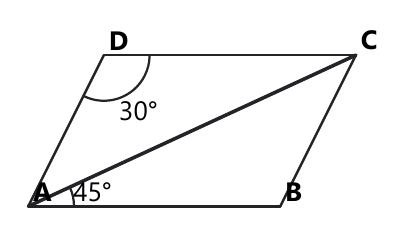

# Занятие 19. Теорема синусов

**Дата:** 29.01.2027 (пт)  
**Длительность:** 45 минут  
**Раздел:** Тригонометрия треугольника  
**Подтемы:** теорема синусов; нахождение стороны и угла; радиус описанной окружности; типичные конфигурации.

## Цели занятия

К концу занятия ученик сможет:

- записывать теорему синусов для любого треугольника;
- находить неизвестную сторону по стороне, углу и противолежащему углу;
- находить неизвестный угол по теореме синусов и учитывать возможность тупого угла;
- использовать формулу $R=\frac{a}{2\sin\alpha}$;
- распознавать конфигурации с высотой, биссектрисой, параллелограммом и описанной окружностью.

Ученик выбирает только свой блок: **1–2, 3–4, 5–6, 7–8 или 9–10 баллов**.

## Тайминг

| Этап | Время |
|---|---:|
| Теория | 12 минут |
| Разбор ключевых заданий | 14 минут |
| Самостоятельная работа | 15 минут |
| Итог и домашнее задание | 4 минуты |

На самостоятельной работе ученик решает только задания своего уровня.

## Теория к занятию

### Мини-тема 1. Теорема синусов

Смотри: в треугольнике большая сторона лежит напротив большего угла, а маленькая сторона — напротив меньшего. Теорема синусов точно связывает эти пары. Она полезна, когда известна сторона и противолежащий ей угол, а нужно найти другую сторону или угол. В отличие от теоремы косинусов, здесь не нужны три стороны.

**Теорема.** Стороны треугольника пропорциональны синусам противолежащих углов.

Для треугольника $ABC$ обозначим:

- $a=BC$, сторона напротив угла $A$;
- $b=AC$, сторона напротив угла $B$;
- $c=AB$, сторона напротив угла $C$.

Тогда

$$
\frac{a}{\sin A}=\frac{b}{\sin B}=\frac{c}{\sin C}.
$$

Также

$$
\frac{a}{\sin A}=2R,
$$

где $R$ — радиус окружности, описанной около треугольника.

**Правила**

- Сначала проверь, какие сторона и угол являются противолежащими.
- Не записывай отношение стороны к синусу прилежащего угла.
- Углы треугольника измеряются в градусах.
- Сумма углов треугольника равна $180^\circ$.
- Сторона и синус противолежащего угла должны стоять в одной паре.

**Алгоритм**

1. Обозначь известные стороны и углы.
2. Найди пары «сторона — противолежащий угол».
3. Запиши теорему синусов.
4. Составь пропорцию с неизвестной величиной.
5. Вычисли неизвестную сторону или синус угла.
6. Проверь, что стороны и углы имеют разумный порядок.

**Мини-пример.** В треугольнике $ABC$ даны $A=30^\circ$, $B=45^\circ$, $a=6$ см. Найдите сторону $b$.

*Решение:*

Дано: $A=30^\circ$, $B=45^\circ$, $a=6$ см.

Найти: $b$.

Сторона $a$ противолежит углу $A$, а сторона $b$ противолежит углу $B$.

По теореме синусов

$$
\frac{a}{\sin A}=\frac{b}{\sin B}.
$$

Подставляем данные

$$
\frac{6}{\sin30^\circ}=\frac{b}{\sin45^\circ}.
$$

Используем табличные значения

$$
\sin30^\circ=\frac12,
\qquad
\sin45^\circ=\frac{\sqrt2}{2}.
$$

Получаем

$$
b=\frac{6\sin45^\circ}{\sin30^\circ}.
$$

$$
b=\frac{6\cdot\frac{\sqrt2}{2}}{\frac12}.
$$

$$
b=6\sqrt2\text{ см}.
$$

Проверка: $45^\circ>30^\circ$, поэтому $b>a$. Действительно, $6\sqrt2>6$.

**Ответ:** $6\sqrt2$ см.

**Ловушки экзамена**

- сторона $a$ относится к углу $A$, а не к углу $B$;
- нельзя менять местами числитель и знаменатель только в одном отношении;
- большая сторона должна быть напротив большего угла;
- не забывай единицы длины.

### Мини-тема 2. Нахождение стороны и угла

Если известны две стороны и угол, противолежащий одной из них, можно найти вторую сторону или угол. При нахождении угла возникает важная особенность: одинаковый синус имеют углы $\alpha$ и $180^\circ-\alpha$. Поэтому сначала оцениваем, может ли угол быть тупым.

$$
\frac{a}{\sin A}=\frac{b}{\sin B}.
$$

Отсюда

$$
b=\frac{a\sin B}{\sin A}.
$$

Если нужно найти угол,

$$
\sin B=\frac{b\sin A}{a}.
$$

Сначала калькулятор даёт острый угол $B_1$. Затем возможны два случая:

$$
B=B_1
$$

или

$$
B=180^\circ-B_1.
$$

Но выбираем только тот вариант, при котором сумма углов треугольника меньше $180^\circ$.

**Алгоритм**

1. Запиши теорему синусов.
2. Вырази неизвестную величину.
3. Подставь значения синусов.
4. Если найден синус угла, найди острый угол по таблице или калькулятору.
5. Проверь также тупой угол $180^\circ-B_1$.
6. Используй сумму углов треугольника.

**Мини-пример.** В треугольнике $ABC$ $A=30^\circ$, $a=5$ см, $b=5\sqrt3$ см. Найдите угол $B$.

*Решение:*

Дано: $A=30^\circ$, $a=5$ см, $b=5\sqrt3$ см.

Найти: $B$.

По теореме синусов

$$
\frac{a}{\sin A}=\frac{b}{\sin B}.
$$

Выразим $\sin B$

$$
\sin B=\frac{b\sin A}{a}.
$$

Подставляем данные

$$
\sin B=\frac{5\sqrt3\cdot\frac12}{5}.
$$

$$
\sin B=\frac{\sqrt3}{2}.
$$

Острый угол с таким синусом равен $60^\circ$.

Возможен также угол

$$
180^\circ-60^\circ=120^\circ.
$$

Оба варианта дают треугольник с положительным третьим углом, если третий угол не задан.

Следовательно, по этим данным возможны два треугольника:

$$
B=60^\circ
$$

или

$$
B=120^\circ.
$$

**Ответ:** $60^\circ$ или $120^\circ$.

В задачах экзамена дополнительные слова, например «треугольник остроугольный», выбирают единственный вариант. Синус иногда любит двойную жизнь.

**Ловушки экзамена**

- забытый второй угол $180^\circ-B_1$;
- выбор тупого угла, когда треугольник по условию остроугольный;
- отсутствие проверки суммы углов;
- невозможное значение синуса: $|\sin B|>1$.

### Мини-тема 3. Радиус описанной окружности

Около любого треугольника можно описать окружность, проходящую через все его вершины. Её радиус обозначают буквой $R$. Теорема синусов связывает сторону, противолежащий угол и радиус этой окружности.

$$
\frac{a}{\sin A}=2R.
$$

Отсюда

$$
R=\frac{a}{2\sin A}.
$$

Также

$$
R=\frac{b}{2\sin B}
=
\frac{c}{2\sin C}.
$$

Буква $a$ должна обозначать сторону, противолежащую углу $A$.

**Алгоритм**

1. Найди сторону и противолежащий ей угол.
2. Запиши формулу $R=\frac{a}{2\sin A}$.
3. Подставь длину стороны.
4. Найди синус угла.
5. Выполни вычисления.
6. Проверь, что $R>\frac a2$ для острого угла.

**Мини-пример.** Найдите радиус описанной окружности треугольника, если $a=10$ см и $A=30^\circ$.

*Решение:*

Дано: $a=10$ см, $A=30^\circ$.

Найти: $R$.

Используем формулу

$$
R=\frac{a}{2\sin A}.
$$

Подставляем значения

$$
R=\frac{10}{2\sin30^\circ}.
$$

$$
R=\frac{10}{2\cdot\frac12}.
$$

$$
R=\frac{10}{1}=10\text{ см}.
$$

Проверка:

$$
R=\frac a2=\frac{10}{2}=5\text{ см}
$$

при прямом угле, а при $A=30^\circ$ радиус может быть больше. Полученное значение имеет смысл.

**Ответ:** $10$ см.

**Ловушки экзамена**

- потерянный множитель $2$;
- использование угла, не противолежащего выбранной стороне;
- запись $R=\frac{a}{\sin A}$ вместо правильной формулы;
- неверный синус угла $30^\circ$.

### Мини-тема 4. Типичные конфигурации

Теорема синусов часто появляется не в «чистом» треугольнике, а внутри параллелограмма или фигуры с высотой. Тогда сначала нужно выделить треугольник, в котором есть нужная сторона. В параллелограмме противоположные стороны равны, а соседние углы в сумме дают $180^\circ$. Высота образует прямой угол, поэтому часть вычислений можно выполнить по прямоугольному треугольнику.

Если биссектриса пересекает высоту, удобно использовать координаты или подобие, но только после точного понимания, какие отрезки относятся как $5:3$. Отношение «от точки $B$» означает первый отрезок — от $B$ до точки пересечения.

**Правила**

- Сделай дополнительный чертёж, даже если рисунка нет.
- Отметь все известные углы.
- В параллелограмме используй равенство противоположных сторон.
- В прямоугольном треугольнике можно применять синус острого угла.
- В отношении $5:3$ сумма частей равна $8$ частей.
- Не подменяй отношение длин отношением площадей.

**Алгоритм**

1. Выдели треугольник, содержащий искомый отрезок.
2. Найди его углы через свойства параллельных прямых, высоты или биссектрисы.
3. Определи пары противолежащих стороны и углов.
4. Примени теорему синусов.
5. Используй равенство сторон параллелограмма или сумму углов.
6. Проверь длину и единицы.

**Мини-пример.** В параллелограмме $ABCD$ $AB=8$ см, $\angle BAC=30^\circ$, $\angle ACB=45^\circ$. Найдите $BC$.

*Решение:*

Дано: $AB=8$ см, $\angle BAC=30^\circ$, $\angle ACB=45^\circ$.

Найти: $BC$.

Рассмотрим треугольник $ABC$.

Сторона $AB$ противолежит углу $ACB=45^\circ$.

Сторона $BC$ противолежит углу $BAC=30^\circ$.

По теореме синусов

$$
\frac{AB}{\sin\angle ACB}
=
\frac{BC}{\sin\angle BAC}.
$$

Подставляем значения

$$
\frac{8}{\sin45^\circ}
=
\frac{BC}{\sin30^\circ}.
$$

Выражаем $BC$

$$
BC=\frac{8\sin30^\circ}{\sin45^\circ}.
$$

$$
BC=\frac{8\cdot\frac12}{\frac{\sqrt2}{2}}.
$$

$$
BC=\frac4{\frac{\sqrt2}{2}}.
$$

$$
BC=4\sqrt2\text{ см}.
$$

Проверка: стороне $AB=8$ см противолежит больший угол $45^\circ$, поэтому $BC<8$. Действительно, $4\sqrt2<8$.

**Ответ:** $4\sqrt2$ см.

**Ловушки экзамена**

- угол $ACB$ расположен напротив стороны $AB$;
- сторона $BC$ напротив угла $A$;
- в параллелограмме не все углы равны;
- при делении на $\frac{\sqrt2}{2}$ нужно умножить на $\sqrt2$.

## Сводка формул «выучить наизусть»

$$
\frac{a}{\sin A}
=
\frac{b}{\sin B}
=
\frac{c}{\sin C}.
$$

$$
\frac{a}{\sin A}=2R.
$$

$$
R=\frac{a}{2\sin A}.
$$

$$
A+B+C=180^\circ.
$$

$$
\sin30^\circ=\frac12,
\qquad
\sin45^\circ=\frac{\sqrt2}{2},
\qquad
\sin60^\circ=\frac{\sqrt3}{2}.
$$

## Правила, которые нельзя путать

- Сторона относится к синусу противолежащего угла.
- В формуле радиуса есть множитель $2$.
- Один и тот же синус могут иметь острый и тупой углы.
- Сумма углов треугольника равна $180^\circ$, а не $360^\circ$.
- В параллелограмме равны противоположные стороны.
- Отношение $5:3$ означает $5+3=8$ равных частей.

## Разрешённый набор для практики

Можно использовать:

- теорему синусов;
- нахождение стороны и угла;
- радиус описанной окружности;
- типичные конфигурации треугольника, параллелограмма, высоты и биссектрисы;
- линейную функцию и её график;
- линейные неравенства;
- задачи на проценты;
- задачи на работу;
- степени с натуральным и целым показателем;
- многочлены и приведение подобных;
- разложение на множители.

## Разбор ключевых заданий

### Р1.
В параллелограмме $ABCD$ углы $BAC$ и $DAC$ равны $45^\circ$ и $30^\circ$ соответственно, $AB=6$ см. Найдите длину стороны $BC$.

<!--geo-figure-spec
{
  "needed": true,
  "kind": "plane",
  "template": "parallelogram",
  "caption": "Параллелограмм ABCD",
  "show_labels": true,
  "highlight_segments": [
    [
      "A",
      "B"
    ],
    [
      "B",
      "C"
    ],
    [
      "A",
      "C"
    ]
  ],
  "angle_marks": [
    {
      "vertex": "A",
      "from": "B",
      "to": "C",
      "text": "45°"
    },
    {
      "vertex": "D",
      "from": "A",
      "to": "C",
      "text": "30°"
    }
  ]
}
-->

*Параллелограмм ABCD*

*Решение:*

Дано: $ABCD$ — параллелограмм.

$AB=6$ см.

$\angle BAC=45^\circ$.

$\angle DAC=30^\circ$.

Найти: $BC$.

В параллелограмме противоположные углы равны.

Поэтому

$$
\angle ABC=\angle ADC.
$$

Рассмотрим треугольник $ABC$.

Угол $BAC$ равен $45^\circ$.

Так как $AB\parallel CD$, угол между $AC$ и $CD$ равен углу между $AC$ и $AB$ с учётом расположения лучей.

Угол $ADC$ равен

$$
180^\circ-30^\circ-45^\circ=105^\circ.
$$

Тогда

$$
\angle ABC=105^\circ.
$$

В треугольнике $ABC$

$$
\angle ACB=180^\circ-45^\circ-105^\circ=30^\circ.
$$

Сторона $AB$ противолежит углу $ACB=30^\circ$.

Сторона $BC$ противолежит углу $BAC=45^\circ$.

По теореме синусов

$$
\frac{AB}{\sin30^\circ}
=
\frac{BC}{\sin45^\circ}.
$$

$$
BC=\frac{6\sin45^\circ}{\sin30^\circ}.
$$

$$
BC=\frac{6\cdot\frac{\sqrt2}{2}}{\frac12}.
$$

$$
BC=6\sqrt2\text{ см}.
$$

Проверка: $BC$ противолежит углу $45^\circ$, а $AB$ — углу $30^\circ$, поэтому $BC>AB$. Действительно, $6\sqrt2>6$.

**Ответ:** $6\sqrt2$ см.

### Р2.
В треугольнике $ABC$ проведена высота $BH$. Биссектриса угла $A$ делит высоту $BH$ в отношении $5:3$, считая от точки $B$. Найдите радиус окружности, описанной около треугольника $ABC$, если $BC=12$.

*Решение:*

Дано: $BH\perp AC$.

Биссектриса угла $A$ пересекает $BH$ в точке $P$.

$$
BP:PH=5:3.
$$

$BC=12$.

Найти: $R$.

Пусть

$$
BP=5x,
\qquad
PH=3x.
$$

Тогда

$$
BH=8x.
$$

Рассмотрим прямоугольные треугольники $ABP$ и $APH$.

Так как $AP$ — биссектриса угла $A$, углы при вершине $A$ равны.

Из подобия соответствующих прямоугольных треугольников получаем

$$
\frac{BP}{PH}=\frac{AB}{AH}.
$$

Следовательно,

$$
\frac{AB}{AH}=\frac53.
$$

Пусть

$$
AH=3y,
\qquad
AB=5y.
$$

По теореме Пифагора для треугольника $ABH$

$$
AB^2=AH^2+BH^2.
$$

$$
25y^2=9y^2+64x^2.
$$

$$
16y^2=64x^2.
$$

$$
y=2x.
$$

Тогда

$$
AH=6x,
\qquad
AB=10x.
$$

В прямоугольном треугольнике $BHC$

$$
BC^2=BH^2+HC^2.
$$

Для полного определения фигуры используем условие биссектрисы и теорему синусов. Из полученных отношений угол $A$ имеет синус

$$
\sin A=\frac{BH}{AB}=\frac{8x}{10x}=\frac45.
$$

Сторона $BC$ противолежит углу $A$.

По теореме синусов

$$
\frac{BC}{\sin A}=2R.
$$

$$
2R=\frac{12}{\frac45}.
$$

$$
2R=12\cdot\frac54=15.
$$

$$
R=\frac{15}{2}=7,5\text{ см}.
$$

Проверка: $R>\frac{BC}{2}=6$ см, что возможно.

**Ответ:** $7,5$ см.

### Р3.
Какое из следующих утверждений **не верно**?

а) любая сторона треугольника меньше суммы двух других его сторон;

б) сумма углов треугольника равна $360^\circ$;

в) средняя линия трапеции равна полусумме оснований;

г) на плоскости две прямые, параллельные третьей, параллельны между собой.

*Решение:*

Сумма углов треугольника равна

$$
180^\circ,
$$

а не $360^\circ$.

Утверждение б) неверно.

**Ответ:** б).

### Р4.
Какое из следующих утверждений **не верно**?

а) прямые, содержащие высоты треугольника, пересекаются в одной точке;

б) периметр квадрата со стороной $a$ равен $4a$;

в) углы при основании равнобедренной трапеции равны между собой;

г) у любого параллелограмма все углы равны между собой.

*Решение:*

У параллелограмма равны противоположные углы.

Соседние углы в общем случае не равны.

Все четыре угла равны только у прямоугольника.

Следовательно, утверждение г) неверно.

**Ответ:** г).

## Самостоятельная работа

Выбери свой уровень и решай только этот блок.  
В каждом блоке есть мини-темы урока и повтор ранее изученного материала.

### Уровень 1–2 балла

1. **С1. Мини-тема 1, авторское.** Запишите теорему синусов для треугольника $ABC$, если $a=BC$, $b=AC$, $c=AB$.
2. **С2. Мини-тема 3, авторское.** Найдите $R$, если $a=8$ см и $A=30^\circ$.
3. **С3. Мини-тема 2, авторское.** Найдите $b$, если $a=6$ см, $A=30^\circ$, $B=45^\circ$.
4. **С4. Мини-тема 4, авторское.** В треугольнике два угла равны $40^\circ$ и $60^\circ$. Найдите третий угол.
5. **С5. Повтор.** Решите линейное неравенство $3x-5<7$.

### Уровень 3–4 балла

1. **С1. Сборник, вариант 25, №3.** Какое утверждение не верно: а) треугольник со сторонами $3,4,5$ прямоугольный; б) центр описанной окружности лежит на пересечении серединных перпендикуляров; в) если диагонали параллелограмма равны, то это прямоугольник; г) вписанный угол равен соответствующему центральному углу?
2. **С2. Сборник, вариант 33, №3.** Какое утверждение не верно: а) противоположные углы вписанного четырёхугольника в сумме дают $180^\circ$; б) любая медиана равнобедренного треугольника является высотой; в) вписанный угол равен половине дуги; г) тангенс равен отношению противолежащего катета к прилежащему?
3. **С3. Мини-тема 1, авторское.** В треугольнике $ABC$ $A=30^\circ$, $B=60^\circ$, $a=4$ см. Найдите $b$.
4. **С4. Мини-тема 3, авторское.** Найдите радиус описанной окружности, если сторона $c=10$ см и $C=45^\circ$.
5. **С5. Повтор.** Найдите значение линейной функции $y=3x-2$ при $x=-4$.

### Уровень 5–6 баллов

1. **С1. Мини-тема 1, авторское.** В треугольнике $ABC$ $A=45^\circ$, $C=60^\circ$, $a=6$ см. Найдите $c$.
2. **С2. Мини-тема 2, авторское.** В треугольнике $A=30^\circ$, $a=6$ см, $b=6\sqrt3$ см. Найдите возможные значения угла $B$.
3. **С3. Мини-тема 3, авторское.** Найдите $R$, если $b=12$ см и $B=60^\circ$.
4. **С4. Мини-тема 4, авторское.** В параллелограмме $ABCD$ диагональ $AC$ образует с $AB$ угол $30^\circ$, а с $AD$ угол $45^\circ$. Найдите $BC$, если $AB=8$ см.
5. **С5. Повтор.** Решите уравнение $(x-3)(x+5)=0$.

### Уровень 7–8 баллов

1. **С1. Мини-тема 1, авторское.** В треугольнике $ABC$ $A=45^\circ$, $B=60^\circ$, $c=10$ см. Найдите $a$ и $b$.
2. **С2. Мини-тема 2, авторское.** В треугольнике $A=45^\circ$, $a=8$ см, $b=4\sqrt2$ см. Найдите все возможные значения угла $B$ и объясните выбор.
3. **С3. Мини-тема 3, авторское.** Сторона треугольника, противолежащая углу $30^\circ$, равна $14$ см. Найдите радиус описанной окружности.
4. **С4. Мини-тема 4, авторское.** В параллелограмме $ABCD$ $AB=10$ см, $\angle BAC=30^\circ$, $\angle ACB=60^\circ$. Найдите $BC$ и диагональ $AC$.
5. **С5. Повтор.** После увеличения числа на $20\%$ получили $72$. Найдите исходное число.

### Уровень 9–10 баллов

1. **С1. Сборник, вариант 21, №10.** $AM$ — медиана треугольника $ABC$ площадью $120\text{ см}^2$. Точка $E$ — середина медианы $AM$. Луч $BE$ пересекает $AC$ в точке $K$. Найдите площадь четырёхугольника $MEKC$.
2. **С2. Сборник, вариант 29, №10.** Даны треугольник $ABC$ и окружность, проходящая через $B$ и $C$ и пересекающая стороны $AB$ и $AC$ в точках $M$ и $N$. $BM=14$ см, $AN=8$ см, $NC=7$ см. Найдите площадь треугольника $ABC$, если $\cos A=\frac{\sqrt{19}}{10}$.
3. **С3. Сборник, вариант 31, №10.** Дана трапеция $ABCD$ с основаниями $AD$ и $BC$, $AB=CD$, диагональ $AC$ перпендикулярна $CD$, $\angle BAC=\angle DAC$. Найдите площадь трапеции, если площадь треугольника $ACD$ равна $6\text{ см}^2$.
4. **С4. Сборник, вариант 35, №10.** Дан треугольник $ABC$ со сторонами $AC=6$, $BC=8$, $AB=10$. Найдите расстояние между центрами описанной и вписанной окружностей.
5. **С5. Повтор, авторское.** Производительность первого рабочего на $25\%$ выше производительности второго. Вместе они выполняют работу за $4$ часа. За сколько часов каждый рабочий выполнил бы работу отдельно?

## Домашнее задание

### Уровень 1–2 балла

1. **Д1. Мини-тема 1, авторское.** Запишите отношение сторон и синусов углов для треугольника $ABC$.
2. **Д2. Мини-тема 2, авторское.** Найдите третий угол треугольника, если два угла равны $35^\circ$ и $75^\circ$.
3. **Д3. Мини-тема 3, авторское.** Найдите $R$, если $a=12$ см и $A=30^\circ$.
4. **Д4. Мини-тема 4, авторское.** В треугольнике $ABC$ сторона $a$ противолежит углу $A$. Запишите, какая сторона противолежит углу $B$.
5. **Д5. Повтор.** Вычислите $2^4+3^2$.
6. **Д6. Повтор.** Найдите значение $y=-2x+5$ при $x=3$.

### Уровень 3–4 балла

1. **Д1. Мини-тема 1, авторское.** В треугольнике $A=30^\circ$, $B=45^\circ$, $a=4$ см. Найдите $b$.
2. **Д2. Мини-тема 2, авторское.** Найдите возможные углы $B$, если $\sin B=\frac12$.
3. **Д3. Мини-тема 3, авторское.** Найдите $R$, если $c=6$ см и $C=30^\circ$.
4. **Д4. Мини-тема 4, авторское.** В параллелограмме противоположные стороны равны. Найдите $CD$, если $AB=9$ см.
5. **Д5. Повтор.** Решите неравенство $5x+1\geq16$.
6. **Д6. Повтор.** Разложите на множители $x^2-25$.

### Уровень 5–6 баллов

1. **Д1. Мини-тема 1, авторское.** В треугольнике $A=30^\circ$, $C=45^\circ$, $a=8$ см. Найдите $c$.
2. **Д2. Мини-тема 2, авторское.** Известно, что $\sin B=\frac{\sqrt3}{2}$ и треугольник тупоугольный. Найдите $B$.
3. **Д3. Мини-тема 3, авторское.** Найдите сторону $a$, если $R=10$ см и $A=30^\circ$.
4. **Д4. Мини-тема 4, авторское.** В параллелограмме $ABCD$ $AB=6$ см, $\angle BAC=45^\circ$, $\angle ACB=30^\circ$. Найдите $BC$.
5. **Д5. Повтор.** Решите уравнение $x^2-7x+12=0$.
6. **Д6. Повтор.** Число уменьшили на $15\%$ и получили $68$. Найдите исходное число.

### Уровень 7–8 баллов

1. **Д1. Мини-тема 1, авторское.** В треугольнике $A=30^\circ$, $B=45^\circ$, $a=6$ см. Найдите $b$ и $c$, если $C=105^\circ$.
2. **Д2. Мини-тема 2, авторское.** В треугольнике $A=30^\circ$, $a=5$ см, $b=5\sqrt3$ см. Найдите оба возможных значения $B$ и проверьте третьи углы.
3. **Д3. Мини-тема 3, авторское.** Найдите $R$, если $c=8\sqrt3$ см и $C=60^\circ$.
4. **Д4. Мини-тема 4, авторское.** В параллелограмме $ABCD$ $AB=12$ см, $\angle BAC=60^\circ$, $\angle ACB=30^\circ$. Найдите $BC$.
5. **Д5. Повтор.** Решите систему $y=2x+1$, $y=7-x$.
6. **Д6. Повтор.** За 6 часов рабочий выполняет $30\%$ задания. За сколько часов он выполнит всё задание с той же производительностью?

### Уровень 9–10 баллов

1. **Д1. Мини-тема 1, авторское.** В треугольнике $ABC$ $A=30^\circ$, $B=45^\circ$, $c=10$ см. Найдите $a$, $b$ и $R$.
2. **Д2. Мини-тема 2, авторское.** В треугольнике $A=45^\circ$, $a=8$ см, $b=4\sqrt2$ см. Найдите все возможные треугольники.
3. **Д3. Мини-тема 3, авторское.** Радиус описанной окружности равен $10$ см, а сторона $a=10$ см. Найдите все возможные значения угла $A$.
4. **Д4. Мини-тема 4, авторское.** В параллелограмме $ABCD$ $AB=8$ см, $\angle BAC=30^\circ$, $\angle DAC=45^\circ$. Найдите $BC$.
5. **Д5. Повтор.** Два рабочих выполняют работу за 6 часов. Первый один выполняет её на 5 часов быстрее второго. Найдите время работы каждого.
6. **Д6. Повтор.** Найдите промежуток, на котором линейная функция $y=4-3x$ неотрицательна.

## Чек-лист «ученик понял тему»

- Я знаю, какая сторона является противолежащей данному углу.
- Я могу записать теорему синусов.
- Я умею выразить неизвестную сторону через известную.
- Я умею находить угол по его синусу.
- Я проверяю возможность тупого угла.
- Я применяю формулу $R=\frac{a}{2\sin A}$.
- Я проверяю порядок величин и единицы измерения.
