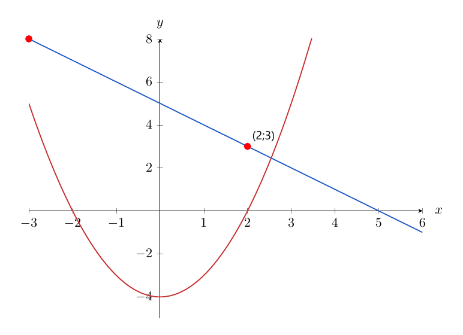

# Занятие 20. Системы нелинейных уравнений

**Дата:** 05.02.2027 (пт)  
**Длительность:** 45 минут  
**Раздел:** Системы уравнений  
**Подтемы:** подстановка и сложение; системы с квадратными уравнениями; связь с теоремой Виета; геометрический смысл системы.

## Цели занятия

К концу занятия ученик сможет:

- отличать систему нелинейных уравнений от системы линейных уравнений;
- решать системы способом подстановки и сложения;
- использовать разложение на множители и теорему Виета;
- понимать решение системы как общие точки двух графиков;
- проверять найденные пары чисел в обоих уравнениях;
- выбрать блок заданий своего уровня: 1–2, 3–4, 5–6, 7–8 или 9–10 баллов.

## Тайминг (45 мин)

| Этап | Время | Что делаем |
|---|---:|---|
| Теория | 12 мин | Четыре мини-темы, алгоритмы и короткие примеры |
| Разбор ключевых заданий | 14 мин | Задания сборника, варианты 5, 13, 27, 57 |
| Самостоятельная работа | 15 мин | Ученик решает только блок своего уровня |
| Подведение итогов | 4 мин | Проверка алгоритма, самооценка, домашнее задание |

---

## Теория к занятию

### Мини-тема 1. Подстановка и сложение

#### Простыми словами

Система уравнений требует найти такую пару чисел $x$ и $y$, которая подходит сразу к обоим уравнениям.

Если одно уравнение позволяет выразить $x$ или $y$, удобно применить способ подстановки.

Если после преобразований одинаковые или противоположные части можно сложить, используем способ сложения.

В нелинейной системе после подстановки часто получается квадратное уравнение.

Главная ловушка: найти одно значение переменной и забыть восстановить вторую.

#### Определение / факт

Система уравнений называется нелинейной, если хотя бы одно её уравнение содержит произведение переменных, квадрат переменной или другую нелинейную зависимость.

Пара чисел $(x_0;y_0)$ является решением системы, если при подстановке этой пары оба уравнения превращаются в верные равенства.

#### Формулы

Если из первого уравнения получено

$$
x=\varphi(y),
$$

то вместо $x$ во втором уравнении подставляют выражение $\varphi(y)$.

Если система имеет вид

$$
\begin{cases}
A+B=C,\\
A-B=D,
\end{cases}
$$

то сложением уравнений получаем

$$
2A=C+D.
$$

#### Правила

- Сначала вырази одну переменную.
- Подставляй выражение аккуратно, полностью заменяя переменную.
- После нахождения одной переменной найди вторую.
- Записывай решения именно парами $(x;y)$.
- Проверяй каждую пару в исходной системе.
- Не путай порядок: $(2;5)$ и $(5;2)$ — разные пары.

#### Алгоритм способа подстановки

1. Выразить одну переменную через другую.
2. Подставить выражение во второе уравнение.
3. Решить полученное уравнение.
4. Найти значение второй переменной.
5. Записать пары решений.
6. Выполнить проверку.

#### Мини-пример

Решите систему уравнений

$$
\begin{cases}
x-y=3,\\
xy=10.
\end{cases}
$$

*Решение:*

Дано:

$$
\begin{cases}
x-y=3,\\
xy=10.
\end{cases}
$$

Найти пару $(x;y)$.

Из первого уравнения выразим $x$:

$$
x=y+3.
$$

Подставим это выражение во второе уравнение:

$$
(y+3)y=10.
$$

Раскроем скобки:

$$
y^2+3y=10.
$$

Перенесём все слагаемые в левую часть:

$$
y^2+3y-10=0.
$$

Разложим на множители:

$$
(y+5)(y-2)=0.
$$

Получаем:

$$
y=-5
$$

или

$$
y=2.
$$

Если $y=-5$, то

$$
x=-5+3=-2.
$$

Получаем пару:

$$
(-2;-5).
$$

Если $y=2$, то

$$
x=2+3=5.
$$

Получаем пару:

$$
(5;2).
$$

Проверка первой пары:

$$
-2-(-5)=3,
$$

$$
(-2)\cdot(-5)=10.
$$

Проверка второй пары:

$$
5-2=3,
$$

$$
5\cdot2=10.
$$

Обе пары подходят.

**Ответ:** $(-2;-5)$; $(5;2)$.

#### Ловушки экзамена

- потеря одного корня квадратного уравнения;
- неверное раскрытие скобок;
- найдено $y$, но не найдено $x$;
- ответ записан не парами.

---

### Мини-тема 2. Системы с квадратными уравнениями

#### Простыми словами

В системе может встретиться квадрат переменной, например $x^2$ или $y^2$.

Тогда после подстановки или сложения часто получается квадратное уравнение.

Иногда удобно сразу применить формулу разности квадратов:

$$
x^2-y^2=(x-y)(x+y).
$$

Если получилось произведение, равное нулю, каждый множитель по очереди приравнивают к нулю.

Квадрат не уничтожает знак: из $x^2=9$ следуют два значения, $x=3$ и $x=-3$.

#### Определение / факт

Квадратным уравнением называется уравнение вида

$$
ax^2+bx+c=0,
$$

где $a\ne0$.

В системе квадратное уравнение может быть одним из двух уравнений.

#### Формулы

Разность квадратов:

$$
a^2-b^2=(a-b)(a+b).
$$

Квадрат суммы:

$$
(a+b)^2=a^2+2ab+b^2.
$$

Квадрат разности:

$$
(a-b)^2=a^2-2ab+b^2.
$$

#### Правила

- При раскрытии квадрата сохраняй средний член $2ab$.
- При разложении разности квадратов используй два множителя.
- Из $x^2=a$ при $a>0$ получаем $x=\pm\sqrt a$.
- Если получилось произведение, равное нулю, рассматривай все случаи.
- Каждый найденный корень проверь в исходной системе.

#### Алгоритм

1. Выбрать способ подстановки, сложения или разложения на множители.
2. Получить уравнение с одной переменной.
3. Решить его.
4. Найти вторую переменную.
5. Отобрать подходящие пары.
6. Проверить ответ.

#### Мини-пример

Решите систему

$$
\begin{cases}
x+y=5,\\
x^2-y^2=15.
\end{cases}
$$

*Решение:*

Дано:

$$
\begin{cases}
x+y=5,\\
x^2-y^2=15.
\end{cases}
$$

Используем разность квадратов:

$$
x^2-y^2=(x-y)(x+y).
$$

Подставим данные из первого уравнения:

$$
(x-y)\cdot5=15.
$$

Разделим на $5$:

$$
x-y=3.
$$

Получили систему линейных уравнений:

$$
\begin{cases}
x+y=5,\\
x-y=3.
\end{cases}
$$

Сложим уравнения:

$$
2x=8.
$$

Тогда

$$
x=4.
$$

Найдём $y$:

$$
4+y=5.
$$

$$
y=1.
$$

Проверка:

$$
4+1=5,
$$

$$
4^2-1^2=16-1=15.
$$

**Ответ:** $(4;1)$.

#### Ловушки экзамена

- забытый множитель $2ab$;
- неверный знак в формуле разности квадратов;
- потеря второго значения при извлечении квадратного корня;
- проверка преобразованной, но не исходной системы.

---

### Мини-тема 3. Связь с теоремой Виета

#### Простыми словами

Иногда после подстановки получается квадратное уравнение, но считать дискриминант необязательно.

Если корни нужны не отдельно, а, например, их сумма или произведение, помогает теорема Виета.

Для системы это особенно удобно: сначала находим все возможные значения одной переменной, затем используем сумму или произведение найденных корней.

Теорема Виета экономит вычисления, но только если квадратное уравнение приведено к правильному виду.

#### Определение / факт

Для приведённого квадратного уравнения

$$
t^2+pt+q=0
$$

с корнями $t_1$ и $t_2$ справедливо:

$$
t_1+t_2=-p,
$$

$$
t_1t_2=q.
$$

#### Формулы

Для уравнения

$$
at^2+bt+c=0
$$

с корнями $t_1$ и $t_2$:

$$
t_1+t_2=-\frac{b}{a},
$$

$$
t_1t_2=\frac{c}{a}.
$$

#### Правила

- Сначала приведи уравнение к виду $at^2+bt+c=0$.
- Не забывай знак минус в формуле суммы корней.
- Теорема Виета относится к корням одного квадратного уравнения.
- Если корни системы — пары, внимательно находи соответствующие значения второй переменной.
- Если нужно найти сумму произведений, не обязательно находить сами корни.

#### Алгоритм

1. Выразить одну переменную через другую.
2. Составить квадратное уравнение.
3. Найти сумму или произведение его корней по Виету.
4. Выразить нужную величину через эти корни.
5. Подставить найденные значения.
6. Проверить смысл результата.

#### Мини-пример

Система имеет решения $(x_1;y_1)$ и $(x_2;y_2)$:

$$
\begin{cases}
x-y=2,\\
xy=8.
\end{cases}
$$

Найдите $y_1+y_2$.

*Решение:*

Из первого уравнения выразим $x$:

$$
x=y+2.
$$

Подставим во второе уравнение:

$$
(y+2)y=8.
$$

Раскроем скобки:

$$
y^2+2y-8=0.
$$

Обозначим корни этого уравнения через $y_1$ и $y_2$.

По теореме Виета:

$$
y_1+y_2=-2.
$$

Следовательно,

$$
y_1+y_2=-2.
$$

Проверка корней:

$$
y^2+2y-8=(y+4)(y-2).
$$

Корни равны $-4$ и $2$, их сумма:

$$
-4+2=-2.
$$

**Ответ:** $-2$.

#### Ловушки экзамена

- запись суммы корней как $p$, а не $-p$;
- применение Виета до приведения уравнения;
- путаница между $x_1+x_2$ и $y_1+y_2$;
- вычисление корней, когда требовалась только их сумма.

---

### Мини-тема 4. Геометрический смысл системы

#### Простыми словами

Каждое уравнение с двумя переменными можно рассматривать как график.

Решение системы — это точка, которая принадлежит обоим графикам.

Значит, решения системы — это точки пересечения графиков.

Если графики не пересекаются, решений нет.

Если пересекаются в одной, двух или трёх точках, система имеет соответственно одно, два или три решения.

#### Определение / факт

Графиком уравнения с двумя переменными называется множество всех точек координатной плоскости, координаты которых удовлетворяют этому уравнению.

Графический метод решения системы состоит в построении графиков уравнений и нахождении их общих точек.

<!--geo-figure-spec
{
  "needed": true,
  "kind": "graph",
  "template": "function",
  "caption": "Графики прямой и параболы",
  "x_range": [
    -3,
    6
  ],
  "y_range": [
    -5,
    8
  ],
  "show_grid": false,
  "curves": [
    {
      "expr": "5-x",
      "label": "y=5-x"
    },
    {
      "expr": "x**2-4",
      "label": "y=x**2-4"
    }
  ],
  "marks": [
    {
      "xy": [
        2,
        3
      ],
      "label": "(2;3)"
    },
    {
      "xy": [
        -3,
        8
      ],
      "label": "(-3;8)"
    }
  ]
}
-->

*Графики прямой и параболы*

#### Формулы

Если уравнение можно записать в виде

$$
y=f(x),
$$

то строят график функции $y=f(x)$.

Точка $(x_0;y_0)$ является решением системы, если

$$
y_0=f(x_0)
$$

и одновременно

$$
y_0=g(x_0).
$$

#### Правила

- Пересечение графиков даёт пару координат.
- По рисунку можно определить число решений.
- Точные координаты, найденные по рисунку, нужно проверить подстановкой.
- Если графики касаются, это одна точка пересечения.
- Если графики совпадают, решений бесконечно много.

#### Алгоритм

1. Выразить $y$ через $x$ в каждом уравнении.
2. Построить оба графика в одной системе координат.
3. Найти точки пересечения.
4. Записать координаты точек.
5. Проверить найденные пары в исходной системе.
6. Сделать вывод о числе решений.

#### Мини-пример

Определите число решений системы

$$
\begin{cases}
y=x+1,\\
y=x^2-3.
\end{cases}
$$

*Решение:*

График первого уравнения — прямая:

$$
y=x+1.
$$

График второго уравнения — парабола:

$$
y=x^2-3.
$$

В точках пересечения значения $y$ равны, поэтому приравняем правые части:

$$
x+1=x^2-3.
$$

Перенесём все слагаемые в левую часть:

$$
x^2-x-4=0.
$$

Дискриминант:

$$
D=(-1)^2-4\cdot1\cdot(-4)=1+16=17.
$$

Так как

$$
D>0,
$$

квадратное уравнение имеет два корня.

Следовательно, графики пересекаются в двух точках.

Система имеет два решения.

Точные значения абсцисс:

$$
x_1=\frac{1-\sqrt{17}}{2},
$$

$$
x_2=\frac{1+\sqrt{17}}{2}.
$$

Для каждого значения $x$ значение $y$ находится по формуле $y=x+1$.

**Ответ:** $2$ решения.

#### Ловушки экзамена

- считать точки пересечения «на глаз» без проверки;
- перепутать координаты $(x;y)$;
- назвать число корней одного уравнения числом решений системы без восстановления $y$;
- не учитывать, что одна общая точка даёт одну пару чисел.

---

## Сводка формул «выучить наизусть»

Разность квадратов:

$$
a^2-b^2=(a-b)(a+b).
$$

Квадрат суммы:

$$
(a+b)^2=a^2+2ab+b^2.
$$

Квадрат разности:

$$
(a-b)^2=a^2-2ab+b^2.
$$

Теорема Виета:

$$
t_1+t_2=-\frac{b}{a},
$$

$$
t_1t_2=\frac{c}{a}.
$$

Геометрический смысл:

- решение системы — общая точка графиков;
- число решений системы равно числу точек пересечения графиков.

## Правила, которые нельзя путать

- $x^2=9$ даёт $x=3$ и $x=-3$.
- $(x-y)^2$ не равно $x^2-y^2$.
- В теореме Виета сумма корней равна $-\frac{b}{a}$.
- Решение системы — это пара $(x;y)$, а не отдельное число.
- Подстановка должна выполняться в исходные уравнения.
- После преобразований проверяй все пары.

## Разрешённый набор для практики

Мини-темы занятия:

- подстановка и сложение;
- системы с квадратными уравнениями;
- связь с теоремой Виета;
- геометрический смысл системы.

Повтор:

- линейная функция и её график;
- линейные неравенства;
- задачи на проценты;
- задачи на работу;
- степень с натуральным показателем;
- степень с целым показателем;
- многочлены и приведение подобных;
- разложение на множители.

---

## Разбор ключевых заданий

### Р1.
Определите число решений системы уравнений

$$
\begin{cases}
x^2+y^2=16,\\
y=-x^2+4.
\end{cases}
$$

Ответ обоснуйте.

*Решение:*

Дано:

$$
\begin{cases}
x^2+y^2=16,\\
y=-x^2+4.
\end{cases}
$$

Найти число решений системы.

Из второго уравнения выразим $y$:

$$
y=4-x^2.
$$

Подставим это выражение в первое уравнение:

$$
x^2+(4-x^2)^2=16.
$$

Обозначим $t=x^2$.

Тогда

$$
t+(4-t)^2=16.
$$

Раскроем квадрат:

$$
t+16-8t+t^2=16.
$$

Приведём подобные:

$$
t^2-7t=0.
$$

Разложим на множители:

$$
t(t-7)=0.
$$

Получаем:

$$
t=0
$$

или

$$
t=7.
$$

Так как $t=x^2$, рассмотрим оба случая.

При $t=0$:

$$
x^2=0,
$$

$$
x=0.
$$

Тогда

$$
y=4-0^2=4.
$$

Получаем одну пару:

$$
(0;4).
$$

При $t=7$:

$$
x^2=7,
$$

$$
x=\sqrt7
$$

или

$$
x=-\sqrt7.
$$

Для обоих значений $x$:

$$
y=4-7=-3.
$$

Получаем две пары:

$$
(\sqrt7;-3)
$$

и

$$
(-\sqrt7;-3).
$$

Проверка:

$$
0^2+4^2=16.
$$

$$
(\sqrt7)^2+(-3)^2=7+9=16.
$$

$$
(-\sqrt7)^2+(-3)^2=7+9=16.
$$

Второе уравнение также выполняется для всех трёх пар.

Следовательно, система имеет три решения.

**Ответ:** $3$ решения.

---

### Р2.
Решите систему уравнений

$$
\begin{cases}
x-4y=2,\\
xy+2y=8
\end{cases}
$$

и найдите значение выражения $x_1y_1+x_2y_2$, где $(x_1;y_1)$ и $(x_2;y_2)$ — решения системы.

*Решение:*

Дано:

$$
\begin{cases}
x-4y=2,\\
xy+2y=8.
\end{cases}
$$

Найти:

$$
x_1y_1+x_2y_2.
$$

Из первого уравнения выразим $x$:

$$
x=2+4y.
$$

Подставим во второе уравнение:

$$
(2+4y)y+2y=8.
$$

Раскроем скобки:

$$
2y+4y^2+2y=8.
$$

Приведём подобные:

$$
4y^2+4y-8=0.
$$

Разделим уравнение на $4$:

$$
y^2+y-2=0.
$$

Разложим на множители:

$$
(y+2)(y-1)=0.
$$

Получаем:

$$
y=-2
$$

или

$$
y=1.
$$

Если $y=-2$, то

$$
x=2+4\cdot(-2)=2-8=-6.
$$

Получаем решение:

$$
(-6;-2).
$$

Если $y=1$, то

$$
x=2+4\cdot1=6.
$$

Получаем решение:

$$
(6;1).
$$

Найдём сумму произведений координат:

$$
x_1y_1+x_2y_2=(-6)\cdot(-2)+6\cdot1.
$$

$$
x_1y_1+x_2y_2=12+6=18.
$$

Проверка первой пары:

$$
-6-4\cdot(-2)=-6+8=2,
$$

$$
(-6)\cdot(-2)+2\cdot(-2)=12-4=8.
$$

Проверка второй пары:

$$
6-4\cdot1=2,
$$

$$
6\cdot1+2\cdot1=8.
$$

**Ответ:** $18$.

---

### Р3.
Сколько решений имеет система уравнений

$$
\begin{cases}
x^2+xy=15,\\
y^2+xy=10?
\end{cases}
$$

Ответ обоснуйте.

*Решение:*

Дано:

$$
\begin{cases}
x^2+xy=15,\\
y^2+xy=10.
\end{cases}
$$

Найти число решений.

Вычтем второе уравнение из первого:

$$
x^2+xy-y^2-xy=15-10.
$$

Получаем:

$$
x^2-y^2=5.
$$

Разложим разность квадратов:

$$
(x-y)(x+y)=5.
$$

Также сложим исходные уравнения:

$$
x^2+y^2+2xy=25.
$$

Левая часть — квадрат суммы:

$$
(x+y)^2=25.
$$

Следовательно,

$$
x+y=5
$$

или

$$
x+y=-5.
$$

Рассмотрим первый случай:

$$
x+y=5.
$$

Из равенства $(x-y)(x+y)=5$ получаем:

$$
(x-y)\cdot5=5.
$$

$$
x-y=1.
$$

Решим систему:

$$
\begin{cases}
x+y=5,\\
x-y=1.
\end{cases}
$$

Сложим уравнения:

$$
2x=6.
$$

$$
x=3.
$$

Тогда

$$
y=5-3=2.
$$

Получаем пару:

$$
(3;2).
$$

Рассмотрим второй случай:

$$
x+y=-5.
$$

Тогда

$$
(x-y)\cdot(-5)=5.
$$

$$
x-y=-1.
$$

Решим систему:

$$
\begin{cases}
x+y=-5,\\
x-y=-1.
\end{cases}
$$

Сложим уравнения:

$$
2x=-6.
$$

$$
x=-3.
$$

Тогда

$$
y=-5-(-3)=-2.
$$

Получаем пару:

$$
(-3;-2).
$$

Проверка пары $(3;2)$:

$$
3^2+3\cdot2=9+6=15,
$$

$$
2^2+3\cdot2=4+6=10.
$$

Проверка пары $(-3;-2)$:

$$
(-3)^2+(-3)\cdot(-2)=9+6=15,
$$

$$
(-2)^2+(-3)\cdot(-2)=4+6=10.
$$

Получены две различные пары решений.

**Ответ:** $2$ решения.

---

### Р4.
Решите систему уравнений

$$
\begin{cases}
xy-x-y=29,\\
x^2+y^2-x-y=72.
\end{cases}
$$

*Решение:*

Дано:

$$
\begin{cases}
xy-x-y=29,\\
x^2+y^2-x-y=72.
\end{cases}
$$

Найти все пары $(x;y)$.

Обозначим:

$$
s=x+y,
$$

$$
p=xy.
$$

Первое уравнение принимает вид:

$$
p-s=29.
$$

Отсюда

$$
p=s+29.
$$

Во втором уравнении используем формулу:

$$
x^2+y^2=(x+y)^2-2xy.
$$

Получаем:

$$
s^2-2p-s=72.
$$

Подставим $p=s+29$:

$$
s^2-2(s+29)-s=72.
$$

Раскроем скобки:

$$
s^2-2s-58-s=72.
$$

$$
s^2-3s-130=0.
$$

Разложим на множители:

$$
(s-13)(s+10)=0.
$$

Получаем:

$$
s=13
$$

или

$$
s=-10.
$$

#### Первый случай: $s=13$

Тогда

$$
p=s+29=13+29=42.
$$

Числа $x$ и $y$ являются корнями уравнения:

$$
t^2-st+p=0.
$$

Получаем:

$$
t^2-13t+42=0.
$$

Разложим на множители:

$$
(t-6)(t-7)=0.
$$

Следовательно,

$$
t=6
$$

или

$$
t=7.
$$

Получаем пары:

$$
(6;7)
$$

и

$$
(7;6).
$$

#### Второй случай: $s=-10$

Тогда

$$
p=-10+29=19.
$$

Составим уравнение для $x$ и $y$:

$$
t^2+10t+19=0.
$$

Дискриминант:

$$
D=10^2-4\cdot1\cdot19.
$$

$$
D=100-76=24.
$$

$$
\sqrt D=\sqrt{24}=2\sqrt6.
$$

Корни:

$$
t=\frac{-10\pm2\sqrt6}{2}.
$$

$$
t=-5\pm\sqrt6.
$$

Получаем две пары:

$$
(-5+\sqrt6;-5-\sqrt6)
$$

и

$$
(-5-\sqrt6;-5+\sqrt6).
$$

Проверка по сумме и произведению:

Для первой пары сумма равна $13$, произведение равно $42$.

Для второй пары сумма равна $-10$, произведение равно $19$.

Во всех случаях выполняются исходные уравнения.

**Ответ:** $(6;7)$; $(7;6)$; $(-5+\sqrt6;-5-\sqrt6)$; $(-5-\sqrt6;-5+\sqrt6)$.

---

## Самостоятельная работа

Выбери свой уровень и решай только этот блок.  
В каждом блоке есть все мини-темы урока и повтор пройденного материала.

### Уровень 1–2 балла

**С1.** *мини-тема 1, авторское*  
Решите систему уравнений:

$$
\begin{cases}
x+y=7,\\
x=3.
\end{cases}
$$

**С2.** *мини-тема 2, авторское*  
Решите уравнение:

$$
x^2=25.
$$

**С3.** *мини-тема 3, авторское*  
Для уравнения $t^2-7t+12=0$ найдите сумму его корней.

**С4.** *мини-тема 4, авторское*  
Сколько решений имеет система, если графики её уравнений пересекаются в двух точках?

**С5.** *повтор*  
Постройте график функции:

$$
y=2x-1.
$$

Укажите её угловой коэффициент.

### Уровень 3–4 балла

**С1.** *мини-тема 1, авторское*  
Решите систему:

$$
\begin{cases}
x-y=1,\\
xy=6.
\end{cases}
$$

**С2.** *мини-тема 2, авторское*  
Решите систему:

$$
\begin{cases}
x+y=6,\\
x^2-y^2=12.
\end{cases}
$$

**С3.** *мини-тема 3, авторское*  
Корни уравнения $t^2-9t+14=0$ обозначены $t_1$ и $t_2$. Найдите $t_1t_2$.

**С4.** *мини-тема 4, авторское*  
Определите число решений системы:

$$
\begin{cases}
y=2x+1,\\
y=x^2-3.
\end{cases}
$$

**С5.** *повтор*  
Решите неравенство:

$$
3x-5\le7.
$$

### Уровень 5–6 баллов

**С1.** *мини-тема 1, авторское*  
Решите систему:

$$
\begin{cases}
x-2y=1,\\
xy=3.
\end{cases}
$$

**С2.** *мини-тема 2, авторское*  
Решите систему:

$$
\begin{cases}
x+y=4,\\
x^2+y^2=10.
\end{cases}
$$

**С3.** *мини-тема 3, авторское*  
Решения системы имеют вид $(x_1;y_1)$ и $(x_2;y_2)$. После подстановки получено уравнение для $y$:

$$
y^2-5y+6=0.
$$

Найдите $y_1+y_2$ и $y_1y_2$.

**С4.** *мини-тема 4, авторское*  
Найдите число точек пересечения графиков:

$$
y=x+2
$$

и

$$
y=x^2-4.
$$

**С5.** *повтор*  
Вычислите:

$$
2^3\cdot2^{-1}.
$$

### Уровень 7–8 баллов

**С1.** *сборник, вариант 9, №7*  
Решите систему уравнений:

$$
\begin{cases}
x-4y=2,\\
xy+2y=8.
\end{cases}
$$

**С2.** *сборник, вариант 1, №8*  
Найдите значение выражения $x_1x_2+y_1y_2$, где $(x_1;y_1)$ и $(x_2;y_2)$ — решения системы:

$$
\begin{cases}
x^2-y=21,\\
x+y=9.
\end{cases}
$$

**С3.** *сборник, вариант 21, №8*  
Постройте графики уравнений системы

$$
\begin{cases}
x+y=5,\\
y-x^2=3
\end{cases}
$$

и найдите сумму ординат точек пересечения.

**С4.** *сборник, вариант 45, №8*  
Найдите значение выражения $6(x-y)$, где $(x;y)$ — решение системы:

$$
\begin{cases}
3x+y=2,\\
y^2+6xy+9x^2=-y-x.
\end{cases}
$$

**С5.** *повтор*  
Первый рабочий выполняет работу за $6$ часов, второй — за $12$ часов. Какую часть работы они выполнят вместе за $2$ часа?

### Уровень 9–10 баллов

**С1.** *мини-тема 1, авторское*  
Решите систему:

$$
\begin{cases}
x+y=1,\\
x^2+y^2=13.
\end{cases}
$$

**С2.** *мини-тема 2, авторское*  
Решите систему:

$$
\begin{cases}
x^2-y^2=16,\\
x+y=8.
\end{cases}
$$

**С3.** *мини-тема 3, авторское*  
Решения системы имеют вид $(x_1;y_1)$ и $(x_2;y_2)$. Найдите $x_1+x_2$ и $x_1x_2$, если значения $x_1$ и $x_2$ являются корнями уравнения:

$$
x^2-6x+5=0.
$$

**С4.** *мини-тема 4, авторское*  
Определите число решений системы:

$$
\begin{cases}
x^2+y^2=25,\\
y=x+1.
\end{cases}
$$

Ответ обоснуйте.

**С5.** *повтор, авторское*  
Цена товара после повышения на $20\%$ стала равна $360$ рублей. Найдите первоначальную цену товара. Затем определите, на сколько рублей первоначальная цена меньше новой.

---

## Домашнее задание

Ученик берёт свой уровень и выполняет только этот блок.

### Уровень 1–2 балла

**Д1.** *мини-тема 1, авторское*  
Решите систему:

$$
\begin{cases}
x+y=10,\\
x=4.
\end{cases}
$$

**Д2.** *мини-тема 2, авторское*  
Решите уравнение:

$$
y^2=36.
$$

**Д3.** *мини-тема 3, авторское*  
Найдите произведение корней уравнения:

$$
t^2-8t+15=0.
$$

**Д4.** *мини-тема 4, авторское*  
Сколько решений имеет система, если графики не имеют общих точек?

**Д5.** *повтор*  
Упростите выражение:

$$
3a+5a-2a.
$$

**Д6.** *повтор*  
Решите неравенство:

$$
5x+1>16.
$$

### Уровень 3–4 балла

**Д1.** *мини-тема 1, авторское*  
Решите систему:

$$
\begin{cases}
x-y=2,\\
xy=8.
\end{cases}
$$

**Д2.** *мини-тема 2, авторское*  
Решите систему:

$$
\begin{cases}
x+y=5,\\
x^2-y^2=5.
\end{cases}
$$

**Д3.** *мини-тема 3, авторское*  
Найдите сумму корней уравнения:

$$
2t^2-10t+7=0.
$$

**Д4.** *мини-тема 4, авторское*  
Определите число решений системы:

$$
\begin{cases}
y=x+3,\\
y=x^2-1.
\end{cases}
$$

**Д5.** *повтор*  
Вычислите:

$$
2^4\cdot2^{-2}.
$$

**Д6.** *повтор*  
После уменьшения числа на $20\%$ получили $64$. Найдите исходное число.

### Уровень 5–6 баллов

**Д1.** *мини-тема 1, авторское*  
Решите систему:

$$
\begin{cases}
x+y=7,\\
xy=10.
\end{cases}
$$

**Д2.** *мини-тема 2, авторское*  
Решите систему:

$$
\begin{cases}
x-y=1,\\
x^2+y^2=25.
\end{cases}
$$

**Д3.** *мини-тема 3, авторское*  
Корни уравнения $t^2+4t-12=0$ обозначены $t_1$ и $t_2$. Найдите $t_1+t_2$ и $t_1t_2$.

**Д4.** *мини-тема 4, авторское*  
Сколько точек пересечения имеют графики:

$$
y=3-x
$$

и

$$
y=x^2-1?
$$

**Д5.** *повтор*  
Упростите:

$$
4x^2-7x+3x^2+2x.
$$

**Д6.** *повтор*  
Рабочий выполняет работу за $8$ часов. Какую часть работы он выполнит за $3$ часа?

### Уровень 7–8 баллов

**Д1.** *сборник, вариант 63, №8*  
Решите систему уравнений

$$
\begin{cases}
x-2y=1,\\
3x+4y=23
\end{cases}
$$

и найдите разность найденных значений $x$ и $y$.

**Д2.** *сборник, вариант 11, №7*  
Определите количество целых решений системы неравенств:

$$
\begin{cases}
\dfrac{x+2}{2}-3\le\dfrac{x-3}{3},\\
x^2<5x+6.
\end{cases}
$$

**Д3.** *мини-тема 1, авторское*  
Решите систему:

$$
\begin{cases}
x+y=6,\\
xy=5.
\end{cases}
$$

**Д4.** *мини-тема 2, авторское*  
Решите систему:

$$
\begin{cases}
x-y=4,\\
x^2-y^2=24.
\end{cases}
$$

**Д5.** *повтор*  
Постройте график функции:

$$
y=-2x+4.
$$

Укажите координаты точки пересечения графика с осью абсцисс.

**Д6.** *повтор*  
Два рабочих выполняют работу вместе за $4$ часа. Первый один выполняет её за $6$ часов. За сколько часов выполнит работу второй рабочий?

### Уровень 9–10 баллов

**Д1.** *мини-тема 1, авторское*  
Решите систему:

$$
\begin{cases}
x+y=6,\\
x^2+xy=12.
\end{cases}
$$

**Д2.** *мини-тема 2, авторское*  
Решите систему:

$$
\begin{cases}
x^2-y^2=21,\\
x-y=3.
\end{cases}
$$

**Д3.** *мини-тема 3, авторское*  
Пусть $(x_1;y_1)$ и $(x_2;y_2)$ — решения системы, причём $x_1$ и $x_2$ — корни уравнения

$$
x^2-9x+14=0.
$$

Найдите $x_1+x_2$ и $x_1x_2$.

**Д4.** *мини-тема 4, авторское*  
Определите число решений системы:

$$
\begin{cases}
x^2+y^2=10,\\
y=x^2-2.
\end{cases}
$$

Ответ обоснуйте.

**Д5.** *повтор, авторское*  
В первый день турист прошёл $40\%$ всего маршрута, во второй — $30\%$ оставшегося пути, после чего ему осталось пройти $42$ км. Найдите длину всего маршрута.

**Д6.** *повтор, авторское*  
Два рабочих вместе выполняют работу за $6$ часов. Первый рабочий один выполняет её за $10$ часов. За сколько часов выполнит работу второй рабочий?

---

## Чек-лист «ученик понял тему»

- [ ] Я понимаю, что решение системы — это пара $(x;y)$.
- [ ] Я умею выразить одну переменную и выполнить подстановку.
- [ ] Я умею применять разность квадратов.
- [ ] Я не теряю корни квадратного уравнения.
- [ ] Я умею использовать теорему Виета.
- [ ] Я понимаю, что решения системы — точки пересечения графиков.
- [ ] Я проверяю найденные пары в исходной системе.

---
