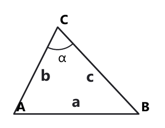

# Занятие 21. Теорема косинусов

**Дата:** 12.02.2027 (пт)  
**Длительность:** 45 минут  
**Раздел:** Тригонометрия треугольника  
**Подтемы:** теорема косинусов; нахождение стороны и угла; остроугольный и тупоугольный треугольник; связь с теоремой Пифагора.

## Цели занятия

К концу занятия ученик умеет:

- применять теорему косинусов для нахождения стороны треугольника;
- находить косинус угла по трём сторонам;
- определять вид треугольника по длинам его сторон;
- объяснять, почему теорема Пифагора является частным случаем теоремы косинусов;
- выбирать блок заданий своего уровня: 1–2, 3–4, 5–6, 7–8 или 9–10 баллов.

## Тайминг

| Этап | Время | Что делаем |
|---|---:|---|
| Теория | 12 мин | Формулы, алгоритмы, типичные ловушки |
| Разбор ключевых заданий | 14 мин | Четыре задачи сборника |
| Самостоятельная работа | 15 мин | Ученик решает только свой уровень |
| Подведение итогов | 4 мин | Проверка формул и самоконтроль |

---

## Теория к занятию

### Мини-тема 1. Теорема косинусов

#### Простыми словами

Теорема Пифагора работает только в прямоугольном треугольнике. Но большинство треугольников прямыми углами не балует. Для любого треугольника используется теорема косинусов.

Она связывает три стороны треугольника и угол между двумя из них.

Если известны две стороны и угол между ними, можно найти третью сторону.

Если известны все три стороны, можно найти косинус любого угла.

#### Определение / факт

Квадрат стороны треугольника равен сумме квадратов двух других сторон без удвоенного произведения этих сторон на косинус угла между ними.

#### Формулы

Если сторона $a$ лежит напротив угла $\alpha$, а стороны $b$ и $c$ образуют этот угол, то

$$a^2=b^2+c^2-2bc\cos\alpha.$$

Здесь $a$, $b$, $c$ — стороны треугольника, а $\alpha$ — угол между сторонами $b$ и $c$.

Для других сторон:

$$b^2=a^2+c^2-2ac\cos\beta,$$

$$c^2=a^2+b^2-2ab\cos\gamma.$$

Формулу применяют в любом треугольнике.

#### Правила

- Сторона в левой части формулы лежит напротив соответствующего угла.
- Угол в формуле — это угол между двумя сторонами, записанными справа.
- Сначала вычисляют квадрат неизвестной стороны.
- Только после этого извлекают квадратный корень.
- Длина стороны не может быть отрицательной.
- Не забывай множитель $2bc$.

#### Алгоритм нахождения стороны

1. Записать теорему косинусов для нужной стороны.
2. Подставить известные длины и косинус угла.
3. Выполнить действия в правильном порядке.
4. Найти квадрат стороны.
5. Извлечь положительный квадратный корень.
6. Проверить, что длина имеет разумный смысл.

#### Мини-пример

В треугольнике две стороны равны $5$ см и $7$ см, а угол между ними равен $60^\circ$. Найдите третью сторону.

*Решение:*

Дано: $b=5$ см, $c=7$ см, $\alpha=60^\circ$.

Найти: сторону $a$.

Применяем теорему косинусов:

$$a^2=b^2+c^2-2bc\cos\alpha.$$

Подставляем значения:

$$a^2=5^2+7^2-2\cdot5\cdot7\cdot\cos60^\circ.$$

Так как $\cos60^\circ=\frac12$, получаем:

$$a^2=25+49-70\cdot\frac12.$$

$$a^2=74-35.$$

$$a^2=39.$$

Длина стороны положительна:

$$a=\sqrt{39}\text{ см}.$$

Проверка: третья сторона должна быть больше разности $7-5=2$ и меньше суммы $7+5=12$.

Число $\sqrt{39}$ действительно находится между $2$ и $12$.

**Ответ:** $\sqrt{39}$ см.

#### Ловушки экзамена

- записать $+2bc\cos\alpha$ вместо $-2bc\cos\alpha`;
- перепутать угол между сторонами с углом напротив неизвестной стороны;
- забыть извлечь корень;
- получить отрицательную длину и оставить её в ответе.

---

### Мини-тема 2. Нахождение стороны и угла

#### Простыми словами

Теорема косинусов работает в двух направлениях.

По двум сторонам и углу между ними находим третью сторону.

По трём сторонам находим косинус угла.

После нахождения косинуса угол можно определить по таблице или калькулятору, если это требуется условием.

#### Определение / факт

Если стороны треугольника известны, то косинус угла, лежащего напротив стороны $a$, вычисляется по формуле

$$\cos\alpha=\frac{b^2+c^2-a^2}{2bc}.$$

#### Формулы

Для угла $\alpha$:

$$\cos\alpha=\frac{b^2+c^2-a^2}{2bc}.$$

Для угла $\beta$:

$$\cos\beta=\frac{a^2+c^2-b^2}{2ac}.$$

Для угла $\gamma$:

$$\cos\gamma=\frac{a^2+b^2-c^2}{2ab}.$$

Знаменатель не равен нулю, поскольку стороны треугольника положительны.

#### Правила

- Сначала определяют, какая сторона лежит напротив нужного угла.
- Квадраты сторон считают отдельно.
- Числитель и знаменатель проверяют перед сокращением.
- Если косинус положителен, угол острый.
- Если косинус равен нулю, угол прямой.
- Если косинус отрицателен, угол тупой.

#### Алгоритм нахождения угла

1. Определить сторону, лежащую напротив искомого угла.
2. Записать формулу косинуса.
3. Подставить три стороны.
4. Сократить дробь.
5. По значению косинуса определить угол или его вид.
6. Проверить, что угол находится между $0^\circ$ и $180^\circ$.

#### Мини-пример

Стороны треугольника равны $5$ см, $5$ см и $6$ см. Найдите косинус угла, лежащего напротив стороны $6$ см.

*Решение:*

Дано: $a=5$ см, $b=5$ см, $c=6$ см.

Найти: $\cos\gamma$, где угол $\gamma$ лежит напротив стороны $c=6$ см.

Используем формулу:

$$\cos\gamma=\frac{a^2+b^2-c^2}{2ab}.$$

Подставляем значения:

$$\cos\gamma=\frac{5^2+5^2-6^2}{2\cdot5\cdot5}.$$

Вычисляем квадраты:

$$\cos\gamma=\frac{25+25-36}{50}.$$

$$\cos\gamma=\frac{14}{50}.$$

Сокращаем дробь на $2$:

$$\cos\gamma=\frac{7}{25}.$$

Значение положительно, поэтому угол $\gamma$ острый.

**Ответ:** $\frac{7}{25}$.

#### Ловушки экзамена

- сторона напротив угла ошибочно записывается в знаменателе;
- путают $a^2$ и $a$;
- считают только знак, но забывают, что сторона должна быть наибольшей;
- при отрицательном косинусе называют угол острым.

---

### Мини-тема 3. Остроугольный и тупоугольный треугольник

#### Простыми словами

Чтобы определить вид треугольника по трём сторонам, достаточно проверить угол напротив большей стороны.

Пусть $c$ — большая сторона.

Если квадрат большей стороны меньше суммы квадратов двух других, треугольник остроугольный.

Если равен — прямоугольный.

Если больше — тупоугольный.

Это похоже на теорему Пифагора, но теперь знак сравнения сам сообщает вид треугольника.

#### Определение / факт

Треугольник называется:

- остроугольным, если все его углы острые;
- прямоугольным, если один угол прямой;
- тупоугольным, если один угол тупой.

#### Формулы и признаки

Пусть $c$ — большая сторона.

$$c^2<a^2+b^2 \quad \Rightarrow \quad \text{треугольник остроугольный};$$

$$c^2=a^2+b^2 \quad \Rightarrow \quad \text{треугольник прямоугольный};$$

$$c^2>a^2+b^2 \quad \Rightarrow \quad \text{треугольник тупоугольный}.$$

Сначала нужно убедиться, что стороны образуют треугольник:

$$a+b>c.$$

#### Правила

- Сравнивают именно квадрат большей стороны.
- Не нужно проверять все три угла.
- Если равенство выполняется, треугольник прямоугольный.
- Если большая сторона слишком велика и не выполняется неравенство треугольника, треугольника вообще нет.
- Большая сторона лежит напротив большего угла.

#### Алгоритм

1. Найти большую сторону.
2. Проверить неравенство треугольника.
3. Возвести в квадрат большую сторону.
4. Найти сумму квадратов двух других сторон.
5. Сравнить полученные числа.
6. Записать вид треугольника.

#### Мини-пример

Определите вид треугольника со сторонами $6$ см, $8$ см и $10$ см.

*Решение:*

Дано: $a=6$ см, $b=8$ см, $c=10$ см.

Большая сторона равна $10$ см.

Проверим существование треугольника:

$$6+8=14>10.$$

Треугольник существует.

Сравним квадраты:

$$c^2=10^2=100.$$

$$a^2+b^2=6^2+8^2=36+64=100.$$

Получили:

$$c^2=a^2+b^2.$$

Следовательно, треугольник прямоугольный.

**Ответ:** прямоугольный треугольник.

#### Ловушки экзамена

- проверить $c<a+b$, но не сравнить квадраты;
- забыть выбрать большую сторону;
- назвать треугольник тупоугольным при равенстве;
- не проверить существование треугольника.

---

### Мини-тема 4. Связь с теоремой Пифагора

#### Простыми словами

В прямоугольном треугольнике угол между катетами равен $90^\circ$.

Так как $\cos90^\circ=0$, член с косинусом исчезает.

Теорема косинусов превращается в теорему Пифагора.

Значит, теорема Пифагора — частный случай теоремы косинусов, а не отдельная математическая планета.

#### Определение / факт

Если угол между сторонами $b$ и $c$ равен $90^\circ$, то сторона $a$, лежащая напротив этого угла, является гипотенузой.

#### Формулы

По теореме косинусов:

$$a^2=b^2+c^2-2bc\cos90^\circ.$$

Так как $\cos90^\circ=0$, получаем:

$$a^2=b^2+c^2.$$

Это и есть теорема Пифагора.

Для катета:

$$b^2=a^2-c^2,$$

$$c^2=a^2-b^2.$$

#### Правила

- Гипотенуза лежит напротив прямого угла.
- Гипотенуза — самая длинная сторона.
- Для прямого угла косинус равен нулю.
- Нельзя применять теорему Пифагора к произвольному треугольнику.
- Теорему косинусов можно применять и к прямоугольному, и к непрямоугольному треугольнику.

#### Алгоритм

1. Найти прямой угол.
2. Определить гипотенузу.
3. Записать теорему Пифагора или теорему косинусов.
4. Подставить значения.
5. Найти неизвестную длину.
6. Проверить, что гипотенуза самая большая.

#### Мини-пример

Катеты прямоугольного треугольника равны $9$ см и $12$ см. Найдите гипотенузу.

*Решение:*

Дано: $b=9$ см, $c=12$ см.

Найти: гипотенузу $a$.

Угол между катетами равен $90^\circ$.

По теореме косинусов:

$$a^2=b^2+c^2-2bc\cos90^\circ.$$

Так как $\cos90^\circ=0$, получаем:

$$a^2=9^2+12^2.$$

$$a^2=81+144.$$

$$a^2=225.$$

$$a=\sqrt{225}=15.$$

Проверка:

$$15^2=9^2+12^2,$$

$$225=81+144,$$

$$225=225.$$

Гипотенуза $15$ см больше каждого катета.

**Ответ:** $15$ см.

#### Ловушки экзамена

- принять катет за гипотенузу;
- забыть, что гипотенуза самая длинная;
- записать $a=b+c$ вместо $a^2=b^2+c^2$;
- применять теорему Пифагора без прямого угла.

---

### Ключевой чертёж

<!--geo-figure-spec
{
  "needed": true,
  "kind": "plane",
  "template": "triangle",
  "caption": "Треугольник ABC: сторона a лежит напротив угла α",
  "show_labels": true,
  "vertices": {
    "A": [
      0,
      0
    ],
    "B": [
      6,
      0
    ],
    "C": [
      2,
      4
    ]
  },
  "edges": [
    [
      "A",
      "B"
    ],
    [
      "B",
      "C"
    ],
    [
      "C",
      "A"
    ]
  ],
  "angle_marks": [
    {
      "vertex": "C",
      "from": "A",
      "to": "B",
      "text": "α"
    }
  ],
  "segment_labels": [
    {
      "points": [
        "A",
        "B"
      ],
      "text": "a",
      "t": 0.5
    },
    {
      "points": [
        "B",
        "C"
      ],
      "text": "c",
      "t": 0.5
    },
    {
      "points": [
        "C",
        "A"
      ],
      "text": "b",
      "t": 0.5
    }
  ]
}
-->

*Треугольник ABC: сторона a лежит напротив угла α*

## Сводка формул «выучить наизусть»

$$a^2=b^2+c^2-2bc\cos\alpha.$$

$$\cos\alpha=\frac{b^2+c^2-a^2}{2bc}.$$

$$c^2<a^2+b^2 \Rightarrow \text{остроугольный треугольник}.$$

$$c^2=a^2+b^2 \Rightarrow \text{прямоугольный треугольник}.$$

$$c^2>a^2+b^2 \Rightarrow \text{тупоугольный треугольник}.$$

$$a^2=b^2+c^2 \quad \text{для прямоугольного треугольника}.$$

## Правила, которые нельзя путать

- Сторона напротив угла записывается в левой части теоремы косинусов.
- Угол в формуле расположен между двумя сторонами справа.
- Для нахождения стороны сначала находят её квадрат.
- Для нахождения угла сначала находят косинус.
- Для определения вида треугольника сравнивают квадрат большей стороны.
- Равенство квадратов означает прямоугольный, а не тупоугольный треугольник.
- Теорема Пифагора применяется только при наличии прямого угла.

## Разрешённый набор для практики

На занятии используются:

- теорема косинусов;
- нахождение стороны и угла;
- определение вида треугольника;
- связь с теоремой Пифагора;
- линейная функция и её график;
- линейные неравенства;
- задачи на проценты;
- задачи на работу;
- степени с натуральным и целым показателем;
- многочлены и приведение подобных;
- разложение на множители.

---

## Разбор ключевых заданий

### Р1.
Известно, что в равнобедренном треугольнике $ABC$ $AB=BC=4$. Найдите $AC$, если медиана $AM=3$.

*Решение:*

Дано: $AB=BC=4$, $AM=3$.

Так как треугольник $ABC$ равнобедренный и $AB=BC$, основание — $AC$.

Медиана $AM$ проведена из вершины $A$ к стороне $BC$.

По формуле медианы:

$$AM^2=\frac{2AB^2+2AC^2-BC^2}{4}.$$

Подставляем известные значения:

$$3^2=\frac{2\cdot4^2+2AC^2-4^2}{4}.$$

$$9=\frac{2\cdot16+2AC^2-16}{4}.$$

$$9=\frac{16+2AC^2}{4}.$$

Умножаем на $4$:

$$36=16+2AC^2.$$

$$2AC^2=20.$$

$$AC^2=10.$$

Длина отрезка положительна:

$$AC=\sqrt{10}\text{ см}.$$

Проверка по формуле медианы:

$$AM^2=\frac{2\cdot16+2\cdot10-16}{4}.$$

$$AM^2=\frac{36}{4}=9.$$

$$AM=3.$$

**Ответ:** $\sqrt{10}$.

---

### Р2.
Какое из следующих утверждений не верно:

а) если все стороны квадрата увеличить в $2$ раза, то его площадь увеличится в $2$ раза;

б) внешний угол треугольника является смежным с его внутренним углом;

в) медианы равностороннего треугольника равны между собой;

г) диагональ квадрата со стороной $a$ равна $a\sqrt2$?

*Решение:*

Проверим утверждение а).

Пусть сторона квадрата равна $a$.

Его площадь равна:

$$S=a^2.$$

После увеличения стороны в $2$ раза новая сторона равна $2a$.

Новая площадь:

$$S_1=(2a)^2=4a^2.$$

Площадь увеличилась в $4$ раза, а не в $2$ раза.

Утверждение а) неверно.

Утверждение б) верно, так как внешний и внутренний углы образуют развернутый угол.

Утверждение в) верно: равносторонний треугольник имеет равные стороны, поэтому его медианы равны.

Утверждение г) верно по теореме Пифагора:

$$d^2=a^2+a^2=2a^2,$$

$$d=a\sqrt2.$$

**Ответ:** а).

---

### Р3.
Найдите площадь треугольника, если две его стороны равны $6$ см и $8$ см, а медиана, проведённая к третьей стороне, равна $5$ см.

*Решение:*

Дано: $b=6$ см, $c=8$ см, $m_a=5$ см.

Найти: площадь треугольника.

Обозначим третью сторону через $a$.

По формуле медианы:

$$m_a^2=\frac{2b^2+2c^2-a^2}{4}.$$

Подставляем значения:

$$5^2=\frac{2\cdot6^2+2\cdot8^2-a^2}{4}.$$

$$25=\frac{2\cdot36+2\cdot64-a^2}{4}.$$

$$25=\frac{72+128-a^2}{4}.$$

$$25=\frac{200-a^2}{4}.$$

Умножаем на $4$:

$$100=200-a^2.$$

$$a^2=100.$$

$$a=10\text{ см}.$$

Проверка существования треугольника:

$$6+8>10.$$

$$14>10.$$

Треугольник существует.

Теперь определим вид треугольника:

$$6^2+8^2=36+64=100=10^2.$$

Треугольник прямоугольный.

Стороны $6$ см и $8$ см являются катетами.

Площадь:

$$S=\frac12\cdot6\cdot8.$$

$$S=3\cdot8=24\text{ см}^2.$$

Проверка по формуле площади через две стороны и угол:

$$S=\frac12\cdot6\cdot8\cdot\sin90^\circ.$$

$$S=24\cdot1=24\text{ см}^2.$$

**Ответ:** $24\text{ см}^2$.

---

### Р4.
Какое из следующих утверждений не верно:

а) диагонали ромба взаимно перпендикулярны;

б) если две стороны одного треугольника соответственно равны двум сторонам другого треугольника, то такие треугольники равны;

в) хорда окружности, проходящая через её центр, является диаметром;

г) боковые стороны равнобедренной трапеции равны между собой?

*Решение:*

Проверим утверждение а).

Диагонали ромба действительно перпендикулярны.

Утверждение в) верно по определению диаметра: диаметр — хорда, проходящая через центр окружности.

Утверждение г) верно по определению равнобедренной трапеции.

Утверждение б) неверно.

Равенство только двух сторон не является признаком равенства треугольников.

Необходимо знать ещё угол между этими сторонами или третью сторону.

**Ответ:** б).

---

## Самостоятельная работа

Выбери свой уровень и решай только этот блок.

В каждом блоке есть все мини-темы занятия и повтор ранее изученного материала.

### Уровень 1–2 балла

**С1.** *Мини-тема 1, авторское.* В треугольнике две стороны равны $3$ см и $4$ см, а угол между ними равен $90^\circ$. Найдите третью сторону.

**С2.** *Мини-тема 2, авторское.* Стороны треугольника равны $3$ см, $4$ см и $5$ см. Найдите косинус угла, лежащего напротив стороны $5$ см.

**С3.** *Мини-тема 3, авторское.* Определите вид треугольника со сторонами $5$ см, $12$ см и $13$ см.

**С4.** *Мини-тема 4, авторское.* Катеты прямоугольного треугольника равны $5$ см и $12$ см. Найдите гипотенузу.

**С5.** *Повтор.* Решите линейное неравенство $3x-7\leq5$.

### Уровень 3–4 балла

**С1.** *Сборник, вариант 47, №3.* Какое из следующих утверждений не верно:  
а) диагонали любого прямоугольника взаимно перпендикулярны;  
б) высота ромба равна диаметру вписанной в него окружности;  
в) центр окружности, описанной около треугольника, лежит на пересечении серединных перпендикуляров к сторонам треугольника;  
г) угол, равный $89^\circ$, — острый?

**С2.** *Сборник, вариант 61, №3.* Какое из следующих утверждений не верно:  
а) острый угол больше $0^\circ$ и меньше $90^\circ$;  
б) если $\alpha$ — острый угол, то $\sin^2\alpha+\cos^2\alpha=1$;  
в) центр окружности, описанной около прямоугольного треугольника, лежит на середине гипотенузы;  
г) в любом параллелограмме все углы равны между собой?

**С3.** *Сборник, вариант 67, №3.* Какое из следующих утверждений не верно:  
а) для прямоугольного треугольника $ABC$ с прямым углом $C$ верно $\sin A=\frac{BC}{AB}$;  
б) диагонали прямоугольника равны;  
в) площадь трапеции равна произведению полусуммы оснований на высоту;  
г) сумма градусных мер всех углов квадрата равна $180^\circ$?

**С4.** *Мини-тема 1, авторское.* Найдите третью сторону треугольника, если две стороны равны $7$ см и $9$ см, а угол между ними равен $60^\circ$.

**С5.** *Повтор.* Дана функция $y=2x-3$. Найдите значение функции при $x=4$.

### Уровень 5–6 баллов

**С1.** *Мини-тема 1, авторское.* В треугольнике стороны $7$ см и $8$ см образуют угол $60^\circ$. Найдите третью сторону.

**С2.** *Мини-тема 2, авторское.* Стороны треугольника равны $5$ см, $5$ см и $6$ см. Найдите косинус угла, лежащего напротив стороны $6$ см.

**С3.** *Мини-тема 3, авторское.* Определите вид треугольника со сторонами $7$ см, $24$ см и $25$ см.

**С4.** *Мини-тема 4, авторское.* В прямоугольном треугольнике гипотенуза равна $17$ см, один катет равен $8$ см. Найдите второй катет.

**С5.** *Повтор.* Разложите на множители выражение $x^2-9x+20$.

### Уровень 7–8 баллов

**С1.** *Мини-тема 1, авторское.* В треугольнике $ABC$ $AB=6$ см, $BC=10$ см, $\angle B=60^\circ$. Найдите $AC$.

**С2.** *Мини-тема 2, авторское.* Стороны треугольника равны $6$ см, $8$ см и $10$ см. Найдите косинус угла, лежащего напротив стороны $8$ см.

**С3.** *Мини-тема 3, авторское.* Определите вид треугольника со сторонами $8$ см, $10$ см и $13$ см.

**С4.** *Мини-тема 4, авторское.* В прямоугольном треугольнике один катет на $7$ см меньше гипотенузы, а второй катет равен $24$ см. Найдите гипотенузу.

**С5.** *Повтор.* Решите систему:
$$
\begin{cases}
x+y=7,\\
x-y=1.
\end{cases}
$$

### Уровень 9–10 баллов

**С1.** *Мини-тема 1, авторское.* В треугольнике $ABC$ $AB=8$ см, $BC=5$ см, $\angle B=60^\circ$. Найдите длину $AC$.

**С2.** *Мини-тема 2, авторское.* Стороны треугольника равны $7$ см, $8$ см и $9$ см. Найдите косинус угла, лежащего напротив стороны $9$ см.

**С3.** *Мини-тема 3, авторское.* Определите вид треугольника со сторонами $9$ см, $12$ см и $16$ см.

**С4.** *Мини-тема 4, авторское.* В треугольнике две стороны равны $5$ см и $7$ см, а угол между ними равен $120^\circ$. Найдите третью сторону и определите вид треугольника.

**С5.** *Повтор.* Два рабочих выполняют работу вместе за $6$ дней. Первый рабочий выполняет эту работу один за $10$ дней. За сколько дней выполнит работу второй рабочий?

---

## Домашнее задание

Ученик выбирает свой уровень.

### Уровень 1–2 балла

**Д1.** *Мини-тема 1, авторское.* Две стороны треугольника равны $6$ см и $8$ см, угол между ними равен $90^\circ$. Найдите третью сторону.

**Д2.** *Мини-тема 2, авторское.* Стороны треугольника равны $6$ см, $8$ см и $10$ см. Найдите косинус угла напротив стороны $10$ см.

**Д3.** *Мини-тема 3, авторское.* Определите вид треугольника со сторонами $9$ см, $12$ см и $15$ см.

**Д4.** *Мини-тема 4, авторское.* Катеты прямоугольного треугольника равны $8$ см и $15$ см. Найдите гипотенузу.

**Д5.** *Повтор.* Вычислите $2^4+3^2$.

**Д6.** *Повтор.* Решите неравенство $5x+1>11$.

### Уровень 3–4 балла

**Д1.** *Мини-тема 1, авторское.* Найдите третью сторону треугольника, если две стороны равны $5$ см и $6$ см, а угол между ними равен $60^\circ$.

**Д2.** *Мини-тема 2, авторское.* Стороны треугольника равны $4$ см, $5$ см и $6$ см. Найдите косинус угла напротив стороны $6$ см.

**Д3.** *Мини-тема 3, авторское.* Определите вид треугольника со сторонами $6$ см, $8$ см и $11$ см.

**Д4.** *Мини-тема 4, авторское.* В прямоугольном треугольнике гипотенуза равна $13$ см, один катет равен $5$ см. Найдите второй катет.

**Д5.** *Повтор.* После повышения цены на $20\%$ товар стал стоить $72$ руб. Найдите первоначальную цену товара.

**Д6.** *Повтор.* Первый рабочий выполняет работу за $12$ дней, второй — за $6$ дней. Какую часть работы они выполнят вместе за один день?

### Уровень 5–6 баллов

**Д1.** *Мини-тема 1, авторское.* Стороны $9$ см и $12$ см образуют угол $60^\circ$. Найдите третью сторону.

**Д2.** *Мини-тема 2, авторское.* Стороны треугольника равны $6$ см, $7$ см и $8$ см. Найдите косинус угла напротив стороны $8$ см.

**Д3.** *Мини-тема 3, авторское.* Определите вид треугольника со сторонами $10$ см, $11$ см и $15$ см.

**Д4.** *Мини-тема 4, авторское.* В прямоугольном треугольнике катеты равны $7$ см и $24$ см. Найдите гипотенузу и площадь.

**Д5.** *Повтор.* Разложите на множители выражение $x^2-11x+30$.

**Д6.** *Повтор.* Решите линейное неравенство $4-3x\geq10$.

### Уровень 7–8 баллов

**Д1.** *Мини-тема 1, авторское.* В треугольнике $AB=9$ см, $BC=12$ см, $\angle B=60^\circ$. Найдите $AC$.

**Д2.** *Мини-тема 2, авторское.* Стороны треугольника равны $8$ см, $10$ см и $12$ см. Найдите косинус угла напротив стороны $12$ см.

**Д3.** *Мини-тема 3, авторское.* Определите вид треугольника со сторонами $7$ см, $9$ см и $14$ см.

**Д4.** *Мини-тема 4, авторское.* В прямоугольном треугольнике гипотенуза на $2$ см больше одного катета, а второй катет равен $15$ см. Найдите гипотенузу.

**Д5.** *Повтор.* Постройте график функции $y=-2x+4$ и найдите координаты точки пересечения графика с осью $Ox$.

**Д6.** *Повтор.* В растворе массой $200$ г содержится $30$ г соли. Сколько процентов соли содержится в растворе?

### Уровень 9–10 баллов

**Д1.** *Мини-тема 1, авторское.* В треугольнике $AB=7$ см, $BC=9$ см, $\angle B=120^\circ$. Найдите $AC$.

**Д2.** *Мини-тема 2, авторское.* Стороны треугольника равны $8$ см, $11$ см и $13$ см. Найдите косинус угла напротив стороны $13$ см.

**Д3.** *Мини-тема 3, авторское.* Определите вид треугольника со сторонами $10$ см, $13$ см и $17$ см.

**Д4.** *Мини-тема 4, авторское.* В треугольнике две стороны равны $6$ см и $10$ см, угол между ними равен $120^\circ$. Найдите третью сторону и определите вид треугольника.

**Д5.** *Повтор.* Два рабочих выполняют работу вместе за $8$ дней. Первый рабочий выполняет её один за $12$ дней. За сколько дней выполнит работу второй рабочий?

**Д6.** *Повтор.* Решите систему:
$$
\begin{cases}
x+y=9,\\
xy=20.
\end{cases}
$$

## Чек-лист «ученик понял тему»

- Я знаю, какая сторона лежит напротив выбранного угла.
- Я умею записывать теорему косинусов для любой стороны.
- Я не забываю множитель $2bc$.
- Я умею находить косинус угла по трём сторонам.
- Я могу определить вид треугольника по его сторонам.
- Я понимаю, почему при угле $90^\circ$ получается теорема Пифагора.
- Я проверяю знак, единицы измерения и смысл найденной длины.
