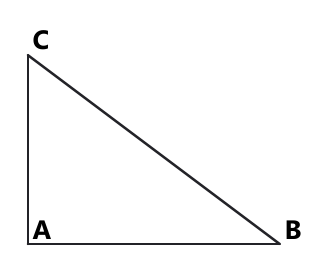

# Занятие 32. Экзаменационный тренинг: задания 1–4

**Дата:** 07.05.2027 (пт)  
**Длительность:** 45 минут  
**Раздел:** Повторение  
**Подтемы:** вычисления, степени и корни; неравенства и выражения; планиметрия базового уровня; ловушки лёгких баллов.

## Цели занятия

- Повторить быстрые и надёжные приёмы вычислений со степенями, корнями и дробями.
- Научиться аккуратно решать линейные неравенства и упрощать выражения.
- Повторить базовые формулы и факты планиметрии.
- Научиться замечать ловушки: порядок действий, знаки, границы промежутков, ОДЗ.
- Выбрать свой уровень: 1–2, 3–4, 5–6, 7–8 или 9–10 баллов — и решать только свой блок.

## Тайминг

| Этап | Время |
|---|---:|
| Теория | 8 минут |
| Разбор ключевых заданий | 12 минут |
| Самостоятельная работа по выбранному уровню | 21 минута |
| Итог и самопроверка | 4 минуты |

---

## Теория к занятию

### Мини-тема 1. Вычисления, степени, корни

Смотри на выражение как на маршрут: сначала скобки, затем степени и корни, потом умножение и деление, после этого сложение и вычитание. Степень показывает, сколько раз множитель умножается сам на себя. При делении степеней с одинаковым основанием показатели вычитаются. Отрицательная степень означает обратное число. Квадратный корень из неотрицательного числа — это неотрицательное число, квадрат которого равен подкоренному числу.

**Определение и факты**

Степень числа $a$ с натуральным показателем $n$ — произведение $n$ одинаковых множителей:

$$a^n=\underbrace{a\cdot a\cdot \ldots \cdot a}_{n\text{ множителей}}.$$

Арифметическим квадратным корнем из числа $a$, где $a\geq 0$, называют неотрицательное число, квадрат которого равен $a$.

**Формулы**

$$a^m\cdot a^n=a^{m+n}.$$

Применяется при умножении степеней с одинаковым основанием.

$$a^m:a^n=a^{m-n},\qquad a\ne 0.$$

Применяется при делении степеней с одинаковым основанием.

$$a^{-n}=\frac{1}{a^n},\qquad a\ne 0.$$

$$\sqrt{a^2}=|a|.$$

Последняя формула особенно важна: корень не «снимает квадрат» без модуля. Минус любит прятаться именно здесь.

$$\sqrt{ab}=\sqrt a\cdot\sqrt b,\qquad a\geq 0,\ b\geq 0.$$

$$\sqrt{\frac{a}{b}}=\frac{\sqrt a}{\sqrt b},\qquad a\geq 0,\ b>0.$$

**Правила**

- Сначала вычисляй степени и корни.
- При умножении степеней показатели складывай.
- При делении степеней показатели вычитай.
- Не путай $(-3)^2=9$ и $-3^2=-9$.
- Подкоренное выражение должно быть неотрицательным.
- В выражении с отрицательной степенью основание не может быть равно нулю.

**Алгоритм вычисления выражения**

1. Определи порядок действий.
2. Выполни действия в скобках.
3. Вычисли степени и корни.
4. Выполни умножение и деление слева направо.
5. Выполни сложение и вычитание.
6. Проверь знак и примерный размер ответа.

**Мини-пример**

Вычислите:

$$2^{-2}+\sqrt{49}-3^2.$$

*Решение:*

Дано выражение:

$$2^{-2}+\sqrt{49}-3^2.$$

Сначала заменяем отрицательную степень обратным числом:

$$2^{-2}=\frac{1}{2^2}=\frac14.$$

Вычисляем корень:

$$\sqrt{49}=7.$$

Вычисляем квадрат:

$$3^2=9.$$

Подставляем найденные значения:

$$\frac14+7-9.$$

Выполняем вычитание целых чисел:

$$7-9=-2.$$

Получаем:

$$\frac14-2=\frac14-\frac84=-\frac74.$$

Проверка: выражение действительно отрицательно, потому что $7-9<0$, а добавление $\frac14$ не меняет знак.

**Ответ:** $-\frac74$.

**Ловушки экзамена**

- $a^{-n}$ — это не $-a^n$, а $\frac1{a^n}$.
- $\sqrt{a^2}=|a|$, а не всегда $a$.
- В записи $3^4:3^2\cdot3$ действия деления и умножения выполняются слева направо.
- Знак минус перед степенью не входит в основание, если нет скобок.

---

### Мини-тема 2. Неравенства и выражения

Линейное неравенство решается почти так же, как линейное уравнение. Главное отличие появляется при умножении или делении на отрицательное число: знак неравенства меняется на противоположный. Система неравенств означает одновременное выполнение всех условий, поэтому нужен общий участок числовой прямой. Если спрашивают количество целых решений, промежуток нужно просмотреть внимательно, включая или не включая концы.

**Определение**

Неравенство — это запись, содержащая знаки $<$, $>$, $\leq$ или $\geq$.

Системой неравенств называют несколько неравенств, которые должны выполняться одновременно.

**Формулы**

При умножении или делении неравенства на положительное число знак сохраняется:

$$a<b\Rightarrow ac<bc,\qquad c>0.$$

При умножении или делении на отрицательное число знак меняется:

$$a<b\Rightarrow ac>bc,\qquad c<0.$$

**Правила**

- Перенос слагаемого через знак равенства или неравенства меняет его знак.
- При делении на отрицательное число переверни знак.
- В системе пересекай решения.
- Круглая скобка означает, что конец не входит.
- Квадратная скобка означает, что конец входит.
- Для количества целых решений выпиши целые числа явно.

**Алгоритм решения системы линейных неравенств**

1. Реши каждое неравенство отдельно.
2. Запиши решения в виде промежутков.
3. Найди пересечение промежутков.
4. Если требуется количество целых решений, выпиши целые числа.
5. Проверь каждое найденное число в исходной системе.

**Мини-пример**

Определите количество целых решений системы:

$$
\begin{cases}
x\leq 5,\\
2-x<0.
\end{cases}
$$

*Решение:*

Дано:

$$
\begin{cases}
x\leq 5,\\
2-x<0.
\end{cases}
$$

Найти: количество целых решений.

Решим второе неравенство:

$$2-x<0.$$

Переносим число $2$ вправо:

$$-x<-2.$$

Делим обе части на $-1$ и меняем знак:

$$x>2.$$

Первое неравенство даёт:

$$x\leq 5.$$

Пересекаем условия:

$$2<x\leq 5.$$

Целые решения:

$$3,\ 4,\ 5.$$

Их количество равно $3$.

Проверка:

$$3\leq5,\quad 2-3=-1<0;$$

$$4\leq5,\quad 2-4=-2<0;$$

$$5\leq5,\quad 2-5=-3<0.$$

**Ответ:** $3$.

**Ловушки экзамена**

- После деления на $-1$ знак обязан измениться.
- В промежутке $2<x\leq5$ число $2$ не считается, а число $5$ считается.
- Система — это пересечение, а не объединение.
- При раскрытии скобок минус перед скобками меняет знаки всех слагаемых.

---

### Мини-тема 3. Планиметрия базового уровня

В первых заданиях по геометрии обычно проверяют не длинное доказательство, а знание главного факта. Нужно быстро определить фигуру и выбрать подходящую формулу. Для прямоугольного треугольника работает теорема Пифагора. Для площади треугольника нужны основание и высота. Для ромба — диагонали. Для круга — радиус и число $\pi$. Ошибка в формуле превращает лёгкий балл в математический квест.

**Определения и факты**

Прямоугольный треугольник — треугольник, один из углов которого равен $90^\circ$.

Гипотенуза — сторона, лежащая напротив прямого угла.

В правильном многоугольнике все стороны и все углы равны.

**Формулы**

Теорема Пифагора:

$$c^2=a^2+b^2,$$

где $c$ — гипотенуза, $a$ и $b$ — катеты.

Площадь треугольника:

$$S=\frac12 ah,$$

где $a$ — основание, $h$ — высота к этому основанию.

Площадь ромба:

$$S=\frac12 d_1d_2.$$

Площадь круга:

$$S=\pi r^2.$$

Длина окружности:

$$l=2\pi r.$$

Формула $S=pr$ применяется для площади треугольника, если $p$ — полупериметр, а $r$ — радиус вписанной окружности:

$$S=pr.$$

**Правила**

- В теореме Пифагора гипотенуза стоит отдельно.
- Площадь круга не равна длине окружности.
- У ромба площадь равна половине произведения диагоналей.
- Вписанный угол равен половине центрального угла, опирающегося на ту же дугу.
- В прямоугольном треугольнике центр описанной окружности — середина гипотенузы.

**Алгоритм**

1. Определи вид фигуры.
2. Выпиши известные величины и единицы измерения.
3. Выбери формулу.
4. Подставь данные.
5. Выполни вычисления.
6. Проверь единицы площади или длины.

**Мини-пример**

Катеты прямоугольного треугольника равны $6$ см и $8$ см. Найдите гипотенузу.

*Решение:*

Дано:

$$a=6\text{ см},\qquad b=8\text{ см}.$$

Найти: $c$.

По теореме Пифагора:

$$c^2=a^2+b^2.$$

Подставляем значения:

$$c^2=6^2+8^2.$$

Вычисляем квадраты:

$$c^2=36+64.$$

Получаем:

$$c^2=100.$$

Так как длина стороны положительна:

$$c=\sqrt{100}=10\text{ см}.$$

Проверка:

$$10^2=6^2+8^2,$$

$$100=36+64.$$

Единицы измерения — сантиметры.

**Ответ:** $10$ см.

<!--geo-figure-spec
{
  "needed": true,
  "kind": "plane",
  "template": "right_triangle",
  "caption": "Прямоугольный треугольник с катетами 6 и 8",
  "show_labels": true,
  "size": {
    "a": 6,
    "b": 8
  }
}
-->

*Прямоугольный треугольник с катетами 6 и 8*

**Ловушки экзамена**

- Не перепутай катет и гипотенузу.
- В формуле площади забывают множитель $\frac12$.
- У площади единицы квадратные: $\text{см}^2$, а не $\text{см}$.
- $2\pi r$ — длина окружности, $\pi r^2$ — площадь круга.

---

### Мини-тема 4. Ловушки лёгких баллов

Лёгкое задание не означает «можно решать на автопилоте». На экзамене чаще всего мешают не сложные методы, а спешка. Надо читать, что именно спрашивают: значение, количество, наименьшее число, неверное утверждение или координаты центра. Важно не только получить число, но и проверить, отвечает ли оно вопросу.

**Основные правила**

- Прочитай вопрос после условия ещё раз.
- Выпиши ОДЗ, если есть знаменатели или корни.
- Проверь порядок действий.
- Сохраняй скобки при подстановке отрицательных чисел.
- В задачах с процентами различай «увеличили на $p\%$» и «составляет $p\%$».
- В задачах на движение используй таблицу «скорость — время — расстояние».
- В задачах на работу используй производительность, то есть часть работы за единицу времени.
- В линейной функции $y=kx+b$ число $k$ — коэффициент при $x$, а $b$ — свободный член.

**Мини-пример**

Найдите значение функции $f(x)=3x-2$ при $x=-4$.

*Решение:*

Дано:

$$f(x)=3x-2,\qquad x=-4.$$

Найти: $f(-4)$.

Подставляем значение аргумента в формулу:

$$f(-4)=3\cdot(-4)-2.$$

Выполняем умножение:

$$3\cdot(-4)=-12.$$

Получаем:

$$f(-4)=-12-2.$$

Вычитаем:

$$f(-4)=-14.$$

Проверка знака: положительное число, умноженное на отрицательное, даёт отрицательное число.

**Ответ:** $-14$.

**Ловушки экзамена**

- При подстановке $x=-4$ нужны скобки.
- Вопрос «какое утверждение НЕ верно» требует найти ошибочное утверждение.
- В окружности $(x-a)^2+(y-b)^2=r^2$ центр имеет координаты $(a;b)$.
- В записи $y=\frac{k}{x}$ нельзя брать $x=0$.

---

## Сводка формул «выучить наизусть»

$$a^m\cdot a^n=a^{m+n}.$$

$$a^m:a^n=a^{m-n},\qquad a\ne0.$$

$$a^{-n}=\frac1{a^n},\qquad a\ne0.$$

$$\sqrt{a^2}=|a|.$$

$$c^2=a^2+b^2.$$

$$S_{\triangle}=\frac12 ah.$$

$$S_{\text{ромба}}=\frac12d_1d_2.$$

$$S_{\text{круга}}=\pi r^2.$$

$$l_{\text{окружности}}=2\pi r.$$

$$S=pr.$$

$$y=kx+b.$$

$$y=\frac{k}{x},\qquad x\ne0.$$

$$
\begin{cases}
x\leq a,\\
x>b
\end{cases}
\Rightarrow b<x\leq a.
$$

## Правила, которые нельзя путать

- $(-2)^2=4$, но $-2^2=-4$.
- $\sqrt{x^2}=|x|$.
- При делении неравенства на отрицательное число знак меняется.
- Система означает пересечение решений.
- Площадь круга — $\pi r^2$, длина окружности — $2\pi r$.
- В прямоугольном треугольнике гипотенуза — напротив прямого угла.
- Центр окружности $(x-a)^2+(y-b)^2=r^2$ — точка $(a;b)$.
- В функции $f(x)=\frac{k}{x}$ число $x$ не может быть равно нулю.

## Разрешённый набор для практики

Мини-темы занятия:

- вычисления, степени, корни;
- неравенства и выражения;
- планиметрия базового уровня;
- ловушки лёгких баллов.

Повтор:

- линейная функция и её график;
- линейные неравенства;
- задачи на проценты;
- задачи на работу;
- задачи на движение;
- степени с натуральным и целым показателем;
- порядок действий;
- теорема Пифагора;
- площади фигур;
- рациональные выражения и ОДЗ;
- системы линейных уравнений;
- преобразование многочленов.

---

## Разбор ключевых заданий

### Р1. Сборник, вариант 3, задание 4

Определите количество целых решений системы неравенств

$$
\begin{cases}
x\leq7,\\
3-x<0.
\end{cases}
$$

*Решение:*

Дано:

$$
\begin{cases}
x\leq7,\\
3-x<0.
\end{cases}
$$

Найти: количество целых решений.

Решим второе неравенство:

$$3-x<0.$$

Переносим число $3$ вправо:

$$-x<-3.$$

Делим обе части на $-1$ и меняем знак:

$$x>3.$$

Первое неравенство даёт:

$$x\leq7.$$

Находим пересечение:

$$3<x\leq7.$$

Целые решения:

$$4,\ 5,\ 6,\ 7.$$

Количество решений:

$$4.$$

Проверка:

$$4\leq7,\quad3-4=-1<0;$$

$$5\leq7,\quad3-5=-2<0;$$

$$6\leq7,\quad3-6=-3<0;$$

$$7\leq7,\quad3-7=-4<0.$$

**Ответ:** $4$.

---

### Р2. Сборник, вариант 11, задание 2

Выражение, тождественно равное выражению $(a^5)^{-1}\cdot a^{-13}$, имеет вид:

а) $a^{-9}$;  
б) $a^{-18}$;  
в) $a^8$;  
г) $a^{18}$;  
д) $a^{17}$.

*Решение:*

Дано:

$$(a^5)^{-1}\cdot a^{-13}.$$

Найти тождественно равное выражение.

Применяем правило степени степени:

$$(a^5)^{-1}=a^{5\cdot(-1)}=a^{-5}.$$

Умножаем степени с одинаковым основанием:

$$a^{-5}\cdot a^{-13}=a^{-5+(-13)}.$$

Вычисляем показатель:

$$-5+(-13)=-18.$$

Получаем:

$$a^{-18}.$$

ОДЗ: $a\ne0$, так как используются отрицательные показатели.

**Ответ:** б) $a^{-18}$.

---

### Р3. Сборник, вариант 15, задание 2

Запись выражения $3^4:3^3\cdot3^5$ в виде степени с основанием $3$ имеет вид:

а) $3^{12}$;  
б) $3^{-4}$;  
в) $3^6$;  
г) $3^2$;  
д) $3^5$.

*Решение:*

Дано:

$$3^4:3^3\cdot3^5.$$

Деление и умножение выполняем слева направо:

$$3^4:3^3\cdot3^5=(3^4:3^3)\cdot3^5.$$

При делении степеней показатели вычитаются:

$$3^4:3^3=3^{4-3}=3.$$

Представим число $3$ как $3^1$:

$$3\cdot3^5=3^1\cdot3^5.$$

При умножении степеней показатели складываются:

$$3^1\cdot3^5=3^{1+5}=3^6.$$

**Ответ:** в) $3^6$.

---

### Р4. Сборник, вариант 17, задание 3

Какое из следующих утверждений НЕ верно:

а) у правильного $n$-угольника все стороны равны между собой;

б) по теореме косинусов для треугольника со сторонами $a$, $b$, $c$ верно, что

$$a^2=b^2+c^2-2bc\cos\alpha;$$

в) площадь ромба равна половине произведения диагоналей;

г) площадь круга с радиусом $r$ равна $2\pi r$?

*Решение:*

Проверяем утверждения по очереди.

У правильного многоугольника все стороны равны.

Утверждение а) верно.

Теорема косинусов имеет вид

$$a^2=b^2+c^2-2bc\cos\alpha,$$

если угол $\alpha$ заключён между сторонами $b$ и $c$.

Утверждение б) верно.

Площадь ромба вычисляется по формуле

$$S=\frac12d_1d_2.$$

Утверждение в) верно.

Площадь круга вычисляется по формуле

$$S=\pi r^2.$$

Выражение $2\pi r$ задаёт длину окружности, а не площадь круга.

Следовательно, неверно утверждение г).

**Ответ:** г).

---

## Самостоятельная работа

Выбери свой уровень и решай только этот блок. В каждом блоке есть мини-темы занятия и повтор ранее изученного материала.

### Уровень 1–2 балла

**С1.** *Сборник, вариант 23, №1.*  
Какая точка является центром окружности

$$(x-3)^2+(y+1)^2=1?$$

а) $A(-3;1)$; б) $B(-3;-1)$; в) $C(3;-1)$; г) $D(3;1)$; д) $E(-1;3)$.

**С2.** *Сборник, вариант 37, №1.*  
Какое равенство верно, если $f(x)=\frac6x$?

а) $f(2)=2$; б) $f(2)=3$; в) $f(2)=12$; г) $f(2)=4$; д) $f(2)=36$.

**С3.** *Сборник, вариант 45, №1.*  
Определите наименьшее натуральное число, принадлежащее промежутку $(-\frac34;5,6)$:

а) $-1$; б) $0$; в) $1$; г) $2$; д) $5$.

**С4.** *Сборник, вариант 49, №1.*  
Какое выражение НЕ является одночленом?

а) $2abc$; б) $m^{11}$; в) $\frac4y$; г) $-\frac27c^4$; д) $\frac t5$.

**С5.** *Повтор. Авторское.*  
Решите неравенство:

$$4x-7\leq9.$$

### Уровень 3–4 балла

**С1.** *Сборник, вариант 17, №4.*  
Найдите $x\cdot y$, если $(x;y)$ — решение системы

$$
\begin{cases}
x+y=5,\\
2x-y=4.
\end{cases}
$$

**С2.** *Сборник, вариант 29, №4.*  
Приведите подобные слагаемые:

$$2xy-4xy+9x+4xy-2x.$$

**С3.** *Сборник, вариант 31, №4.*  
Расстояние между городами на карте равно $5$ см. Масштаб карты $1:100000$. Определите расстояние между городами на местности.

**С4.** *Сборник, вариант 35, №4.*  
Из $4$ кг муки получается $3,2$ кг печенья. Сколько муки потребуется для получения $2,4$ кг печенья?

**С5.** *Повтор. Авторское.*  
Катеты прямоугольного треугольника равны $9$ см и $12$ см. Найдите гипотенузу.

### Уровень 5–6 баллов

**С1.** *Мини-тема 1. Авторское.*  
Вычислите:

$$\left(\frac12\right)^{-2}-\sqrt{81}+2^3.$$

**С2.** *Мини-тема 2. Авторское.*  
Решите систему неравенств:

$$
\begin{cases}
2x-1\geq5,\\
7-x>2.
\end{cases}
$$

**С3.** *Мини-тема 3. Авторское.*  
Площадь ромба равна $96\text{ см}^2$, одна диагональ равна $12$ см. Найдите вторую диагональ.

**С4.** *Мини-тема 4. Авторское.*  
Упростите выражение при $x\ne0$:

$$\frac{x^2-9}{x-3}.$$

**С5.** *Повтор. Авторское.*  
Цена товара была $240$ рублей. Сначала её увеличили на $15\%$. Найдите новую цену товара.

### Уровень 7–8 баллов

**С1.** *Мини-тема 1. Авторское.*  
Упростите выражение:

$$\frac{a^{-2}\cdot a^5}{a},\qquad a\ne0.$$

**С2.** *Мини-тема 2. Авторское.*  
Решите неравенство:

$$x^2-5x+6\leq0.$$

**С3.** *Мини-тема 3. Авторское.*  
В прямоугольном треугольнике гипотенуза равна $13$ см, один катет равен $5$ см. Найдите площадь треугольника.

**С4.** *Мини-тема 4. Авторское.*  
Решите уравнение и укажите ОДЗ:

$$\frac{x^2-16}{x-4}=5.$$

**С5.** *Повтор. Авторское.*  
Два рабочих выполняют работу за $6$ часов. Первый один выполняет её за $10$ часов. За сколько часов выполнит работу второй рабочий?

### Уровень 9–10 баллов

**С1.** *Мини-тема 1. Авторское.*  
Вычислите:

$$\frac{3^{-2}+\sqrt{16}}{\frac12}.$$

**С2.** *Мини-тема 2. Авторское.*  
Решите систему:

$$
\begin{cases}
x+y=7,\\
x^2+y^2=25.
\end{cases}
$$

**С3.** *Мини-тема 3. Авторское.*  
В прямоугольном треугольнике катеты равны $6$ см и $8$ см. Найдите радиус вписанной окружности.

**С4.** *Мини-тема 4. Авторское.*  
Решите уравнение:

$$\frac{x+2}{x-1}-\frac3{x-1}=2.$$

**С5.** *Повтор. Авторское.*  
Катер прошёл $36$ км по течению реки и $36$ км против течения, затратив всего $5$ часов. Скорость течения равна $3$ км/ч. Найдите собственную скорость катера.

---

## Домашнее задание

Выбери тот же уровень, который выполнял на занятии.

### Уровень 1–2 балла

**Д1.** *Сборник, вариант 41, №2.*  
Запишите одночлен $3a^4b\cdot\left(-\frac13a^3\right)$ в стандартном виде.

а) $-ab$; б) $-a^7b$; в) $a^4b$; г) $2\frac23ab$; д) $9a^7b$.

**Д2.** *Сборник, вариант 45, №2.*  
График обратной пропорциональности $y=\frac{k}{x}$ проходит через точку $(-\sqrt3;4\sqrt3)$. Найдите $k$.

**Д3.** *Сборник, вариант 79, №1.*  
Определите наибольшее значение:

а) $2^2$; б) $3^{-1}$; в) $(-2)^{-1}$; г) $(-4)^2$; д) $\left(\frac18\right)^{-1}$.

**Д4.** *Мини-тема 3. Авторское.*  
Площадь треугольника с основанием $10$ см и высотой $7$ см.

**Д5.** *Повтор. Авторское.*  
Найдите значение функции $y=-2x+5$ при $x=-3$.

**Д6.** *Повтор. Авторское.*  
Решите неравенство:

$$5-2x>11.$$

### Уровень 3–4 балла

**Д1.** *Сборник, вариант 37, №4.*  
Раскройте скобки и упростите:

$$-10-(-5x-12).$$

**Д2.** *Сборник, вариант 41, №4.*  
График функции $y=kx-4$ проходит через точку $K(-\frac12;4)$. Найдите $k$.

**Д3.** *Мини-тема 1. Авторское.*  
Вычислите:

$$3^2-\sqrt{25}+2^{-1}.$$

**Д4.** *Мини-тема 2. Авторское.*  
Определите количество целых решений системы:

$$
\begin{cases}
x<6,\\
x\geq-2.
\end{cases}
$$

**Д5.** *Повтор. Авторское.*  
Изделие стоимостью $80$ рублей подешевело на $25\%$. Найдите новую стоимость.

**Д6.** *Повтор. Авторское.*  
Автомобиль ехал $3$ часа со скоростью $70$ км/ч. Какое расстояние он проехал?

### Уровень 5–6 баллов

**Д1.** *Мини-тема 1. Авторское.*  
Упростите:

$$\sqrt{72}-\sqrt8.$$

**Д2.** *Мини-тема 2. Авторское.*  
Решите неравенство:

$$3(2x-1)-4\leq2x+7.$$

**Д3.** *Мини-тема 3. Авторское.*  
Диагонали ромба равны $10$ см и $24$ см. Найдите его площадь.

**Д4.** *Мини-тема 4. Авторское.*  
Упростите при $x\ne2$:

$$\frac{x^2-4}{x-2}.$$

**Д5.** *Повтор. Авторское.*  
Рабочий выполняет заказ за $12$ дней. Какую часть заказа он выполняет за один день?

**Д6.** *Повтор. Авторское.*  
Решите уравнение:

$$x^2-7x+12=0.$$

### Уровень 7–8 баллов

**Д1.** *Мини-тема 1. Авторское.*  
Вычислите:

$$\left(\frac13\right)^{-2}-\sqrt{64}.$$

**Д2.** *Мини-тема 2. Авторское.*  
Решите неравенство:

$$x^2-4x-5>0.$$

**Д3.** *Мини-тема 3. Авторское.*  
В равнобедренном треугольнике боковые стороны равны $13$ см, основание равно $10$ см. Найдите высоту, проведённую к основанию.

**Д4.** *Мини-тема 4. Авторское.*  
Решите уравнение:

$$\frac{x^2-25}{x-5}=7.$$

**Д5.** *Повтор. Авторское.*  
Два насоса вместе наполняют бассейн за $4$ часа. Первый насос один наполняет его за $6$ часов. За сколько часов наполнит бассейн второй насос?

**Д6.** *Повтор. Авторское.*  
Прямая $y=kx+3$ проходит через точку $(2;9)$. Найдите $k$.

### Уровень 9–10 баллов

**Д1.** *Мини-тема 1. Авторское.*  
Упростите:

$$\frac{2^{-3}\cdot2^5}{\sqrt{16}}.$$

**Д2.** *Мини-тема 2. Авторское.*  
Решите систему:

$$
\begin{cases}
x-y=2,\\
x^2+y^2=10.
\end{cases}
$$

**Д3.** *Мини-тема 3. Авторское.*  
В прямоугольном треугольнике катеты равны $9$ см и $12$ см. Найдите радиус описанной окружности.

**Д4.** *Мини-тема 4. Авторское.*  
Решите уравнение:

$$\frac{2x-1}{x+3}=\frac{x+5}{x+3}.$$

**Д5.** *Повтор. Авторское.*  
Велосипедист проехал по ровной дороге $24$ км со скоростью $v$ км/ч, а затем $12$ км со скоростью, на $4$ км/ч большей. На весь путь он затратил $2$ часа. Найдите $v$.

**Д6.** *Повтор. Авторское.*  
Цена товара после двух последовательных снижений на $10\%$ стала равна $810$ рублей. Найдите первоначальную цену.

---

## Чек-лист «ученик понял тему»

- [ ] Я соблюдаю порядок действий.
- [ ] Я умею применять свойства степеней и отрицательный показатель.
- [ ] Я помню, что $\sqrt{x^2}=|x|$.
- [ ] Я меняю знак неравенства при делении на отрицательное число.
- [ ] Я различаю пересечение и объединение промежутков.
- [ ] Я знаю формулы Пифагора, площадей треугольника, ромба и круга.
- [ ] Я проверяю знаки, границы промежутка, ОДЗ и смысл ответа.
