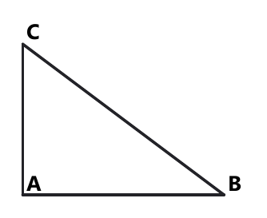
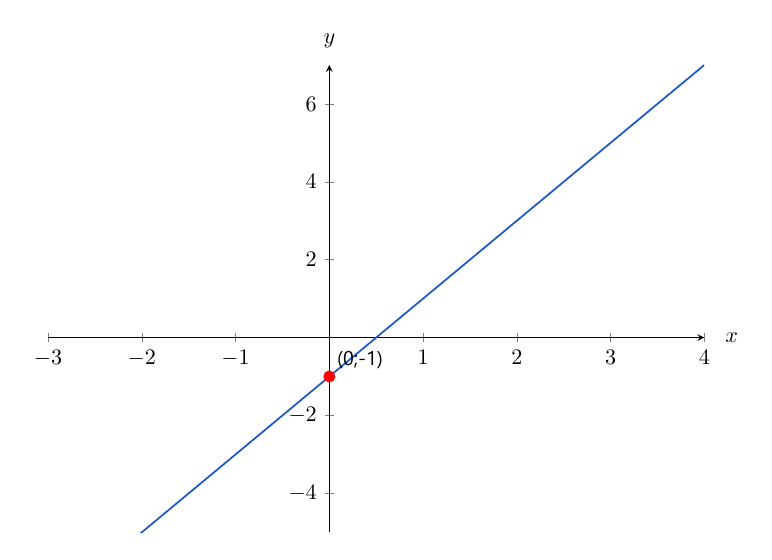

# Занятие 33. Экзаменационный тренинг: геометрия и задания 5–7

**Дата:** 14.05.2027 (пт)  
**Длительность:** 45 минут  
**Раздел:** Повторение  
**Подтемы:** треугольники, четырёхугольники, окружность; уравнения и рациональные выражения; функции и графики; системы.

## Цели занятия

- повторить основные свойства треугольников, четырёхугольников и окружности;
- закрепить решение уравнений, рациональных выражений и систем неравенств;
- научиться быстро читать график линейной функции;
- отработать выбор задания по своему экзаменационному уровню;
- не терять баллы из-за ОДЗ, знаков, единиц измерения и арифметики.

Ученик выбирает только один блок: **1–2, 3–4, 5–6, 7–8 или 9–10 баллов**.

## Тайминг

| Этап | Время |
|---|---:|
| Теория | 8 минут |
| Разбор ключевых заданий | 12 минут |
| Самостоятельная работа | 21 минута |
| Проверка и выводы | 4 минуты |

---

## Теория к занятию

### Мини-тема 1. Треугольники, четырёхугольники, окружность

Смотри на геометрическую задачу как на поиск знакомой фигуры. Если есть прямой угол — вспоминаем теорему Пифагора. Если есть ромб — диагонали перпендикулярны и делятся пополам. Если треугольник прямоугольный и около него описана окружность, гипотенуза является диаметром.

**Школьные факты:**

- сумма углов треугольника равна $180^\circ$;
- сумма углов четырёхугольника равна $360^\circ$;
- в прямоугольном треугольнике квадрат гипотенузы равен сумме квадратов катетов;
- диагонали ромба перпендикулярны и делят его углы пополам;
- центр описанной окружности треугольника равноудалён от его вершин;
- центр вписанной окружности равноудалён от сторон треугольника.

<!--geo-figure-spec
{
  "needed": true,
  "kind": "plane",
  "template": "right_triangle",
  "caption": "Прямоугольный треугольник ABC",
  "show_labels": true,
  "size": {
    "a": 4,
    "b": 3
  },
  "highlight_edges": [
    [
      "A",
      "C"
    ],
    [
      "B",
      "C"
    ],
    [
      "A",
      "B"
    ]
  ]
}
-->

*Прямоугольный треугольник ABC*

**Формулы:**

$$a^2+b^2=c^2,$$

где $a$ и $b$ — катеты, $c$ — гипотенуза.

$$S_{\triangle}=\frac{1}{2}ab,$$

если $a$ и $b$ — катеты.

$$S=pr,$$

где $p$ — полупериметр, $r$ — радиус вписанной окружности.

$$R=\frac{c}{2},$$

если окружность описана около прямоугольного треугольника.

Для ромба со стороной $a$ и диагоналями $d_1$, $d_2$:

$$a^2=\left(\frac{d_1}{2}\right)^2+\left(\frac{d_2}{2}\right)^2.$$

**Правила:**

- сначала определи фигуру;
- выпиши, что дано и что нужно найти;
- не путай радиус с диаметром;
- в прямоугольном треугольнике гипотенуза лежит напротив прямого угла;
- единицы длины и площади не смешивай.

**Алгоритм:**

1. Найти известную фигуру.
2. Отметить прямые углы, равные стороны и диагонали.
3. Выбрать теорему или формулу.
4. Подставить данные.
5. Выполнить вычисления.
6. Проверить смысл ответа.

**Мини-пример.** Катеты прямоугольного треугольника равны $6$ см и $8$ см. Найдите гипотенузу.

*Решение:*

Дано: $a=6$ см, $b=8$ см.

Найти: $c$.

Применяем теорему Пифагора:

$$c^2=a^2+b^2.$$

Подставляем значения:

$$c^2=6^2+8^2.$$

$$c^2=36+64.$$

$$c^2=100.$$

Так как длина положительна,

$$c=10\text{ см}.$$

Проверка:

$$6^2+8^2=36+64=100=10^2.$$

**Ответ:** $10$ см.

**Ловушки экзамена:**

- принять диаметр за радиус;
- использовать сумму углов треугольника для четырёхугольника;
- забыть извлечь квадратный корень;
- записать площадь в сантиметрах вместо квадратных сантиметров.

---

### Мини-тема 2. Уравнения и рациональные выражения

Рациональная дробь — это дробь, в числителе и знаменателе которой находятся многочлены. Главный охранник здесь — ОДЗ: знаменатель не может быть равен нулю. ОДЗ записывают до преобразований, иначе можно случайно принять запрещённое значение.

**Определение:**

Рациональным выражением называют выражение, составленное из чисел и переменных с помощью сложения, вычитания, умножения, деления и возведения в целую степень.

**Формулы и правила:**

$$\frac{A}{B}=\frac{A\cdot C}{B\cdot C},\qquad B\ne0,\ C\ne0.$$

$$\frac{A}{B}+\frac{C}{D}=\frac{AD+BC}{BD},\qquad B\ne0,\ D\ne0.$$

$$\frac{A}{B}\cdot\frac{C}{D}=\frac{AC}{BD}.$$

$$\frac{A}{B}:\frac{C}{D}=\frac{A}{B}\cdot\frac{D}{C},\qquad C\ne0.$$

**Правила:**

- сначала найди ОДЗ;
- сокращать можно только множители;
- сумму нельзя сокращать почленно;
- после решения проверь корни по ОДЗ;
- при умножении неравенства на отрицательное число знак меняется.

**Алгоритм решения дробного уравнения:**

1. Записать ОДЗ.
2. Умножить обе части на общий знаменатель.
3. Решить полученное уравнение.
4. Проверить корни по ОДЗ.
5. Записать ответ.

**Мини-пример.** Решите уравнение

$$\frac{2}{x-1}=1.$$

*Решение:*

ОДЗ:

$$x-1\ne0.$$

$$x\ne1.$$

Умножаем обе части на $x-1$:

$$2=x-1.$$

Выражаем $x$:

$$x=3.$$

Проверяем ОДЗ:

$$3\ne1.$$

Корень допустим.

**Ответ:** $3$.

**Ловушки экзамена:**

- забыть ОДЗ;
- сократить слагаемые;
- потерять минус перед скобками;
- не проверить найденный корень.

---

### Мини-тема 3. Функции и графики

Функция связывает значения аргумента $x$ и функции $y$. Каждому допустимому значению $x$ соответствует единственное значение $y$. На экзамене чаще всего нужно найти значение функции, нуль, область определения, промежутки возрастания или коэффициенты линейной функции.

Для линейной функции график — прямая. Коэффициент $k$ показывает наклон: при $k>0$ функция возрастает, при $k<0$ убывает.

<!--geo-figure-spec
{
  "needed": true,
  "kind": "graph",
  "template": "function",
  "caption": "График линейной функции $y=2x-1$",
  "x_range": [
    -3,
    4
  ],
  "y_range": [
    -5,
    7
  ],
  "curves": [
    {
      "expr": "2*x-1",
      "label": "y=2x-1"
    }
  ],
  "marks": [
    {
      "xy": [
        0,
        -1
      ],
      "label": "(0;-1)"
    }
  ]
}
-->

*График линейной функции y=2x-1*

**Определение:**

Функцией называют зависимость, при которой каждому значению аргумента соответствует единственное значение функции.

**Формулы:**

$$y=kx+b,$$

где $k$ и $b$ — числа.

$$f(x_0)=y_0,$$

если при $x=x_0$ значение функции равно $y_0$.

Нуль функции находится из уравнения:

$$f(x)=0.$$

Для прямой через точки $(x_1;y_1)$ и $(x_2;y_2)$:

$$k=\frac{y_2-y_1}{x_2-x_1}.$$

**Правила:**

- нуль функции — это значение $x$, а не точка;
- пересечение с осью $Oy$ имеет координаты $(0;b)$;
- при $k>0$ прямая возрастает;
- при $k<0$ прямая убывает;
- при сдвиге $y=f(x-a)$ график перемещается вправо на $a$.

**Мини-пример.** Найдите нуль функции $y=3x-12$.

*Решение:*

Нуль функции находится при $y=0$.

$$3x-12=0.$$

$$3x=12.$$

$$x=4.$$

Проверка:

$$3\cdot4-12=12-12=0.$$

**Ответ:** $4$.

**Ловушки экзамена:**

- перепутать $x$ и $y$;
- назвать точку $(4;0)$ ответом вместо значения $x=4$;
- ошибиться в знаке свободного члена;
- перепутать сдвиги $f(x-a)$ и $f(x+a)$.

---

### Мини-тема 4. Системы

Решение системы — это пара значений, которая одновременно удовлетворяет всем уравнениям или неравенствам системы. На экзамене важно найти пересечение решений, а не объединение. Это как пропуск в школу: подходят только те значения, которые проходят через все турникеты.

**Определение:**

Системой уравнений называют несколько уравнений, решения которых должны выполняться одновременно.

**Формулы и правила:**

При сложении уравнений складывают их левые и правые части.

При подстановке сначала выражают одну переменную через другую.

Для системы неравенств:

$$x\in A\cap B,$$

где берётся пересечение промежутков.

**Алгоритм решения системы линейных уравнений:**

1. Выразить одну переменную.
2. Подставить выражение во второе уравнение.
3. Найти одну переменную.
4. Найти вторую переменную.
5. Проверить пару в обоих уравнениях.

**Мини-пример.** Решите систему

$$
\begin{cases}
x+y=7,\\
x-y=1.
\end{cases}
$$

*Решение:*

Складываем уравнения:

$$x+y+x-y=7+1.$$

$$2x=8.$$

$$x=4.$$

Подставляем в первое уравнение:

$$4+y=7.$$

$$y=3.$$

Проверка:

$$4+3=7,$$

$$4-3=1.$$

Пара подходит.

**Ответ:** $(4;3)$.

**Ловушки экзамена:**

- объединить промежутки вместо пересечения;
- потерять одну переменную;
- не проверить пару;
- перепутать систему и совокупность.

---

## Сводка формул «выучить наизусть»

$$a^2+b^2=c^2.$$

$$S_{\triangle}=\frac{1}{2}ab.$$

$$S=pr.$$

$$R=\frac{c}{2}.$$

$$a^2=\left(\frac{d_1}{2}\right)^2+\left(\frac{d_2}{2}\right)^2.$$

$$\frac{A}{B}+\frac{C}{D}=\frac{AD+BC}{BD}.$$

$$\frac{A}{B}\cdot\frac{C}{D}=\frac{AC}{BD}.$$

$$y=kx+b.$$

$$k=\frac{y_2-y_1}{x_2-x_1}.$$

$$f(x)=0.$$

## Правила, которые нельзя путать

- Гипотенуза — самая длинная сторона прямоугольного треугольника.
- Радиус в два раза меньше диаметра.
- ОДЗ записывается до преобразований.
- Нуль функции — значение аргумента.
- В системе берут пересечение решений.
- При делении неравенства на отрицательное число знак меняется.
- Диагонали ромба не обязаны быть равными.

## Разрешённый набор для практики

Мини-темы занятия:

- треугольники, четырёхугольники, окружность;
- уравнения и рациональные выражения;
- функции и графики;
- системы.

Повтор:

- линейная функция и её график;
- линейные уравнения и неравенства;
- проценты и пропорции;
- задачи на работу;
- задачи на движение;
- степени с натуральным и целым показателем;
- теорема Пифагора;
- площади фигур;
- рациональные дроби;
- квадратные уравнения;
- системы линейных уравнений.

---

## Разбор ключевых заданий

### Р1. Сборник, вариант 25, задание 7

Найдите наибольшее целое число, принадлежащее множеству решений системы неравенств

$$
\begin{cases}
\frac{1}{3}(x+3)\geq\frac{6x-7}{4},\\
\frac{1}{4}x+3\leq6,5x+2.
\end{cases}
$$

*Решение:*

Первое неравенство:

$$\frac{x+3}{3}\geq\frac{6x-7}{4}.$$

Умножаем на $12$:

$$4(x+3)\geq3(6x-7).$$

Раскрываем скобки:

$$4x+12\geq18x-21.$$

Переносим слагаемые:

$$33\geq14x.$$

$$x\leq\frac{33}{14}.$$

Второе неравенство:

$$\frac{x}{4}+3\leq6,5x+2.$$

Переносим:

$$1\leq6,25x.$$

$$x\geq\frac{1}{6,25}.$$

$$x\geq0,16.$$

Пересечение решений:

$$x\in[0,16;\frac{33}{14}].$$

Наибольшее целое число из этого промежутка:

$$2.$$

Проверка:

$$2\leq\frac{33}{14},$$

а число $3$ уже больше правой границы.

**Ответ:** $2$.

---

### Р2. Сборник, вариант 55, задание 7

Решите систему неравенств

$$
\begin{cases}
3-x>0,\\
11x-3x^2+14\geq0
\end{cases}
$$

и определите количество натуральных решений системы.

*Решение:*

Из первого неравенства:

$$3-x>0.$$

$$x<3.$$

Рассмотрим второе неравенство:

$$11x-3x^2+14\geq0.$$

Перепишем:

$$-3x^2+11x+14\geq0.$$

Умножаем на $-1$ и меняем знак:

$$3x^2-11x-14\leq0.$$

Разложим на множители:

$$3x^2-11x-14=(3x+?)(x+?).$$

Подбираем корни:

$$D=(-11)^2-4\cdot3\cdot(-14)=121+168=289.$$

$$\sqrt{289}=17.$$

$$x_1=\frac{11-17}{6}=-1,$$

$$x_2=\frac{11+17}{6}=\frac{14}{3}.$$

Так как коэффициент при $x^2$ положительный, выражение не больше нуля на отрезке:

$$x\in\left[-1;\frac{14}{3}\right].$$

Пересекаем с условием $x<3$:

$$x\in[-1;3).$$

Натуральные решения:

$$1,\ 2.$$

Их количество равно $2$.

**Ответ:** $[-1;3)$; $2$.

---

### Р3. Сборник, вариант 9, задание 6

Треугольник $ABC$ — прямоугольный, $\angle C=90^\circ$, $AC=4$ см, проекция катета $BC$ на гипотенузу равна $6$ см. Найдите длину гипотенузы.

*Решение:*

Пусть гипотенуза равна $c$.

Проекция катета $BC$ на гипотенузу равна $6$ см.

Тогда проекция катета $AC$ равна:

$$c-6.$$

По свойству катета прямоугольного треугольника:

$$AC^2=c(c-6).$$

Подставляем $AC=4$:

$$16=c(c-6).$$

$$c^2-6c-16=0.$$

Находим корни:

$$D=(-6)^2-4\cdot1\cdot(-16)=36+64=100.$$

$$c_1=\frac{6-10}{2}=-2,$$

$$c_2=\frac{6+10}{2}=8.$$

Длина не может быть отрицательной, поэтому:

$$c=8\text{ см}.$$

Проверка:

$$c-6=8-6=2,$$

$$c(c-6)=8\cdot2=16=4^2.$$

**Ответ:** $8$ см.

---

### Р4. Сборник, вариант 11, задание 6

Найдите значение выражения

$$\frac{1}{1+\sqrt2}+\frac{1}{\sqrt2+\sqrt3}+\frac{1}{\sqrt3+2}.$$

*Решение:*

Домножаем первую дробь на сопряжённое выражение:

$$\frac{1}{1+\sqrt2}=\frac{\sqrt2-1}{(\sqrt2+1)(\sqrt2-1)}.$$

$$\frac{1}{1+\sqrt2}=\frac{\sqrt2-1}{2-1}=\sqrt2-1.$$

Вторая дробь:

$$\frac{1}{\sqrt2+\sqrt3}=
\frac{\sqrt3-\sqrt2}{3-2}=\sqrt3-\sqrt2.$$

Третья дробь:

$$\frac{1}{\sqrt3+2}=
\frac{2-\sqrt3}{4-3}=2-\sqrt3.$$

Складываем:

$$\sqrt2-1+\sqrt3-\sqrt2+2-\sqrt3.$$

Сокращаем противоположные слагаемые:

$$-1+2=1.$$

**Ответ:** $1$.

---

## Самостоятельная работа

Выбери свой уровень и решай только этот блок.  
В каждом блоке есть все мини-темы занятия и повтор пройденного материала.

### Уровень 1–2 балла

**С1. *мини-тема 1*.** В прямоугольном треугольнике катеты равны $5$ см и $12$ см. Найдите гипотенузу.

**С2. *мини-тема 2*.** Решите уравнение $3x-7=11$.

**С3. *мини-тема 3*.** Найдите нуль функции $y=4x-20$.

**С4. *мини-тема 4*.** Решите систему

$$
\begin{cases}
x+y=9,\\
x=4.
\end{cases}
$$

**С5. *повтор*.** Вычислите $2^3\cdot2^2$.

### Уровень 3–4 балла

**С1. *мини-тема 1*.** Найдите площадь прямоугольного треугольника с катетами $7$ см и $10$ см.

**С2. *мини-тема 2*.** Упростите выражение

$$\frac{x^2-9}{x-3},\qquad x\ne3.$$

**С3. *мини-тема 3*.** Для функции $y=-2x+6$ укажите коэффициенты $k$ и $b$.

**С4. *мини-тема 4*.** Решите систему

$$
\begin{cases}
x+y=11,\\
x-y=3.
\end{cases}
$$

**С5. *повтор*.** Решите неравенство $5x-8\leq12$.

### Уровень 5–6 баллов

**С1. *сборник, вариант 13, №5*.** Периметр ромба $ABCD$ равен $48$ см. Угол между стороной $AD$ и диагональю $AC$ равен $30^\circ$. Найдите диагональ $BD$ ромба.

**С2. *сборник, вариант 15, №6*.** Упростите выражение $|x-3|+|x+2|-3$, если $x\in(-2;0]$.

**С3. *сборник, вариант 19, №6*.** $ABCD$ — прямоугольник с периметром $22$ см, сторона $AB$ на $5$ см меньше стороны $AD$. Найдите площадь прямоугольника.

**С4. *сборник, вариант 21, №6*.** Сумма длин гипотенузы и катета, лежащего против угла $30^\circ$, равна $24$ см. Найдите площадь круга, описанного около треугольника.

**С5. *повтор*.** Один рабочий выполняет работу за $6$ часов, второй — за $3$ часа. За сколько часов они выполнят работу вместе?

### Уровень 7–8 баллов

**С1. *сборник, вариант 23, №7*.** Найдите площадь треугольника со сторонами $9$ см, $12$ см и $15$ см.

**С2. *сборник, вариант 29, №7*.** Несколько подруг решили обменяться фотографиями на память. Чтобы каждая девочка получила по одной фотографии от своей подруги, потребовалось $42$ фотографии. Сколько было подруг?

**С3. *сборник, вариант 31, №7*.** $ABCD$ — прямоугольник с периметром $28$ см, у которого $AC=10$ см. Найдите радиус окружности, вписанной в треугольник $ABD$.

**С4. *авторское, мини-тема 3*.** Постройте график функции $y=|x-2|$ и укажите её наименьшее значение.

**С5. *повтор*.** Решите уравнение

$$x^2-7x+12=0.$$

### Уровень 9–10 баллов

**С1. *мини-тема 1, авторское*.** В равнобедренной трапеции основания равны $10$ см и $22$ см, а боковая сторона равна $10$ см. Найдите площадь трапеции.

**С2. *мини-тема 2, авторское*.** Решите уравнение

$$\frac{2}{x-1}+\frac{1}{x+1}=1.$$

**С3. *мини-тема 3, авторское*.** Найдите уравнение линейной функции, график которой проходит через точки $(2;5)$ и $(-1;-4)$.

**С4. *мини-тема 4, авторское*.** Решите систему

$$
\begin{cases}
x+y=7,\\
x^2+y^2=25.
\end{cases}
$$

**С5. *повтор*.** Турист ехал $2$ часа на велосипеде со скоростью $v$ км/ч, а затем $3$ часа со скоростью, на $4$ км/ч большей. Всего он проехал $58$ км. Найдите $v$.

---

## Домашнее задание

### Уровень 1–2 балла

**Д1. *мини-тема 1*.** В прямоугольном треугольнике катеты равны $8$ см и $15$ см. Найдите гипотенузу.

**Д2. *мини-тема 2*.** Решите уравнение $7x+1=22$.

**Д3. *мини-тема 3*.** Найдите $f(3)$, если $f(x)=2x+5$.

**Д4. *мини-тема 4*.** Решите систему

$$
\begin{cases}
x-y=2,\\
y=5.
\end{cases}
$$

**Д5. *повтор*.** Найдите $20\%$ от $150$.

**Д6. *повтор*.** Вычислите $3^2+4^2$.

### Уровень 3–4 балла

**Д1. *мини-тема 1*.** Найдите площадь ромба с диагоналями $6$ см и $10$ см.

**Д2. *мини-тема 2*.** Упростите выражение

$$\frac{x^2-16}{x+4},\qquad x\ne-4.$$

**Д3. *мини-тема 3*.** Найдите нуль функции $y=-3x+15$.

**Д4. *мини-тема 4*.** Решите систему

$$
\begin{cases}
2x+y=8,\\
x-y=1.
\end{cases}
$$

**Д5. *повтор*.** Решите неравенство $4x+3>19$.

**Д6. *повтор*.** Рабочий выполняет работу за $8$ часов. Какую часть работы он выполнит за $3$ часа?

### Уровень 5–6 баллов

**Д1. *сборник, вариант 23, №5*.** Учащемуся в возрасте 12 лет требуется не менее 8—9 часов сна. Выполняется ли это требование, если он спит $\frac13$ суток? Ответ обоснуйте.

**Д2. *сборник, вариант 25, №6*.** После проведения профилактических мероприятий необходимо наполнить бассейн объёмом $1500$ л. Через первый кран вливается $30$ л воды в минуту, а через второй — $20$ л воды в минуту. За какое время бассейн будет наполнен, если открыть оба крана одновременно?

**Д3. *сборник, вариант 27, №6*.** Дан треугольник $ABC$, серединные перпендикуляры к его сторонам $AC$ и $BC$ пересекаются в точке $O$. Докажите, что серединный перпендикуляр к стороне $AB$ проходит через точку $O$.

**Д4. *сборник, вариант 29, №5*.** Найдите периметр ромба, диагонали которого равны $18$ см и $24$ см.

**Д5. *повтор*.** Число увеличили на $15\%$ и получили $92$. Найдите исходное число.

**Д6. *повтор*.** Решите уравнение $x^2-9x+20=0$.

### Уровень 7–8 баллов

**Д1. *мини-тема 1, авторское*.** В прямоугольной трапеции основания равны $8$ см и $14$ см, высота равна $8$ см. Найдите площадь трапеции.

**Д2. *мини-тема 2, авторское*.** Решите уравнение

$$\frac{x+1}{x-2}=3.$$

**Д3. *мини-тема 3, авторское*.** Для функции $y=x^2-4x+3$ найдите нули и промежутки, на которых функция принимает отрицательные значения.

**Д4. *мини-тема 4, авторское*.** Решите систему

$$
\begin{cases}
x-y=1,\\
xy=6.
\end{cases}
$$

**Д5. *повтор*.** Автомобиль проехал $180$ км за $3$ часа. Найдите его скорость.

**Д6. *повтор*.** Решите неравенство

$$x^2-5x+6\leq0.$$

### Уровень 9–10 баллов

**Д1. *мини-тема 1, авторское*.** В треугольнике стороны равны $13$ см, $14$ см и $15$ см. Найдите его площадь и радиус вписанной окружности.

**Д2. *мини-тема 2, авторское*.** Решите уравнение

$$\frac{3}{x-2}-\frac{2}{x+2}=\frac{16}{x^2-4}.$$

**Д3. *мини-тема 3, авторское*.** График функции $y=kx+b$ проходит через точки $(1;4)$ и $(3;10)$. Найдите $k$, $b$ и нуль функции.

**Д4. *мини-тема 4, авторское*.** Решите систему

$$
\begin{cases}
x+y=5,\\
x^2+y^2=13.
\end{cases}
$$

**Д5. *повтор*.** Два рабочих вместе выполняют работу за $4$ часа. Первый один выполняет её за $6$ часов. За сколько часов выполнит работу второй?

**Д6. *повтор*.** Тело двигалось первые $2$ часа со скоростью $v$ км/ч, а следующие $3$ часа со скоростью $v+10$ км/ч. Всего пройдено $100$ км. Найдите $v$.

---

## Чек-лист «ученик понял тему»

- [ ] Я умею применять теорему Пифагора.
- [ ] Я различаю радиус и диаметр.
- [ ] Я умею находить площадь треугольника и четырёхугольника.
- [ ] Я записываю ОДЗ до преобразования рационального выражения.
- [ ] Я умею находить нуль линейной функции.
- [ ] Я понимаю, что решение системы — это пересечение решений.
- [ ] Я проверяю корни, знаки и единицы измерения.

---
