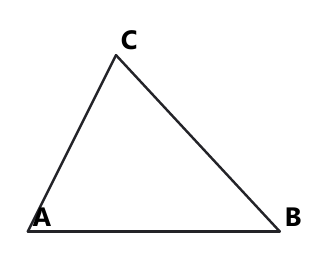

# Занятие 35. Итоговый тренинг всех уровней

**Дата:** 25.05.2027 (вт)  
**Длительность:** 45 минут  
**Раздел:** Повторение  
**Подтемы:** срез по всем номерам экзамена; типичные ловушки всего курса; стратегия выполнения работы; формулы «наизусть»

## Цели занятия

- Понять, чем отличаются задания №1–2, №3–4, №5–6, №7–8 и №9–10.
- Повторить основные формулы курса 5–9 классов.
- Научиться быстро замечать ОДЗ, знаки, единицы измерения и границы промежутков.
- Выбрать свой рабочий уровень и решить только соответствующий блок.
- Отработать стратегию: сначала надёжные задания, затем более сложные.

## Тайминг

| Этап | Время | Что делаем |
|---|---:|---|
| Теория | 8 мин | Срез по номерам, стратегия, ловушки, формулы |
| Разбор ключевых заданий | 12 мин | Четыре задания сборника |
| Самостоятельная работа | 21 мин | Ученик решает только свой уровень |
| Подведение итогов | 4 мин | Проверка чек-листа и ошибок |

---

## Теория к занятию

### Мини-тема 1. Срез по всем номерам экзамена

На выпускном экзамене задания расположены от более простых к более сложным. Номер задания показывает его максимальный балл, но не обязан сообщать тему. В №1–2 чаще проверяются вычисления, определения, простые свойства функций и геометрические факты. В №3–6 нужно выполнить уже несколько связанных действий. В №7–10 важны модель задачи, преобразования, доказательство и аккуратная запись решения.

**Определение / факт**

Задание экзамена нужно сначала прочитать полностью, определить тему и только затем выбирать способ решения. Рисунок помогает, но все данные должны быть взяты из условия.

**Формулы**

Для линейной функции:

$$y=kx+b$$

Здесь $k$ — коэффициент наклона графика, $b$ — ордината точки пересечения с осью $Oy$.

Для площади треугольника:

$$S=\frac{1}{2}ah$$

Для прямоугольного треугольника:

$$c^2=a^2+b^2$$

Для процентов:

$$p\%=\frac{p}{100}$$

Если величина $a$ составляет $p\%$ от числа $x$, то:

$$a=\frac{p}{100}x$$

**Правила**

- №1–2 сначала решай устно или короткой записью.
- В №3–4 внимательно проверяй формулу и арифметику.
- В №5–6 выписывай данные и искомую величину.
- В №7–10 обязательно записывай модель, ОДЗ и проверку.
- Геометрическую задачу начинай с чертежа и названия теоремы.
- Не трать всё время на один номер: экзамен — не свидание, ждать бесконечно не будет.

**Алгоритм**

1. Прочитать условие целиком.
2. Определить раздел: числа, выражения, уравнения, неравенства, функция, геометрия или текстовая задача.
3. Выписать данные.
4. Назвать формулу или метод.
5. Выполнить решение по шагам.
6. Проверить ответ и его смысл.
7. Если задача не решается сразу, перейти к следующей.

**Мини-пример**

Условие: найдите значение функции $y=2x-3$ при $x=4$.

*Решение:*

Дано: $y=2x-3$, $x=4$.

Найти: значение $y$.

Подставляем $x=4$ в формулу функции:

$$y=2\cdot4-3$$

Выполняем умножение:

$$2\cdot4=8$$

Вычитаем:

$$8-3=5$$

Проверка: точка $(4;5)$ удовлетворяет формуле $y=2x-3$.

**Ответ:** $5$.

**Ловушки экзамена**

- Перепутать коэффициент $k$ и свободный член $b$.
- Решить только первую часть составного условия.
- Считать ответ по рисунку, хотя данные указаны в тексте.
- Потерять единицы измерения.

---

### Мини-тема 2. Типичные ловушки всего курса

Большинство ошибок появляется не из-за незнания темы, а из-за одного пропущенного шага. Особенно опасны отрицательные числа, скобки, дроби, корни и границы промежутков. В геометрии часто путают формулы площади и свойства фигур. В текстовых задачах ошибаются при выборе величины, которую обозначают буквой.

**Определение / факт**

ОДЗ — множество значений переменной, при которых выражение имеет смысл. При решении уравнения сначала учитывают ОДЗ, а после преобразований проверяют найденные корни.

**Формулы**

Если знаменатель дроби не равен нулю:

$$\frac{A}{B}; \qquad B\ne0$$

Квадрат корня:

$$\sqrt{a}\ge0; \qquad a\ge0$$

Свойство степеней:

$$a^m\cdot a^n=a^{m+n}$$

$$\frac{a^m}{a^n}=a^{m-n}; \qquad a\ne0$$

Отрицательный показатель:

$$a^{-n}=\frac{1}{a^n}; \qquad a\ne0$$

Квадрат суммы и разности:

$$
(a+b)^2=a^2+2ab+b^2
$$

$$
(a-b)^2=a^2-2ab+b^2
$$

Разность квадратов:

$$
a^2-b^2=(a-b)(a+b)
$$

**Правила**

- При делении неравенства на отрицательное число знак меняется.
- При сокращении дроби нельзя забывать ограничения на знаменатель.
- $\sqrt{x^2}=|x|$, а не всегда $x$.
- В квадратном уравнении проверяй оба корня.
- В дроби отрицательная степень означает обратное число.
- При раскрытии скобок перед скобкой стоит минус — меняются все знаки внутри.

**Алгоритм**

1. Найти ОДЗ.
2. Раскрыть скобки и привести подобные слагаемые.
3. Перенести слагаемые аккуратно, проверяя знаки.
4. Решить полученное уравнение или неравенство.
5. Пересечь ответ с ОДЗ.
6. Подставить корни в исходное уравнение.

**Мини-пример**

Условие: решите уравнение

$$\frac{x+1}{x-2}=0$$

*Решение:*

Знаменатель не должен равняться нулю:

$$x-2\ne0$$

$$x\ne2$$

Дробь равна нулю, если её числитель равен нулю:

$$x+1=0$$

$$x=-1$$

Проверяем ОДЗ:

$$-1\ne2$$

Корень допустим.

Проверка:

$$\frac{-1+1}{-1-2}=\frac{0}{-3}=0$$

**Ответ:** $-1$.

**Ловушки экзамена**

- Записать $x=2$ как корень из-за нулевого знаменателя.
- Не изменить знак при делении неравенства на отрицательное число.
- Потерять модуль в выражении $\sqrt{x^2}$.
- Получить правильную формулу, но ошибиться в последней арифметике.

---

### Мини-тема 3. Стратегия: что решать сначала

На экзамене не требуется решать задания строго по порядку. Сначала выгодно собрать надёжные баллы: вычисления, простые формулы, знакомые типовые задачи. Затем переходят к задачам, где требуется несколько действий. Самые сложные задания оставляют на конец, но к ним нужно вернуться, если осталось время.

**Определение / факт**

Стратегия выполнения — это порядок выбора заданий с учётом их сложности, времени и уверенности ученика.

**Формулы**

Средняя скорость при равномерном движении:

$$v=\frac{s}{t}$$

Путь:

$$s=vt$$

Время:

$$t=\frac{s}{v}$$

Производительность:

$$A=pt$$

Работа:

$$p=\frac{A}{t}$$

При совместной работе складываются производительности:

$$p_{\text{общ}}=p_1+p_2$$

**Правила**

- Сначала решай то, что узнаёшь сразу.
- В задаче на движение составь таблицу: скорость, время, путь.
- В задаче на работу используй «вся работа — $1$».
- В задаче на проценты переводи проценты в дробь.
- Если решение длинное, оставляй промежуточные записи.
- В конце проверь, что ответ подходит по смыслу: время и длина не отрицательны.

**Алгоритм**

1. Быстро просмотреть все задания.
2. Отметить знакомые.
3. Решить задания №1–4, где способ очевиден.
4. Перейти к заданиям №5–6.
5. Затем решать №7–10.
6. Вернуться к пропущенным номерам.
7. Проверить бланк и единицы измерения.

**Мини-пример**

Условие: один рабочий выполняет заказ за $6$ часов, другой — за $3$ часа. За сколько часов они выполнят заказ вместе?

*Решение:*

Вся работа равна $1$.

Производительность первого рабочего:

$$p_1=\frac{1}{6}$$

Производительность второго рабочего:

$$p_2=\frac{1}{3}$$

Совместная производительность:

$$p=\frac{1}{6}+\frac{1}{3}$$

Приводим дроби к знаменателю $6$:

$$\frac{1}{3}=\frac{2}{6}$$

$$p=\frac{1}{6}+\frac{2}{6}=\frac{3}{6}=\frac{1}{2}$$

Время выполнения всей работы:

$$t=\frac{1}{p}=\frac{1}{\frac12}=2$$

Проверка: за $2$ часа первый выполнит $\frac{2}{6}=\frac13$ работы, второй — $\frac23$ работы. Вместе они выполнят $1$.

**Ответ:** $2$ часа.

**Ловушки экзамена**

- Сложить времена вместо производительностей.
- Перепутать путь и скорость.
- Найти $12\%$ от числа вместо числа по его $12\%$.
- Потратить половину экзамена на одну задачу.

---

### Мини-тема 4. Повторение формул «наизусть»

Формула нужна не для украшения записи, а для быстрого перехода от условия к решению. На экзамене полезно помнить формулы площадей, теорему Пифагора, свойства прогрессий, корней, степеней и основные сведения о функциях. Формулу нужно не только знать, но и понимать, какие величины в неё подставляются.

**Определение / факт**

Формула — равенство, выражающее зависимость между величинами. Перед применением формулы нужно проверить, подходят ли данные и совпадают ли единицы измерения.

**Формулы**

Площадь прямоугольника:

$$S=ab$$

Площадь параллелограмма:

$$S=ah$$

Площадь трапеции:

$$S=\frac{a+b}{2}h$$

Площадь ромба:

$$S=\frac{d_1d_2}{2}$$

Площадь треугольника через две стороны и угол:

$$S=\frac12 ab\sin\gamma$$

Сумма углов треугольника:

$$\alpha+\beta+\gamma=180^\circ$$

Сумма углов четырёхугольника:

$$360^\circ$$

Арифметическая прогрессия:

$$a_n=a_1+(n-1)d$$

Сумма первых $n$ членов:

$$S_n=\frac{n(a_1+a_n)}{2}$$

Геометрическая прогрессия:

$$b_n=b_1q^{n-1}$$

Сумма первых $n$ членов при $q\ne1$:

$$S_n=b_1\frac{q^n-1}{q-1}$$

Уравнение окружности с центром $(a;b)$ и радиусом $R$:

$$
(x-a)^2+(y-b)^2=R^2
$$

Свойства нечётной функции:

$$f(-x)=-f(x)$$

Свойства чётной функции:

$$f(-x)=f(x)$$

**Правила**

- В формуле площади ромба $d_1$ и $d_2$ — диагонали, а не стороны.
- В теореме Пифагора $c$ — гипотенуза.
- В окружности радиус возводится в квадрат.
- В прогрессии не путай разность $d$ и знаменатель $q$.
- При сдвиге графика $y=f(x-a)$ график сдвигается вправо на $a$.
- При сдвиге $y=f(x)+b$ график сдвигается вверх на $b$.

**Алгоритм**

1. Назвать известные величины.
2. Выбрать формулу.
3. Привести единицы к одинаковым.
4. Подставить значения в формулу.
5. Выполнить вычисления.
6. Проверить единицы и смысл результата.

**Мини-пример**

Условие: найдите площадь ромба с диагоналями $6$ см и $10$ см.

*Решение:*

Дано:

$$d_1=6\text{ см}; \qquad d_2=10\text{ см}$$

Площадь ромба вычисляем по формуле:

$$S=\frac{d_1d_2}{2}$$

Подставляем значения:

$$S=\frac{6\cdot10}{2}$$

Выполняем умножение:

$$6\cdot10=60$$

Делим:

$$60:2=30$$

Единица площади — квадратный сантиметр.

**Ответ:** $30\text{ см}^2$.

**Ловушки экзамена**

- Использовать периметр вместо площади.
- Возвести в квадрат диаметр окружности вместо радиуса.
- Перепутать формулы арифметической и геометрической прогрессий.
- Забыть квадрат в правой части уравнения окружности.

---

## Сводка формул «выучить наизусть»

- $y=kx+b$.
- $s=vt$, $v=\frac{s}{t}$, $t=\frac{s}{v}$.
- $p=\frac{A}{t}$.
- $S=ab$, $S=ah$, $S=\frac{a+b}{2}h$, $S=\frac{d_1d_2}{2}$.
- $S=\frac12ab\sin\gamma$.
- $c^2=a^2+b^2$.
- $\alpha+\beta+\gamma=180^\circ$.
- Сумма углов четырёхугольника равна $360^\circ$.
- $a_n=a_1+(n-1)d$.
- $S_n=\frac{n(a_1+a_n)}{2}$.
- $b_n=b_1q^{n-1}$.
- $S_n=b_1\frac{q^n-1}{q-1}$.
- $(x-a)^2+(y-b)^2=R^2$.
- $f(-x)=f(x)$ для чётной функции.
- $f(-x)=-f(x)$ для нечётной функции.
- $a^m\cdot a^n=a^{m+n}$.
- $\frac{a^m}{a^n}=a^{m-n}$.
- $a^{-n}=\frac1{a^n}$.
- $\sqrt{x^2}=|x|$.

## Правила, которые нельзя путать

- НОД и НОК — разные величины.
- При делении неравенства на отрицательное число знак меняется.
- Нулевой знаменатель запрещён.
- Проценты переводятся в сотые доли.
- Время при совместной работе считают через производительность.
- Гипотенуза лежит напротив прямого угла.
- Радиус окружности в уравнении возводится в квадрат.
- В квадратном уравнении нельзя автоматически отбрасывать один корень.
- Ответ геометрической задачи должен иметь единицы длины или площади.

## Разрешённый набор для практики

Мини-темы занятия:

- срез по всем номерам экзамена;
- типичные ловушки;
- стратегия выполнения;
- формулы курса 5–9 классов.

Повтор:

- линейная функция и её график;
- линейные неравенства;
- проценты;
- задачи на работу;
- задачи на движение;
- степени с натуральным и целым показателем;
- квадратные уравнения;
- рациональные дроби и ОДЗ;
- теорема Пифагора;
- площади фигур;
- прогрессии;
- свойства чётных и нечётных функций.

---

## Разбор ключевых заданий

### Р1.
**Условие:** решите уравнение

$$\frac38:\frac34=y:\frac23$$

*Решение:*

Дано:

$$\frac38:\frac34=y:\frac23$$

Найти: $y$.

Используем основное свойство пропорции: произведение крайних членов равно произведению средних.

$$\frac38\cdot\frac23=\frac34\cdot y$$

Вычисляем левую часть:

$$\frac38\cdot\frac23=\frac{6}{24}=\frac14$$

Получаем:

$$\frac14=\frac34y$$

Делим обе части на $\frac34$:

$$y=\frac14:\frac34$$

Деление на дробь заменяем умножением на обратную дробь:

$$y=\frac14\cdot\frac43$$

$$y=\frac{4}{12}=\frac13$$

Проверка:

$$\frac38:\frac34=\frac38\cdot\frac43=\frac12$$

$$\frac13:\frac23=\frac13\cdot\frac32=\frac12$$

Равенство верно.

**Ответ:** $y=\frac13$.

---

### Р2.
**Условие:** сократите дробь

$$\frac{b^2+15b+56}{b^2+3b-28}$$

и найдите значение полученного выражения при $b=-6$.

*Решение:*

ОДЗ:

$$b^2+3b-28\ne0$$

Разложим числитель на множители:

$$b^2+15b+56=(b+7)(b+8)$$

Разложим знаменатель:

$$b^2+3b-28=(b+7)(b-4)$$

Тогда:

$$\frac{b^2+15b+56}{b^2+3b-28}
=
\frac{(b+7)(b+8)}{(b+7)(b-4)}$$

Сокращаем множитель $b+7$, учитывая $b\ne-7$:

$$\frac{b+8}{b-4}$$

Подставляем $b=-6$:

$$\frac{-6+8}{-6-4}=\frac2{-10}=-\frac15$$

Проверка ОДЗ:

$$(-6)^2+3\cdot(-6)-28=36-18-28=-10\ne0$$

Значение допустимо.

**Ответ:** $-\frac15$.

---

### Р3.
**Условие:** периметр ромба $ABCD$ равен $48$ см, острый угол $A$ ромба равен $60^\circ$. Найдите меньшую диагональ $BD$ ромба.

<!--geo-figure-spec
{
  "needed": true,
  "kind": "plane",
  "template": "triangle",
  "caption": "Ромб $ABCD$",
  "show_labels": true,
  "vertices": {
    "A": [
      0,
      0
    ],
    "B": [
      4,
      2
    ],
    "C": [
      10,
      0
    ],
    "D": [
      6,
      -2
    ]
  },
  "edges": [
    [
      "A",
      "B"
    ],
    [
      "B",
      "C"
    ],
    [
      "C",
      "D"
    ],
    [
      "D",
      "A"
    ],
    [
      "B",
      "D"
    ],
    [
      "A",
      "C"
    ]
  ],
  "segment_labels": []
}
-->

*Ромб ABCD*

*Решение:*

Дано:

$$P=48\text{ см}; \qquad \angle A=60^\circ$$

Все стороны ромба равны.

Находим сторону:

$$AB=48:4=12\text{ см}$$

Рассмотрим треугольник $ABD$.

В ромбе $AB=AD=12$ см.

Угол между сторонами $AB$ и $AD$ равен $60^\circ$.

По теореме косинусов:

$$BD^2=AB^2+AD^2-2\cdot AB\cdot AD\cos60^\circ$$

Подставляем значения:

$$BD^2=12^2+12^2-2\cdot12\cdot12\cdot\frac12$$

$$BD^2=144+144-144$$

$$BD^2=144$$

Так как длина отрезка положительна:

$$BD=12\text{ см}$$

Это меньшая диагональ, потому что острый угол ромба равен $60^\circ$.

**Ответ:** $12$ см.

---

### Р4.
**Условие:** выберите уравнение окружности с центром в точке $(5;0)$ и радиусом $\sqrt7$.

а) $(x+5)^2+y^2=7$  
б) $(x-5)^2+y^2=\sqrt7$  
в) $(x+5)^2-y^2=7$  
г) $(x-5)^2+y^2=7$  
д) $(x-5)^2-y^2=7$

*Решение:*

Уравнение окружности с центром $(a;b)$ и радиусом $R$ имеет вид:

$$
(x-a)^2+(y-b)^2=R^2
$$

Здесь:

$$a=5; \qquad b=0; \qquad R=\sqrt7$$

Подставляем:

$$
(x-5)^2+(y-0)^2=(\sqrt7)^2
$$

$$
(x-5)^2+y^2=7
$$

Подходит вариант г).

**Ответ:** г).

---

## Самостоятельная работа

Выбери свой уровень и решай только этот блок. В каждом блоке есть задания по мини-темам урока и повтор ранее изученного материала.

### Уровень 1–2 балла

**С1.** *Сборник, вариант 53, №2.* Значение выражения

$$\frac{18\cdot9+18\cdot3}{18\cdot12}$$

равно:

а) $18$; б) $1$; в) $12$; г) $2$; д) $4$.

**С2.** *Сборник, вариант 55, №1.* Выберите все выражения, которые не имеют смысла при $x=0$:

а) $\frac{5x}{x^2+49}$;  
б) $4\sqrt{x}-6x$;  
в) $\frac{x-6}{2x}$;  
г) $\frac{x}{x-9}$;  
д) $\frac{x}{\sqrt{x-1}}$.

**С3.** *Сборник, вариант 57, №2.* Определите одночлен, записанный в стандартном виде:

а) $3xyyz$;  
б) $-x\cdot\frac12\cdot y\cdot z$;  
в) $0.25x^5yz$;  
г) $0.5x^5y\cdot2z$;  
д) $x^5y\cdot2zy$.

**С4.** *Мини-тема 3, авторское.* Ученик решил сначала задания №1–4, затем №7, а после этого вернулся к пропущенным заданиям №5–6. Назовите одно преимущество такой стратегии.

**С5.** *Повтор, авторское.* Найдите значение выражения:

$$2^3+2^{-1}$$

### Уровень 3–4 балла

**С1.** *Сборник, вариант 49, №4.* Найдите значение выражения:

$$15^0+\sqrt{16}-\left(\frac13\right)^{-1}+\frac1{\sqrt4}$$

**С2.** *Сборник, вариант 51, №4.* Найдите частное от деления НОК на НОД чисел $112$ и $80$.

**С3.** *Сборник, вариант 55, №3.* Какое утверждение неверно?

а) прямой угол равен $90^\circ$;  
б) если из одной точки к прямой проведены перпендикуляр и наклонная, то наклонная меньше перпендикуляра;  
в) углы при большем основании равнобедренной трапеции равны между собой;  
г) у квадрата все углы равны между собой.

**С4.** *Сборник, вариант 55, №4.* В библиотеке $12\%$ всех книг — словари. Сколько книг в библиотеке, если словарей $900$?

**С5.** *Повтор, авторское.* Постройте график функции $y=2x-4$ и укажите координаты точки пересечения графика с осью $Oy$.

### Уровень 5–6 баллов

**С1.** *Сборник, вариант 57, №3.* Какое утверждение неверно?

а) $\sin30^\circ=\frac12$;  
б) площадь треугольника равна половине произведения двух его сторон на синус угла между ними;  
в) сумма углов прямоугольника равна $270^\circ$;  
г) периметр квадрата со стороной $a$ равен $4a$.

**С2.** *Сборник, вариант 57, №4.* Функция $f$ нечётная, $f(5)=-9$, $f(-3)=4$. Найдите $f(3)+f(-5)$.

**С3.** *Сборник, вариант 51, №6.* Высота $DH$ ромба $ABCD$ делит сторону $BC$ на отрезки $BH=8$ см и $HC=12$ см. Найдите площадь ромба.

**С4.** *Сборник, вариант 53, №5.* Найдите значение выражения

$$(18n^4+27n^3):(9n^2)-10n^3:(5n)$$

при $n=-4$.

**С5.** *Повтор, авторское.* Автомобиль проехал $180$ км со скоростью $60$ км/ч. Сколько времени заняла поездка? Ответ дайте в часах и минутах.

### Уровень 7–8 баллов

**С1.** *Мини-тема 1, авторское.* Решите уравнение:

$$\frac{x-3}{2}+\frac{x+1}{3}=5$$

**С2.** *Мини-тема 2, авторское.* Решите неравенство:

$$-3(2x-1)\le9$$

**С3.** *Мини-тема 3, авторское.* Первый рабочий выполняет заказ за $12$ часов, второй — за $18$ часов. За сколько часов они выполнят заказ вместе?

**С4.** *Мини-тема 4, авторское.* В арифметической прогрессии $a_1=7$, $d=3$. Найдите $a_8$ и сумму первых восьми членов.

**С5.** *Повтор, авторское.* Для функции $y=-2x+6$ найдите нуль функции и промежуток, на котором функция положительна.

### Уровень 9–10 баллов

**С1.** *Мини-тема 1, авторское.* Решите систему:

$$
\begin{cases}
x+y=7,\\
xy=10.
\end{cases}
$$

**С2.** *Мини-тема 2, авторское.* Решите уравнение:

$$\frac{x+2}{x-1}=\frac{3}{x-1}$$

**С3.** *Мини-тема 3, авторское.* Из пункта $A$ в пункт $B$ одновременно выехали велосипедист и мотоциклист. Скорость мотоциклиста на $30$ км/ч больше скорости велосипедиста. Велосипедист затратил на путь $3$ часа, а мотоциклист — $1$ час. Найдите расстояние между пунктами.

**С4.** *Мини-тема 4, авторское.* В прямоугольном треугольнике катеты равны $9$ см и $12$ см. Найдите гипотенузу и площадь треугольника.

**С5.** *Повтор, авторское.* Решите квадратное неравенство:

$$x^2-5x+6\le0$$

---

## Домашнее задание

Ученик выбирает свой уровень. В каждом блоке шесть задач: четыре по мини-темам занятия и две задачи на повтор.

### Уровень 1–2 балла

**Д1.** *Мини-тема 1, авторское.* Вычислите:

$$48:6+3\cdot2$$

**Д2.** *Мини-тема 2, авторское.* Укажите ОДЗ выражения:

$$\frac{7}{x+4}$$

**Д3.** *Мини-тема 3, авторское.* Составьте порядок действий при выполнении экзаменационной работы из трёх шагов: просмотр, решение знакомых задач, проверка.

**Д4.** *Мини-тема 4, авторское.* Запишите формулу площади прямоугольника со сторонами $a$ и $b$.

**Д5.** *Повтор, авторское.* Решите неравенство:

$$x-4>2$$

**Д6.** *Повтор, авторское.* Найдите значение:

$$3^2+2^3$$

### Уровень 3–4 балла

**Д1.** *Мини-тема 1, авторское.* Вычислите:

$$\frac{5}{6}-\frac14$$

**Д2.** *Мини-тема 2, авторское.* Сократите дробь:

$$\frac{6x^2}{9x}$$

при $x\ne0$.

**Д3.** *Мини-тема 3, авторское.* Товар стоил $80$ рублей. Его цену увеличили на $10\%$. Найдите новую цену.

**Д4.** *Мини-тема 4, авторское.* Найдите площадь треугольника с основанием $10$ см и высотой $6$ см.

**Д5.** *Повтор, авторское.* Решите уравнение:

$$x^2-9=0$$

**Д6.** *Повтор, авторское.* Найдите значение функции $y=-3x+2$ при $x=-2$.

### Уровень 5–6 баллов

**Д1.** *Мини-тема 1, авторское.* Решите уравнение:

$$4x-7=2x+9$$

**Д2.** *Мини-тема 2, авторское.* Решите уравнение:

$$\frac{x-2}{x+1}=0$$

**Д3.** *Мини-тема 3, авторское.* Один рабочий выполняет работу за $8$ часов, другой — за $12$ часов. Какую часть работы они выполнят за $2$ часа совместной работы?

**Д4.** *Мини-тема 4, авторское.* Найдите $a_{10}$ арифметической прогрессии, если $a_1=4$, $d=5$.

**Д5.** *Повтор, авторское.* Найдите гипотенузу прямоугольного треугольника с катетами $6$ см и $8$ см.

**Д6.** *Повтор, авторское.* Решите неравенство:

$$5-2x\ge1$$

### Уровень 7–8 баллов

**Д1.** *Мини-тема 1, авторское.* Решите уравнение:

$$\frac{x+2}{4}-\frac{x-1}{3}=2$$

**Д2.** *Мини-тема 2, авторское.* Решите неравенство:

$$\frac{x-2}{x+1}>0$$

**Д3.** *Мини-тема 3, авторское.* Первый насос наполняет бассейн за $6$ часов, второй — за $9$ часов. За сколько часов они наполнят бассейн вместе?

**Д4.** *Мини-тема 4, авторское.* В геометрической прогрессии $b_1=2$, $q=3$. Найдите $b_5$.

**Д5.** *Повтор, авторское.* Сумма двух чисел равна $18$, а их произведение равно $77$. Найдите эти числа.

**Д6.** *Повтор, авторское.* Для функции $y=x^2-4$ найдите нули функции и промежутки знакопостоянства.

### Уровень 9–10 баллов

**Д1.** *Мини-тема 1, авторское.* Решите систему:

$$
\begin{cases}
2x+y=8,\\
x^2+y^2=20.
\end{cases}
$$

**Д2.** *Мини-тема 2, авторское.* Решите уравнение:

$$\frac{x^2-9}{x-3}=0$$

**Д3.** *Мини-тема 3, авторское.* Два велосипедиста выехали навстречу друг другу из пунктов, расстояние между которыми $78$ км. Скорость первого на $4$ км/ч больше скорости второго. Они встретились через $3$ часа. Найдите скорости велосипедистов.

**Д4.** *Мини-тема 4, авторское.* В арифметической прогрессии $a_3=11$, $a_7=27$. Найдите $a_1$, разность прогрессии и сумму первых семи членов.

**Д5.** *Повтор, авторское.* Сократите дробь:

$$\frac{x^2-16}{x^2+8x+16}$$

и укажите ОДЗ.

**Д6.** *Повтор, авторское.* В равнобедренной трапеции основания равны $14$ см и $26$ см, а высота равна $8$ см. Найдите площадь трапеции и длину боковой стороны.

---

## Чек-лист «ученик понял тему»

- [ ] Я понимаю, чем отличаются задания №1–2, №3–4, №5–6, №7–8 и №9–10.
- [ ] Я умею начинать решение с данных, искомой величины и формулы.
- [ ] Я проверяю ОДЗ и не допускаю нулевого знаменателя.
- [ ] Я не путаю производительность с временем работы.
- [ ] Я умею переводить проценты в дробь.
- [ ] Я помню основные формулы площадей, степеней, прогрессий и окружности.
- [ ] Я проверяю знаки, единицы измерения и смысл ответа.
